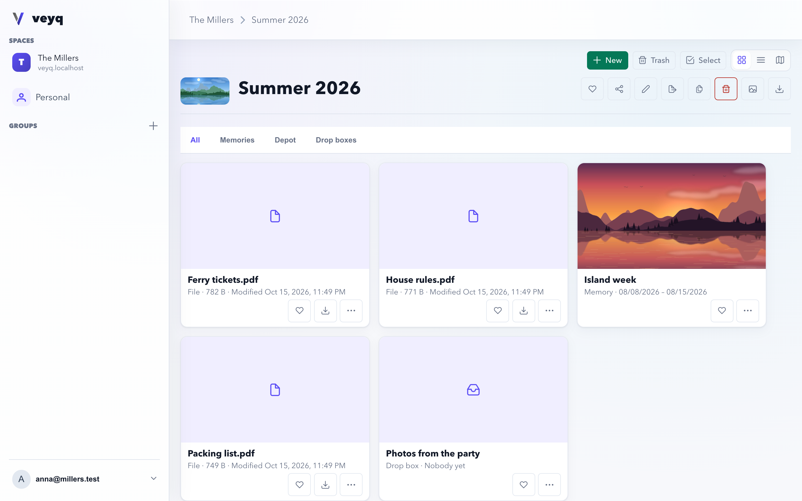
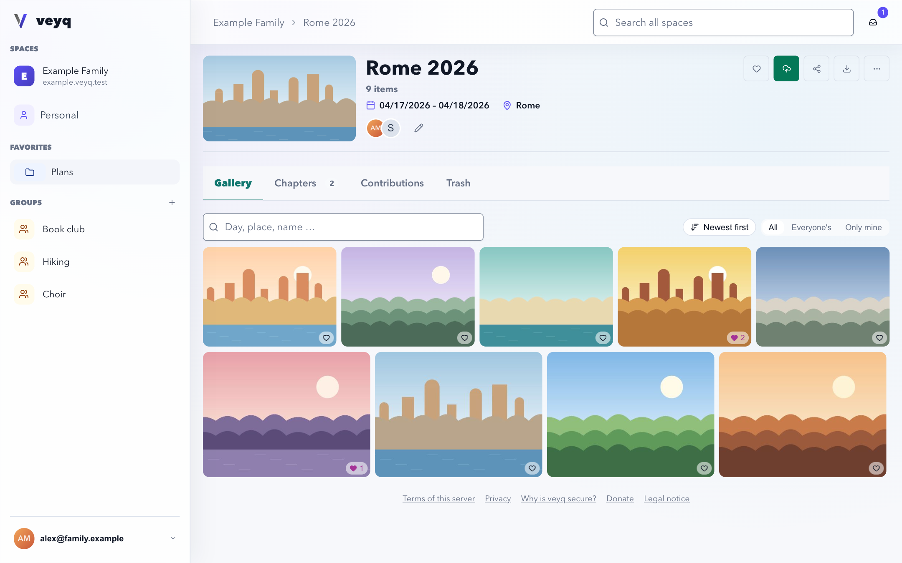
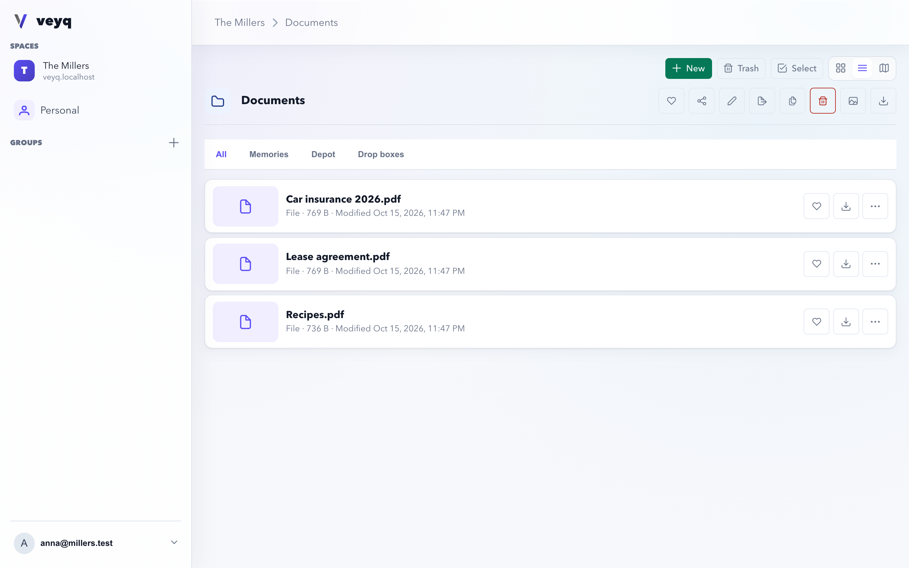

<div align="center">

<picture>
  <source srcset="site/src/assets/website/logo-dark.svg" media="(prefers-color-scheme: dark)" />
  
</picture>

# veyq

**Share what matters — only with the people it belongs to.**

Photos and videos, documents and files, shared costs — for your family, your friends or your club.<br />
End-to-end encrypted. Self-hostable. Free software.

[**Website**](https://veyq.app) · [**Run your own**](https://veyq.app/run/) · [**Security model**](https://veyq.app/security/start-here/) · [**Releases**](https://github.com/raddatzk/veyq/releases) · [Deutsch](https://veyq.app/de/)

</div>

Run your own — fetch `veyqctl` into `~/.local/bin`, check its signature, and let it set up an instance (it needs
`python3` and [`cosign`](https://docs.sigstore.dev/cosign/system_config/installation/) 3.1.3 or later). Run it where the
instance belongs — for Argo CD, in your empty repository's clone:

```sh
bin=~/.local/bin base=https://github.com/raddatzk/veyq/releases/latest/download && mkdir -p "$bin"
curl -fsSLo "$bin/veyqctl" "$base/veyqctl" && curl -fsSLo "$bin/veyqctl.bundle" "$base/veyqctl.bundle"
cosign verify-blob --bundle "$bin/veyqctl.bundle" "$bin/veyqctl" \
  --certificate-oidc-issuer https://token.actions.githubusercontent.com \
  --certificate-identity-regexp '^https://github\.com/raddatzk/veyq/\.github/workflows/release\.yml@refs/heads/(main|release/[0-9]+\.x)$' \
  && chmod +x "$bin/veyqctl" && "$bin/veyqctl" init
```

It runs only what verifies: if `cosign` refuses, nothing starts. [Run your own](https://veyq.app/run/) says what `init`
asks, on Docker Compose or Kubernetes.

<div align="center">

[](https://github.com/raddatzk/veyq/actions/workflows/checks.yml)
[](https://github.com/raddatzk/veyq/actions/workflows/codeql.yml)

<sub>Pronounced **/veɪk/**.</sub>



</div>

> **v1 is out** — the first stable release. Install it on Docker Compose or Kubernetes; every later 1.x upgrades in place.

## Why veyq

Last summer at the lake, everyone took photos. Now they are spread over five phones, a group chat that shrank them to
thumbnails, and a cloud album in one person's account. The lease and the insurance papers sit in somebody's inbox —
each on a service that can open everything it stores.

What a family, a group of friends or a club keeps together belongs in **one place they share**, in full quality, that
nobody else can open — not an advertiser, not a data broker, and **not whoever runs the server**.

> You, or someone you trust, runs it. The people you invite add to it. The server only ever holds locked boxes.

## One platform, three applications

Everything lives side by side in the same folders, and every application gets the same spaces, sharing and
encryption from the platform.

<table>
<tr>
<td width="33%" valign="top">

### 📸 Memories
**Photos and videos** of a trip, a wedding, a birthday.

- Chapters for each day, or each part of it
- A gallery in the order the photos were taken
- Date, place and people — all encrypted
- Guests add their own photos through a link

[Memories in the guide →](https://veyq.app/memories/)

</td>
<td width="33%" valign="top">

### 🗂️ Depot
**Documents and files** you want to keep.

- Upload single files or whole folders
- Open PDFs and images right in the browser
- Replace a file with its newer version
- Drop boxes collect files from people without an account

[Depot in the guide →](https://veyq.app/depot/)

</td>
<td width="33%" valign="top">

### 💸 Expenses
**Shared costs** of a trip, a shared flat, a club evening.

- Split equally, by shares, by percent or item by item
- Who owes whom, and the few transfers that settle it
- Every change kept, a deleted entry restorable
- Friends follow and add entries through a link

[Expenses in the guide →](https://veyq.app/expenses/)

</td>
</tr>
<tr>
<td></td>
<td></td>
<td align="center"><em>More to come — an inventory of the things you own is on the drawing board.</em></td>
</tr>
</table>

## How it works

| 1. You add something | 2. The server keeps locked boxes | 3. Your people open them |
|---|---|---|
| Your browser locks it — a photo or a document, its name, its date and place — with a key only you and the people you share with hold. | It stores them and hands them out, but holds no key that opens them. Someone who copies its database gets nothing readable. | Members of a space hold its key on their own devices. A share link carries its secret in a part of the link that never reaches the server. |

**What the server still sees:** that something exists, how big it is, who belongs to which space, and when it was
uploaded or changed. Never what is inside. Your unshared personal space is confidential even from whoever runs the
server — including when that is you. This is not a setting; there is no key on the server to misuse.

## What every application gets

- 👥 **Spaces and groups** — a shared space for everyone, a personal one only you can open, groups for smaller circles
- 🔗 **Share with anyone** — view only, view and add, or a drop box; with a password and an expiry if you like. Guests need no account
- 🛡️ **Ready for quantum computers** — keys are handed over with a classic and a post-quantum lock combined
- 📦 **Take everything with you** — download any folder as a plain ZIP that unpacks into the same folders, and import it again anywhere
- 🔑 **Locked out, but not for good** — an email link plus the Secret Key from your Emergency Kit get you back in; neither works alone
- 📱 **All your devices** — add a phone or a laptop by scanning a QR code with a device you already use

## Run it yourself

Self-hosting is veyq's default — and its **strongest protection**: on your own instance, nobody can hand you a
tampered client. One signed container image, a MariaDB database and an S3-compatible object store.

- **Docker Compose** — `veyqctl` installs, upgrades and backs up an instance from the signed release files
- **Kubernetes** — the Helm chart, GitOps-friendly (Argo CD)

👉 [Plan an instance](https://veyq.app/run/plan/) · [Set up a new instance](https://veyq.app/run/new-instance/) · [Verify a release](https://veyq.app/run/verify-a-release/)

**The honest boundary.** For the people you host, confidentiality holds against an operator who reads the database
and the logs — not against one who changes the code they are served. That is why self-hostability is a security
property here, not just a sovereignty one ([ADR 0026](docs/decisions/0026-client-trust-tiers.md), the
[security model](docs/crosscutting/security-model.md)).

## Documentation

| | For | |
|---|---|---|
| **Use** | People using veyq and space owners — English and German | [veyq.app/start](https://veyq.app/start/) |
| **Run** | Whoever runs a server: install, configure, back up, upgrade | [veyq.app/run](https://veyq.app/run/) |
| **Security** | Researchers: threat model, cryptography, known limits | [veyq.app/security](https://veyq.app/security/start-here/) |

Came to check the encryption claim? Start at the [security model](docs/crosscutting/security-model.md); for the
whole-system view, [`docs/architecture/`](docs/architecture/README.md).

## Development

<details>
<summary><b>Build and run it locally</b></summary>

<br />

The repository root is a small launcher: `./gradlew <surface>:<verb>` runs what each surface already has.

```bash
./gradlew infra:up        # MariaDB, an S3-compatible store, a test mailbox
./gradlew backend:run     # Quarkus dev mode
./gradlew web:run         # the web client on veyq.localhost:8081
./gradlew backend:seed    # a local dev user
```

[`infra/README.md`](infra/README.md) has the full task list and the dev stack. Each surface proves itself with its own
check: [`src/backend/`](src/backend/CLAUDE.md) (`./gradlew check`), [`src/web/`](src/web/CLAUDE.md) (`pnpm run check`).

</details>

<details>
<summary><b>Repository layout</b></summary>

<br />

| Path | What it is |
|---|---|
| [`contracts/`](contracts/) | OpenAPI and crypto vectors — the source of truth code is **generated** from |
| [`src/backend/`](src/backend/CLAUDE.md) | Quarkus / Kotlin: the platform core and one module per application. Performs no content crypto, never sees a password |
| [`src/web/`](src/web/CLAUDE.md) | The Vue 3 client. All content crypto runs here |
| [`src/admin-web/`](src/admin-web/) | The server owner's administration console, its own container |
| [`src/packages/crypto/`](src/packages/crypto/) | `@veyq/crypto`, the one shared, conformance-pinned crypto package |
| [`src/tools/`](src/tools/CLAUDE.md) | `veyqctl` and the backup tool |
| [`infra/`](infra/README.md) | Docker Compose files and the Helm chart |
| `tests/` | The end-to-end browser suite and the API fuzzer |
| [`site/`](site/src/content/docs/start.md) | The website and the published documentation |
| [`docs/`](docs/README.md) | Engineering state: architecture, ADRs, features, coverage |

</details>

## Security

Found a vulnerability? See [SECURITY.md](SECURITY.md) — please don't open a public issue for it.

## Contributing

Contributions are welcome — see [CONTRIBUTING.md](CONTRIBUTING.md). Everything stays AGPL-3.0-only, with a DCO
sign-off on every commit and no CLA.

## License

[AGPL-3.0-only](LICENSE). Brand assets are excluded — see [NOTICE](NOTICE).
