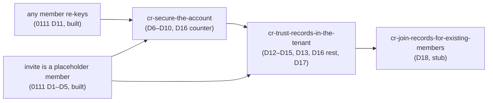

## Goal

Inbox #556 and #559, rebuilt on [ADR 0111](../docs/decisions/0111-an-invitee-grants-itself-a-rotator-re-keys-its-own-scopes-and-a-key-chain-anchors-trust.md)
decisions 6–10, plus the device counter of decision 16. The user-facing name is **"Secure your account" / "Konto
absichern"**: one ceremony that replaces the identity, the Master Key and the Secret Key behind password + current
Secret Key, issues a new Emergency Kit, and leaves the person **inside** every space it was in.

**#556 — today a rotation can strand a space.** The publish overwrites the only server-held copy of the old identity,
and the re-key of each sole-member space runs afterwards with the old identity from this tab's memory. A lost answer, a
closed tab, a re-key that fails, or a space in another tenant strands that space for good (four ways, measured, § The
defect). **#559 — the Secret Key cannot be replaced**: someone holding password and Secret Key is indistinguishable
from the member.

Under ADR 0111 the rotation becomes **self-service and complete**:
1. The client mints the new Master Key, identity and Secret Key, and the **key-chain step** old → new, signed by the
   old identity **and** the old Secret-Key proof key.
2. **One publish, one transaction**, carries the account rewrite and the chain step, and applies the self-grants the
   client **staged** just before it: for **every** scope the account holds a grant on — sole and shared, across all
   tenants — that scope's **current** epoch key granted to the new identity, signed by it. From that moment no state
   can lose access; before it, nothing staged is applied.
3. **The rotator mints the next epoch of every such scope itself**, from any unlocked device of the account, and
   grants it to every member whose key its client anchors and to its own new identity — never to the old one, which
   the server refuses. Every member it does not grant is declared pending.
4. **Any member re-keys the nodes** (ADR 0111 decision 11, built 2026-10-27: `RekeyAccess` refuses a member only on
   a node `OwnerOnlyRekey` names, and a member's write pulls its path through `pullRekeyPath`).

Other members' clients accept the rotator's new key **without a review**, because the key chain reaches it from the
head they pinned; a key the chain does not reach is an anomaly nobody wraps to.

**Size: seven phases** (a measurement, contracts and crypto, backend, web trust layer, web rotation mechanism, web
ceremony, durable docs and site). One CR, because the Secret Key, the chain step, the self-grants and the epoch mint
share one request, one proof statement, one transaction and one screen, and the trust layer (phase 4) is what makes the
others' grants acceptable — shipped alone it would accept chain steps nobody makes yet, shipped without it every
rotation would lock the rotator out of every shared space.

## Context & constraints

Re-grounded 2026-10-28 on `23da80658` (§ What the code does today: the grant writers, the TOFU sites, the key readers, the requeue path; Decision 2's head list; the rest line drift only). Re-refined 2026-10-27 against `main` at `8cd444bbc` (ADR 0111 accepted that day, nothing of it built). No code changed
between `5b845ec5c`, where the former refine measured its pointers, and `8cd444bbc`
(`git diff --stat 5b845ec5c HEAD -- src contracts scripts` → empty), so its measured pointers stand; each pointer new
in this refine was read here or by a delegated read that cited it. A claim held from memory is marked *(remembered)*.

### Order: this CR lands third



- **After the any-member re-key (ADR 0111 decision 11, built 2026-10-27).** Step 3 makes any member the committer of a
  shared epoch. Under the owner-only re-key it replaced, every write into an existing node would then have answered
  `409 node_rekey_pending` until an owner was online — goal 3 broken for everyone, by every rotation. Its
  `rotation_excluded` refusal (`RekeyAccess.check`) stays for this CR to remove with the exclusion machinery.
- **After the invite as a placeholder member (ADR 0111 decisions 1–5, built 2026-10-28).** A rotation of the tenant
  scope must carry every open invite, and before that build it re-tagged their admissions from `listMemberInvites`,
  which answers only an owner, so a plain member securing their account could not have rotated the tenant. Now every
  member reads the open invites' keys (`listOpenInvites`, `GET /api/scopes/{id}/open-invites`, no email), and a tenant
  `rotateScope` carries `inviteGrants` (re-granted to the invite key) and `pendingInviteIds`, which the server requires
  to be exactly the open invites (`409 rotation_incomplete`, `RotationPolicy.kt`). `commitRotation`'s
  `carryOpenInvites` (`src/web/src/features/spaces/scopes.ts`) re-grants an invite whose owner signature verifies and
  whose signer passes `checkAndPin`; this CR's anchor function takes that pin check's place.
- **An owner's open invites do not survive the owner's rotation** (decided 2026-10-28, ADR 0111 § What stays open
  keeps it). The invitee's link anchors the owner's identity **fingerprint** only, and an owner-wrapped grant must
  verify under that key. Accepting a rotated owner through the key chain would need the invitee to anchor the step
  old → new, but a fingerprint pins the identity and not the proof key: an operator holding a stolen device's identity
  could serve an invented step 0 naming that identity with a proof key of its choosing, then sign a step to a key of
  its own — exactly the prefix decision 9 refuses. Re-signing the invite under the new identity fails the fingerprint
  for the same reason, and a one-tap re-issue mints fresh codes the owner would have to hand out again anyway. So the
  invite dies, as today, and the invitee is told to ask for a new one; the ceremony's entry says so when the account
  signed open invites (`factInvites`, from `listOpenInvites`' `signerUserId`). The sound way to keep them — the
  owner's **head** inside the link's seal, so the invitee walks the chain from a pinned head — changes the built link
  format and is inbox #568.
- **A grant a rotation re-wrapped to an open invite stays trusted on first use (inbox #565).** The key chain anchors
  a key from a head someone pinned; a newcomer has pinned no rotator, so the chain does not close it. Join records do
  (`cr-trust-records-in-the-tenant`).
- **Before `cr-trust-records-in-the-tenant`.** Until that CR, the anchor of decision 15 is this account's **pinned
  head** (decision 9 below): ADR 0111 decision 15 already trusts a person without a join record on first use. That CR
  makes the join record the anchor, adds verifications and the closing list of decision 13 (which needs verification
  records to close, so it cannot be built before them — *assistant decision, for owner review*).

Sentences that hold only until a sibling lands carry *"until `cr-…` lands"*; the implementer re-reads them against the
merged tree before the first edit (`changes/README.md` § A sibling CR still in flight).

### The defect, measured: four ways (#556)

1. **The answer to a committed publish is lost.** The fake server committed and then rejected with a `FetchError`-shaped
   error. `rotateKeys` rejected with `FetchError`, not a `RotationRefused`, so the panel showed `rotation.errorFailed`:
   "Nothing was changed — please try again" (`KeyRotationPanel.vue:137-151`, `i18n/index.ts:300`). The retry was
   refused as `credentialRejected`, because the floor now opens `MK'` while the vault holds `MK`
   (`coldCredential.ts:62-70`).
2. **The tab closes after the publish.** The request carries exactly seven fields
   (`contracts/api/account.openapi.yaml:1747-1787`). Nothing the account keeps leads back to the old identity once the
   tab's memory is gone.
3. **A sole-member re-key fails.** `rekeyAlone` answers `failed` (`rotateKeys.ts:327-340`). `setUnlocked` receives the
   new identity regardless (`rotateKeys.ts:243`), and `verifyOwnGrant` then refuses the personal grant as
   `bad_signature` (`grantTrust.ts:70-72`).
4. **A space in another tenant fails on every rotation.** The server's split spans every tenant
   (`MembershipStore.memberCountsByScopeFor`, `MembershipStore.kt:75-82`; the split at `RotationHandler.kt:203-204`).
   The client opens a scope only through `listMyScopes()`, which serves the active tenant's rows
   (`ScopesResource.kt:92-93`; `scopes.ts:331-336`), so `commitRotation` throws `cannot open scope to rotate`
   (`scopes.ts:613-614`) for every sole-member space outside the active tenant.

The four were confirmed by the former refine's throwaway spike (`spike556.test.ts`, run and deleted). **No path
recovers a stranded space today**: other devices' wraps are deleted and sessions revoked (`RotationStore.kt:61`,
`RotationHandler.kt:207`); the session vault holds only the Master Key (`rememberMe/sessionVault.ts:17-19`); the
scope-rotation worker resumes only node re-keys (`scopeRotationWorker.ts:111-117`); the Emergency Kit opens the
rewritten `RECOVERY` wrap; pairing envelopes are superseded (`RotationHandler.kt:191`).

Under ADR 0111 the same four ways reach **shared** scopes too, because the rotator now mints their next epoch after
the publish. So the publish self-grants every scope, not only the sole ones.

### What the code does today, beyond the four ways

- **The publish is one transaction** (`RotationHandler.kt`, `applyAll` :152-210, `QuarkusTransaction.requiringNew()`
  :162): account lock :163; live-session check :164; Secret-Key proof over a statement the server rebuilds against the
  stored current identity :165-172; `applyRotation` :176-179 (overwrites the two cold wraps, `identity_public_key`,
  `wrapped_identity_private_key`, deletes every other Master Key wrap, `RotationStore.kt:42-63`; it leaves
  `secret_key_proof_public_key` as it is); the pin store and device register :186-189; pairing supersede :191; the
  moderation hook :196; the sole/shared split :203-204; `originateScopeRotationExcluding` per shared scope :205
  (`TasksStore.kt:432-441`, with `exclude` :470-478); `revokeOtherFamilies` :207.
- **No server-side identity history exists.** The only trace is the per-grant snapshot
  `veyq_membership.granter_identity_public_key` (`MembershipEntity.kt:102`), served as `granterIdentityPublicKey`.
  No key chain, step or head exists anywhere (`grep -rniE 'keyChain|key_chain' src/web/src src/packages
  src/backend/core/src contracts` finds only the unrelated `contentKeyChain`).
- **Grants name their recipient key on four writers of nine** (re-grounded 2026-10-28 on `23da80658`). The nine of
  `scripts/validate_grant_writer_arity.py:48-58`: `ScopesStore.createPersonal`, `createGroup`, `rotate`, `addMember`;
  `TasksStore.complete`; `TenantStore.activate`, `mintMemberInvite`, `joinAsMember`, `carryInvites` — each with a leg in
  `GrantWriterSnapshotSliceTest` (`core/membership/`). `addMember`, `mintMemberInvite`, `joinAsMember` and
  `carryInvites` carry `recipientIdentityDigest` and are checked through `InviteAcceptProof.digestMatches` (`409
  recipient_key_not_current`); `createPersonal`, `createGroup`, `rotate`'s member grants, `TasksStore.complete` and
  `TenantStore.activate` do not — on those the key is only inside the signed statement. Request schemas without it:
  `CreatePersonalScopeRequest`, `CreateGroupRequest`, `ScopeGrantEntry`, the owner birth's `grant` in
  `AcceptInviteRequest`/`RegisterAndAcceptRequest`, `CompleteRequest`. **Precedent for decision 10:** the moderation
  grants already name the key and the server compares it with the account's current one (`ModerationHandler.kt`,
  `ModerationFailures.identityChanged`).
- **`rotateScope` is owner-only** (`ScopesHandler.kt:551`, `isScopeOwner`), and `SCOPE_ROTATION` jobs are claimable by
  owners only (`TasksHandler.kt:52`, `TasksStore.ownedScopeIds` :120). `RotationPolicy.plan` drops grants to
  non-members silently and does **not** refuse a rotation that leaves a member out (`RotationPolicy.kt:117-122`).
- **`SCOPE_ROTATION` jobs have a second origin that stays:** a tenant member's removal queues the rotation of each
  co-shared group (`TenantHandler.kt:688`, `originateScopeRotation`). Only the account rotation's origination
  (`originateScopeRotationExcluding`) and its exclusion go.
- **The TOFU gate is one function at eight sites.** `checkAndPin(userId, keyB64)` (`identityPins.ts:415-426`) returns
  `firstUse | match | changed`; a pin is `{userId, fingerprint, state: pinned|verified, firstSeenAt}`, padded to
  `ENTRY_BYTES = 192` (`identityPins.ts:53`), one per contact per **account** (not per tenant). Its sites (re-grounded
  2026-10-28):
  - recipient side — `grantTrust.ts:44` (`pinSerially`), used at :83 (`granter_key_changed`);
  - group add's name key — `scopes.ts:413` (`wrapGroupNameKeyForInvitee`);
  - open-invite carry — `scopes.ts:627` (`inviteVouched`, from `carryOpenInvites` :598): the invite's signer;
  - rotation re-grant — `scopes.ts:680` in `commitRotation` (a `changed` member is skipped with `continue`);
  - group add's grant — `members.ts:115` (`addGroupMember`, `IdentityChangedError`);
  - grant delivery — `grantDeliveryWorker.ts:71`, declining `identity_changed` at :79-81;
  - moderation — `unlockModeration.ts:101`;
  - invite accept — `TenantJoinView.vue:282` (a foreign granter) and :283 (the invite's signer,
    `tenant.join.inviteUncheckable`).
  The human override is `acceptChangedKey` (`acceptChangedKey.ts:21-28`: one scope-rotation worker pass, then
  `acceptKeyChange`, `identityPins.ts:446-456`, then `clearDeclinesForAcceptedKey`, `tasks.openapi.yaml:417`), reached
  from `ChangedKeyReviewDialog.vue` at `PersonSafetyNumber.vue:196, 227`, `TenantMembersPanel.vue:402-403, 523`,
  `GroupMembersPanel.vue:152-157, 182-194, 524-525, 655`.
- **Where a client reads another user's key:** `ScopeMember.identityPublicKey` (`listScopeMembers`),
  `ResolvedGroupCandidate.identityPublicKey`, `OpenInvite.signerIdentityPublicKey` (`listOpenInvites`),
  `ServedMemberInvite.signerIdentityPublicKey` and `.granterIdentityPublicKey` (`tenants.openapi.yaml`, read by
  `TenantJoinView.vue`), `GrantDeliveryTarget.identityPublicKey` (`tasks.openapi.yaml`), the moderation schemas, and
  the per-grant snapshot `granterIdentityPublicKey` (`ScopeSummary`, `MyTenant`). A member's Secret-Key proof public
  key reaches co-members (never the operator) inside the sealed join record (`ScopeMember.sealedJoinRecord`, the
  `join-record` statement); the chain's step 0 is what this CR anchors it by.
- **The epoch chain is checked by opening it.** `deriveEpochKeys` (`epochs.ts:40-50`) opens each `wrappedPrev`
  downward from the grant key; a grant key that does not open its link throws. ADR 0111 decision 8's "its chain link
  opens under the `E_n` it holds" is that open.
- **The Secret-Key machinery** (unchanged since the former refine):
  - the proof key is `hkdf(secretKey, 'veyq/v1/secret-key-proof')` (`v1.ts:282-287`; its doc says "the Secret Key
    never changes in these flows", :283);
  - its public half is written once, at birth (`AccountStore.kt:52, 65`), stored nullable in
    `veyq_user.secret_key_proof_public_key`, and **served by no response** — only `AccountRegistration`
    (`tenants.openapi.yaml:3601-3645`) and `CreateServerOwnerRequest` (`setup.openapi.yaml:245-305`) carry it;
  - the rotation statement is `veyq/v1/secret-key-proof/rotation` over `sha256` of the current and new identity, of the
    wrapped identity and the two wrap digests (`v1.ts:302-316`; `SecretKeyProof.kt:35-50`; vector `v1.json:963-1020`);
  - the 2SKD KEK is `kekPasswordSecret` (`v1.ts:207-212`), the recovery KEK `kekRecovery(secretKey, salt)` (:214-215);
  - the Emergency Kit carries `{email, secretKey}` only (`emergencyKit.ts:12, 22-24`); the reusable "save and confirm"
    step is `EmergencyKitSave.vue`, ready = downloaded **and** confirmed (:14-15, 23-25, 48-51), gating account birth
    (`TenantJoinView.vue:349-356`) and the change-email re-print (`ConfirmEmailChangeView.vue:139`);
  - no device caches the Secret Key (`LoginView.vue:240` clears it; `deviceKeyWrap.ts:44`). *Machine hint, dev only:*
    `.run/.env`'s `VEYQ_SECRET_KEY` goes stale after a dev account is secured.
- **Change-password already needs the Secret Key** (`changePassword.ts:50-51, 70-80`; `PasswordChangeHandler.kt:93-100`),
  and the auth keypair is deterministic from `(password, authSalt)` (`changePassword.ts:59-61`), so keeping the password
  derives the same auth key.
- **A pending email change outlives a rotation today.** Its proof is checked at request (`EmailChangeHandler.kt:138-141`);
  the confirm checks only token, session and uniqueness (:186-206) and writes the address and stored `authPublicKey`
  (:202-203). Recovery verifies against the key stored at completion (`RecoveryHandler.kt:165-166`).
- **Cross-tenant reads.** `listMyTenants` and `listRotationScopeStates` are Host-independent (`ScopesResource.kt:229-242`;
  `AccountRotationResource.kt:78-79`); every scope-addressed operation checks access through `ScopeAccess`, never by
  Host (`ScopeAccess.kt:43-53`); no Host-independent read serves the caller's own PERSONAL or GROUP grant row. The node
  re-key itself is not Host-bound (`rekeyScope.ts` opens through `openScopeById`, which reads `listMyScopes()` — the
  active tenant's rows — so in effect it reaches only the active tenant).
- **Links.** `listShares` without `nodeId` is account-wide (`sharing.openapi.yaml:137-138`) and each row carries
  `reissueRequired` (`ShareSummary`, :1815, 1897-1905); no web code calls that form (`manageShares.ts:448-449` passes a
  `nodeId`). A re-key leaves a link marked (`ReissuePolicy.kt:19-23`). The renew UI is per kind, reached through the
  registry's `shareDialog` slot (`core/applications/registry.ts:17-21`): Memories' `ShareDialog.vue:292-298`, folders'
  and files' `FolderShareDialog.vue:665-673`; a drop box has none (`DropBoxShareDialog.vue:215`).

### Why self-granting a shared scope's current epoch gives nothing away

(Kept from the deleted `cr-rotated-member-re-grants-itself`, where it was the finding that made the tenant switch moot.)
The self-grant hands the new identity `E_n`, and through the chain links every older epoch. Everyone able to publish
the rotation already reads `E_n`: the device-link attacker of ADR 0060 holds the old identity but is refused by the
Secret-Key proof (`RotationHandler.kt:165-172`); the holder of password **and** Secret Key opens the `PASSWORD` floor,
the old identity, and `E_n`. What closes the old identity out is the next epoch (decision 4), which only the published
identity is granted.

### Is the race for the account new? No

Whoever holds the password and the current Secret Key can today already move the sign-in address (the confirm needs
nothing from the old address, `uc.account.change-email.md:58-59`, `EmailChangeHandler.kt:181-206`), change the password,
and thereby take recovery (ADR 0054). Securing the account first adds no power over that; it is the first remedy for the
**member** who still holds both and acts first. Against the device thief who lacks the Secret Key, the doubly signed
step (decision 2) is what ADR 0111 rests its reversal of ADR 0060 Decision 4 on.

## Decisions

Owner decisions of 2026-10-27 that still stand are written in as decided: "Konto absichern" bundles identity, Master
Key and Secret Key behind password + Secret Key; the new Secret Key and Emergency Kit are issued now; a new password is
offered pre-selected; the copy of the former Q1 where it still fits. Decisions marked *(assistant, for owner review)*
were taken by the assistant on 2026-10-27 under the owner's instruction to decide rather than block.

1. **The order: access first, security after.**
   - **Mint.** The cold proof (password + current Secret Key, `proveColdCredential`, as today), then `MK'`, the new
     identity, the new Secret Key `SK'`, and the chain step (decision 2), all in memory.
   - **Stage.** The self-grants, in chunks, verified at upload, applied by nothing yet (decision 3).
   - **Publish.** One request, one transaction, which applies the stage (decisions 2, 3, 6, 7).
   - **New epochs.** Each self-granted scope gets `E_{n+1}`, minted by the account from any unlocked device
     (decision 4).
   - **Nodes.** Each scope's nodes are re-keyed by any member (ADR 0111 decision 11, built).
   - **Nothing private of the old identity is kept.** `E_n` suffices: every older epoch is reachable from it through
     the links. The key chain keeps the retired **public** keys, which is its purpose.
2. **The key-chain step (ADR 0111 decision 7).**
   - **The chain begins at the account's birth** *(assistant, for owner review)*: step 0 is the birth identity public
     bundle and birth Secret-Key proof public key, written by the one account-birth writer (`AccountStore`, reached from
     `registerAndAcceptTenantInvite` and `createServerOwner`), unsigned. Without a stored step 0 the first rotation's
     old proof key would have nowhere to live once `veyq_user` is overwritten.
   - **A step `i ≥ 1`** names: the user id, `i`, the hash of step `i−1`, `sha256` of the old identity bundle and of the
     old proof public key, and the **new identity bundle and new proof public key in full** (a reader learns the new
     keys from the chain, not from the directory). Encoded as the other typed statements (`STATEMENT_PURPOSES` in
     `seal.ts`), whose label is their domain: purpose `key-chain-step`, and step 0 a purpose of its own,
     `key-chain-genesis` (user id, birth bundle, birth proof key). *Built in phase 1 that way rather than as a
     `veyq/v1/key-chain/step` string: no typed statement carries a `veyq/v1/…` label, and a genesis label of its own
     keeps a genesis from ever reading as a step or a step as a genesis.*
   - **Signed twice:** by the old identity (`identitySign`, `v1.ts:609`, widened to the new purpose) and by the old
     proof key (`secretKeyProofSign`, `v1.ts:388`) over the same bytes.
   - **The head** is `sha256("veyq/v1/key-chain/head" ‖ statement)` of the newest step (of step 0 for an account that
     never rotated). One head per account, the same in every tenant.
   - **The server checks it in the publish** — both signatures under the **stored** current identity and proof key,
     the predecessor hash equal to the stored head — and refuses otherwise (`403 secret_key_proof_failed` for the proof
     half, `422 key_chain_step_invalid` for the rest), writing nothing. That is an honest-server check; every reader
     verifies the chain itself (decision 9).
   - **The rotation proof statement binds the step**: it gains `sha256(step statement)`, the current and new auth public
     keys (decision 7), the new proof public key, and the stage (`stageId`, `stagedGrantsDigest`, decision 3). It stays signed by the **current** proof key (the gate) and is
     also signed by the **new** one (`secretKeyProofPossession`), so a client bug cannot register a key nobody holds.
     There is no release (`scripts/applied_migrations.sha256`, `release: none`), so the statement is replaced, not
     versioned, and its vector regenerated by an independent implementation, per `v1.json`'s note.
   - **Storage and read.** A table `veyq_key_chain_step (user_id, idx, identity_public_key, secret_key_proof_public_key,
     identity_signature, proof_signature, created_at)`, cascading from `veyq_user`. A new read
     **`getKeyChain`** (`GET /api/people/{userId}/key-chain`, new tag `key-chain`) serves the whole chain and its head,
     to the person and to users who share a tenant with them (a membership on the same tenant root scope); anyone else
     gets the `404` an unknown user gets (ADR 0042). The server already knows every rotation, so this read adds nothing
     to what the operator learns.
   - **`keyChainHead` rides every read that serves another user's key to a check**: `ScopeMember`,
     `ResolvedGroupCandidate`, `GrantDeliveryTarget`, `OpenInvite` (`signerKeyChainHead`) and `ServedMemberInvite`
     (`signerKeyChainHead`, `granterKeyChainHead`) *(assistant, for owner review: so a client compares heads without
     fetching chains, and fetches a chain only when a head moved)*. The per-grant snapshot `granterIdentityPublicKey`
     gets none: it may be a retired key, and the recipient checks it against the granter's chain (decision 9).
3. **Self-grants of every scope, staged before the publish and applied in it** (Phase 0: one request cannot carry
   them — no cap bounds an account's memberships, and any co-member can add it to groups; decided 2026-10-28 by the
   coordinator under the owner's delegation, ADR 0111 decision 6 states it).
   - **What is granted.** One self-grant per scope the account holds a grant on — PERSONAL, TENANT and GROUP, across
     every tenant, a group invitation the account has not yet answered included (a consent proposal holds a grant
     from the add on, ADR 0111 decision 4). Each grants the scope's **current** epoch key `E_n` to the new identity,
     names it (`recipientIdentityDigest` = `sha256` of the new bundle) and is signed by it.
   - **The client opens those grants with the old identity before the publish**, from the plan (decision 5), not
     from `listMyScopes`.
   - **The stage.** `openRotationStage` (`POST /api/account/rotation/stage`, body: the new identity public bundle)
     opens the account's one stage — a second open replaces the first and its grants — and answers `stageId` and
     `expiresAt`. `putRotationStageGrants` (`PUT /api/account/rotation/stage/{stageId}/grants`, at most **256** a
     chunk: 256 × 8,501 bytes at every field cap ≈ 2.2 MB, a fifth of the limit) upserts by `scopeId`. Each staged
     grant is **verified at upload** under the bundle the stage declares (Kotlin `GrantSignature` beside
     `SecretKeyProof`: the `grant` statement, `scopeId`, the scope's own kind, `epoch`, the caller's id, `sha256` of the
     stage's bundle, `sha256` of `wrappedGrant`; `Ed25519Verifier`; pinned to `v1.json`'s `grant_signature` vector,
     both cases) and its `recipientIdentityDigest` must equal `sha256` of that bundle — one that does not is
     **`422 self_grant_invalid`** and nothing of the chunk is written; a scope the caller holds no grant on is `409
     rotation_plan_changed`; an unknown, expired or other account's stage is `404 rotation_stage_not_found`. The
     epoch is not judged at upload — the publish does. **Nothing staged is applied before the publish**: a stage is
     ciphertext and scope ids the server already holds as grant rows, inert until a Secret-Key-proved publish names
     it. A stage expires `veyq.account.rotation.stage.ttl` (default `PT1H`, server-observed) after it opened;
     `RotationStagePurge` deletes expired ones, in the `@Scheduled` purge pattern (`PairingPurge.kt`), and
     `veyq_user`'s erasure cascades to it.
   - **The publish names the stage**: `stageId` and `stagedGrantsDigest`, both bound into the rotation proof
     statement (decision 2). Under the account lock the server takes the stage (missing, expired, or declaring
     another bundle than the request publishes → `409 rotation_plan_changed`), recomputes the digest over the staged
     rows (`rotationStageDigest`, `v1.ts` and Kotlin, vector `rotation_stage`: `sha256(utf8("veyq/v1/rotation-stage")
     ‖ …)` over the entries in ascending `scopeId` byte order, each `lp(utf8(scopeId)) ‖ lp(u64be(epoch)) ‖
     lp(sha256(wrappedGrant))`), and refuses a different one with `409 rotation_plan_changed` before it checks the
     proof. *Built in phase 1 in the identity-pin set digest's shape — every field length-prefixed, the epoch the u64
     every statement encodes it as — where the refine wrote `lp(scopeId) ‖ u32(epoch) ‖ sha256(wrappedGrant)`.*
   - **The server's set.** Under each scope's row lock it recomputes the account's memberships that carry a grant. It
     requires every one to be **staged at the scope's current epoch** or named in `unreadableScopeIds`; otherwise
     **`409 rotation_plan_changed`**, nothing written (a membership arrived, or a scope rotated, in between). A staged
     grant for a scope the account no longer holds a grant on is not written (the membership ended in between;
     writing it would make one). The client re-reads the plan, **re-stages only the delta** (a new scope, a moved
     epoch) into the same stage — or a new one after `404 rotation_stage_not_found` — re-signs with the same new keys,
     counted against `MAX_PUBLISH_ATTEMPTS` (`rotateKeys.ts:36`).
   - **The size, measured (Phase 0):** the publish keeps the pin store and gains only fixed fields and
     `unreadableScopeIds` (`maxItems` 10,000, 39 bytes each). At the pin cap with every other field at its contract
     cap it is ≈ 9,700,000 + 2,524 + 390,000 = **10,092,524 < 10,485,760**; a real one at the pin cap with nothing
     unreadable ≈ 9,605,224.
   - **This is the one place the server checks a grant signature**: a consistency check of the stage against the
     identity the publish then registers under the Secret Key's proof, not a trust judgment (ADR 0028 Decision 6
     gains that sentence).
   - **The lock order.** The account lock first, as today; then one ascending pass over all the publish's scopes takes
     each scope's row lock and writes its self-grant (`wrapped_grant`, `granted_epoch`, `granter_user_id` = the caller,
     `grant_signature`, `granter_identity_public_key` = the new key) and its pending row (decision 4); the stage is
     deleted in the same transaction. That replaces the shared-only origination loop (`RotationHandler.kt:203-205`);
     scope → membership order holds (`ScopeEntity.kt:104-116`). `originateScopeRotationExcluding`, `exclude` and
     `isRotationExcluded` lose their last callers and go, with `rotation_excluded` (`RekeyAccess.kt`, `ScopesHandler`'s
     `RotationExcluded`, `RotationPolicy`'s `callerExcluded`, `ScopesStore.kt`). The requeue path's second caller goes
     too: `TasksStore.requeueFailedRotations` re-originates through `originateScopeRotationExcluding`, reached from
     `RotationHandler.requeue` (an account rotation's stalled job — no job any more, so it goes) and
     `ScopesHandler.requeueScopeRotation` (a removal cascade's job — stays, re-originating without an exclusion).
   - **A grant this device cannot open is left out, and declared** (kept). If `verifyOwnGrant` or the epoch floor
     refuses a scope's grant (`GrantRefused`, `AwaitingCurrentKey`, a grant behind the current epoch, `scopes.ts:288-289`),
     the client names it in `unreadableScopeIds`; the server keeps its grant untouched and writes no pending row. The
     refusals are device-independent except the floor, and a grant below the floor is a rollback this device already
     refuses, so nothing a correct server would have let the account read is stranded. The entry screen lists it with
     "this device can't open it — it is already closed to you" (decision 11).
4. **The rotator mints every next epoch itself (ADR 0111 decision 8).**
   - **The pending row.** Per self-granted scope the publish writes `veyq_rotation_regrant (user_id, scope_id,
     epoch_at_rotation, created_at)`, cascading from `veyq_user` and `veyq_scope`; a second rotation replaces the
     account's rows.
   - **The commit gate.** `rotateScope` accepts a caller who is not an owner of the scope only while that caller has a
     `veyq_rotation_regrant` row for it whose `epoch_at_rotation` equals the current epoch, and only with no removal
     (`removesUserId` absent). A removal stays an owner's act. No row, or a removal, is `403 not_scope_owner`, as today;
     a row the scope has moved past is `409 stale_epoch` (read under the scope's row lock, in `RotationPolicy`) — *built
     so in phase 2: the bullet below and the gate's test control both answer `stale_epoch` there, which is what tells the
     client that someone else's commit met the row; `403` would have read as "you may not".*
   - **`finishRotation()`** runs first in `runScopeRotationWorker`, before `resumeRekeys`, on start and every 45 s while
     unlocked (`scopeRotationPolling.ts:11-25`) — so every device of the account finishes, one opened from the new
     Emergency Kit included; `rotateKeys` calls it right after the publish. Per `waiting` row it opens the scope's grant
     with the vault's (published) identity from the plan, Host-independently, and commits `E_{n+1}` through
     `commitRotation` with an injected opener (its other callers keep `openById`; `git grep -n "commitRotation(" --
     src/web/src`). The `members.length !== 1` refusal (`rotateKeys.ts:330`) goes: `commitRotation` grants whoever is
     a member then, gated by decision 9.
   - **`409 stale_epoch` from someone else's commit finishes the row.** If another committer moved the scope past
     `epoch_at_rotation`, that commit could not grant the old identity (decision 6), so the row's purpose is met; the
     state reads `secured` or `rekeying` (decision 8). The account's grant at the new epoch, or its declared pending
     status, is that committer's.
   - **A scope in another tenant.** The epoch commits from anywhere; its node re-key is any member's
     (ADR 0111 decision 11, built).
5. **A plan read, Host-independent: `getAccountRotationPlan`** (`GET /api/account/rotation/plan`, tag
   `account-rotation`). Per scope the account holds a membership on, across every tenant: `scopeId`, `kind`,
   `tenantId`, `currentEpoch`, `blocked` (`tenant_suspended`, `scope_deleting`, or absent), and the caller's own grant
   row — what `toOpenedScope` reads (`wrappedGrant`, `grantedEpoch`, `granterUserId`, `grantSignature`,
   `granterIdentityPublicKey`, `scopes.ts:284-304`). It serves the entry screen's blocked list, the publish's
   self-grants and decision 4's opener. Operator-blind: only rows the server already serves the caller, per tenant,
   through `listMyScopes`. Not in it any more: `callerIsOwner`, `otherOwners` and every "only owner" category — under
   ADR 0111 no scope waits for an owner.
6. **The server refuses a grant to a key that is not the recipient's current one (ADR 0111 decision 10).**
   - Every grant a client sends names its recipient key: `recipientIdentityDigest`, the `sha256` of the recipient bundle
     the grant statement already signs. The existing writers gain it — `CreatePersonalScopeRequest`, `CreateGroupRequest`,
     `ScopeGrantEntry` (`rotateScope`), `CompleteRequest` (grant delivery), the tenant birth in
     `AcceptInviteRequest`/`RegisterAndAcceptRequest` — and the staged self-grants. The four writers ADR 0111
     decisions 1–5 added (2026-10-28) already carry it and the server already checks it (`409
     recipient_key_not_current`): the member invite's grant, the accept's self-grant, a tenant rotation's invite
     re-grant (`inviteGrants`) and a group add's grant.
   - The server compares it, under the recipient's account lock or the scope's row lock as each writer already holds,
     with `sha256` of the stored current identity (of the invite key, for an invite placeholder), as the moderation
     writers do; a mismatch is **`409 recipient_key_not_current`**, nothing written. A concurrent rotation therefore
     cannot be outrun by a stale directory read wrapping to the old identity.
   - Concurrent rotations keep ADR 0024 Decision 4's `current + 1` rule (`409 stale_epoch`).
   - The publish's self-grant is one more grant writer: `EXPECTED_WRITERS` gains it beside the nine of today
     (`scripts/validate_grant_writer_arity.py:48-58`; the four ADR 0111 decisions 1–5 added are
     `TenantStore.mintMemberInvite`, `TenantStore.joinAsMember`, `TenantStore.carryInvites` and
     `ScopesStore.addMember`), and each writer owes a leg in `GrantWriterSnapshotSliceTest`.
7. **The new Secret Key and the password (#559; kept).**
   - A fresh 32-byte `SK'`. `PASSWORD` = `kekPasswordSecret(SK', password')`, `RECOVERY` = `kekRecovery(SK', salt)`,
     fresh salts, both over `MK'`. The publish carries `secretKeyProofPublicKey` (from `SK'`) and
     `secretKeyProofPossession`.
   - The server verifies both proof signatures, then stores the new proof key in the same transaction; change-password,
     recovery, change-email and the next rotation already read the stored key per request
     (`PasswordChangeHandler.kt:93-100`, `RecoveryHandler.kt:165-166`, `EmailChangeHandler.kt:138-141`).
   - **The publish voids every open email-change request of the account**, in the same transaction.
   - **The new Emergency Kit is saved before the publish**: `EmergencyKitSave` with the email and `SK'`, and the publish
     button stays disabled until it reports ready, as account birth does.
   - **"Also choose a new password"**, pre-selected, not forced. The publish always carries `authPublicKey` and
     `attestationSignature` (the old auth key signs the new one, verified as `PasswordChangeHandler.kt:88-91` does);
     keeping the password derives the same key and the attestation still verifies, so both are always required — no
     mode by omission (ADR 0060 Decision 1).
8. **The state per scope** (`listRotationScopeStates`, kept Host-independent): from the account's `veyq_rotation_regrant`
   rows, first match wins — `blocked` (with `reason`) while the tenant is suspended or the scope is being deleted;
   `waiting` while the scope's current epoch equals `epoch_at_rotation`; `rekeying` while a node lags
   (`ScopeRekeying.lagsBelow`, `ScopeRekeying.kt:18`); `secured` otherwise. No job, so no attempts, `stalled` or
   `failed`. `CompromiseRotationPolicy` loses its account-rotation states; the `SCOPE_ROTATION` job and
   `uc.spaces.complete-queued-rotation` remain for the removal cascade (`TenantHandler.kt:688`).
9. **Trust: a key is accepted when the chain reaches it from the pinned head (ADR 0111 decisions 15–16, the part that
   needs no join record).**
   - **The pin entry gains the head** *(assistant, for owner review)*: `{u: userId, f: fingerprint, h: head, s: state,
     t: firstSeenAt}` — single-letter keys, so the entry stays inside `ENTRY_BYTES = 192` (179 bytes, 182 at the largest
     `firstSeenAt`; with today's keys it is 211 and would cost 428 bytes a pin, 25,000 × 428 = 10,700,000 past the
     limit — Phase 0). The `identity_pin` vector is regenerated, its `entry_bytes` unchanged. The head pins the identity **and** the proof key: with only the identity pinned, an operator
     could serve an invented prefix whose last step names the pinned identity with a proof key of its choosing, and a
     device thief holding the old identity could then sign a step every member accepts — where today each would see
     "key changed". The personal `verified` state stays in the entry until `cr-trust-records-in-the-tenant` lands.
   - **One function replaces `checkAndPin`**: given a user, a served key and a served head, it answers
     - `firstUse` — no pin: fetch the chain, check that its head is the served one and its newest key the served key,
       pin the head (TOFU, ADR 0111 decision 15's unknown person);
     - `match` — served head equals the pinned head and the served key is the key at it;
     - `advanced` — the chain from the pinned head to the served head verifies step by step (both signatures, the
       predecessor hashes, the keys at the pinned head equal to the pinned fingerprint) and ends at the served key: the
       pin moves to the new head, `verified` drops (ADR 0111 decision 15: *verified* returns only through a new compare);
     - `anomaly` — anything else, a served head older than the pinned one included (rollback, ADR 0028 Decision 7's
       class).
   - **At the eight sites** (§ Context): the recipient accepts a grant whose granter key is `match` or `advanced`, and
     refuses `anomaly` as `granter_key_unanchored` (replacing `granter_key_changed`); a rotation, a delivery, a group
     add, an open-invite carry (the invite's signer) and the moderation unlock wrap only to
     `match`/`advanced`/`firstUse`; the invite accept checks the signer against the link's fingerprint as today and
     pins it with the served head, and a foreign granter through the same function.
   - **A grant signed by a retired key of the pinned chain** (the per-grant snapshot, ADR 0028 Decision 6's reason for
     keeping it) is accepted only at an epoch at or below this device's epoch floor for that scope *(assistant, for
     owner review)*: such grants exist from before the rotation; a new epoch from a retired key is what a thief with
     the old identity would forge, and the honest rotator signs every new epoch with the new key.
   - **No human override.** `ChangedKeyReviewDialog`, `acceptChangedKey`, `acceptKeyChange` and
     `clearDeclinesForAcceptedKey` go; an anomaly is shown with its reason and no accept *(assistant, for owner review:
     ADR 0111 decision 15 has one gate and no review; a legitimate rotation is always signed)*. The residual until
     `cr-trust-records-in-the-tenant`: a contact pinned at first use under a key the operator substituted sees the real
     person as an anomaly; other members, whose pins are right, keep granting them (decision 10).
   - **Display, until `cr-trust-records-in-the-tenant` lands:** a member list badges only `anomaly` ("Can't confirm this
     key"); the person's profile says "New identity, signed by their previous key, on <date>" from the newest chain
     step's server-observed time.
10. **An omission is declared, and anyone who anchors the member grants them (ADR 0111 decision 9).**
    - `rotateScope` gains `pendingUserIds`. The server requires `grants ∪ pendingUserIds ∪ {removed}` to cover every
      membership of the scope (beside the open invites `inviteGrants ∪ pendingInviteIds` already cover, built
      2026-10-28) and refuses otherwise with **`409 rotation_incomplete`** (the code the invite completeness already
      answers), nothing written. A member left behind is therefore always a declared
      one: its grant behind the current epoch **is** the stored pending marker, with no column of its own.
      `ScopeMember` serves `pending` (granted epoch behind the current one), shown as "waiting for someone who can
      confirm their key".
    - **The narrow delivery stays**: `reconcileGrantDelivery` already gives every behind membership a `GRANT_DELIVERY`
      job (`TasksStore.kt:646-674`). The worker wraps when decision 9 answers `match`/`advanced`/`firstUse` for the
      target, and declines `identity_unanchored` otherwise (replacing `identity_changed`).
    - **Declines clear when the target's chain advances**: the publish deletes the declines of every job whose target
      is the rotating account, in its transaction — so a worker that could not anchor the old key tries the new one.
      This replaces ADR 0060 Decision 7's accept-clears-decline.
11. **The ceremony and its words.**
    - **Entry**, plain words before any field (copy in § Copy): all devices signed out; a new Emergency Kit to save, the
      old one stops working; a new password offered; **you keep every space**, and the people there see that your
      account was secured; what was already seen stays seen; links made before stay open until renewed; which spaces
      cannot get their new lock yet and why (suspended, being deleted, unreadable on this device); and, when the account
      signed open invites, that those invitations stop working and are sent again (`factInvites`).
    - **Steps:** the gate (password + current Secret Key); "Also choose a new password" (pre-selected); the new
      Emergency Kit (ready gates the next button); the confirm dialog; the publish; the result.
    - The minted keys live only in the panel's memory and are zeroed when it is left; the kit step says to keep the old
      kit until the result screen says the account is secured.
    - **Result:** per space `waiting`, `rekeying`, `secured` or `blocked`; the links to renew (decision 13); "Your old
      Emergency Kit no longer works. You can destroy it."
    - Settings rail entry and panel title become "Secure your account" / "Konto absichern"; the Use page keeps its URL
      (`/account/replace-your-keys/`) and takes the new title. Every text saying the Secret Key or the kit cannot be
      replaced is corrected, the kit PDF's `kit.pdfKeepSafe` (`i18n/index.ts:625`, DE `:2579`) included.
12. **Failure handling (kept from the former refine).**
    - **Unknown outcome.** Declared refusals, where nothing was written: `400`, `401`, `403 secret_key_proof_failed`,
      `409 rotation_unavailable`, `409 stale_revision` and `409 rotation_plan_changed` (re-staged and retried), `413` (#553's
      `requestTooLarge`, `rotateKeys.ts:211`), `422`. Anything else — a `FetchError`, a `5xx`, a proxy's `502`/`504`,
      today's final rethrow `rotateKeys.ts:212` — re-reads `getAccountKeyMaterial` and tries the served
      `wrappedIdentityPrivateKey`: opens under `MK'` to the minted identity → committed, the vault swaps, decision 4
      runs, nothing re-minted; opens under `MK` to the old one → `errorFailed` is true; neither, or the re-read fails →
      the vault is **locked** and `rotation.errorUnknownOutcome` shown.
    - **A retry finishes, never re-mints.** `proveColdCredential` splits today's refusal (`coldCredential.ts:62-70`):
      the floor does not open (`credentialRejected`) vs. it opens to a Master Key other than the vault's (`vaultStale`).
      On `vaultStale`, the panel checks the key opens the served `wrappedIdentityPrivateKey`, re-opens the vault through
      `openVault` (a cold unlock, `unlock.ts:41-52`), shows the states, and the worker finishes. Change-password keeps
      mapping `vaultStale` to its `credentialRejected` copy.
    - **The vault swaps as soon as the publish is known committed**, before the best-effort re-seals (Memory pins, item
      marks' tags, this device's marks — `rotateKeys.ts:217-239, 288-301`; ADR 0068) and before decision 4. The old
      identity is zeroed in the `finally`.
13. **Share links (kept).** The result screen reads `listShares()` without `nodeId` and lists the caller's own links
    with `reissueRequired`, by space; **Renew** opens that node's share dialog through the registry's `shareDialog`
    slot; a drop-box link says to make a new link; a link in another tenant's space says to open that tenant.

### Not in this CR

- **ADR 0111 decisions 12–15's display and 13, 14, 16's personal-verified part, 17** →
  `changes/cr-trust-records-in-the-tenant.md` (join record as anchor, signed verifications, the closing list, the head
  in the compare). Decisions 1–5 are built (2026-10-28). Decision 11 is
  built (2026-10-27). Decision 18 → `changes/cr-join-records-for-existing-members.md`.
- **A password holder acting after the publish** without the Secret Key: a session is all `rotateScope` asks, so they
  could commit an epoch of their own on a scope they own; that denies, it discloses nothing new (ADR 0060 Decision 2).
  Securing the account with a new password (pre-selected) closes it.
- **Recovering a space stranded before this CR.** No copy of its identity exists. (No release exists, so no user has
  one; a dev account has to be recreated.)
- **Change-password meeting a stale vault** keeps its copy (decision 12's split).

## Builds on #553 (done)

`RotationRefused('requestTooLarge')` (`rotateKeys.ts:52`) and the `413` branch (:211) stay; the final rethrow (:212)
becomes decision 12's re-read. #553's control `control: %s is rethrown as it is, never as too large`
(`rotateKeys.test.ts:688-701`) keeps its point (never `requestTooLarge`) and asserts the re-read; the `413` case above it
(:676-686) stays. E10 is #553's; this CR rewrites E7 in place and adds E11. The throwaway-instance recipe
(`changes/README.md:1695`) carries the browser pass.

## Inventory

Every locator was run at refine (on `8cd444bbc`).

| What | Where | Locator |
|---|---|---|
| The request, result, states, plan | `contracts/api/account.openapi.yaml` | `grep -n "RotateAccountKeysRequest:\|RotateAccountKeysResult:\|RotationScopeState:\|operationId: rotateAccountKeys\|operationId: listRotationScopeStates" contracts/api/account.openapi.yaml` |
| Contract prose that says the Secret Key survives | same | `grep -n "Secret Key is unchanged\|survives the rotation\|no \`authPublicKey\`\|Kit survives\|kit survives\|Emergency Kit stays" contracts/api/account.openapi.yaml` (also wrapped across lines: :616, :1703, :1733) |
| The shape guard | `scripts/validate_rotation_shape.py` | `grep -n "REQUEST_PROPS\|RotatedWrap" scripts/validate_rotation_shape.py` |
| Builders of the request, readers of the result | backend tests, web | `git grep -ln "rotateAccountKeysRequest\|RotateAccountKeysRequest\|soleMemberScopeIds" -- . ':!**/generated/**'` |
| Statements: rotation proof, grant, the purposes table | `v1.ts`, `seal.ts`, `SecretKeyProof.kt`, `v1.json` | `git grep -n "rotationProofStatement\|rotationStatement\|export const grantStatement\|STATEMENT_PURPOSES\|\"grant_signature\"\|\"secret_key_proof\"" -- src/packages/crypto/src src/backend/core/src contracts/crypto` |
| The publish's transaction and the exclusion machinery | `RotationHandler.kt`, `RotationStore.kt`, `TasksStore.kt`, `ScopesStore.kt`, `RekeyAccess.kt` | `git grep -n "applyRotation\|originateScopeRotationExcluding\|isRotationExcluded\|memberCountsByScopeFor\|rotation_excluded\|ROTATION_ORIGINATOR" -- src/backend/core/src` |
| Every grant writer, its request schema, its guard | `ScopesStore.kt`, `TasksStore.kt`, `TenantStore.kt`, contracts, guard | `grep -n "EXPECTED_WRITERS" -A8 scripts/validate_grant_writer_arity.py; grep -n "wrappedGrant\|grantSignature" contracts/api/*.yaml` |
| The key-named precedent | `ModerationHandler.kt` | `grep -n "identityChanged" src/backend/core/src/main/kotlin/me/raddatz/veyq/core/moderation/ModerationHandler.kt` |
| `rotateScope`'s gate and completeness | `ScopesHandler.kt`, `RotationPolicy.kt` | `grep -n "isScopeOwner\|fun rotateScope" src/backend/core/src/main/kotlin/me/raddatz/veyq/core/spaces/scope/ScopesHandler.kt; grep -n "Incomplete\|fun plan" src/backend/core/src/main/kotlin/me/raddatz/veyq/core/spaces/scope/RotationPolicy.kt` |
| The proof key's column, its writer, every reader of another user's key | backend, contracts | `git grep -n "secretKeyProofPublicKey =" -- src/backend/core/src/main; grep -n "identityPublicKey:" contracts/api/*.yaml` |
| Open email changes to void | `EmailChangeHandler.kt` and store | `grep -rn "fun spend\|fun findByTokenHash\|class .*EmailChange.*Entity" src/backend/core/src/main/kotlin/me/raddatz/veyq/core/account/email/` |
| The state derivation | `CompromiseRotationPolicy.kt`, `TasksStore.compromiseRotations` | `git grep -n "fun state\|fun compromiseRotations\|STALLED\|claimableByAnOwner" -- src/backend/core/src/main` |
| Decline machinery to replace | `TasksStore.kt`, tasks contract | `git grep -n "clearDeclinesForTarget\|clearDeclinesForAcceptedKey\|identity_changed\|IDENTITY_CHANGED" -- src contracts ':!**/generated/**'` |
| Migration and pins; erasure guards | `db/migration/`, `scripts/applied_migrations.sha256` | `ls src/backend/core/src/main/resources/db/migration/ \| tail -1` |
| New operations' classification | `OperatorBlindProbeTest` | `git grep -n "class OperatorBlindProbeTest" -- src/backend` |
| The client flow | `rotateKeys.ts` | `grep -n "setUnlocked\|rekeyAlone\|resealBestEffort\|isCodedError\|MAX_PUBLISH_ATTEMPTS" src/web/src/features/account/rotation/rotateKeys.ts` |
| The opener and every `commitRotation` caller | `scopes.ts`, web | `grep -n "async function openById\|export async function commitRotation\|function toOpenedScope" src/web/src/features/spaces/scopes.ts; git grep -n "commitRotation(" -- src/web/src` |
| The trust gate, its sites, its override | web | `git grep -n "checkAndPin(\|acceptKeyChange(\|acceptChangedKey\|ChangedKeyReviewDialog\|granter_key_changed\|IdentityChangedError\|'changed'" -- src/web/src ':!**/generated/**'` |
| The pin entry and its vector | `identityPins.ts`, `v1.json` | `grep -n "ENTRY_BYTES\|type PinState\|function sealEntry" src/web/src/features/account/identityPins.ts; grep -n '"identity_pin"' contracts/crypto/vectors/v1.json` |
| The gate's refusals | `coldCredential.ts` and readers | `git grep -n "credentialRejected\|ColdCredentialRefused" -- src/web/src` |
| The worker pass | `scopeRotationWorker.ts`, `grantDeliveryWorker.ts` | `grep -n "resumeRekeys\|export async function runScopeRotationWorker" src/web/src/features/tasks/scopeRotationWorker.ts; grep -n "checkAndPin\|declineJob" src/web/src/features/tasks/grantDeliveryWorker.ts` |
| The entry list that becomes the plan | `soleOwnerSpaces.ts` | `git grep -n "soleOwnerSpaces" -- src/web/src` |
| The kit step | `EmergencyKitSave.vue` and users | `git grep -n "EmergencyKitSave" -- src/web/src` |
| Readers of the outcome type | web | `git grep -n "ScopeOutcome\|RotationResult\|'failed'" -- src/web/src/features/account/rotation` |
| The links read | `manageShares.ts` | `grep -n "listShares" src/web/src/core/sharing/manageShares.ts` |
| Copy, EN and DE: rotation, key review, every "cannot be replaced" | `src/web/src/i18n/index.ts`, `src/admin-web/src/i18n/index.ts` | `git grep -n "rotation\.\|verify\.\|safety\.changedNote\|safety\.badgeVerifiedChanged\|groups\.identityChanged\|groups\.acceptKeyChange\|cannot be replaced\|can't be replaced\|nicht ersetzt\|nicht ersetzen\|stay as they are\|bleiben, wie sie sind" -- src/web/src/i18n/index.ts src/admin-web/src/i18n/index.ts` |
| The settings rail label | `SettingsHubView.vue` | `grep -n "KeyRotationPanel\|'security'" src/web/src/views/SettingsHubView.vue` |
| Durable docs: Secret Key never rotated, rotator excluded, key change reviewed | `docs/` | `git grep -n -i "secret key itself is not rotated\|emergency kit stays valid\|never changes in these flows\|survives unchanged\|outside every shared\|rotation_excluded\|accept the new key\|accepts the new key" -- docs` |
| Site pages | Use EN/DE, Security | `git grep -n -i "replace your keys\|Schlüssel ersetzen\|stay as they are\|bleiben, wie sie sind\|cannot make you a new\|kein neues Notfall-Kit\|only time you get a new one\|No operation rotates it\|key changed\|Schlüssel geändert\|confirms it" -- site/src/content/docs` |
| Code comments that say the Secret Key never changes | crypto, backend, web | `git grep -n -i "secret key never changes\|never changed by rotation\|secret key does not change\|secret key is unchanged" -- src contracts` |
| Tests that build or assert the removed paths (test trees too) | backend + web tests, e2e | `git grep -ln "originateScopeRotationExcluding\|rotation_excluded\|acceptKeyChange\|acceptChangedKey\|identity_changed\|granter_key_changed\|soleOwnerSpaces" -- src tests` |

**Second angle**, on the Secret Key's "never": `git grep -n -i "kit stays valid\|old kit keeps working\|kit keeps working\|Kit funktioniert weiter" -- docs site src` finds the change-email and forgot-password lines (`site/src/content/docs/account/change-email.mdx:41`, `account/forgot-password.mdx:22`, and DE twins), which **stay true** — neither flow replaces the Secret Key — and the rotation lines, which change. **Second angle on the trust gate**: `git grep -n "trustState\|foldTrust\|TrustState" -- src/web/src` finds the readers of the `changed` state that do not call `checkAndPin` (member badges, the profile header); each moves to `anomaly`.

## Phases

### Phase 0: measure the request at its worst case

The publish already carries the whole pin store, and at the pin cap it fits the default request limit only just (#553,
E10). It now also carries one self-grant per membership. Before Phase 1 fixes `selfGrants`' `maxItems`, measure on a
throwaway instance: a rotation request at the pin cap (25000, `account.openapi.yaml:1565`) plus N self-grants, for the
largest N the membership caps allow (read them, do not assume them), against the default limit.

**Done when:** the measured size and the limit are written into this CR, with the command. If the worst case does not
fit, phase 1 stops and the CR goes back to the owner with the numbers (the self-grants must stay in the publish's
transaction; splitting them out reopens way 2).

#### Phase 0 measured (2026-10-28, `main` at `23da80658`) — **the worst case did not fit; option 2 taken**

**Decided 2026-10-28** (the coordinator, under the owner's delegation of design decisions for this run; presented to
the owner at the end): **option 2, staged self-grants** — option 1 is a product limit another member can push an
account into, options 3 and 4 only move the ceiling; option 2 bounds nothing and keeps way 2 closed. Decision 3 holds
the design. The pin store stays in the publish with the short keys of decision 9 (384 bytes a pin). Staging the pin
store too, to lift ADR 0104's ceiling, is inbox #569, not this CR.

**The limit:** `quarkus.http.limits.max-body-size` is set nowhere, so Quarkus' default `10240K` = **10,485,760 bytes**
(`git grep -n "max-body-size" -- src infra` → only `RequestTooLargeRoutes.kt:39`'s default and test comments).

**There is no membership cap, so N has no bound.** Measured: `git grep -n -i "max-groups\|groups-per\|max-memberships"
-- src/backend` → nothing; `createGroup` checks only the capability switch (`ScopesHandler.kt:298`); `listMyScopes`
has no page or `maxItems`; `scopes.openapi.yaml` has no `maxItems` at all. An account's grants grow with every tenant
it joins and every group it is in — **and with every group another member adds it to**: any tenant member creates a
group, is its owner (`addGate`, `ScopesHandler.kt:419-431`), and a `pendingConsent` proposal holds a grant from the add
on (decision 3 counts it). So another member can push an account past any per-request budget without its consent.

**The sizes, from the real encoders** (`@veyq/crypto`'s `seal`, `sealTo`, `generateIdentity`; a throwaway vitest file
in `src/packages/crypto/src/`, deleted after, body below; run with `npx vitest run src/phase0.measure.test.ts
--silent=false`):

| Piece | Bytes on the wire |
|---|---|
| a real rotation at the pin cap today (ADR 0104, measured 2026-10-26) | 9,602,700 (25,000 × 384 per pin + ~2,700) |
| the same, every other field at its contract cap (`IdentityPinsSliceTest.ROTATION_OVERHEAD`) | ≈ 9,700,000 |
| new fixed fields: `keyChainStep` (a 1,256-byte bundle + key + two signatures) | 2,015 |
| new fixed fields: `authPublicKey`, `attestationSignature`, `secretKeyProofPublicKey`, `secretKeyProofPossession`, the two array keys | 409 |
| **one self-grant**, real (`wrappedGrant` an X-Wing `sealTo` of 32 bytes = 1,576 base64) | **1,845** |
| one self-grant at its contract caps (`wrappedGrant` 8,192, signature 128) | 8,501 |
| one `unreadableScopeIds` entry | 39 |

**What fits beside a full pin store** (10,485,760 − 9,602,700 − 2,424 = 880,636 bytes): **477** real self-grants
(103 at the field caps); with every other field at its cap, **424** (92). Beside 1,000 pins: 5,472. **The worst
case — any number of memberships — does not fit at any limit.**

**A second finding on the same budget: decision 9's pin entry with `head` breaks the pin cap by itself.** Today's entry
plaintext is 157 bytes (160 at the largest `firstSeenAt`), padded to 192; with `"head":"<44>"` it is 211 (214). Padded
to the next size that holds it (224), an entry seals to 340 base64 and costs 428 bytes a pin: 25,000 × 428 =
**10,700,000 > 10,485,760** with no self-grant at all (the cap would drop to 24,487). Single-letter keys
(`{"u","f","h","s","t"}`) put the entry with its head at 179 (182) bytes, inside today's 192 — so the pin cost stays
384 and this finding needs no owner decision (the `identity_pin` vector is regenerated either way).

**Options for the owner** (the self-grants stay applied in the publish's transaction in every one):
1. **A per-account membership cap** (e.g. 400), refused at every membership writer — group create, group add (the
   proposal included), tenant accept — and `selfGrants` `maxItems` equal to it. Smallest build; a product limit
   (an account in 400 spaces cannot join a 401st); a co-member's adds count against it, so the add would have to be
   refused to the adder at the target's cap.
2. **Staged self-grants** *(implementer's recommendation)*: the client uploads the self-grants in chunks before the
   publish, under a rotation nonce, each verified at upload under the new identity the stage declares; the publish
   names the stage and its digest (bound into the rotation proof statement), and its one transaction checks the set
   equality against the staged rows and moves them into place. Nothing is applied before the publish, so a closed tab
   before it changes nothing (way 2 stays closed); a stage is inert until a Secret-Key-proved publish binds it and is
   replaced by the next stage. No bound on N, and the same staging lifts ADR 0104's pin-cap ceiling ("above it a
   rotation would need a staged write, which is not built"). Cost: a staging table, an endpoint, cleanup of abandoned
   stages, one more contract operation.
3. **Smaller self-grants**: one `sealTo` of a fresh key R to the new identity, and per scope `E_n` sealed under R
   (≈ 84 base64) — about 330 bytes a self-grant, ≈ 2,660 beside a full pin store. Moves the bound, does not remove it,
   and adds a second grant format every grant reader must open.
4. **A larger body limit for this route.** Moves the bound; a proxy in front keeps its own (the Run area's E10
   remedy), and N stays unbounded.

<details><summary>The measurement file (throwaway)</summary>

```ts
import { describe, it } from 'vitest'
import * as v1 from './v1'
import { b64std } from './base64'
const uuid = '1f2d3e4a-5b6c-4c3f-8e2a-9b1d4a6e8b2c'
describe('phase 0', () => { it('measures', () => {
  const id = v1.generateIdentity(), bundle = v1.serializeIdentityPublic(id.pub)
  const fp = b64std(v1.fingerprintHash(id.pub)), head = b64std(v1.sha256Digest(new Uint8Array(10)))
  const mk = v1.randomBytes(32), sig = b64std(v1.randomBytes(64)), digest = b64std(v1.randomBytes(32))
  const entryAt = (n: number) => b64std(v1.seal({ purpose: 'identity-pin', pinId: v1.randomBytes(32) }, mk, new Uint8Array(n))).length
  const pinJson = (len: number) => JSON.stringify({ pinId: 'a'.repeat(64), entry: 'x'.repeat(len) }).length + 1
  const wrapped = b64std(v1.sealTo({ purpose: 'scope-grant', scopeId: uuid, epoch: 2147483647 }, v1.hybridPublic(id.priv), v1.randomBytes(32)))
  console.log({
    entryJsonWithHead: JSON.stringify({ userId: uuid, fingerprint: fp, head, state: 'verified', firstSeenAt: Date.now() }).length,
    pinJsonAt192: pinJson(entryAt(192)), pinJsonAt224: pinJson(entryAt(224)), wrappedGrantB64: wrapped.length,
    selfGrantJson: JSON.stringify({ scopeId: uuid, epoch: 2147483647, wrappedGrant: wrapped, grantSignature: sig, recipientIdentityDigest: digest }).length + 1,
    keyChainStepJson: JSON.stringify({ keyChainStep: { newIdentityPublicKey: b64std(bundle), newSecretKeyProofPublicKey: digest, identitySignature: sig, proofSignature: sig } }).length,
  })
}) })
```
</details>

Measured offline with the real encoders rather than on a throwaway instance: no built client can send the new fields
yet, and the server's refusal is a compare of `Content-Length` with the limit before anything is read
(`RequestTooLargeRoutes`, pinned by `RequestTooLargeSliceTest`), so a live run would add only that compare.

### Phase 1: contracts and crypto

Decisions 2, 3, 5, 6, 7, 8, 10 in the contract; the statements and vectors.

- `RotateAccountKeysRequest` gains, all required: `keyChainStep` (`KeyChainStepSignatures {identitySignature,
  proofSignature}`; the index, the predecessor and the two keys it installs are the server's to rebuild, from the
  stored chain and the request's own `identityPublicKey` and `secretKeyProofPublicKey` — *built so: the refine's
  `{newIdentityPublicKey, newSecretKeyProofPublicKey, …}` repeated both keys, a second way to name what the rotation
  installs that the server would have had to compare*), `stageId`, `stagedGrantsDigest`,
  `unreadableScopeIds` (`maxItems` 10,000), `authPublicKey`, `attestationSignature`, `secretKeyProofPublicKey`,
  `secretKeyProofPossession`. Each new property carries its `x-veyq-visibility` and bound
  (`validate_field_visibility.py`, `validate_request_bounds.py`).
- The stage (decision 3): `openRotationStage` (`OpenRotationStageRequest {identityPublicKey}` → `RotationStage
  {stageId, expiresAt}`) and `putRotationStageGrants` (`RotationStageGrants {grants}`, `maxItems` 256 per chunk, each
  `StagedSelfGrant {scopeId, epoch, wrappedGrant, grantSignature, recipientIdentityDigest}`), tag `account-rotation`;
  `404 rotation_stage_not_found`, `409 rotation_plan_changed`, `422 self_grant_invalid`.
- `recipientIdentityDigest` on every grant-carrying request (decision 6); `pendingUserIds` on `RotateScopeRequest`;
  `keyChainHead` on `ScopeMember`, `ResolvedGroupCandidate`, `GrantDeliveryTarget`; `pending` on `ScopeMember`.
- Declared refusals: `409 rotation_plan_changed`, `422 self_grant_invalid`, `422 key_chain_step_invalid`,
  `409 recipient_key_not_current`, `409 rotation_incomplete`; `rotation_excluded` removed.
- New operations: `getAccountRotationPlan`, `openRotationStage`, `putRotationStageGrants`; `getKeyChain` (new tag
  `key-chain`). Removed: `clearDeclinesForAcceptedKey`.
- `RotateAccountKeysResult.soleMemberScopeIds` → `regrantedScopeIds`; `RotationScopeState` per decision 8.
- Contract prose that says the Secret Key survives, or that the rotator is excluded, is rewritten (Inventory rows 2, 7).
- `validate_rotation_shape.py`: the new property set, each required, a docstring line per field on why it is not a mode.
  **Bite:** drop `secretKeyProofPossession` from `required` in a snapshot of the spec; the guard goes red; restore from
  the snapshot.
- `v1.ts`: the chain-step statement and purpose, the head, the genesis hash, the rotation statement's new fields; a
  chain verifier (`verifyKeyChain(chain, fromHead)` → the keys at the head, or a refusal naming the failing step) in
  `@veyq/crypto`, so web and admin-web share it; `rotationStageDigest`. Vectors: `key_chain` (genesis, two steps, the
  heads, one step per failure — wrong predecessor, identity signature by another key, proof signature by another key),
  `rotation_stage` (two entries out of order, the digest), regenerated `secret_key_proof.rotation`, `identity_pin` with
  the short keys — each by an independent implementation, per `v1.json:3`. `v1.ts:283`'s "never changes" goes.
- `OperatorBlindProbeTest`: a line per new operation (a probe, or an exclusion with its reason).

**Done when:** `npm run generate:api` runs; `npm run check` in `src/packages/crypto` is green, conformance included; the
trust-chain guards are green, and `validate_guard_gaps.py` runs once (a guard changed).

Expected red, stated and not stubbed (`changes/README.md` § Phases): `src/web/` at every request literal that gains a
required field (found by the newest existing field of each request, grepped across the tree — `grantSignature`) and at
`soleMemberScopeIds`; `./gradlew check` at `AccountRotationResource` (a new operation on an existing tag), at the
generated `key-chain` interface in `ModuleCompositionTest`, and at the test builders of every reshaped request. Run
each check once to see the red it names. **This contract makes client-sent fields required, so phases 1–5 merge to
`main` together** (`changes/README.md` § A contract that makes a client-sent field required lands on `main` together
with its client phase).

#### Phase 1 built (2026-10-28) — where it differs from the text above, and what the next phases inherit

- **`requeueRotationScope` is gone** (`POST /api/account/rotation/scopes/{scopeId}/requeue`), with
  `RotateAccountKeysResult.queuedScopeIds`: an account rotation queues no job (decision 4), so there is nothing to
  dead-letter or re-queue (decision 8 drops `failed`). Its probe left `OperatorBlindProbeTest`.
- **`requeueScopeRotation` and `CompromiseRotation` stay, reworded to the removal cascade** (decision 3 keeps both for
  it). Phase 2 inherits that `CompromiseRotationPolicy` derives its facts from a rotator's exclusion today: the
  owner view must be rebased on the removal cascade's job (no rotator, no exclusion) — a design step of phase 2.
- **The served chain** (`getKeyChain` → `KeyChain {userId, head, steps}`, `KeyChainStep {index, previousHead,
  identityPublicKey, secretKeyProofPublicKey, identitySignature, proofSignature, createdAt}`, the three nullable
  exactly at step 0) carries each step's `previousHead`, so `verifyKeyChain` can name a `predecessor` refusal apart
  from a signature one. The operation lives in `scopes.openapi.yaml` under the new tag `key-chain`; its refusal is
  `404 not_found`.
- **`verifyKeyChain(chain, fromHead)`** answers `{ok: true, head, index, fromIndex, identityPublicKey,
  secretKeyProofPublicKey}` or `{ok: false, step, reason}` with `reason` one of `malformed`, `predecessor`,
  `identity_signature`, `proof_signature`, `head_not_in_chain` (a rollback or another account's chain); `fromIndex`
  is where the pinned head sits (`index` = match, below it = advanced, `null` = first use) — phase 3's four answers.
- **`RotationScopeState`** is `{scopeId, state: waiting|rekeying|secured|blocked, reason?}`, `reason` a shared
  `RotationBlockedReason` (`tenant_suspended`, `scope_deleting`) that `RotationPlanScope.blocked` uses too.
- **The publish declares `403 attestation_failed`** beside `secret_key_proof_failed` (the password half, as
  `changePassword` answers it). `putRotationStageGrants` answers `204`, takes 1-256 grants, and declares
  `x-veyq-concurrency: last-writer-wins` (one writer; the publish applies the digest-named set, not the last write).
- **`pendingUserIds` is optional** (omitted = none), as `pendingInviteIds` is: the completeness check is what makes a
  forgotten member a refusal. The owner birth's digest is a top-level `recipientIdentityDigest` beside `grant` in
  `AcceptInviteRequest` and `RegisterAndAcceptRequest`, nullable like `grant`; `CompleteRequest`'s is nullable like
  its `grantSignature`. `keyChainHead`/`signerKeyChainHead`/`granterKeyChainHead` and `ScopeMember.pending` are
  required response fields.
- **`clearDeclinesForAcceptedKey` is gone** with its schemas; the decline reason is `identity_unanchored`.
- **The `identity_pin` vector's head is synthetic** (`sha256("veyq/v1/key-chain/head" ‖ utf8(userId))`): the entry
  only carries 32 bytes there.
- **Vectors:** an independent Python implementation (hashlib + `cryptography` Ed25519/HKDF/AES-GCM, kept out of the
  tree as `9f9ce8e0a`'s was) wrote `key_chain`, `rotation_stage`, `secret_key_proof.rotation` and `identity_pin`; it
  first re-derived the existing proof key, a grant signature and the change-password statement, so it agrees with
  the vectors it did not write.
- **Green at the end of phase 1** (load 8.4–8.9): `npm run check` in `src/packages/crypto` (801 tests); every
  `scripts/validate_*.py`; `validate_guard_gaps.py --force` (91 cases); `npm run generate:api` in `src/web/` and
  `src/admin-web/` (`tests/e2e/` generates nothing).
- **The red it left, measured once each — the next phases' worklist:**
  - `./gradlew check` stops at `:core:compileKotlin` (20 errors), so no test of the backend ran and the test reds
    the paragraph above predicts (`ModuleCompositionTest`'s `key-chain` interface, `SecretKeyProofTest` on the
    regenerated `secret_key_proof.rotation`, every builder of a reshaped request, `OperatorBlindProbeTest`'s
    `createPersonalScope`/`createGroup` bodies without `recipientIdentityDigest`) are still unseen behind it:
    `AccountRotationResource` (the four new operations unimplemented; `soleMemberScopeIds`/`queuedScopeIds`;
    `requeueRotationScope` and the `stalled`/`failed` states), `TenantsResource:579` (`signerKeyChainHead`,
    `granterKeyChainHead`), `ScopesResource:129, 195, 268` (`keyChainHead`, `signerKeyChainHead`, `pending`),
    `TasksResource` (`clearDeclinesForAcceptedKey` and its two types; `GrantDeliveryTarget.keyChainHead`).
  - `src/web/` `npm run check`: lint green, typecheck red with 45 errors (so its tests did not run): `identityPins.ts`
    and its test (`clearDeclinesForAcceptedKey`), `rotateKeys.ts` and its test (the request's eight fields,
    `rotationProofStatement`'s new input, `soleMemberScopeIds`/`queuedScopeIds`, `requeueRotationScope`),
    `KeyRotationPanel.vue` and its test (`failed`/`stalled`), `scopes.ts` (`recipientIdentityDigest` on the
    personal/group birth, `RotationGrant[]` vs `ScopeGrantEntry[]`), `noServerReachesTheReset.test.ts`, and every
    `ScopeMember`/`ResolvedGroupCandidate`/`OpenInvite`/`GrantDeliveryTarget`/`ServedMemberInvite` fixture
    (`GroupMembersPanel`, `members`, `scopes`, `TenantMembersPanel`, `useMemberDirectory`, `grantDeliveryWorker`,
    `scopeRotationWorker` tests, `src/test/memberInvite.ts`, `src/test/models.ts`). Run alone, the vector-reading
    `identityPins.test.ts` is red on the entry with the short keys (`an entry sealed by the independent generator
    opens as the pin of its contact`) — phase 3's.
  - `src/admin-web/` was regenerated (only `tenants` moved: `ServedMemberInvite`, the owner birth's
    `recipientIdentityDigest`, both optional or unread there): its typecheck is green; its full check was not run.

### Phase 2: backend

Decisions 2, 3, 4 (the gate), 6, 7 (server half), 8, 10.

- **Migration:** `veyq_key_chain_step` (with step 0 written for every existing account — there are none: no release,
  every dev database is recreated), `veyq_rotation_regrant`, `veyq_rotation_stage` and its grants, all cascading,
  their pin lines.
- **The stage:** its two operations, the upload check, `RotationStagePurge` with its TTL and purge interval config.
- `AccountStore` writes step 0 at birth; `GrantSignature.kt` and `KeyChainStep.kt` beside `SecretKeyProof.kt`, each
  with a conformance test against its vector.
- **The publish:** the step check and append; the new statement and the possession check; the attestation; the one
  ascending pass (self-grant + pending row per scope); the set equality; `auth_public_key` and
  `secret_key_proof_public_key` written; open email changes voided; declines on jobs targeting the account cleared;
  the exclusion machinery and its origination removed.
- **`rotateScope`:** the regrant-row gate for a non-owner; `pendingUserIds` completeness; every grant writer's
  `recipientIdentityDigest` check.
- **Reads:** `getKeyChain` with its co-member gate; `keyChainHead` on the three schemas; `pending` on `ScopeMember`;
  the plan; the states.
- `EXPECTED_WRITERS` and a `GrantWriterSnapshotSliceTest` leg for the self-grant writer.
- Comments: `VeyqUser.kt:43-46` and `RotationStore.kt:29-30` lose "never changed".

**Reproducing tests first, red against the handler as phase 1 left it**, in `RotationSliceTest` (seeds as
`aSoleMemberScopeIsLeftForTheCallerAndQueuesNothing`, `:171`) and `ScopesSliceTest`:
- **Ways 2 and 3, server half:** `everyScopeIsRegrantedToTheNewIdentityInThePublish` — the personal **and** the tenant
  grant are at the current epoch, signed by the caller, carry the new key, verify under it. Control on the same
  predicate: another member's grant on the tenant scope is untouched.
- **Way 4:** `aScopeInAnotherTenantIsRegrantedToo` (a second tenant seeded); the plan read on tenant A's Host lists
  tenant B's scopes with their grant rows.
- **The step:** `theChainGainsTheStepAndTheHeadMoves`; refusals `aStepNotSignedByTheStoredIdentityIsRefused`,
  `aStepNotSignedByTheStoredProofKeyIsRefused`, `aStepWithAStalePredecessorIsRefused` — each answers its code, writes
  nothing (re-read identity, chain and grants), and has a passing control differing in that one input.
- **The stage:** `aStagedGrantSignedByTheOldIdentityIsRefusedAtUpload` (`422 self_grant_invalid`, nothing of the
  chunk stored; control: the same chunk signed by the stage's identity is stored); `aStageAppliesNothingBeforeThePublish`
  (grants and epochs unchanged after a full stage); `anExpiredStageIsPurged`; `aChunkOverItsBoundIs400`.
- **Publish refusals**, same discipline: `aPublishMissingAScopeIsRefused` — **the delta**: a membership added between
  stage and publish answers `409 rotation_plan_changed`, nothing written; staging only that scope into the same stage
  then publishes (control); `aSelfGrantAtAStaleEpochIsRefused` (a scope rotated after staging, `409
  rotation_plan_changed`); `aStageDigestOtherThanTheStagedRowsIsRefused`; `aStageOfAnotherIdentityIsRefused`;
  `aPossessionSignatureByAnotherKeyIsRefused` (`403 secret_key_proof_failed`); `aWrongAttestationIsRefused`.
- `anUnreadableScopeKeepsItsGrantAndGetsNoRow`.
- **Decision 10:** `aGrantToTheRetiredIdentityIsRefused` on each writer (control: the same grant to the current key
  passes); `aRotationThatLeavesAMemberOutSilentlyIsRefused` (control: the same with the member in `pendingUserIds`).
- **The gate:** `aMemberWithAWaitingRowCommitsTheNextEpoch`; controls: without the row `403 not_scope_owner`; with the
  row and `removesUserId` `403 not_scope_owner`; with the row after someone else's commit `409 stale_epoch`.
- **The key-chain read:** a co-member reads it; a user sharing no tenant gets the same `404` as an unknown id.
- `theNextCredentialFlowVerifiesUnderTheNewProofKey` (change-password signed by the old key `403`, by the new `200`;
  recovery likewise); `anOpenEmailChangeDoesNotSurviveThePublish` (control: one requested after the publish confirms);
  `aRolledBackRotationLeavesNothing` (a `stale_revision` writes no step, self-grant, row, proof or auth key);
  `thePublishClearsDeclinesTargetingTheRotator`.
- **States:** `waiting` after the publish; `rekeying` then `secured` after the commit and the re-key; `secured` after
  someone else's commit; `blocked` for a suspended tenant.
- **Purge:** an erased account leaves no step and no row.

**Bite** each, with its lever: drop the set check (the delta red); skip the upload signature check (old-identity
red); drop the digest compare (digest red); skip the self-grant signature check
(old-identity red); skip the proof half of the step check (proof-key red); keep the old proof key (change-password red);
skip the void (email red); write the row outside the pass (rollback red); drop the recipient-digest compare
(retired-identity red); drop the completeness check (silent-omission red).

**Done when:** `./gradlew check` is green, and the guards that read the backend (`validate_grant_writer_arity.py`, the
two erasure-arity guards, `validate_migration_versions.py`, `validate_time_columns.py`) are green.

#### Phase 2 built (2026-10-28) — where it differs from the text above, and what phases 3–5 inherit

- **Tables** (`V202610280730__core_secure_the_account.sql`): each has a surrogate `id` and a unique key where the text
  named a composite one (`(user_id, idx)`, `(user_id, scope_id)`, `(stage_id, scope_id)`, one stage per `user_id`), as
  the other surrogate-keyed tables do. `veyq_key_chain_step` also stores each step's derived `head` (base64), so every
  directory read serves a head without rebuilding the chain. `veyq_rotation_regrant` has **no `created_at`**: nothing
  reads it (`EveryStoredTimeHasAReaderTest`, inbox #318). Every table cascades from `veyq_user`; the regrant row and the
  staged grant also from `veyq_scope`.
- **An account without a stored step reads as the genesis its row describes** (`KeyChainStore.chainOf`/`heads`). No
  production account lacks step 0 (the one birth writer writes it); a test fixture's seeded account does, and a rotation
  of such an account writes step 0 before its step 1. Exact, because a rotation is the only writer that changes the row's
  keys and it always writes its steps.
- **The publish's check order** (`RotationHandler.applyAll`), under the account lock: the stage (live, the caller's,
  declaring exactly the published bundle, digest recomputed over the staged rows → else `409 rotation_plan_changed`);
  the step's **identity half** under the stored identity (`422 key_chain_step_invalid`); its **proof half** under the
  stored proof key (`403 secret_key_proof_failed`); the rotation proof under the stored proof key, then possession under
  the new one (`403 secret_key_proof_failed`); the attestation under the stored auth key (`403 attestation_failed`).
  The identity half goes first because the step is not sent but rebuilt: a stale predecessor fails every signature over
  it, and only this order answers it `422` as decision 2 asks. An account with no proof key is `403` before the step.
- **The set check, and why the locks suffice** (`applyStage`): the scopes the account holds a grant on are read, each
  row is locked ascending, the memberships are read again, and a membership that appeared in between is
  `409 rotation_plan_changed` too. Every writer of a grant to the account holds the lock of the scope it writes or of
  that scope's tenant root (which the account is a member of), so it either committed before the re-read — and must be
  staged — or waits and then meets the published key. The one writer that holds neither — the account's own accept into
  a **new** tenant — now takes the account's lock first (`TenantAcceptHandler`, both roles), the order the publish
  takes (account → scopes). A staged grant for a scope the account no longer holds is not written; a scope in
  `unreadableScopeIds` keeps its grant and gets no row even if it was also staged.
- **The stage**: open, chunk and publish all take the account lock. A chunk is checked whole before anything is
  written — every scope held (`409`) first, then every grant's digest and signature (`422`); a scope named twice in one
  chunk is upserted in order. `RotationStagePurge` runs every `veyq.account.rotation.stage.purge.every` (5m).
- **The gate**: a non-owner with no row, or with a removal, is `403 not_scope_owner`; a row the scope moved past is
  `409 stale_epoch` (decision 4's bullet, edited in place). The rows stay after the commit; the states derive from them.
- **Decision 10 on the writers that lacked it**: the personal and group birth compare the caller's stored key under the
  tenant root's lock (`409 recipient_key_not_current`); `rotateScope` every member grant under the scope lock; a
  grant-delivery completion requires `recipientIdentityDigest` (`400` without) and a mismatch releases the lease
  without spending an attempt, as `stale_epoch` does; the owner birth compares the caller's key (accept) or the
  registered bundle (register). Completeness: every member is granted or in `pendingUserIds`, else
  `409 rotation_incomplete` (the removed one excepted).
- **The owner view, rebased** (`CompromiseRotationPolicy`, kept by name for the PIT manifest): judged on the scope's
  newest `scope-rotation` job — done needs nobody, dead is `failed`, live with no owner who may claim it is `stalled`.
  `requeueScopeRotation` re-originates without an exclusion. The account-rotation states are `RotationScopeStates`
  (pure, unit-tested, not yet in the PIT scope).
- **Removed**: `originateScopeRotationExcluding`, `exclude`, `isRotationExcluded`, `compromiseRotations`,
  `requeueFailedRotations`' rotator path, `ROTATION_ORIGINATOR`, `clearDeclinesForTarget`, `TasksHandler.clearDeclines`,
  `RekeyRight.Excluded`, `RotateOutcome.RotationExcluded`, `RotationDecision.Excluded`, `MembershipStore.memberCountsByScopeFor`.
- **Coverage YAMLs** (`uc.account.rotate-keys`, `uc.spaces.complete-queued-rotation`, `uc.spaces.rekey-after-rotation`):
  the criteria whose backend refs named removed tests were re-pointed, and the five whose behaviour is gone rewritten to
  the built backend, each marked for phase 6 (which aligns the use cases themselves).
- `validate_node_rekey_arity.py` excludes `RotationStageGrantEntity.wrapped_grant` (sealed to an identity, never to a
  node key).
- **Green at the end of phase 2** (`afb8571d7`): `./gradlew check` (2,540 tests, load 7.1 at start); every
  `scripts/validate_*.py`; `validate_guard_gaps.py --force` (91 cases; two validators changed). The reproducing tests
  were red first against the phase-1 tree with the new operations stubbed (38 of 39 `RotationSliceTest`, 7 of 7
  `RecipientKeySliceTest`, 4 of 5 `KeyChainSliceTest`). Every check named above was bitten — 28 levers, each snapshotted,
  broken, its named test red, restored and `cmp`-identical — plus the two changed guards. `src/web` stays red until
  phases 3–5.

**What phases 3–5 meet on the server** (exact codes): `POST /api/account/rotation/stage` → `201 {stageId, expiresAt}`;
`PUT …/stage/{id}/grants` → `204`, or `404 rotation_stage_not_found`, `409 rotation_plan_changed` (a scope not held),
`422 self_grant_invalid`, `400` past 256; the grant statement is signed by the **new** identity with the caller as
recipient and the scope's own kind; `GET /api/account/rotation/plan` lists every grant-carrying membership in every
tenant, ascending by `scopeId`. The publish's `stagedGrantsDigest` must be over exactly the rows the server holds
staged — after a `409`, re-stage the delta into the same stage and recompute over the union. Its refusals are listed
above; after it, `GET /api/account/rotation/scopes` reads `waiting` until the account commits each scope's next epoch
(`rotateScope` with the self-grant to the **new** key, every other member granted or in `pendingUserIds`), where a
`409 stale_epoch` means someone else's commit met the row. Every directory read now serves `keyChainHead` (and
`ScopeMember.pending`); `GET /api/people/{id}/key-chain` serves the chain (step 0's `previousHead` and signatures null).

### Phase 3: web, the trust layer

Decisions 6 (client half), 9, 10. Lands before the rotation mechanism because every grant the mechanism writes is read
through it.

- The pin entry with `head`; the one function replacing `checkAndPin`; the eight sites (§ Context); the retired-key epoch rule;
  `recipientIdentityDigest` on every grant the web sends; `pendingUserIds` in `commitRotation` (the anchor gate decides
  who is pending); the delivery worker's `identity_unanchored`; `ChangedKeyReviewDialog`, `acceptChangedKey`,
  `acceptKeyChange` and their entry points removed; the anomaly badge and the profile's rotation line.

Tests (`identityPins.test.ts`, `grantTrust.test.ts`, `scopes.test.ts`, `grantDeliveryWorker.test.ts`, on the vectors of
phase 1):
- `advanced`: a chain of two real steps from the pinned head is accepted, the pin moves, `verified` drops. Bite: skip
  the proof-key signature check in the walker → the case "step signed by the identity only" must be refused and goes
  green-to-red.
- **The prefix attack** (decision 9's reason): a chain whose last step names the pinned identity with another proof key,
  served with a fabricated prefix, is `anomaly`. Control: the honest chain is `advanced`.
- Rollback: a served head older than the pinned one is `anomaly`; control: the pinned head itself is `match`.
- Recipient side: a grant from `advanced` is opened; from `anomaly` refused `granter_key_unanchored`; a grant signed by a
  retired chain key above this device's floor is refused, at or below it opened.
- Wrap side: `commitRotation` puts an `anomaly` member into `pendingUserIds` and grants the rest; bite: drop it from
  both lists → the fake server's completeness check refuses.

**Done when:** `npm run check` in `src/web/` is green.

#### Phase 3 built (2026-10-28) — where it differs from the text above, and what phases 4–5 inherit

- **The pin entry** is `{u, f, h, s, t}` in that order (`identityPins.ts` `sealEntry`/`openEntry`); an entry without a
  32-byte `h` is unreadable, so a store written before this phase is refused, as decision 9's regenerated vector wants
  (no release, no migration). The vector entry opens with its synthetic head (`identityPins.test.ts`, first case).
- **Two entry points over one walk, not one function** (deviation): `anchorIdentity(userId, {identityPublicKey,
  keyChainHead}, opts?)` → `firstUse | match | advanced | anomaly` for every read that serves a head (member lists,
  group candidates, delivery targets, open invites, served invites), and `anchorChainKey(userId, key)` →
  `{anchor, retired}` for a key served **without** a head — the per-grant snapshot (decision 2 gives it none) and the
  moderation pending delivery (whose schema carries none). Both walk the chain through one pure `readChain(pin, userId,
  chain)` (`verifyKeyChain` from the pinned head; the key at the pinned head must be the pinned fingerprint; the
  chain's `head` field must be the head its steps make; another account's chain is refused). `match` on the pinned
  head is local; the chain is read only when the served head differs, or on first use; a chain the server does not
  serve (`404`) is an anomaly, never a bare-key pin.
- **The retired-key rule** answers its own refusal, `granter_key_retired` (beside `granter_key_unanchored`), so a test
  anchors on which rule refused. A key is retired only in the chain this device walked: a pin still at the old head
  matches the old key with no chain read (the snapshot carries no head to say otherwise) — the residual until a
  directory read serving the new head moves the pin.
- **The invite accept** (deviation in mechanism, not in what is trusted): the accepting account is no co-member yet, so
  `getKeyChain` answers it `404`. The signer — whose key the link's fingerprint already checked — goes through
  `anchorIdentity(…, {firstUse: 'served'})`: pinned at the served head unread on first use (reading the chain would not
  strengthen a first contact: the operator serves its chain as freely as its head), judged by the chain once pinned. A
  **foreign granter** this account never met stays trusted on first use (#565) and is **not pinned** at the accept: the
  grant's snapshot may be a key its granter has since retired, and pinning it beside their current head would pin a pair
  that never was — a permanent anomaly with no way back; the account pins them through their chain at its first contact
  as a co-member. One already pinned is judged by `anchorChainKey` (an anomaly or a retired key refuses the accept).
  `memberInviteAnchored` in `tenantInvite.ts`.
- **The moderation unlock** declines an anomaly **and** a retired key (the moderator holds a newer one). A moderator who
  shares no tenant with the delivering holder is served no chain, so a first delivery to them is declined where the
  fingerprint-only check delivered — fail closed, another holder who shares a tenant delivers. *Open:* a head on
  `ModerationPendingDelivery` and a key-chain gate that admits moderation-key holders would close it; neither is in this
  CR's contract.
- **`commitRotation`** judges every member but the rotator (`anchorIdentity(m.userId, m)`): an anomaly goes into
  `pendingUserIds`, everyone else is granted with `recipientIdentityDigest`; the rotator's own grant goes to the identity
  it holds, unjudged. Nobody is dropped from both lists.
- **Grant delivery** sends `recipientIdentityDigest` and treats `409 recipient_key_not_current` as `stale_epoch` (stop
  draining; the next pass claims with the current key).
- **Display:** the member lists badge `verified` (the personal state stays until `cr-trust-records-in-the-tenant`) and
  `anomaly` with `trust.anomalyNote` beside it in the row; `members.pending` badges `ScopeMember.pending`. The profile
  (`PersonSafetyNumber.vue`) reads `personTrust` — always the chain, for `trust.rotated`'s date — and compares the key
  the pin holds after the read. A badge read moves an advanced pin (decision 16: the store holds the highest head seen),
  never pins an unpinned contact, and a failed chain read gives that contact no badge rather than a false anomaly. The
  group add's anomaly says `trust.anomalyNote`. `moderation.declined`'s copy said "account keys changed … check their
  safety number first"; it now says the key can't be confirmed (EN + DE), in the anomaly note's words.
- **Removed:** `ChangedKeyReviewDialog` (+ test), `acceptChangedKey`, `acceptKeyChange`, `checkAndPin`,
  `IdentityChangedError` (→ `IdentityUnanchoredError`), `ContactTrust.pinVerified`, `trustState`, and the i18n keys that
  lost their last reader (`verify.badgeChanged … expectedUnreadable`, `safety.changedNote`, `.badgeVerifiedChanged`,
  `.changedVerifiedNote`, `.reviewVerifiedIntro`, `groups.identityChanged`, `.acceptKeyChange`). `loadIdentityKey` became
  `loadServedIdentity` (key and head). The coverage criteria that cited the dialog were rewritten to the built layer,
  each marked for phase 6.
- **The seeder** (`scripts/instanceBirth.mts`) sends `recipientIdentityDigest` on the owner birth and the personal scope.
- **Bites**, each snapshotted, broken, its named test red, restored and `cmp`-identical: skip the proof-key check in
  `verifyKeyChain` → "a step signed by the retired identity only" (and the grantTrust/worker anomaly cases) red; anchor on
  the identity alone (walk from genesis, find the pinned fingerprint anywhere) → both prefix-attack cases red; re-read a
  head the pin is not in as a first contact → the rollback case red (and the prefix cases); drop the served-head
  equality → "first use refuses a served head the chain does not end at" red; drop the floor rule → "above the floor it
  is refused" red; drop the anomaly refusal → the recipient anomaly cases red; drop an anomaly member from both lists in
  `commitRotation` → the fake server's completeness check refuses (`409 rotation_incomplete`); deliver to an anomaly → the
  worker's `identity_unanchored` cases red.
- **Phase 4 inherits:** `commitRotation(scopeId, members, rotator?, removes?, revokeLinks?)` decides pending by
  `anchorIdentity` per member and always grants the `rotator`'s identity; the members it is handed must be
  `ScopeMember`s with `keyChainHead` (`listScopeMembers`). `rotateKeys.ts`, `KeyRotationPanel.vue` and their tests stay
  red on the phase-1 contract (11 typecheck errors, `rotateKeys.test.ts` 28 failing at runtime) — phase 4/5's.

### Phase 4: web, the rotation mechanism

Decisions 1, 3, 4, 5, 12. Starts from #553's code.

**Reproducing tests first, red against the untouched `rotateKeys.ts`** (the regenerated client aside), in a new
`describe('securing the account loses no space (inbox #556)')` on the harness the spike used (`fakeServer`, `heldAt0`,
`storedFloor`, `rotateKeys.test.ts:114-227`; `rotateFails`, :165, :193). The fake gains a committed state, the plan,
the states read, the set check and the chain.
- **Way 1, lost answer:** publish commits, then rejects `FetchError`-shaped. The call ends with the vault on the minted
  identity; the personal and the tenant scope are `secured`/`rekeying` at a new epoch whose grant opens under the new
  identity; `rotateAccountKeys` called once. *Red today:* it rejects.
- **Way 1, retry:** vault still on `MK`, server committed, the user types the **new** Secret Key: no second
  `rotateAccountKeys`, vault on the published identity. *Red today:* `credentialRejected`.
- **Way 2, closed tab:** the staged self-grants hold the personal **and** the tenant scope's `E_n`, each opening
  under the new identity, and the publish names that stage; a fresh worker pass with a vault opened from `MK'` alone commits `E_{n+1}` for both, links
  opening to `E_n`, and grants the other tenant member (whose pinned head the chain reaches). *Red today:* no field, no
  grant but to the old identity.
- **Way 3, step 3 fails:** `listScopeMembers` rejects once → state `waiting`, vault on the new identity, the `E_n`
  grant **opens** under it; the next pass secures it. *Red today:* `failed`, then `bad_signature`.
- **Way 4, another tenant:** a scope absent from `listMyScopes` but in the plan is self-granted and committed. *Red
  today:* `failed`.
- **Unknown outcome:** re-read fails too → vault locked, `errorUnknownOutcome`, never `errorFailed`. Control: a
  `FetchError` whose re-read shows the old identity is `errorFailed`, vault on `MK`.
- **#553's controls restated:** `httpError(500)` and the `FetchError` are never `requestTooLarge`, and both are
  re-read; the `413` case stays.
- **`rotation_plan_changed`:** re-read, re-stage only the delta (a scope added or rotated since), resubmit with the
  same identity and new Secret Key; after `404 rotation_stage_not_found` open a new stage and stage all; bounded by
  `MAX_PUBLISH_ATTEMPTS`. More than 256 scopes stage in several chunks.

**Bite tests for the fix:** the old identity never reaches the vault and never signs a self-grant (each verifies under
the new key and not `OLD_ID`'s, as `rotateKeys.test.ts:453-454`; no `setUnlocked` with `OLD_ID`; lever: sign with the
old identity → red); an unreadable grant is declared, not dropped (lever: omit it from both lists → the fake refuses);
`vaultStale` fires only on "opened to another Master Key that opens the served identity" (controls: a wrong Secret Key
and a floor opening to a key that does not open the served identity are both `credentialRejected`; lever: drop the
identity check → the second control red); the finish grants a member who joined after the publish (lever: restore the
`!== 1` refusal → red). Snapshot and restore every lever, never `git checkout`.

**Done when:** `npm run check` in `src/web/` is green.

### Phase 5: web, the ceremony

Decisions 7 (client half), 11, 13, and § Copy.

- The panel's steps; `SK'` and the wraps under it; the proof key, possession signature and attestation; the result's
  link list; the entry screen from the plan, replacing `soleOwnerSpaces.ts`; the copy EN and DE.
- `rotateKeys.test.ts`: `passwordWrap` opens with the password and the **new** Secret Key, not the old;
  `recoveryWrap` under `kekRecovery(SK')`; `secretKeyProofPublicKey` is `deriveSecretKeyProofKeypair(SK')`'s; both
  signatures verify over the server-rebuilt statement; keeping the password keeps `authPublicKey`. Bite: wrap the
  recovery under the old Secret Key → the `kekRecovery(SK')` assertion red.
- `KeyRotationPanel.test.ts`, beside #553's arms (`:232`): publish disabled until `EmergencyKitSave` is ready; password
  pre-selected; blocked list renders the plan's reasons; a `reissueRequired` link renders **Renew**, one without the flag
  does not; each error arm maps to its copy, `errorUnknownOutcome` included. Bite: enable on download alone → red.

**Done when:** `npm run check` in `src/web/` is green, and the **browser pass** ran — headless system Chrome per the
owner's machine notes, the owner's German UI, a worktree-built backend, never a second `quarkusDev`, a **throwaway**
two-member tenant on a throwaway instance (#553's recipe; securing the dev seed's account would leave its Secret Key in
`.run/.env` stale):
- **end to end:** kit downloaded, confirmed, publish, sign out; sign in with the password and the **new** kit opens the
  personal space and the tenant space with their content; the **old** kit is refused;
- **the other member:** member B, signed in elsewhere, opens what A posts after the rotation with no review prompt, and
  A's profile reads "New identity, signed by their previous key";
- **way 1 live:** a Playwright route on `POST /api/account/rotation` sends the request (`route.fetch()`) and aborts it;
  the panel shows the result, not "Es wurde nichts geändert";
- **way 2 live:** the same route, then the page closed before step 3; a fresh context signs in with the new kit, the
  spaces open, and they read secured after the worker pass;
- **a link to renew** is listed and **Renew** opens its dialog.
If this phase cannot run a browser, it says so, and the pass stays open here.

### Phase 6: durable docs and site

- **ADR 0060:** Decision 1's "one mode" includes the Secret Key and the chain step; Decision 2 "It changes only when the
  account is secured" (text below); Decisions 4, 6, 7 and the Consequences marked "(under ADR 0111 …)" are rewritten
  as built; Alternatives (j), (k), (l) of the former refine added (text below). **ADR 0054** Consequences; **ADR 0028**
  Decisions 1, 2, 6 (the one server-side grant check; the pin holds the head; no review) and § What is still open;
  **ADR 0104** decision 2 (the entry holds the head); **ADR 0024** Decision 4's queued account rotation; **ADR 0020**
  move 3b's decline clearing; **ADR 0111** § Status (decisions 6–10 and 16's counter built) and the marks those ADRs
  carry for the parts built here.
- `uc.account.rotate-keys`: goal, postconditions, steps 1 and 3–9, E3, E4, E6, E9 (gone or rewritten), E7 rewritten,
  E11 added; `uc.spaces.verify-identity` (chain acceptance replaces the review; the anomaly);
  `uc.spaces.complete-queued-rotation` (the account-rotation trigger goes; the removal cascade stays);
  `en.account.key-model` (Secret Key row, § Rotation after a compromise, § Recovery's kit line stays);
  `en.account.identity-pinning`; `security-model.md` § Key-directory trust and the marks at :548, :598, :609;
  `ui-web-styleguide.md:273`; the coverage YAMLs of every `satisfies:` id (the criterion "the Emergency Kit stays
  valid", `uc.account.rotate-keys.yaml:49`, rewritten).
- **Site**, each Inventory hit assigned (rewritten, or kept with its reason), Use EN and DE together:
  `account/replace-your-keys.mdx`; `getting-started/emergency-kit.mdx:29-34`; `help/lost-emergency-kit.mdx:8` (stays for
  a lost kit, gains a kit someone else may hold); every page that tells a member to review or accept a changed key;
  Security `key-hierarchy.md:134, 139`, `protocols.mdx:569, 610`, and the protocol section for the key chain.

**Done when:** the trust-chain guards are green (`scripts/validate_*.py` without `validate_guard_gaps.py`, unless a guard
changed here); `npm run check` in `site/` is green.

**Not run here:** the release-candidate e2e and the fuzzer (owner rule 2026-10-19: once, at V1's end).
`src/web/src/features/tasks/scopeRotation.e2e.test.ts` already calls `rotateKeys` (`:163`); phase 4 gives it a leg that
abandons the ceremony after the publish and finishes from a fresh sign-in, and a second member reading what follows.

## Proposed durable text

**ADR 0060, Decision 1**, first sentence: **One mode: the Master Key, the identity keypair and the Secret Key rotate
together, always, as one signed step of the account's key chain.**

**ADR 0060, Decision 2**, "It never changes in these flows" becomes: **It changes only when the account is secured.**
The publish registers the new proof key under a signature of the current one, and a signature of the new one proves it
is held. Change-password, recovery and a change of the sign-in address leave it as it is.

**ADR 0060, § Consequences**, "The Emergency Kit stays valid" becomes: **Securing the account replaces the Emergency
Kit.** The Secret Key is rotated with the rest, because someone who holds it and the password is otherwise
indistinguishable from the member (inbox #559). The new kit is saved and confirmed before anything is published, so the
ceremony that needs the old kit cannot leave the member with none. Whoever holds the password and the current Secret
Key and secures the account first owns it; that is not a new power, the same holder can already move the sign-in
address and change the password. The publish voids every open address change, whose proof was taken under the old key.

Added: **Access moves first, security after.** In one transaction the publish appends the doubly signed chain step and
re-grants every scope the account holds a grant on, at its current epoch, to the new identity, signed by it; the server
verifies those grants under the identity the same request publishes and refuses unless the set equals its own, across
every tenant. Then the account mints each next epoch from any of its devices and any member re-keys the nodes. No
retired private key is kept, and no state after the publish can lose access. Before this, the re-key of a sole scope
needed the old identity after the publish, and a lost answer, a closed tab, a failed re-key or a space in another tenant
stranded it (inbox #556).

**ADR 0060, Alternatives rejected:**
- **(j) Keeping the old identity, sealed under the new Master Key, until every space is re-keyed.** It keeps key
  material for no other reason, needs a seal purpose whose only job is never to be opened as the identity, and a later
  compromise of the new Master Key yields the old identity too. Re-granting the current epoch in the publish gives the
  same finishability and keeps nothing.
- **(k) Minting the new epoch inside the publish.** A space that cannot rotate at that moment (a suspended tenant, a
  group in deletion) would block the remedy or be stranded, and the scope rotation would move into the account's
  transaction.
- **(l) A resume record in the browser.** It helps one browser on one device and puts the old private key in local
  storage.

**ADR 0054, § Consequences**, the first bullet's last sentence: Re-issuing a kit means rotating the Secret Key and
re-wrapping. It is part of securing the account (ADR 0060), not of a reset: a reset keeps the Secret Key, so the kit it
was opened with stays valid.

**ADR 0028, Decision 6**, last bullet gains: One exception: an account rotation's publish verifies the self-grants it
carries, under the identity the same request publishes (ADR 0060). That is a consistency check of the request against
itself, under the Secret Key's proof, not a trust judgment about a key.

**`uc.account.rotate-keys`, E7**, replacing today's: **E7: the ceremony is interrupted after the publish.** The answer
is lost, the tab closes, a space's new epoch fails, or a space is in another tenant. Each space the holder was in
already holds its current key for the new identity, so nothing is lost. The new epoch follows from any device that
unlocks the account, the Emergency Kit's included, and the space reads *waiting* until then. A failure the server did
not answer is reported as unknown, and the holder is asked to unlock again, never told that nothing changed. A retry
finishes rather than re-mints. **E11: the new Emergency Kit.** It is shown before the publish, and the publish waits
until it is downloaded and confirmed. Until the result screen says the account is secured, the old kit is the one that
works.

## Copy

The former Q1 table, owner-approved 2026-10-27, stands for: `title`/`action`, `sub`, `factSignsOut`, `factNewKit`,
`factPassword`, `factNotRepair`, `factLinks`, `blockedTitle`, `blocked.unreadable`, `blocked.tenant_suspended`,
`blocked.scope_deleting`, `newPassword`, `kitKeepOld`, `doneOldKit`, `status.waiting`, `errorUnknownOutcome`,
`linksTitle`/`renew`, `kit.pdfKeepSafe` — the table is reproduced here for the implementer:

| Key | EN | DE |
|---|---|---|
| `title`, `action` | Secure your account | Konto absichern |
| `sub` | For when someone else may have your password, your Secret Key, or a device that was signed in to your account. | Für den Fall, dass jemand anderes dein Passwort, deinen Secret Key oder ein Gerät haben könnte, das in deinem Konto angemeldet war. |
| `factSignsOut` | All your devices are signed out. Each signs in again with your password and your new Emergency Kit, or you add it from this one with “Add a device”. | Alle deine Geräte werden abgemeldet. Jedes meldet sich mit deinem Passwort und deinem neuen Notfall-Kit wieder an, oder du fügst es von diesem aus über „Gerät hinzufügen“ hinzu. |
| `factNewKit` | You get a new Emergency Kit. You save it before anything changes, and your old kit stops working once your account is secured. | Du bekommst ein neues Notfall-Kit. Du speicherst es, bevor sich etwas ändert, und dein altes Kit funktioniert nicht mehr, sobald dein Konto abgesichert ist. |
| `factPassword` | You can choose a new password at the same time. We recommend it. | Du kannst dabei ein neues Passwort wählen. Wir empfehlen es. |
| `factNotRepair` | What someone else already saw stays seen. Only what is added afterwards is closed to them. | Was jemand anderes schon gesehen hat, bleibt gesehen. Nur was danach dazukommt, ist für ihn zu. |
| `factLinks` | Links you made before stay open until you renew them. You’ll see a list at the end. | Links, die du vorher erstellt hast, bleiben offen, bis du sie erneuerst. Am Ende siehst du eine Liste. |
| `blockedTitle` | These spaces can’t get their new lock yet: | Diese Bereiche bekommen ihr neues Schloss noch nicht: |
| `blocked.unreadable` | This device can’t open it, so it is already closed to you. | Dieses Gerät kann ihn nicht öffnen, er ist also schon für dich zu. |
| `blocked.tenant_suspended` | It is paused. It gets its new lock once it is back. | Er ist pausiert. Er bekommt sein neues Schloss, sobald er zurück ist. |
| `blocked.scope_deleting` | It is being deleted. | Er wird gerade gelöscht. |
| `newPassword` | Also choose a new password | Auch ein neues Passwort wählen |
| `kitKeepOld` | Keep your old kit until this page says your account is secured. | Bewahr dein altes Kit auf, bis diese Seite sagt, dass dein Konto abgesichert ist. |
| `doneOldKit` | Your account is secured. Your old Emergency Kit no longer works, so you can destroy it. | Dein Konto ist abgesichert. Dein altes Notfall-Kit funktioniert nicht mehr, du kannst es vernichten. |
| `status.waiting` / hint | Not yet / The new lock goes in the next time one of your devices opens veyq. What is here stays yours. | Noch nicht / Das neue Schloss wird eingebaut, sobald eines deiner Geräte veyq das nächste Mal öffnet. Was hier ist, bleibt deins. |
| `errorUnknownOutcome` | We couldn’t confirm whether your account was secured. Unlock again with your new Emergency Kit. If it is refused, nothing was changed and your old kit still works. | Wir konnten nicht prüfen, ob dein Konto abgesichert wurde. Entsperre veyq noch einmal mit deinem neuen Notfall-Kit. Wird es abgelehnt, wurde nichts geändert, und dein altes Kit funktioniert weiter. |
| `linksTitle` / `renew` | Links to renew / Renew | Links zum Erneuern / Erneuern |
| `kit.pdfKeepSafe` | Keep this safe. If someone else may have it, secure your account to get a new one. | Bewahr es sicher auf. Wenn es jemand anderes haben könnte, sichere dein Konto ab, um ein neues zu bekommen. |

Gone with ADR 0111: `soleOwner` (no space waits for an owner) and the former `factSharedSpaces` ("someone there confirms
it's you"). New *(assistant, for owner review; the owner finds the key topic hard, so no key names)*:

| Key | EN | DE |
|---|---|---|
| `factSharedSpaces` | You keep every space you are in. The people there see that your account was secured; nobody has to confirm anything. | Du behältst jeden Bereich, in dem du bist. Die anderen dort sehen, dass dein Konto abgesichert wurde; niemand muss etwas bestätigen. |
| `trust.anomaly` (badge) | Can’t confirm this key | Schlüssel nicht bestätigt |
| `trust.anomalyNote` | This person’s key doesn’t follow from the one you knew. Nothing is shared with it until it does. Compare your safety numbers in person. | Der Schlüssel dieser Person folgt nicht aus dem, den du kanntest. Bis er das tut, wird nichts mit ihm geteilt. Vergleicht eure Sicherheitsnummern persönlich. |
| `trust.rotated` (profile) | New identity, signed by their previous key, on {date}. | Neue Identität, mit ihrem vorherigen Schlüssel unterschrieben, am {date}. |
| `members.pending` | Waiting for someone who can confirm their key | Wartet auf jemanden, der den Schlüssel bestätigen kann |
| `factInvites` | Invitations you sent that were not accepted yet stop working. Send them again afterwards. | Einladungen, die du verschickt hast und die noch niemand angenommen hat, funktionieren dann nicht mehr. Verschick sie danach neu. |

They keep the panel's lock wording (`i18n/index.ts:304-322`), name no key but the Emergency Kit in the ceremony, and a
suspended tenant reads "paused" as `share.spaceUnavailable` does (`:1859`, DE `:3746`). German follows
`cc.inclusive-language.md` ("Person", "die anderen dort").

## Definition of done

- Securing an account whose answer is lost, whose tab closes, whose new epoch fails, or which has a space in another
  tenant leaves every space it was in readable by the published identity from the publish on; the next device that
  unlocks the account mints the new epochs. Each way has a test that was red on the untouched code.
- After the ceremony: the old Secret Key opens nothing; a flow signed by the old proof key is refused; an address change
  requested before it does not confirm; another member reads what the rotator posts afterwards with no review; no grant
  to the old identity can be written.
- A key the chain does not reach from the pinned head is never wrapped to and never accepted as a granter; an omission
  in a rotation is always declared.
- A retry after a committed publish posts no second rotation; no copy says "nothing was changed" unread.
- The server holds no retired private key material; the key chain holds the public ones.
- `validate_rotation_shape.py` and `validate_grant_writer_arity.py` pin the new shape.
- The ADRs, use cases, key model, security model, styleguide, coverage YAMLs and site (EN and DE) say so.
- This CR is deleted, after its Retrospective's findings have moved to where they apply.

## Retrospective

*(filled at implement time)*
