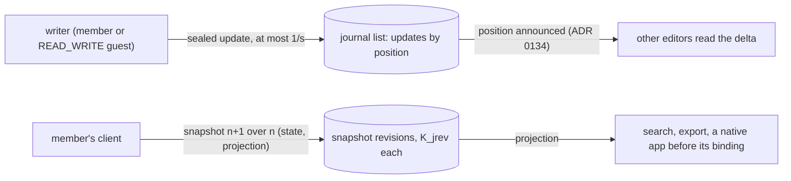

# Memories: the live journal

> **Refined, not built** (inbox #18 and #6). The decisions and their reasons are
> [ADR 0133](../decisions/0133-a-memorys-journal-is-a-sealed-crdt-log-whose-snapshots-only-members-write.md) (the
> journal), [ADR 0134](../decisions/0134-core-pushes-a-lists-new-position-to-the-clients-that-edit-it-on-a-stream.md)
> (core's stream) and [ADR 0093](../decisions/0093-a-report-opens-one-window-for-the-moderator-and-a-hold-copies-never-blocks.md)
> § 10 (a guest's evidence row per writing session); the behaviour is [uc.memory.journal](../features/memory/use-cases/uc.memory.journal.md).
> This page is the model in one place; it says what is true once built, and the work orders
> `changes/cr-live-journal.md` and `changes/cr-live-stream.md` build it.

The journal is a **function of Memories**, not an application of its own: the text of a Memory and of each Chapter, in
markdown, with the node's photos, Chapters, map and GPX tracks embedded as tokens, written by several people at the
same time. The server stores and relays sealed bytes it cannot read and cannot merge; every merge, snapshot and
rendering happens in a client.

## The shape

A journal is **a Yjs document whose content is one `Y.Text` of markdown**. Every edit becomes a small binary update
that a client seals under the current **snapshot revision's** key `K_jrev` and appends; core's items revision gives it
a **position** in the node's journal list. A client reads the newest snapshot revision plus the updates past its
folded position (its **tail**) and merges them; from time to time a **member's** client writes a new snapshot
revision under a fresh key that folds the log in. Earlier snapshot revisions stay for the trash retention, which is
what a member restores from.

## What the server holds, per journal

| Row | Holds | Operator sees |
|---|---|---|
| snapshot revision | number, epoch, `K_jrev` wrapped under `K_node`, folded position, writer, time; sealed state and projection | count, times, size classes, writers |
| contributor | each writer who ever wrote, with its ordinal (a guest is served only ordinals and aliases) | who has written in it |
| alias key | 32 random bytes per journal, never served; a writer's alias is an HMAC of its id under it (ADR 0133 decision 9) | that the journal exists |
| update | snapshot revision, position, writer (member or link identity), time; the sealed envelope (Yjs client id, sequence, update) | every update's time to the millisecond, size class and writer |
| guest-write record (core) | one row per guest writing session: address, port, `Origin`, identity, journal, first and last time, count | as for every guest write |
| the stream (core, in memory only) | who holds a stream onto which journal | who has it open for editing, from when to when |

Not the text, not which passage, not the embeds, not a cursor.

## Not in the first cut

- A Memory's page that shows its Chapters' journals together, read-only (inbox #853).
- Live cursors with names (inbox #854).
- The journal in the native apps, through a Yrs binding (inbox #855).
