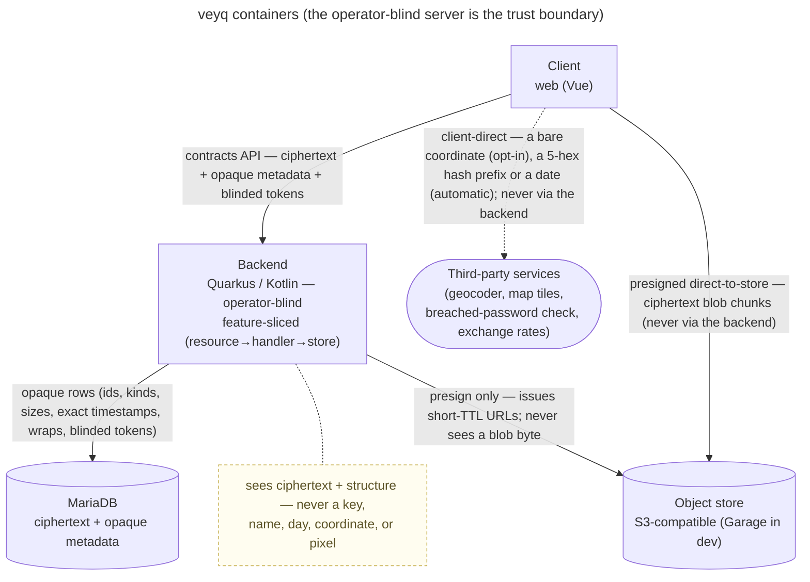
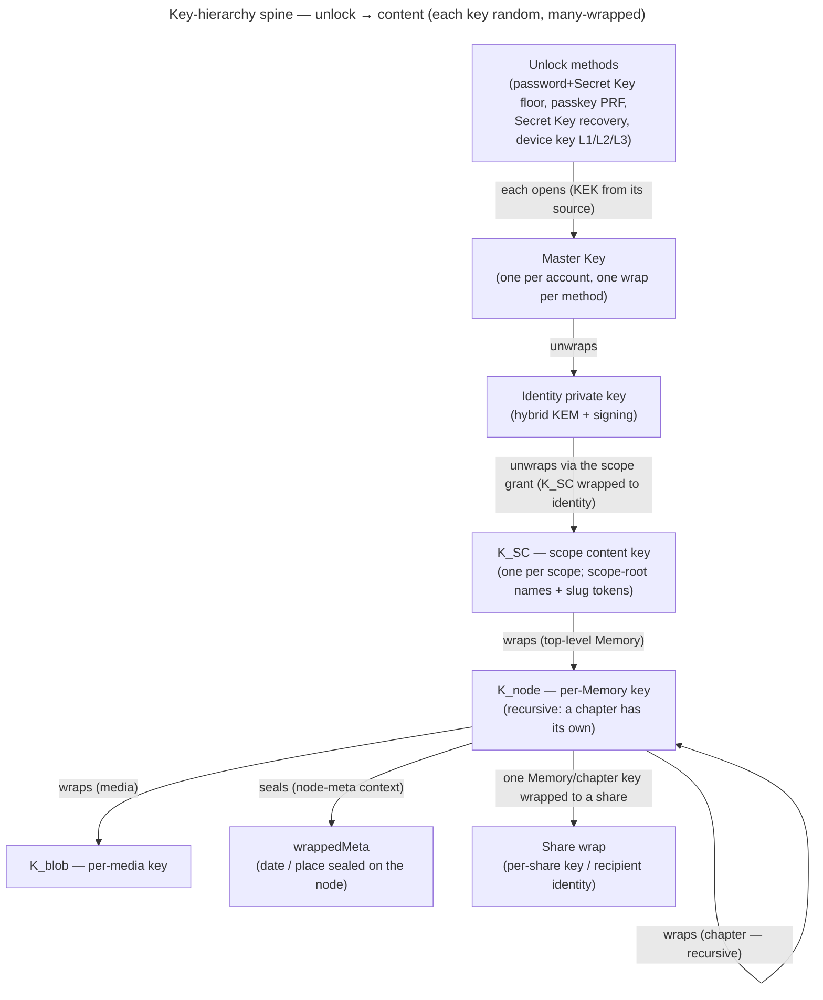
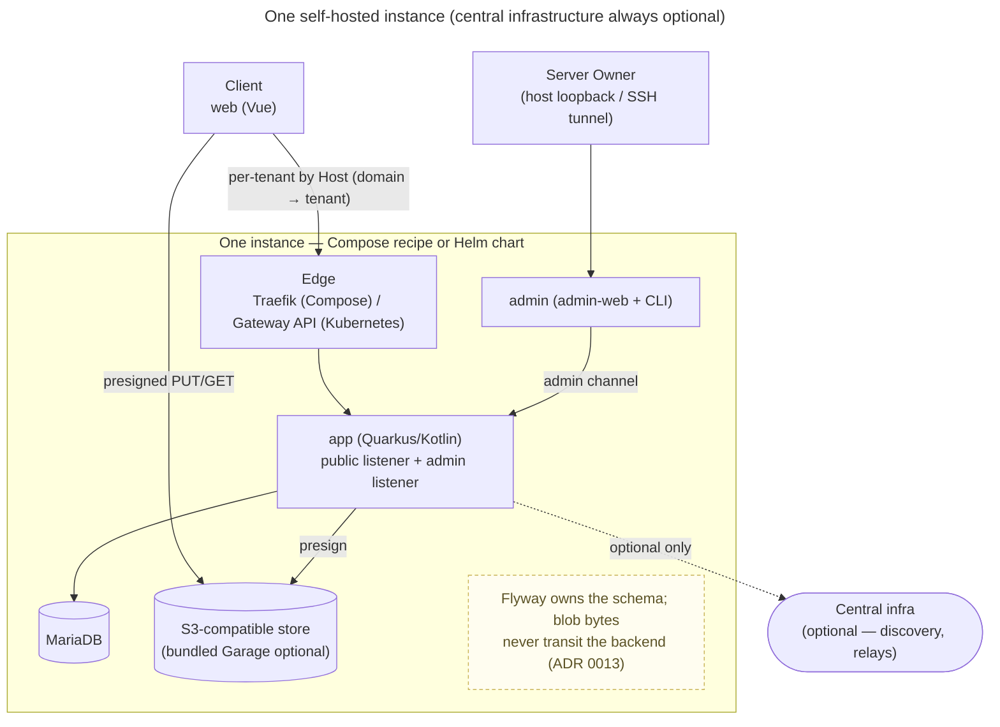

# veyq architecture

The current-state view of **how veyq is built**, in [arc42](https://arc42.org) order — a structure an outside
reader already knows, so they can find what they came for without learning ours first.

**This page is a map, not a compendium.** Every section states the shape and **points** at the doc that owns the
detail; it never restates it. Its place in the taxonomy: [docs/README](../README.md). arc42 is used as its
**markdown** template — it is a section structure, not a file format, and nothing here needs AsciiDoc. Twelve
sections, fixed: that bound is half the reason for adopting it.

Kept current as work lands; a map, not a satisfiable record (no CR `satisfies:` it).

## 1. Introduction and Goals

veyq is a **self-hostable, end-to-end-encrypted platform** for sealed, shareable objects; its first application,
**Memories**, is the product center ([ADR 0079](../decisions/0079-veyq-is-a-platform-memories-is-its-first-application.md)):
the **Memory** (nested into **Chapters**); folders only organize. People keep photos, dates, places and journal entries in
private spaces and share them deliberately — with a person, a group, or a link.

The three goals that outrank every other quality, in order:

1. **The operator cannot read your content — including the operator you are.** A user's unshared personal space
   is confidential even from whoever runs the server. This is not a feature; it is the product.
2. **Anyone can run it.** Self-hosting is the default deployment, not a degraded mode — and, since only a client
   the operator cannot alter holds goal 1 against an *active* operator, it is also how goal 1 is *kept*
   ([ADR 0026](../decisions/0026-client-trust-tiers.md)).
3. **The memories outlive the crypto that protects them.** These are decade-lived keepsakes, which makes
   harvest-now-decrypt-later a present threat and crypto-agility non-negotiable: post-quantum key wrapping from
   the start, a versioned suite id on every artifact, and upgrades that never re-encrypt what already exists
   ([ADR 0017](../decisions/0017-crypto-primitives-and-post-quantum-strategy.md)).

### Stakeholders

Three roles, not three people. The scope veyq is currently built for is **self-hosted** ([the V1 line](../inbox.md)),
which collapses the first two: whoever chooses veyq also runs it. That is a simplification to build on, not a
claim that the roles are the same — the operator is *still* modelled as an adversary, because the person is
entitled to that even when they are the operator.

| Stakeholder | What they need | What makes them fail |
|---|---|---|
| **The person** whose memories these are | that the memories outlive the software, and that sharing stays deliberate | being locked out of their own content, or content reaching further than they meant. Both are loss — one recoverable only by them, one not at all |
| **The operator** who runs the instance — explicitly *not* trusted with content | to install, back up and upgrade an instance without ever needing access to what is in it | a restore that yields ciphertext nobody can open, or an upgrade that needs a step no document describes |
| **The developer or reviewer** judging whether the encryption claim holds | to check the claim in an afternoon, from the outside, without taking the project's word for it | a guarantee that exists only as prose, with nothing that measures it |

Where the operator's convenience and the person's confidentiality conflict, **confidentiality wins** — that is
goal 1, and it is why the operator appears in §2's constraint table as something to be *forbidden* access
rather than as an administrator to be granted it.

## 2. Architecture Constraints

Non-negotiable, and every view below is downstream of them. Stated canonically in
[CLAUDE.md](../../CLAUDE.md) — the list here is the reader's orientation, not a second source of truth:

| Constraint | What it forbids |
|---|---|
| **Operator-blind E2EE everywhere** | any path where the server holds a content key, a password, or plaintext — including "just for a moment", including for the operator's own data |
| **Self-hostable by default** | any required central service; central infrastructure is always optional |
| **API-first** | hand-written DTOs; `contracts/` (OpenAPI + crypto vectors) is what code is generated from |
| **Product language: Memory / Chapter** | Album / Explorer models, APIs or tables |
| **No deprecated or vendor-locked dependencies** | anything EOL, archived, or whose only living successor is commercial — that would break self-hostability |

## 3. Context and Scope

**The trust boundary is the backend, and the adversary is on the inside of it.** What crosses it is ciphertext
plus operational metadata the server needs to route and bill bytes: ids, kinds, sizes, timestamps (exact —
to the millisecond, nothing rounds them), membership, wraps, blinded tokens. What never crosses: a key, a password, a
name, a day, a coordinate, a pixel.

**Third parties are a separate boundary.** A client may reach a geocoder or tile server *directly* —
never proxied — so that using one leaks a bare coordinate to *that* party and still nothing to the veyq
operator ([ADR 0016](../decisions/0016-geocoding-provider-neutrality.md); the boundary is drawn in
[security-model](../crosscutting/security-model.md)). Those are opt-in; two requests run without it, because what
crosses carries no content: the breached-password check (a 5-hex hash prefix) and Expenses' day exchange rates (a
date, [ADR 0108](../decisions/0108-expenses-a-pot-is-a-node-its-entries-are-sealed-revisions.md) decision 8).

## 4. Solution Strategy

| Goal (§1) | Strategy | Where it is decided |
|---|---|---|
| Operator cannot read content | **All content crypto is client-side.** The backend performs no content crypto and never sees the password: login is challenge-response against a derived public key, so there is no credential to steal. | [ADR 0003](../decisions/0003-operator-blind-password-auth.md), [security-model](../crosscutting/security-model.md) |
| …and cannot read it *later*, in bulk | **Envelope encryption with random per-level keys, many-wrapped** (§6) — every level is an independent sharing grain, so sharing never means re-encrypting content. | [ADR 0012](../decisions/0012-content-key-hierarchy.md) |
| …and cannot see bytes at all | **Blobs go direct-to-store via presigned URLs.** The backend signs; it never touches a blob byte. | [ADR 0013](../decisions/0013-blob-storage-presigned-direct-to-store.md) |
| Anyone can run it — and that *is* the security answer | **One node, no required central service**, a vendor-neutral S3 store, Host-based tenant routing. Self-hosting is what makes confidentiality hold against an *active* operator; on someone else's instance veyq is passive-safe and says so. | [ADR 0013](../decisions/0013-blob-storage-presigned-direct-to-store.md), [ADR 0006](../decisions/0006-cold-tenant-scope-birth.md), [ADR 0026](../decisions/0026-client-trust-tiers.md) |
| The memories outlive their crypto | **Post-quantum key wrapping from the start** (hybrid X25519 + ML-KEM-768 — safe if *either* holds) + a **versioned suite id** on every artifact, so a suite can be upgraded without ever re-encrypting what exists. Conformance vectors pin a suite's bytes, so a refactor cannot silently move them. | [ADR 0017](../decisions/0017-crypto-primitives-and-post-quantum-strategy.md) |

## 5. Building Block View

- **`src/backend/`** — Quarkus / Kotlin. **Two axes on purpose:** the application layer is **use-case-sliced**
  (`<area>/<use-case>/…Handler` under `me.raddatz.veyq.core` or an application's package) — that is where cohesion and the trust chain live; the HTTP adapter
  layer is **resource-shaped** (one `…Resource` per generated API interface), because one endpoint can serve
  several use-cases. Cross-cutting code is the platform's declared kernel, which must not depend on a feature slice.
  The platform and each application are Gradle modules (`:core`, `:apps:memories`) the root composes into one
  fast-jar; an application depends on core, never the reverse
  ([ADR 0079](../decisions/0079-veyq-is-a-platform-memories-is-its-first-application.md)).
  → [ADR 0001](../decisions/0001-backend-http-adapter-vs-application-slicing.md),
  [developer-styleguide](../crosscutting/developer-styleguide.md)
- **Authentication and coarse authorization are central**, declared at the resource boundary and default-deny;
  fine-grained content authorization is a small domain guard in the handler — a different layer.
  → [ADR 0008](../decisions/0008-centralized-http-auth.md),
  [cc.security.authorization](../crosscutting/cc.security.authorization.md)
- **`src/web/`** — Vue 3 + its own UI layer on Reka UI (ADR 0107), and **the client surface**. All content crypto runs here.
- **`contracts/`** — OpenAPI + crypto vectors. The source of truth both sides are generated from; never a
  hand-written DTO.

## 6. Runtime View

The one chain each doc shows only a slice of — an unlock gesture down to a sealed field:

Where each level is owned: **unlock + Master Key + identity** →
[en.account.key-model](../features/account/enablers/en.account.key-model.md)
([ADR 0005](../decisions/0005-unlock-methods-and-device-trust.md)) · **K_SC / grants** →
[scopes & tenancy](../crosscutting/scopes-and-tenancy.md)
([ADR 0007](../decisions/0007-membership-role-grant-relation.md)) · **K_node / K_blob / recursion / sharing** →
[en.memory.tree](../features/memory/enablers/en.memory.tree.md) +
[en.memory.media](../features/memory/enablers/en.memory.media.md)
([ADR 0012](../decisions/0012-content-key-hierarchy.md)) · **wrappedMeta** →
[en.memory.node-meta](../features/memory/enablers/en.memory.node-meta.md) · the primitives that realize it →
[ADR 0017](../decisions/0017-crypto-primitives-and-post-quantum-strategy.md) (which also pins their bytes as
conformance vectors).

**Every other runtime flow is drawn where it belongs** — each use-case doc carries its own sequence diagram
(login, unlock, add media, share, add member, rotate a scope key…). This page does not copy them:
[features/](../features/). The whole-system security argument is
[security-model](../crosscutting/security-model.md).

## 7. Deployment View

- **Self-hostable by default; central infrastructure always optional.** The common deployment is one node,
  usually one tenant, self-administered — the Server Owner *is* the Tenant Owner
  ([ADR 0006](../decisions/0006-cold-tenant-scope-birth.md)).
- **Two deployment targets, one answer each.** The Compose recipe (managed on the host by `veyqctl`) and the Helm
  chart run the same services; the edge routes tenant domains the backend projects from its database, and the
  Server-Owner API is answered only on the admin listener the `admin` container reaches. How a release is named,
  published and installed on both, and what of it is built, is
  [release-and-deployment](../crosscutting/release-and-deployment.md); no image carries the recipe — a release's
  recipe is its assets ([ADR 0057](../decisions/0057-release-identity-and-deployment-recipe.md) §3).
- **S3-compatible, vendor-neutral store** — the backend signs via the AWS S3 SDK, never a vendor-locked client
  ([ADR 0013](../decisions/0013-blob-storage-presigned-direct-to-store.md)).
- **Host-based tenant routing** — the active tenant resolves from the request Host (port stripped)
  ([scopes & tenancy](../crosscutting/scopes-and-tenancy.md),
  [uc.admin.setup-server](../features/admin/use-cases/uc.admin.setup-server.md)).

## 8. Cross-cutting Concepts

- **Operator-blind invariant & trust boundaries** — the operator is the adversary; the server sees ciphertext +
  opaque operational metadata, never keys or content; third parties are a separate boundary, opt-in but for two
  content-free automatic requests (the breached-password check, the exchange rates). →
  [security-model](../crosscutting/security-model.md)
  ([ADR 0003](../decisions/0003-operator-blind-password-auth.md),
  [ADR 0015](../decisions/0015-operator-blind-readable-urls.md),
  [ADR 0016](../decisions/0016-geocoding-provider-neutrality.md))
- **Auth ≠ unlock, and the split is deliberate.** Password → auth keypair (Ed25519, derived, never sent) →
  challenge-response login → opaque rotating session tokens → the HTTP auth boundary. A session grants a role
  over *ciphertext*; it never opens content. →
  [ADR 0003](../decisions/0003-operator-blind-password-auth.md) →
  [ADR 0004](../decisions/0004-session-tokens.md) → [ADR 0008](../decisions/0008-centralized-http-auth.md);
  the split itself is [en.account.key-model](../features/account/enablers/en.account.key-model.md).
- **Passwordless unlock** — a device-held key wrap that opens the master key without a password, enrolled per
  device and revocable. →
  [uc.account.remember-this-device](../features/account/use-cases/uc.account.remember-this-device.md)
  ([ADR 0005](../decisions/0005-unlock-methods-and-device-trust.md))
- **Scope / tenancy model** — personal / group / tenant scopes; membership = (user, scope, role, grant); a
  tenant scope is born cold; groups are private even from the tenant owner. →
  [scopes & tenancy](../crosscutting/scopes-and-tenancy.md)
  ([ADR 0002](../decisions/0002-personal-scope-per-tenant.md),
  [ADR 0006](../decisions/0006-cold-tenant-scope-birth.md),
  [ADR 0007](../decisions/0007-membership-role-grant-relation.md),
  [ADR 0014](../decisions/0014-group-scopes-and-governance.md))
- **Media data-flow** — the client generates derivatives and seals each blob under its own `K_blob` (under
  `K_node`), uploads ciphertext chunks direct-to-store via presigned URLs, then records opaque metadata + the
  wraps. → [en.memory.media](../features/memory/enablers/en.memory.media.md) +
  [en.memory.derivatives](../features/memory/enablers/en.memory.derivatives.md)
  ([ADR 0013](../decisions/0013-blob-storage-presigned-direct-to-store.md))
- **Readable-but-blind URLs** — the content path rides the URL `#fragment`, resolved client-side; the operator
  never sees a name-derived slug. → [ADR 0015](../decisions/0015-operator-blind-readable-urls.md)
- **Forward secrecy per scope** — removing a member rotates the scope key forward an epoch; old content stays
  readable to those who kept access, new content is closed to the removed member. →
  [ADR 0024](../decisions/0024-scope-key-rotation.md), [ADR 0025](../decisions/0025-forward-secrecy-policy-per-scope.md)

## 9. Architecture Decisions

The decisions that shape the views above, by theme. **This is a reader's path in, not the full set** — the
[topic index](../decisions/README.md#topics) is the only complete list, each topic with its current-picture doc,
and stating its size here would only be one more number to keep true.

| Theme | ADRs |
|---|---|
| **Backend structure** | [0001](../decisions/0001-backend-http-adapter-vs-application-slicing.md) adapters/slicing · [0008](../decisions/0008-centralized-http-auth.md) central auth/authz · [0042](../decisions/0042-http-failure-projection.md) single-source failure projection |
| **Auth & session** | [0003](../decisions/0003-operator-blind-password-auth.md) password keypair · [0004](../decisions/0004-session-tokens.md) session tokens |
| **Keys & crypto** | [0017](../decisions/0017-crypto-primitives-and-post-quantum-strategy.md) primitives + PQ strategy + conformance vectors · [0012](../decisions/0012-content-key-hierarchy.md) content-key hierarchy · [0005](../decisions/0005-unlock-methods-and-device-trust.md) unlock methods & device trust |
| **Scopes & tenancy** | [0002](../decisions/0002-personal-scope-per-tenant.md) personal scope per tenant · [0006](../decisions/0006-cold-tenant-scope-birth.md) cold tenant birth · [0007](../decisions/0007-membership-role-grant-relation.md) membership relation · [0014](../decisions/0014-group-scopes-and-governance.md) group scopes & governance · [0024](../decisions/0024-scope-key-rotation.md) key rotation · [0111](../decisions/0111-an-invitee-grants-itself-a-rotator-re-keys-its-own-scopes-and-a-key-chain-anchors-trust.md) membership, identity rotation and trust (decisions 1–11 and 16's counter built) |
| **Storage & URLs** | [0013](../decisions/0013-blob-storage-presigned-direct-to-store.md) S3 direct-to-store · [0015](../decisions/0015-operator-blind-readable-urls.md) blind readable URLs |
| **Provider neutrality** | [0016](../decisions/0016-geocoding-provider-neutrality.md) geocoding · [0018](../decisions/0018-map-tiles-provider-neutrality.md) map tiles |
| **Client integrity** | [0026](../decisions/0026-client-trust-tiers.md) trust tiers — self-hosting is the guarantee |
| **Coverage & process** | [0040](../decisions/0040-coverage-gaps-and-http-not-a-surface.md) what counts as a covered surface |

## 10. Quality Requirements

In priority order. The first one wins every conflict, by construction rather than by discipline — the server
has no key to misuse. The ordering is a **rule, not a preference**: trading a higher row for a lower one takes
an ADR that says so out loud. The first row cannot be traded at all — there is no key to trade away.

| Quality | The bar | How it is held |
|---|---|---|
| **Confidentiality from the operator** | absolute. Not "hard to abuse" — *impossible without a client key*. A full DB + object-store dump yields ciphertext, public keys and wrapped blobs, and derives nothing. | §4's strategies; argued end-to-end in [security-model](../crosscutting/security-model.md) |
| **Self-hostability** | one `docker compose up` + a JVM, or one `helm install ./charts/veyq` on a cluster the operator already runs ([ADR 0064](../decisions/0064-kubernetes-helm-deployment-target.md)); no account with anyone, no phone-home, no required central service, no cluster-wide RBAC | [Set up a new instance](../../site/src/content/docs/run/new-instance.mdx) |
| **Durability of what is stored** | a backup taken by the documented procedure restores onto an empty instance — its objects out of the backup's object pool, since a capture's store leg is only their index ([ADR 0056](../decisions/0056-instance-durable-state-and-cold-logical-backup.md) §3) — and afterwards every Memory opens with the keys their owners already hold | **held.** The key half is built — [uc.account.recover-access](../features/account/use-cases/uc.account.recover-access.md) + [ADR 0054](../decisions/0054-password-recovery-two-factor-release.md). The server half: [ADR 0056](../decisions/0056-instance-durable-state-and-cold-logical-backup.md) fixes what a backup captures, [uc.admin.back-up-and-restore-instance](../features/admin/use-cases/uc.admin.back-up-and-restore-instance.md) its flow, [Backup and restore](../../site/src/content/docs/run/backup-and-restore.md) (the docs site's Run area) the commands, and a grouped web e2e rehearsal captures an instance, destroys it, restores onto an empty one and reads the same bytes back. That use-case's `restore-onto-empty-opens-every-memory` **is** this sentence as a criterion, and it cites the rehearsal on the `web-e2e` job, a row a run admitted before the import ([ADR 0040](../decisions/0040-coverage-gaps-and-http-not-a-surface.md)'s note on which rows a run has admitted). The use-case stays `planned` only for criteria no surface reaches |
| **Forward secrecy on removal** | a removed member cannot read content created after their removal | [ADR 0024](../decisions/0024-scope-key-rotation.md) |

**Durability has two halves, and E2EE splits them.** A restored server is only half a restore: perfectly
recovered ciphertext that nobody can open is data loss with extra steps. The other half is the key — the
Emergency Kit the person holds, and the recovery path that opens it. This is the one quality in the table the
operator **cannot** hold alone, which is why key recovery is a durability requirement here and not a convenience
feature. That half is built, and so is the half the operator *can* hold alone: what a backup *is* was decided in
[ADR 0056](../decisions/0056-instance-durable-state-and-cold-logical-backup.md) — three legs, captured with the
writer stopped — the commands are written down and executed as written, and a restore rehearsal that destroys
its own source runs on the `web-e2e` job. That job's row was admitted by a run before this repository's
2026-08-06 import, so the rehearsal counts on the declared run, the standard every other ref here meets
([ADR 0040](../decisions/0040-coverage-gaps-and-http-not-a-surface.md)'s note on what a row is) — no run has
executed it in this repository, and the row claims nothing beyond that standard. What no surface can observe —
the capture window with the writer stopped, the store leg's `verify`, a restore onto a different store
implementation — is argued in ADR 0056 and, where the operator tool can show it, bite-proven there; none of it
is claimed as coverage.

**Deliberately unstated:** there is no latency, throughput or availability target. Under self-hosting nobody
stands behind one — an operator has no service agreement with themselves, and neither their hardware nor their
connection is ours to promise. veyq's load model is a household, and the expensive paths (crypto, derivatives)
run on the client. If a target is ever needed, it becomes an ADR — not a line in this table (the gallery's are
[ADR 0105](../decisions/0105-a-gallery-renders-what-is-near-the-viewport-and-opens-its-listing-in-a-worker.md)'s).

**How performance is read instead: a profile, never a target.** `scripts/profile_hot_paths.py` (with
`tests/e2e/profile/`) boots the release candidate's images in the production recipe on one quiet machine and profiles
the hot paths, unlock, an upload of 50 phone-sized photos, opening a 1,000-photo Chapter and importing a download of 50
photos, on both sides: Chromium's
CPU profile of the main thread and a trace of every thread, three runs each at CPU throttle 1 and 4, and the server
under JFR with its environment and system-property events off, beside the SQL statements per request. Nothing it
records can turn red; a hotspot it finds becomes an inbox row with its number. What its reader can refuse is a reading
of the main thread it cannot stand behind: the trace's tasks must account for the thread's CPU time as the operating
system counts it, and may outlast their own CPU time only as far as on a quiet machine (the ranges and why they are
two angles, not one ratio, are `scripts/profile_attribute.py`'s docstring; inbox #770). Its first reading
(2026-10-23/24) bore out the load model above: the server's JVM averaged under 1 % CPU, unlock waits on the Argon2id worker by design, and the
client's largest avoidable cost was sealing an upload's blobs in pure JS on the main thread: 12.4 s of the main thread's
24 s in the 41 s upload at throttle 1. Those chunk frames are now sealed and opened in core's frame worker
(`src/web/src/core/blob/frames.worker.ts`), on the same `@noble` code (ADR 0017 decision 1). Its after-reading
(2026-10-27) put the upload at 30–31 s, with the frames' work under 0.1 s on the main thread and 5.1–5.4 s in the worker.
Each original's SHA-256 is now read in core's digest worker (`src/web/src/core/blob/digest.worker.ts`), on the same
`@noble` code, while the original's tiers are derived, so it is off the main thread and off the upload's critical path:
read without the CPU profiler, the upload took 25.8 s at throttle 1 against 32.0 s before (2026-10-27). At throttle 4
the main thread still bounded it: read by its tasks (`scripts/profile_attribute.py`), the pump's per-chunk round trip —
a sealed frame back from the worker, then a `fetch` started on the page — held 41–44 s of its 63–67 s (2026-10-28,
inbox #220). Each chunk is now read, sealed and `PUT` in the frame worker, as a `Blob` (a byte-array body cost a
thread about seven times as much per `PUT`); the page keeps the windows, the re-sign and the progress. Its after-reading
(2026-10-28, a machine at load 25–40, three runs each without the CPU profiler, beside two passes of the tree before)
put the upload at 25.9 s against 29.8–32.2 s at throttle 1 and 37.5 s against 73.4–75.4 s at throttle 4, the pump's
tasks at 0.5–0.9 s, and the frame worker at 7.7–8.9 s. What held the main thread then was Vue re-laying out the gallery
on each chunk's progress; a chunk now redraws only its own tile
([uc.memory.gallery](../features/memory/use-cases/uc.memory.gallery.md) § Quality notes). Read again alone on the
machine (2026-10-29, a 1-minute load ≤ 4 at each batch's start, 5–8 during the runs with the instance itself), that
change took the throttle-4 upload from 21.4 s to 20.0 s, and the main thread no longer bounded it at either throttle:
its tasks held 3.0 s of 18.2 s at throttle 1 and 8.5 s of 20.0 s at 4, while each file's on-device stage (type,
digest, tiers, EXIF read; 161 ms) and its upload stage (178 ms) ran one after the other, each mostly worker and wire
time. So the next file's on-device stage now runs while the current file is on the wire, one ahead
([uc.memory.upload](../features/memory/use-cases/uc.memory.upload.md) step 3; inbox #220): 10.8 s (10.6–11.5) against
17.6–19.2 s at throttle 1 and 13.4 s (13.3–13.5) against 19.9–20.3 s at throttle 4, beside two passes of the tree
before, with every next file's digest inside the previous file's upload stage. What bounds it now is the upload stage
itself, about 190 ms a file, with the frame worker busy 6.4 s of the 10.8 s. Each window also records the browser's
resident memory now, read from `/proc` beside the browser (inbox #558): picking those 50 photos decoded every one at once
for its tile's aspect ratio, and the renderer peaked at 2.30–2.79 GiB at throttle 4 against 1.0–1.1 GiB for the rest of
the upload. A tile now reads the size its file's header names (`src/web/src/shared/image/imageHeader.ts`), and the
batch's peak is the upload's own, 1.14–1.27 GiB. The 1.0–1.1 GiB the renderer then held through the upload was the
tiles' previews, each the picked photo decoded whole (0.44–0.46 GiB with none, inbox #785); a tile near the viewport
now shows its photo drawn at the thumbnail's size, one at a time, and the renderer stays at 0.49–0.53 GiB in the same
time. The same upload of 20 clips of 1080p (S2v, inbox #786; the window counts the page's media players too) opened
18–20 video decoders at once, one per tile's poster at the lightbox's 2048 px, and the renderer peaked at 1.51–1.78 GiB
against 0.94–0.96 GiB without those posters, which also cost the upload 3.5 s of main thread at throttle 4; a video's
first frame now joins the photos' queue at the thumbnail's size, 2 decoders run at once, the peak is 1.09–1.12 GiB and
the upload takes 12.4 s against 14.5 s at throttle 4. Each video's size is read from its container's header
(`src/web/src/shared/image/videoHeader.ts`, inbox #793) instead of by a `<video>` per file that loaded its metadata at
the pick and again at its upload: 22 players alive at once become 2, and the upload takes 12.0–12.3 s against
12.8–13.5 s at throttle 4; the renderer's 0.85–0.89 GiB through it are the tile posters' draws of their 1080p frame,
not the probes and not the decodes (0.71–0.72 GiB without those posters, 0.70–0.71 GiB decoded and never drawn, inbox #795) ([uc.memory.upload](../features/memory/use-cases/uc.memory.upload.md)
§ Quality notes; 2026-10-29). A fourth path,
an import of a download of the same 50 photos (S4, inbox #557), spent 3.5 s
of its main thread on each payload's SHA-256 and 0.5 s on its CRC-32 at throttle 1 (14.6 s and 1.9 s at 4); that check
now runs in the digest worker, one payload ahead of the upload, and the import takes 15.8 s against 20.2 s and 17.2 s
against 35.1 s. It then waited about 160 ms between two uploads for the next original's tiers; that preparation now
runs while the previous original uploads, as in a member's batch (inbox #784), and the import takes 9.3–9.8 s
(10.7–13.3 s at throttle 4), as long as S2's upload ([uc.platform.export-import](../features/platform/use-cases/uc.platform.export-import.md)
§ Quality notes). On the server side the first reading's
two statement counts that grew with the data now stay fixed (inbox #537, 2026-10-29): opening the 1,000-photo Chapter
sent about 116 SQL statements a request because the thumbnails' `blob-downloads-batch` read its blob row and the space's
content blocks once per id it named (12 + 2 per id, 524 for a batch of 256), and the member list read each member's
account on its own (1,012 SELECTs at 1,000 members). Both now read a batch once: in the backend's own count the
Chapter's three requests send 17, 13 and 14 statements and the member list 19, whatever the Chapter or the group
holds, and `BlobDownloadQueryCountSliceTest` and `MemberListQueryCountSliceTest` turn red when either grows again. The method,
how its files are handled and the reading's limits are published in the Security area,
[How veyq is tested](../../site/src/content/docs/security/how-veyq-is-tested.md).

## 11. Risks and Technical Debt

Known, current, and each with an owner document. This section exists so that debt has *one* address instead of
being scattered across an ADR's prose, a coverage field, and an audit file.

| Risk / debt | Why it matters | State |
|---|---|---|
| **Two jobs have never run, so everything they test is built but unproven.** `admin-web`'s and `packages/crypto`'s `npm run check` were born on 2026-09-08 ([ADR 0065](../decisions/0065-admin-ui-cli-separate-service.md)) and no run has executed either, so [ADR 0040](../decisions/0040-coverage-gaps-and-http-not-a-surface.md) admits none of their suites (its note on which rows a run has admitted; `ADMITTED` in `scripts/validate_coverage.py` enforces it). The suites exist and pass locally, and each is named under the `gaps` of the use-cases it will flip — `grep -rln "^  admin-web: >\|^  crypto: >" docs/coverage/features` is the population, deliberately not a list here. | A coverage claim is only worth the build behind it, and until a log is read "the job passed" and "the job ran nothing" look the same. The Server-Owner console's and CLI's own suites and the pinned crypto vectors all ride on these two jobs, though no criterion of a built use-case rests on them alone any more: the last, `uc.account.trust-device`'s vector criterion, gained a web test that pins the same vector through web's trust path, so `UNADMITTED_BASELINE` in `scripts/validate_coverage.py` is empty and the guard refuses any ref on either job. | Tracked as `gaps:` in [coverage/](../coverage/), named, so the flip is mechanical: on the first run whose log shows that package's suites executed, the surface joins `ADMITTED` and its suites move under their criteria. Publishing the repository is what makes that run possible ([inbox](../inbox.md) #26). |
| **End-to-end coverage is thin, not absent.** The orchestrator exists (`web-e2e` → `scripts/run_web_e2e.py`) and the suites pass locally. Its job is a row a run admitted before the 2026-08-06 import, so a suite it discovers counts on the declared run like any other ref ([ADR 0040](../decisions/0040-coverage-gaps-and-http-not-a-surface.md)'s note on which rows a run has admitted, which records that log) — though this repository, having no remote, has run none of them since. The population is `git ls-files 'src/web/src/*.e2e.test.ts'` (the set `scripts/run_web_e2e.py` discovers) — deliberately neither a number nor a list of names here: both have been tried, and each went stale with the next suite. The pre-reset tree carried ~30 (login, invitation, password reset, tenant setup, role changes, browse, journal, share, …), all deleted in the reset. | The harness was the hard part and it is done — breadth is now cheap, which is exactly why it should not be left implicit. Each missing suite is a flow whose only live proof is a human remembering to click it. | Open, and the successor to what used to be the highest-value item here: the orchestrator debt itself is **paid** (ported, bite-tested, green locally, and `scripts/validate_e2e_discovery.py` guarding the report-green-on-zero-files failure mode). *"Green in CI" was carried across the repo move without re-measuring and is false here — no run has happened in this repository; what the suites claim, they claim on declaration, not on a green tick.* Adding suites is its own CR; the marginal cost per suite is one file **when the flow is already headless-clean** — the sharing suite needed a data-layer edit first (link assembly out of `share.ts`, pinned by `shareHeadless.test.ts`), which is the shared *bootstrap* paying off, not a guarantee about any given flow. |
## 12. Glossary

The words this project uses precisely. Where a term has a tempting synonym, the synonym is **wrong here**.

| Term | Meaning |
|---|---|
| **Memory** | the product's unit of content — a moment with photos, a date, a place, journal text. **Not** an "album". |
| **Chapter** | a Memory nested inside a Memory. Recursive: it has its own content key. **Not** a "sub-album". |
| **Folder** | organizes; carries no content, but a key of its own that every node below it wraps under ([ADR 0080](../decisions/0080-every-node-carries-a-key-a-folders-key-behaves-like-a-memorys.md)). |
| **Scope** | the keyed container everything lives in, and the unit of sharing. Three kinds: **personal** (one per user per tenant), **group** (private even from the tenant owner), **tenant** (the root, born cold at activation). |
| **Tenant** | one instance's household/organization, resolved from the request **Host**. One server may host many. |
| **Membership** | the relation `(user, scope, role, grant)` — being *in* a scope. Distinct from holding its key. |
| **Grant** | a scope's current content key (`K_SC`) sealed to a member's identity public key. One wrap = the whole scope. Holding a membership without a grant means you are in the room but cannot read. |
| **Wrap** | any key sealed under another key. The Master Key has one wrap per unlock method; a share has its own. |
| **Master Key** | the account root (32 bytes), in client memory only, opened by any unlock method's KEK. |
| **Secret Key** | the user's high-entropy second factor, combined with the password to derive the unlock KEK. **Never reaches the server.** Lives in the Emergency Kit. |
| **Emergency Kit** | the email + Secret Key, saved when the account is born (server setup or joining a tenant). With the password it opens the account on a new device; alone, after a mailed recovery link, it is the only path back after a forgotten password (there is no separate recovery code). Its format: [en.account.key-model](../features/account/enablers/en.account.key-model.md#the-emergency-kit). |
| **Epoch** | a generation of a scope's content key. Removing a member rotates the scope forward one epoch. |
| **K_SC / K_node / K_blob** | scope content key / per-node key / per-media key. Each random, each wrapped by the level above — that is what makes every level an independent sharing grain. |
| **Operator-blind** | the server stores and serves only ciphertext + opaque metadata, and *cannot* do otherwise — it holds no content key. The operator is modelled as the adversary. |
| **Server Owner** | the person who installed the instance. A server role over ciphertext — **not** a reader of content. |
| **Tenant Owner** | governs one tenant (members, groups, terms). In the common self-hosted case, the same person as the Server Owner — and still not a reader. |
| **Surface** | a place veyq's behaviour is built and proven: `backend` and `web`, which every use-case owes, plus `crypto` and `admin-web`, which only some touch. Coverage follows the **build**, never the intention — a test on a job no run has executed proves nothing, however real it is, which is why `crypto`'s and `admin-web`'s suites still wait under `gaps` ([ADR 0040](../decisions/0040-coverage-gaps-and-http-not-a-surface.md)'s note on what a row is). |

## Where else to look

- **Doc taxonomy + rules:** [docs/README](../README.md) · **ADR format:** [decisions/README](../decisions/README.md)
- **Working method (and who these docs are for):** [ai/README](../ai/README.md) · root [CLAUDE.md](../../CLAUDE.md)
- **Features** (use-cases + enablers, each with its own runtime diagram): [features/](../features/)
- **Cross-cutting concerns:** [crosscutting/](../crosscutting/)
- **What is proven, and where:** [coverage/](../coverage/)
- **The published documentation site — plain language for end users (EN+DE), and for operators:** [`site/`](../../site/src/content/docs/)
