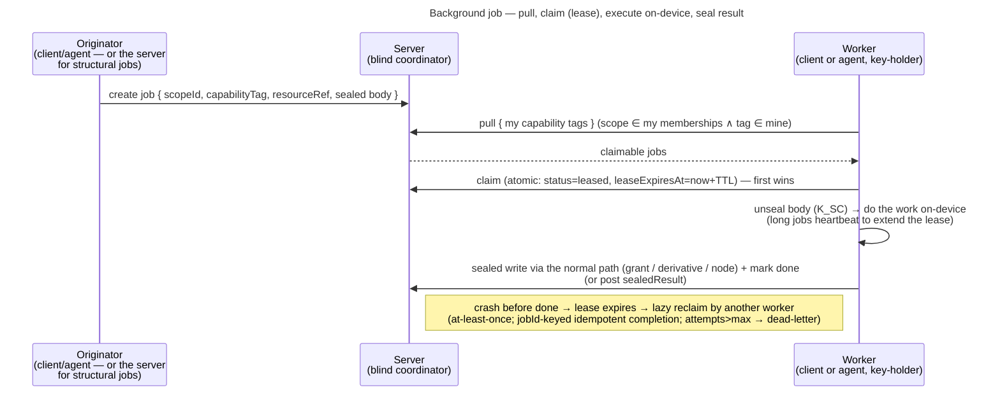

# Background tasks — operator-blind job mechanism

How veyq runs work over content that the **blind server cannot do itself** (deliver a grant, transcode, run
on-device ML): the server coordinates opaque jobs; **keyed workers** do the work on-device. This is the
reference; the decisions + rationale live in [ADR 0021](../decisions/0021-operator-blind-background-tasks.md).

## Model

- **Coordinator = the veyq backend** (a job table). No broker/MQTT, no extra daemon. Discovery is **pull /
  reconcile-on-entry**; a push channel (SSE) is a later seam on the same server.
- **Workers = an equal, self-selecting pool.** Any **interactive client** *or* the headless **agent** is a
  worker on the same protocol. A blind server can't schedule work it can't read, so workers pull and self-select.
- **Eligibility = holding the scope key, narrowed per tag.** A worker can only act on a job whose `scopeId` it
  holds a grant for (it unseals the body with a `K_SC`-derived key). A tag whose work only some key-holders may
  complete narrows that set: `scope-rotation` is offered only to an **owner** of its scope, the only member who may
  commit a rotation ([ADR 0021](../decisions/0021-operator-blind-background-tasks.md) §4). **Capability = opaque
  tags** the worker can process.
- **A worker is a member's own device** — the web tab, an app while idle, or a headless host the member runs, never a
  part of the instance ([ADR 0132](../decisions/0132-a-content-job-runs-on-a-members-own-device-and-adds-its-result-to-the-object-later.md) decisions 1 and 8). **Planned, not built:** each worker holds its lease
  under an id of its own, not the account's, and a decline excludes that worker unless its tag says the account
  (decision 2); a content job is enqueued once per object and its done row kept while the object lives (decision 3);
  its result is a derived blob added to the object later (decision 5).

## The job envelope

| Field | Visibility | Meaning |
|---|---|---|
| `jobId` | cleartext | stable id; keys idempotent completion |
| `scopeId` | cleartext | routing key — the server already knows membership |
| `capabilityTag` | cleartext, **opaque** | which capability the job needs (fixed public registry in `contracts/`; a bare dump sees `0x9f3a`, not `face-recognition`) |
| `resourceRef` | cleartext, opaque id | the resource acted on (e.g. a mediaId) |
| `status` / `leaseHolder` / `leaseExpiresAt` / `attempts` | cleartext | lease + retry bookkeeping |
| **body** (`type` + params) | **sealed** (under a `K_SC`-derived key) | the actual task + parameters — only a scope-key-holder unseals it. No job carries a sealed body yet; the first that does adds its purpose to the typed seal union and a vector ([ADR 0072](../decisions/0072-a-seal-binds-its-object.md)) |
| `sealedResult` (optional) | **sealed**, opaque | a job-specific output when it is not already a normal artifact |

## Lifecycle

- **Claim / lease.** Atomic: a compare-and-set on `status` ([§ Persistence](#persistence)). Every claim leases with a
  **TTL**; expensive jobs **heartbeat** to keep it. The TTL is `veyq.tasks.lease.ttl`, **2 min** by default, and the
  web worker renews it every **30 s** while it works, so a hidden tab whose timers the browser throttles to one a
  minute still keeps it; a Server Owner who sets it below about **60 s** defeats the renewal, and such a tab loses a
  job it is still working on. A worker that stops — a tab closed, reloaded or navigated away — frees its job only when
  the lease runs out: there is **no release endpoint** on `pagehide`, and a holder does not take over its own valid
  lease, so the same user's next page claims the job like any other worker, after the expiry
  ([ADR 0021](../decisions/0021-operator-blind-background-tasks.md) §6). Only the lease holder heartbeats, completes, fails or
  declines ([ADR 0021](../decisions/0021-operator-blind-background-tasks.md) §6) — idempotency makes a *repeated*
  completion harmless, it does not make an *unclaimed* one legitimate. Each of those transitions, the completion
  included, is a compare-and-set on the lease (`… where status = LEASED and leaseHolder = <caller>`) whose row count
  decides the answer: a worker whose expired lease was reclaimed between its read and its write writes nothing,
  and the reclaimer keeps the job. A crash → the lease expires → **lazy reclaim**. `attempts` + a max → **dead-letter**. No job work happens in a deleting scope or a suspended tenant
  ([uc.spaces.scope-access](../features/spaces/use-cases/uc.spaces.scope-access.md)).
- **Result.** Usually a normal **sealed** write via an existing path (a grant onto a membership, a derivative
  blob, a node update) → mark `done`; the originator observes it through that path. Otherwise an optional sealed
  `sealedResult`. No plaintext result store.
- **Origination.** The server may originate only **structural, non-sensitive** jobs it already understands
  (a membership whose grant is behind the scope's epoch → `grant-delivery`), and event jobs it witnessed but cannot
  complete (a co-shared member cut → `scope-rotation`; an account rotation queues none, its rotator mints its scopes'
  epochs itself, [ADR 0060](../decisions/0060-key-rotation-after-compromise.md) Decision 4); a client's enqueue of
  either tag is refused. `grant-delivery` is found on claim (reconcile-on-claim); an hourly backstop
  (`veyq.tasks.grant-delivery.reconcile.every`) originates it for scopes no key-holder pulled. **Content-processing jobs are client/agent-originated**, so the
  server never picks a content-semantic type.

## What the operator sees (honest)

Content and results are **sealed throughout** — that guarantee holds. But the mechanism's metadata exposure is
**correlation-bounded, not label-bounded**: from blob **sizes**, **timing**, **which worker** acts, run
duration, and the **output artifact** that appears, a correlating operator can infer the *character* of a job
(big blob → job → agent → derivative ≈ a transcode) regardless of the tag scheme. Opaque tags keep gratuitous
plaintext labels out of the DB (defense vs. a bare dump), **not** defeat a correlating/hosted operator — which
is the already-declared, accepted gap ([security-model → key-directory & active-operator](security-model.md);
self-hosted makes it moot). Keyed-per-scope tags remain a seam for future low-footprint, ambiguous types.

## Persistence

The queue/claim/lease machinery is **bought, not built** — but the "buy" here is the **DB's own atomic
primitive**, not a job framework: the workers are *remote key-holders that pull over
HTTP* (interactive clients + the later agent), so a server-side execution framework (JobRunr, db-scheduler)
does **not** fit — those run jobs *on the server*, which is exactly what a blind veyq server cannot do (it
holds no key). The claim is therefore a thin, portable **compare-and-set on `status`** (read a claimable
candidate → `UPDATE … WHERE id=? AND status=<prior>`; first writer wins, losers retry). It behaves identically
on the **H2 test DB** and **MariaDB**, so `./gradlew check` exercises the real claim path; MariaDB's
`FOR UPDATE SKIP LOCKED` (≥10.6) stays available as a throughput optimisation layered on top if contention ever
warrants it, but is **not** required for correctness. `attempts` is incremented on each (re)claim so a crashed
worker's job is lazily reclaimed and, once it reaches `max_attempts`, dead-lettered. Only the **blind layer**
(envelope, key-eligibility, sealed body/result, the tag registry) is veyq-specific, kept a thin decoupled
module (extraction-ready, not extracted).

## Consumers

- **Grant delivery** ([ADR 0020](../decisions/0020-grant-distribution-invite-wrap.md)) — the first consumer: trivial
  blind body, universal tag, short lease. Built for member-add, it now serves only a member whose grant is behind —
  one a rotation skipped, or a newcomer whose invite a rotation declared pending — since a newcomer grants itself
  ([ADR 0111](../decisions/0111-an-invitee-grants-itself-a-rotator-re-keys-its-own-scopes-and-a-key-chain-anchors-trust.md)
  decision 5).
- **Scope rotation** — a queued rotation of a group whose co-shared member was cut, offered only to an owner of the
  scope ([uc.spaces.complete-queued-rotation](../features/spaces/use-cases/uc.spaces.complete-queued-rotation.md)).
- **Planned — a video's playable copy** (`memories-playback-v1`, [ADR 0132](../decisions/0132-a-content-job-runs-on-a-members-own-device-and-adds-its-result-to-the-object-later.md) decision 9): the first
  content job, enqueued by whoever uploads a video and by a worker's backfill, run only by an app or a headless host.
- **Later:** text read from a scan (inbox #840), embeddings for semantic search, **face-recognition** (inbox #23) — each
  a job type an application contributes (ADR 0132 decision 6).

## Related

- Decision: [ADR 0021](../decisions/0021-operator-blind-background-tasks.md) (this mechanism),
  [ADR 0020](../decisions/0020-grant-distribution-invite-wrap.md) (grant distribution — the first consumer)
- Concepts: [Security Model](security-model.md) (operator-blind, the accepted gaps),
  [Scopes & Tenancy](scopes-and-tenancy.md) (the scope key a worker must hold)
