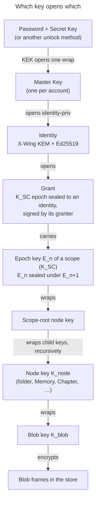
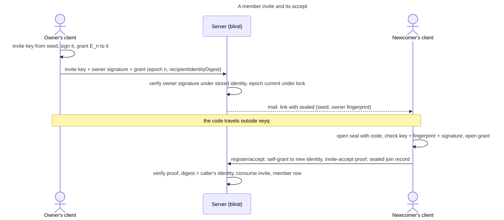

# Concern: Keys, grants, rotation and identity trust

- **ID:** keys-grants-and-trust
- **Type:** **Cross-cutting concern** — the current picture of the topic *Keys: content keys, grants, rotation,
  identity trust*: which key opens which, who wraps a scope key to whom and what the server checks, when a scope moves
  to a new epoch and who re-keys its nodes, how an account replaces its own keys, and how a client decides that a key
  belongs to the person it names. It decides nothing; each part links the ADR that did.
- **Status:** built as stated, measured in code (`src/backend/core`, `src/web/src/features/{account,spaces,tasks,tenant}`,
  `src/web/src/core/node`, `src/packages/crypto`, `contracts/api/{scopes,tenants,account,tasks}.openapi.yaml`). What is
  decided and not built, and what is open, is under [§ Decided, not built](#decided-not-built).
- **Out of scope here:** byte formats — the conformance-pinned suite
  ([`src/packages/crypto/src/v1.ts`](../../src/packages/crypto/src/v1.ts), the seal tables in
  [`seal.ts`](../../src/packages/crypto/src/seal.ts)) and its vectors
  ([`contracts/crypto/vectors/v1.json`](../../contracts/crypto/vectors/v1.json)); what every seal binds
  ([ADR 0072](../decisions/0072-a-seal-binds-its-object.md)); one account's unlock methods, KEKs and recovery
  ([en.account.key-model](../features/account/enablers/en.account.key-model.md)); the pin store's format and sync
  ([en.account.identity-pinning](../features/account/enablers/en.account.identity-pinning.md)); share keys and the
  link lifecycle ([en.sharing.public-link](../features/sharing/enablers/en.sharing.public-link.md)); the threat model and what holds against an active operator
  ([security-model](security-model.md)).
- **Read by:** the docs site's Security area — [Key hierarchy](../../site/src/content/docs/security/key-hierarchy.md)
  and [Protocols](../../site/src/content/docs/security/protocols.mdx).

Every check below that judges a key runs in a client. Against an active operator it holds only on a client the
operator does not serve ([ADR 0026](../decisions/0026-client-trust-tiers.md)); the server's checks are the honest
server's layer.

## The chain, from an account to a blob

| Key | Made by | Wrapped under / sealed to | Held by | Replaced when |
|---|---|---|---|---|
| **Master Key** | the client at account birth, 32 random bytes | one wrap per unlock method ([en.account.key-model](../features/account/enablers/en.account.key-model.md)) | the account's unlocked devices | the account is secured |
| **Identity** (`identityPublicKey` = X-Wing encapsulation key + Ed25519 key) | the client at birth | private half sealed under the Master Key (`identity-priv`) | the account | the account is secured |
| **Secret-Key proof key** (Ed25519) | derived from the Secret Key alone | public half on the server | whoever holds the Secret Key | with the Secret Key, when the account is secured |
| **Epoch key `E_n`** of a scope (`K_SC`) | the client that creates the scope or commits its next epoch | a **grant** per member: sealed to the member's identity (`scope-grant`, bound to scope and epoch); and `E_{n-1}` sealed under `E_n` (`scope-epoch`) | every member holding a current grant | at every rotation of the scope |
| **Node key `K_node`** | the client, fresh and random per node, every kind including folders | under the parent's node key; a scope-root node under the epoch key of its epoch (`content-key`) | whoever holds a key above it — a member, or a share guest below the share's root | at every rotation of the scope (the node re-key) |
| **Blob key `K_blob`** | the client, per blob | under its owning node's key (`blob-key`) | as the node key | never; its wrap moves with the node key |
| **Field key** | derived per write from the key a field belongs under | — | as that key | with every write ([en.platform.field-key](../features/platform/enablers/en.platform.field-key.md)) |

- **One scope, one epoch chain.** A scope's content key is the sequence `E_0, E_1, …`; each new epoch is random and
  seals its predecessor (`deriveEpochKeys` in `src/web/src/features/spaces/epochs.ts`), so holding `E_n` derives every
  earlier epoch and never a later one. A grant carries the newest epoch its member holds
  ([ADR 0024](../decisions/0024-scope-key-rotation.md)). The scope row holds no key, only its current epoch.
- **Every node carries a key** ([ADR 0080](../decisions/0080-every-node-carries-a-key-a-folders-key-behaves-like-a-memorys.md),
  [ADR 0012](../decisions/0012-content-key-hierarchy.md)). A node's **directory entry** — its name, its slug token and
  the wrap of its key — lives under its **parent's** key; only a scope-root node's entry lives under an epoch key, the
  write key at creation (`src/web/src/core/node/tree.ts`). So whoever holds a node's key reads every name below it and
  nothing above it, and a member, holding the epoch keys, opens the whole tree top-down.
- **Every node carries an epoch**: the epoch its key was minted at. A write sealed under a node's key states it, and
  the server refuses one that states an older epoch (`409 stale_epoch`) or meets a node whose epoch lags the scope's
  (`409 node_rekey_pending`, `NodeEpochGate`) — [§ Re-keying the nodes](#re-keying-the-nodes).
- **Every seal names its object** — a grant its scope and epoch, a node key and a name its scope, node, epoch and
  placement revision, a blob key its scope, owner, blob and role — so a wrap served on another row fails to open
  ([ADR 0072](../decisions/0072-a-seal-binds-its-object.md)).
- **Each scope kind is born on a client.** A personal scope by its owner's client after unlock, at epoch 0, with a
  self-grant (`ensurePersonalScope`); a group by its creator's client (`createGroup`); the tenant scope cold, by the
  invited first owner at activation ([ADR 0006](../decisions/0006-cold-tenant-scope-birth.md)). The server never mints
  a scope key.

## Grants: who wraps a scope key to whom

A grant is an epoch key sealed to one identity **and a signed statement** by its granter's identity over the scope,
its kind, the epoch, the recipient's user id, the SHA-256 of the recipient's identity bundle and the SHA-256 of the
wrapped grant (`grant` statement; `sealGrant` in `src/web/src/features/spaces/grant.ts`). The membership row stores the
wrapped grant, its epoch, the granter's id, the signature and the granter's key as it signed.

| Writer | Recipient | When |
|---|---|---|
| The owner's own client | itself | a personal scope's birth; a tenant's cold birth |
| An owner's client | an **invite key** (recipient: the invite id) | a member invite is minted |
| The newcomer's client | its own new identity | accepting a member invite (the **self-grant**) |
| A group owner's client | the target's identity, directly | a group add |
| The rotator's client | every member it anchors, itself, and each open invite | a scope rotation |
| Any write-capable member's client | a member whose grant is behind | a `grant-delivery` job |
| The securing account's client | its own **new** identity | the stage before securing the account |

**What the server checks on every grant it writes.** The epoch must be the scope's current one, read under the scope's
row lock (`409 stale_epoch`); and every writer names the key it wrapped to (`recipientIdentityDigest`), which the
server compares with the recipient's **current** identity — or, for an invite, with the invite key — and refuses
otherwise (`409 recipient_key_not_current`). The digest is checked at the write and not stored: the recipient is bound
inside the signed statement. So no grant lands on a key an account has retired
([ADR 0111](../decisions/0111-an-invitee-grants-itself-a-rotator-re-keys-its-own-scopes-and-a-key-chain-anchors-trust.md)
decision 10). The server stores the signature and does not verify it, except on a staged self-grant
(below); whether a grant is genuine is the recipient's check.

**What the recipient checks before opening one** (`verifyOwnGrant`, `src/web/src/features/spaces/grantTrust.ts`;
[ADR 0028](../decisions/0028-identity-authenticity-tofu-verification.md) Decision 6): the signature must verify — for
the personal scope only under the account's **own** key, so the server cannot plant a personal scope key; for a shared
scope under a granter key the trust check anchors ([§ Trust](#trust-who-is-who)) — for a group from the granter's
standing in its tenant, for the tenant scope's own grant by the pin alone — and a key the granter has since retired
only at an epoch at or below this device's floor for the scope. Refusals: `unsigned`, `not_self_signed`,
`bad_signature`, `granter_key_unanchored`, `granter_key_retired`.

### A member invite is a placeholder member

The newcomer has no identity yet, so the owner grants the epoch to a key that stands in for them
([ADR 0020](../decisions/0020-grant-distribution-invite-wrap.md), ADR 0111 decisions 1–3):

1. **Mint.** From an unlocked vault the owner's client derives an **invite key** (identity-shaped) from a 32-byte seed
   (`inviteKeyFromSeed`, `src/packages/crypto/src/invite.ts`), signs it with the owner's identity (`invite-key`: tenant,
   invite id, the key's digest, the expiry), and grants the tenant's current epoch to it (`sealMemberInvite`). The
   server verifies that signature under the owner's stored identity before it mints — so an owner's session without
   the vault mints nothing — and stores the public half, the signature, the signer's key and the grant, at the current
   epoch under the tenant scope's lock. Minting is owner-only; the expiry is the instance's
   `veyq.tenant.invite.ttl`.
2. **Link.** The seed and the owner's identity fingerprint travel in the mailed link's fragment, **always sealed**
   (`invite-link`, bound to tenant and invite) under `Argon2id` of a **code** — 10 Crockford base32 characters, 50 bits
   — or a password the owner chooses. The owner passes the code on outside veyq; the server appends the sealed part to
   the mail and keeps no copy.
3. **Carried by every rotation.** Each tenant rotation re-grants each open invite, or declares it pending — any
   member reads the open invites' keys for this (`listOpenInvites`, no email).
4. **Accept.** The invitee's client opens the seal with the code, derives the invite key from the seed and requires it
   to be the served one, requires the served signer key to hash to the fingerprint in the seal, verifies the owner's
   signature and the invite's grant (`checkInvite`, `memberInviteAnchored`), and opens the grant. It then
   **grants the epoch to its own new identity**, proves it holds the invite key (`invite-accept`, verified by the
   server, else `403 invite_proof_invalid`), and writes a **join record** (below). The server consumes the invite —
   key and grant nulled — and writes a member row whose granter is the newcomer itself
   (`TenantAcceptHandler`, `TenantStore.joinAsMember`). A newcomer joining through an invite a rotation declared
   pending joins at an older epoch, behind, and is brought current by grant delivery.
5. **Revoking an invite is removing a member.** Accept, revoke, supersede, expiry and the erasure of the signer's or the
   addressee's account null its key and grant. The tenant does not rotate on it, so a revoked link with its code still
   opens the epochs up to the revoke.

**The join record** is the newcomer's identity public key and Secret-Key proof public key with the owner-signed
invite, signed by the **invite key** and by the new identity (`join-record`), sealed under the tenant epoch key the
invite's grant carried (`member-join-record`), stored in the tenant profile (`veyq_tenant_profile.sealed_join_record`)
and served to every member as `ScopeMember.sealedJoinRecord`. The owner's signature on the invite key and the invite
key's signature on the record make a chain **owner → invite → newcomer** that neither the operator nor a holder of the
tenant key can forge. A tenant's first owner has none ([§ Trust](#trust-who-is-who)).

### A group add wraps directly

A group target already has an identity in the tenant, so the group owner's client anchors the target's key in the
tenant ([§ Trust](#trust-who-is-who)) and wraps the group's current epoch to it (`addGroupMember`,
`src/web/src/features/spaces/members.ts`), with the group's name key (`wrapGroupNameKeyForInvitee`). An anomaly refuses
the add (`IdentityUnanchoredError`). The server writes a **consent proposal** — a member row with `pendingConsent`,
which access treats as no member yet — holding that grant from the add on; consenting changes nothing about keys. A
decline, or the owner's rescind, deletes the row and **queues the group's rotation**, since the target held the key.
Groups have no invites.

### Grant delivery brings a behind member current

A member is **behind** when their grant is older than the scope's epoch: a rotation declared them pending, or they
joined through an invite a rotation declared pending. The server keeps one `grant-delivery` job per behind membership,
reconciled on every claim and by a scheduled backstop (`TasksStore.reconcileGrantDelivery`, `GrantDeliveryOriginator`);
only the server originates it ([ADR 0021](../decisions/0021-operator-blind-background-tasks.md)).

- **Who runs it:** any member holding a grant on a scope they may write, whose client polls while a scope is open
  (`runGrantDeliveryWorker`, `src/web/src/features/tasks/grantDeliveryWorker.ts`). The claim serves the target's user
  id, membership, identity key and key-chain head.
- **The anchor check comes first.** The worker anchors the target's key in the scope's tenant (`anchorIdentity`); an
  anomaly **declines** the job (`identity_unanchored`). A decline is per account — that account's other devices are
  excluded too — and the next member whose client anchors the target delivers instead. Securing an account clears every
  decline targeting it, so a worker that could not anchor the old key tries the new one.
- **Completion** requires the wrapped grant, the epoch, the grant signature and the recipient digest; the epoch must
  still be current under the scope's lock (`409 stale_epoch`, the lease released) and the digest the target's current
  key. The grant lands only on a membership of the job's own scope that is still behind.

## Rotating a scope

A rotation commits the scope's **next** epoch. The rotating client mints `E_{n+1}`, seals `E_n` under it, and posts
one request (`rotateScope`, `commitRotation` in `src/web/src/features/spaces/scopes.ts`): the stated epoch, the chain
link, a grant to every member whose key it anchors and always to itself, the members it cannot anchor as
**pending** (`pendingUserIds`), for a tenant every open invite re-granted or declared pending, and, on a group only,
optionally the member it removes — `removesUserId` on a tenant or personal scope is `400 invalid_request`: a tenant
member leaves by the removal cascade, which also cuts their groups. Under the scope's row lock the server decides (`RotationPolicy`):

- **Only `current + 1` commits.** The caller's own grant must be current, else `409 stale_epoch` and nothing is stored;
  a client that lost a race re-opens its grant and rebuilds **once**, from a fresh key
  ([ADR 0024](../decisions/0024-scope-key-rotation.md) Decision 4).
- **Nobody is left out silently.** Grants, pending members and the removed member must cover every membership, and
  for a tenant the re-granted and pending invites every open invite (`409 rotation_incomplete`). A pending member keeps
  the grant it holds, behind — that **is** the stored pending marker, and grant delivery brings it current
  (ADR 0111 decision 9). A removal-rotation's grants must not name the member it removes
  (`422 removed_member_granted`), and the last accepted owner cannot be removed (`409 last_owner`; a consent
  proposal counts as no owner).
- **Who may commit:** an **owner** of the scope, of any kind; and a member who is not an owner only with the pending
  re-key row their own account's securing left for that scope at its current epoch, and never with a removal
  (`403 not_scope_owner`; ADR 0111 decision 8).

A removal-rotation deletes the membership, the member's own links in the group and, on request, every other link of
the group in the same transaction as the epoch ([ADR 0075](../decisions/0075-a-link-a-departed-member-could-copy-is-reissued.md));
a bare delete of a member with a grant is refused (`409 removal_requires_rotation`). After the commit the client raises
its epoch floor for the scope.

### When a scope rotates, per kind

| Kind | Member removed | Account secured | Other triggers | Who commits |
|---|---|---|---|---|
| **Group** | **yes** — by a group owner as one removal-rotation (`rotateGroupForRemoval`); by a tenant owner's removal cascade as a **queued** rotation, which also covers the open proposals the only accepted owner's departure expires | yes, by the securing account | a declined, rescinded or removal-dropped consent proposal: queued | an owner; the securing account through its pending row |
| **Tenant** | **no** — the membership is deleted (layer-1 revoke), the co-shared groups get queued rotations | yes, by the securing account | — | an owner; the securing account through its pending row |
| **Personal** | **no** — the account's personal scope is soft-deleted with its tenant membership | yes, by the account itself (its sole owner) | — | the owner |

The policy is [ADR 0025](../decisions/0025-forward-secrecy-policy-per-scope.md)'s for removals
(`RemovalPolicy` in `src/backend/core/.../admin/tenant/`) and [ADR 0060](../decisions/0060-key-rotation-after-compromise.md)'s
for a compromise. Revoking a link or a member invite rotates nothing. The server accepts a rotation of any kind from
an owner, and a removal only on a group; the client starts one in exactly three places: the group removal, the queued-rotation worker and the
securing account's finish.

### A queued rotation

When a tenant owner removes a member who co-shares a group the tenant owner holds no key to, or a consent proposal is
declined, rescinded or dropped by its invitee's removal from the tenant, the server queues a `scope-rotation` job on
the group — server-originated only, and an event joins a job only while nobody has claimed it, so many removals cost
one rotation. It is offered **only to owners** of
the scope (`TasksHandler.claim`). The worker (`runScopeRotationWorker`, `src/web/src/features/tasks/scopeRotationWorker.ts`)
reads the directory after the claim, commits the rotation, re-keys the nodes and completes. The server completes the
job only if the epoch was committed while the worker held the lease (`409 rotation_not_committed`) and no node lags
(`409 rekey_incomplete`). A worker whose rotation stays stale declines the job; an owner re-queues a failed one
(`POST /api/scopes/{scopeId}/rotation/requeue`). The lifecycle is
[uc.spaces.complete-queued-rotation](../features/spaces/use-cases/uc.spaces.complete-queued-rotation.md).

### Re-keying the nodes

Every rotation re-keys every node of the scope, so nothing added inside an existing folder or Memory seals under a key
the excluded party holds ([ADR 0109](../decisions/0109-a-scope-rotation-re-keys-every-node-below-it.md)).

- **A node's re-key is one commit, top-down** (`RekeyStore.commit`): a fresh key, the node's entry under its parent's
  current key, each child's entry re-sealed, the node's meta, its media's meta and EXIF, every `K_blob` re-wrapped
  (nothing in the store is re-encrypted), its drop key replaced, each share on it re-wrapped from its recovery copy. The
  parent must already be at the current epoch. It fails closed: a child, blob, share, identity or participant row
  without its staged part is `409 rekey_parts_missing`, a moved or changed one `409 rekey_parts_stale`. The node's epoch
  becomes the scope's.
- **Any member holding the current grant re-keys** (`RekeyAccess`; a member behind gets `403 grant_behind`), of any
  scope kind — a re-key is not governance (ADR 0111 decision 11). **Owner-only** are a **drop box** (a node whose kind
  gets per-guest identity folders, Depot's `DEPOT_DROPBOX`), a guest's **identity folder** and every node below one
  (`OwnerOnlyRekey`, `403 not_scope_owner`; ADR 0080 Decision 11). A node that only carries a drop key — a Memory or
  Chapter with an uploader link — is any member's.
- **Who runs it:** the client that committed the epoch, right away; then every member's scope-rotation worker in the
  background, which resumes any scope its row marks *re-keying* (`resumeRekeys`) and skips the owner-only nodes.
- **A member's write pulls its path forward.** A write into a node not yet re-keyed is `409 node_rekey_pending`; the
  client's one retry helper (`writeAtNodeEpoch`, `src/web/src/shared/rekeyRetry.ts`) re-keys that node and its lagging
  ancestors (`pullRekeyPath`) and retries, so for a member a write is delayed, not refused. A write that carries
  ciphertext under the old key is rebuilt, not resent: a cover's or a banner's whole save runs again under the re-read
  key (`writeUnderMemberNode`), a medium's meta edit re-bases on the re-sealed tier (`persistMeta`); an import or a copy
  pulls its target (`memberCreateOptions`). A write stating an older node epoch (`409 stale_epoch`) re-reads once. A **guest**, holding no key above its root, waits and retries until a
  member's or an owner's device reached its node.

## Securing the account

*Secure your account* replaces the account's **identity, Master Key and Secret Key in one publish**, gated on the
password and the Secret Key, and keeps every space ([ADR 0060](../decisions/0060-key-rotation-after-compromise.md),
ADR 0111 decisions 6–10). It is forward secrecy, not repair: what was read stays read. The flow is `rotateKeys`
(`src/web/src/features/account/rotation/rotateKeys.ts`) behind the panel
[uc.account.rotate-keys](../features/account/use-cases/uc.account.rotate-keys.md); the server side is `RotationHandler`.

1. **Gate.** A cold proof: the client re-derives the floor KEK from what was just typed and requires it to open the
   stored `PASSWORD` wrap to the Master Key the vault holds (`proveColdCredential`). A device or session unlock
   upgrades by supplying the cold credential.
2. **Mint** the new identity, Master Key, Secret Key and proof key; the panel makes the user save and confirm the
   **new Emergency Kit** before anything is published.
3. **The key-chain step.** The client walks the served chain, requires it to end at its current keys, and builds the
   next step naming the new identity and the new proof key, carrying the hash of the step before — **signed twice, by
   the old identity and by the old Secret-Key proof key** (`signKeyChainStep`). A stolen logged-in device holds the
   identity but never the Secret Key, so it cannot make a step anyone accepts.
4. **Stage the self-grants.** For every scope the account holds a grant on — personal, tenant and group, in every
   tenant, an unanswered group proposal included (`GET /api/account/rotation/plan`) — the client opens the current
   epoch's grant with the old identity, re-grants it to the **new** identity, naming it and signed by it, and uploads
   the grants in chunks of 256 (`openRotationStage`, `putRotationStageGrants`). The server verifies each under the
   identity the stage declares (`422 self_grant_invalid`) and applies nothing yet; a stage expires after
   `veyq.account.rotation.stage.ttl`. A scope this device cannot open is **declared** (`unreadableScopeIds`), never
   dropped: it keeps its grant and gets no new epoch from this account.
5. **Collect** this account's verifications that still count, per tenant it can open (`collectMyVerifications`).
6. **One publish** (`POST /api/account/rotation`, one transaction): the server checks the stage and its digest, rebuilds
   the chain step and verifies both signatures, the Secret-Key proof under the stored proof key, possession of the new
   proof key and the old auth key's attestation of the new one. It then requires every grant-carrying membership to be
   staged at its scope's **current** epoch or declared, else `409 rotation_plan_changed` and the client re-stages the
   delta. It writes the new identity, the identity private key under the new Master Key, the `PASSWORD` and `RECOVERY`
   wraps under the **new** Secret Key (every other wrap deleted), the new auth and proof keys, the pin store and device
   register re-sealed under the new Master Key, the self-grants, **one pending re-key row per re-granted scope**, the
   chain step; and it clears the delivery declines that target the account and revokes its other sessions.
7. **After the commit**, on any unlocked device of the account: the vault swaps to the new identity, the collected
   verifications are **re-signed** with the new key (`resignVerifications`), and the account **mints the next epoch of
   every scope it was re-granted, itself** (`finishRotation`, also run on every pass of the scope-rotation worker):
   granting every member it anchors and its own new identity, declaring the rest pending, then re-keying the nodes.
   Each scope reads `waiting`, `rekeying`, `secured` or `blocked` (tenant suspended, scope being deleted), derived by the
   server from the pending rows (`RotationScopeStates`). A commit by someone else in between meets the row too, since
   it could not grant the retired key.

From the publish on, every scope the account was in holds its current epoch for the new identity, so a lost answer, a
closed tab or a failed next epoch strands nothing. Other members' grants are untouched by the publish; they receive
the next epoch from it.

## Trust: who is who

Wrapping to "Bob" needs Bob's key, which the server serves. Four records, kept apart, let a client tell Bob's key from
one the operator substituted (ADR 0111 decisions 12–17,
[ADR 0028](../decisions/0028-identity-authenticity-tofu-verification.md),
[ADR 0104](../decisions/0104-the-identity-pin-store-is-one-sealed-entry-per-pin-under-a-sealed-head.md)):

| Record | Where | Written by | What it holds |
|---|---|---|---|
| **Key chain** | beside the identity (`veyq_key_chain_step`), served by `getKeyChain` | the person only | an unsigned **genesis** at birth (identity + proof key), then one doubly signed step per securing; its **head** is the hash of the newest step, the same in every tenant |
| **Join record** | the tenant profile, sealed under a tenant epoch key | the person, through its invite | the identity and proof key it joined with, under the owner → invite → newcomer signatures |
| **Verifications** | `veyq_verification`, one row per verifier and subject per tenant, sealed under a tenant epoch key | each verifier, into their own row only | "in this tenant, I at my head confirmed you at your head", signed by the verifier's identity |
| **Pin store** | per account, synced, sealed under the Master Key | the device | per person the highest key-chain head seen, its index, the identity fingerprint at it, the first-seen time and a *replaced* mark — no verdict |

The chain is served to the person, to users who share a tenant with them, and between two accepted moderators
(`KeyChainStore.mayRead`); every read that serves another user's key to a check serves their head beside it
(`ScopeMember.keyChainHead`, the grant-delivery target, an open invite's signer).

### The anchor, per tenant

Before any wrap in a tenant, the client reads the person's **standing** there (`loadTenantView`,
`src/web/src/features/account/tenantTrust.ts`):

- **joined** — their join record opens, verifies owner → invite → newcomer, and its signer is a member the server lists
  as an **owner** whose key is anchored in the tenant in turn (an owner's retired key included);
- **root** — an owner the server lists with no join record (the tenant's first owner): trusted on first use, by the pin;
- **unanchored** — anyone else: a non-owner without a join record (a membership only the server can have made), a
  record that does not open or verify, a pending proposal;
- **unavailable** — this device cannot read the tenant: a wrap fails closed, a grant's granter check falls back to the
  pin.

Then it judges the served key and head (`anchorIdentity`, `src/web/src/features/account/identityPins.ts`): a
**joined** person's chain is walked from the step that installs the identity and proof key the record names, so no
prefix the server serves counts; a root, and every check outside a shared tenant (the invite accept, a moderation
delivery), goes by the pin. The outcome is `firstUse` (pin the head), `match`, `advanced` (every step signed by both
keys it retires — the pin moves), `replaced` (the pinned head is off the chain the join record anchors and that chain
is at least as long: the pin moves, marked) or **`anomaly`** (anything else, a rollback included). The states and the
store's format are [en.account.identity-pinning](../features/account/enablers/en.account.identity-pinning.md).

**The one gate: an anomaly is never wrapped to and never accepted as a granter.** It is checked at every wrap a member's
client makes — a rotation's re-grant (declared pending), an open invite's carry, a group add and its name key
(refused), a grant delivery (declined) — and on every grant the client opens. A legitimate key change is a signed step,
so the gate never fires for one, and it never blocks anybody's write.

### Verifications and what a member sees

- **The compare.** Two people compare the **safety number** (30 digits over the identity) and the **chain code**
  (10 digits over the key-chain head, `chainCodeDigits`), or scan the QR `veyqid:2:<fingerprint digest>:<head>`
  (`src/web/src/features/account/safetyCode.ts`). A step withheld from one side is a mismatch. A device shows its own
  chain code only once the served chain ends at the identity its vault holds.
- **A match writes a verification** (`verifyPerson`): the statement names the tenant, both user ids and **both heads**,
  signed by the verifier's identity, sealed as `member-verification` under a tenant epoch and written only into the
  verifier's own row (`putMyVerification`); every member reads the tenant's rows (`listVerifications`). It **counts**
  while it names the subject's current head, verifies under the verifier's current key at the verifier's current head,
  and the verifier is anchored in the tenant (`countVerifications`). A contact's rotation moves their head, so every
  verification of them stops counting by itself; a verifier's own rotation **re-signs** theirs with the new key,
  best-effort, so a statement a thief signs with the retired key counts nowhere. A member's removal from the tenant
  deletes every row naming them.
- **Display only, per tenant.** A member reads *New* (first pinned less than 14 days ago), *Not verified*, *Verified by
  …* (the members whose verification counts), *New identity, signed by their previous key, on {date}* after a rotation,
  and the anomaly, *Can't confirm this key* (`tenantBadges`, `MemberTrustBadge.vue`). Nothing here blocks anyone; requiring
  *verified* is not built ([uc.spaces.require-verified-identities](../features/spaces/use-cases/uc.spaces.require-verified-identities.md)).

### The device's counter

The pin store is the device's memory of each contact's newest head, so a served head older than the pinned one is a
rollback and an anomaly. The device also keeps its own **trust marks**, local and never synced
(`src/web/src/features/account/trustMarks.ts`): the highest revision it opened of the pin store and of the device
register, and an **epoch floor** per scope. A store served below its mark, or one that does not open, is refused
(`trust_state_rolled_back`, `trust_state_unreadable`), never read as empty; the floor is what limits a grant signed by
a retired key to the epochs from before its granter's rotation ([ADR 0028](../decisions/0028-identity-authenticity-tofu-verification.md)
Decision 7).

There is no Key Transparency log; a hash-chained key chain with one head per account, shown in the compare, is what
such a log would commit to without a format change (ADR 0111 decision 17).

**What is still trusted on first use:** a root owner; the invite accept's inviter (whom the link's fingerprint
vouches for) and the foreign granter of a grant a rotation re-wrapped to the invite; and every contact outside a shared
tenant (the moderation delivery). Who counts as an owner is the server's word.

## The Secret Key

| Event | The Secret Key | The Emergency Kit |
|---|---|---|
| **Account birth** (joining a tenant in `web`; the Server Owner's setup in `admin-web`) | minted, 32 random bytes (`buildAccount`); its proof key registered; the `PASSWORD` wrap derived from it with the password, the `RECOVERY` wrap from it alone | written; the codec is `@veyq/crypto`'s, one format with two writers and one reader ([en.account.key-model § The Emergency Kit](../features/account/enablers/en.account.key-model.md#the-emergency-kit)) |
| **Unlock** on a new device | entered from the kit, with the password | read |
| **Password change**, **sign-in address change** | kept; each request signed by the proof key | stays valid |
| **Recovery** (forgotten password) | kept: the server releases the withheld `RECOVERY` wrap against a mailed token **and** a signature of the proof key; the client opens it with the Secret Key alone and writes a new `PASSWORD` wrap ([ADR 0054](../decisions/0054-password-recovery-two-factor-release.md), `recovery.ts`) | stays valid |
| **Securing the account** | **replaced**: a new Secret Key and proof key, the two cold wraps rewritten under it, the new proof key named in the chain step | **a new kit**, saved and confirmed before the publish; the old one opens nothing |

The Secret Key never reaches the server. It is the second factor of the `PASSWORD` wrap, the only factor of the
`RECOVERY` wrap, and the root of the proof key with which the server refuses a cold-credential change from someone who
lacks it ([ADR 0060](../decisions/0060-key-rotation-after-compromise.md) Decision 2). A linked device never receives it
([ADR 0059](../decisions/0059-device-linking.md)).

## Decided, not built

- **Join records for existing members** — [ADR 0111](../decisions/0111-an-invitee-grants-itself-a-rotator-re-keys-its-own-scopes-and-a-key-chain-anchors-trust.md)
  decision 18: an owner's client signs a join record for each member who has none, over the key it pins for them and
  their proof key, so every member gets an owner-rooted anchor; two owners signing different keys for one member is an
  anomaly. Nothing needs it while veyq has no release: every newcomer writes a join record at accept, so today only
  root owners lack one.

**Open, not decided** (inbox rows, each a question for the owner):

- **#565** — a newcomer trusts on first use the rotator whose rotation re-wrapped its invite's grant; only an
  owner-wrapped grant is checked against the key the link anchors.
- **#568** — an owner's open invites end with the owner's rotation; sealing the owner's key-chain head into the link
  would let them survive it.
- **#569** — the pin store is re-sealed inside the one publish, which caps it at 25,000 entries; the stage could carry
  it.
- **#570** — a moderator seals a statement's facts to members' keys without the anchor check.
- **#571** — a join record signed by an owner's retired key still anchors after that owner's rotation.
- **#572** — the operator sees from a verification row's address who verified whom, in which tenant, and when.

## Related

- Decisions: [ADR 0012](../decisions/0012-content-key-hierarchy.md) (the content-key hierarchy),
  [ADR 0020](../decisions/0020-grant-distribution-invite-wrap.md) (distributing a grant),
  [ADR 0024](../decisions/0024-scope-key-rotation.md) (epochs, rotate on removal),
  [ADR 0025](../decisions/0025-forward-secrecy-policy-per-scope.md) (rotation policy per scope kind),
  [ADR 0028](../decisions/0028-identity-authenticity-tofu-verification.md) (identity authenticity),
  [ADR 0054](../decisions/0054-password-recovery-two-factor-release.md) (recovery),
  [ADR 0058](../decisions/0058-revoke-never-takes-key-material.md) (a revoke takes no key material),
  [ADR 0060](../decisions/0060-key-rotation-after-compromise.md) (securing the account),
  [ADR 0072](../decisions/0072-a-seal-binds-its-object.md) (what a seal binds),
  [ADR 0080](../decisions/0080-every-node-carries-a-key-a-folders-key-behaves-like-a-memorys.md) (a key per node),
  [ADR 0104](../decisions/0104-the-identity-pin-store-is-one-sealed-entry-per-pin-under-a-sealed-head.md) (the pin store),
  [ADR 0109](../decisions/0109-a-scope-rotation-re-keys-every-node-below-it.md) (the node re-key),
  [ADR 0111](../decisions/0111-an-invitee-grants-itself-a-rotator-re-keys-its-own-scopes-and-a-key-chain-anchors-trust.md)
  (invites, securing the account, the key chain and the anchor)
- Enablers: [en.account.key-model](../features/account/enablers/en.account.key-model.md),
  [en.account.identity-pinning](../features/account/enablers/en.account.identity-pinning.md),
  [en.spaces.scope-key-rotation](../features/spaces/enablers/en.spaces.scope-key-rotation.md),
  [en.spaces.tenant-scope](../features/spaces/enablers/en.spaces.tenant-scope.md),
  [en.spaces.group-scope](../features/spaces/enablers/en.spaces.group-scope.md),
  [en.spaces.personal-scope](../features/spaces/enablers/en.spaces.personal-scope.md)
- Concepts: [security-model](security-model.md) (threat model, what holds), [scopes & tenancy](scopes-and-tenancy.md)
  (scopes, membership, roles)
- Published: [Key hierarchy](../../site/src/content/docs/security/key-hierarchy.md),
  [Protocols](../../site/src/content/docs/security/protocols.mdx)
