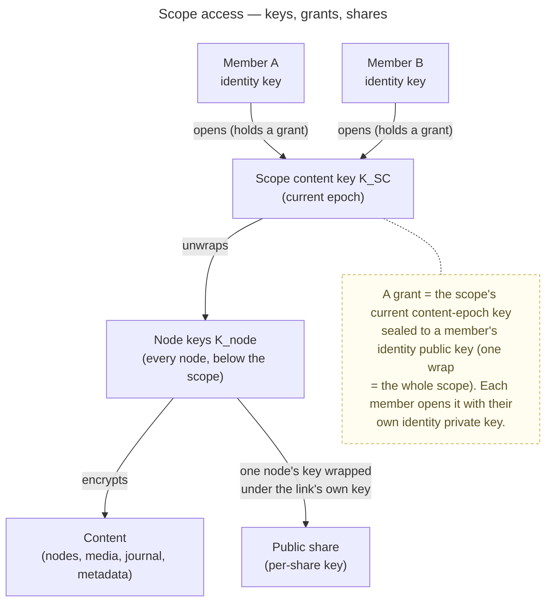

# Scopes & Tenancy

> The structural layer: **where content lives and who may do what with it.** It defines the scope kinds, the
> organizational structures (tenant / group / personal), the roles at each level and the powers each holds, how a new
> member is onboarded (an invite they grant themselves from), and the unified navigation contract. It is the current
> picture of the topic *Scopes, membership, tenancy, governance* in the [ADR index](../decisions/README.md#topics); how
> keys, grants and rotations work is [keys, grants and trust](keys-grants-and-trust.md), and public links are
> [en.sharing.public-link](../features/sharing/enablers/en.sharing.public-link.md). Engineering sibling to the [Security Model](security-model.md) and the
> [Account & Key Model](../features/account/enablers/en.account.key-model.md); byte formats live in the conformance-pinned suite ([`src/packages/crypto/src/v1.ts`](../../src/packages/crypto/src/v1.ts)) and its vectors ([`contracts/crypto/vectors/v1.json`](../../contracts/crypto/vectors/v1.json)), and what every seal binds is [ADR 0072](../decisions/0072-a-seal-binds-its-object.md).

The general **scope identity** (opaque `scopeId` + `kind`) and the per-tenant **personal scope** (client-birthed,
operator-blind) are the enabler [en.spaces.personal-scope](../features/spaces/enablers/en.spaces.personal-scope.md); a
group is [en.spaces.group-scope](../features/spaces/enablers/en.spaces.group-scope.md); the tenant root scope is born
cold by its first owner at activation ([ADR 0006](../decisions/0006-cold-tenant-scope-birth.md)).

Everything in this document is the **platform's** ([ADR 0079](../decisions/0079-veyq-is-a-platform-memories-is-its-first-application.md)):
scopes, memberships, grants, shares and the node tree. The tree is domain-neutral — each node has a `kind`, and
`FOLDER`, `MEMORY` and `CHAPTER` are the kinds that exist today; Memory and Chapter are the **Memories**
application's ([docs/apps](../apps/README.md)). An application is created on demand inside a scope; a tenant
does not activate one.

## Scope — the unit content is keyed on

A **scope** is the unit business data is keyed on, addressed by an **opaque scope ID (UUID)**, never by
name. A **tenant** is the top-level container and carries the domain; the other kinds live **within** a
tenant:

- **`TENANT`** — the tenant's shared root scope. One server hosts many tenants, each with its own domain.
- **`GROUP`** — a collaborative space within a tenant, **no nesting**; all members have equal content
  rights, owners manage membership and settings only.
- **`PERSONAL`** — a member's private space **within a tenant** (one per member, per tenant), born by the
  member's client. Maximum confidentiality; no other key-holder, ever — the member reaches others only through a
  public link.

**Users are global to the server** and may belong to multiple tenants; a user therefore has a **separate
personal scope per tenant**. Because every scope lives within a tenant, it is reached under that
tenant's host — so sharing a private memory yields a link on the **right** domain (a family memory
shared from your personal scope appears under `family.example.com`, never `friends.example.com`). See
[ADR 0002](../decisions/0002-personal-scope-per-tenant.md). The same navigation and key rules apply to
all kinds — the kind changes *who holds keys*, not the model.

## Tenant resolution — by Host

A tenant carries a **domain**. The reverse proxy forwards the request (with its `Host`), and the
backend resolves **which tenant** is meant from that `Host` (a host → tenant mapping). The tenant
context therefore comes from the domain, not from a tenant id or name in the path; **business data
within the resolved context is still addressed by opaque scope/node IDs**. Tenant↔domain is
server-visible operational metadata, so this does not affect operator-blindness.

**The backend resolves the tenant once per request, by one rule.** The header rule (the proxy's
`X-Forwarded-Host`, else `Host`) and the domain lookup live in one place, `src/backend/core/…/core/tenant/`, and
[`validate_lookup_single_home.py`](../../scripts/validate_lookup_single_home.py) keeps it the only one. An
operation receives the **resolved tenant**, meaning its id and its *registered* domain, and never the header
value. Both halves are security properties:
- A gate that normalizes the Host even slightly differently from the handler behind it guards a different
  tenant than the one the handler acts on.
- A domain echoed from the header lets a caller name any origin, for a signed URL or a mailed link. A
  registered domain can only belong to a tenant the table knows.

A Host that no tenant claims resolves to *no tenant*, never to a default one. An operation the Host addresses
(the caller's scope list, their per-tenant profile, a recovery request) acts only within that tenant. The
trap is splitting the two: recovery once chose the relay by the Host but looked the account up across the
whole instance, which put other tenants' links in a tenant owner's mail relay
([ADR 0054](../decisions/0054-password-recovery-two-factor-release.md) §4).

**The header is not a trust boundary, so a client-written `X-Forwarded-Host` is accepted as it is.** The backend
does not need the proxy to strip one. The client writes its `Host` too, and every tenant domain reaches the same
backend, so a request routed as tenant A that names tenant B in `X-Forwarded-Host` gets what a request sent to
B's domain gets. Three things keep that harmless:
- Sessions are account-global and carry no tenant ([ADR 0004](../decisions/0004-session-tokens.md)), so naming a
  tenant gives a request no credential it did not have.
- Every content operation is membership-gated by scope access, whatever the Host says.
- The suspension gate reads the same rule as the handlers, so acting as a suspended tenant means resolving to it,
  and that request is refused.

The residual lies outside the backend. A gateway policy that an operator adds per tenant host (an IP allow-list,
an auth layer, a host-scoped rate limit) can be bypassed by naming that tenant from another tenant's route. So
can a shared cache in front that keys on `Host`. veyq's own projection never builds either: one route per
domain, the same annotations on every route. On Compose the bundled Traefik also drops a client's
`X-Forwarded-Host`. On Helm the operator's gateway may pass it through, and that is the case this paragraph
covers.

Every scope — including personal and group — lives **within** a tenant, so there is no host-less scope:
each is reached under its tenant's host like everything else. This is what keeps share links on the
correct domain (see the scope kinds above and [ADR 0002](../decisions/0002-personal-scope-per-tenant.md)).

## How access works — keys, grants, shares

- **Grant = the unit of access.** A member receives the **scope's current content-epoch key sealed to
  their identity public key** — one wrap grants the whole scope
  ([keys, grants and trust § Grants](keys-grants-and-trust.md#grants-who-wraps-a-scope-key-to-whom)).
  Membership *is* this cryptographic grant; the server stores that a grant exists, not a readable role that
  confers content.
- **Links are least-privilege.** A public link gets only the shared node's key, wrapped under the link's own key
  — never the scope key ([en.sharing.public-link](../features/sharing/enablers/en.sharing.public-link.md)).
- **Group/tenant roles** live in membership rows (`OWNER` / `MEMBER`) and gate *management*
  actions, not content readability — content readability is purely the grant.

## Authorization vs. confidentiality — how the split maps to scopes

The [Security Model](security-model.md#the-one-guarantee) owns the guarantee — *the server enforces
authorization, the client enforces confidentiality with keys it never sees.* Here is how that split lands on
scope architecture:

- **Authorization (server):** the **membership boundary first**, then the key-holder check
  ([ADR 0042](../decisions/0042-http-failure-projection.md)) — checked by small guards (a scope-access guard, a
  tenant-owner guard) on **opaque IDs**, so the server never reads content to decide. The order is the security
  property: a member legitimately knows the scope exists, a stranger must not. Every gate dimension is mapped in
  [cc.security.authorization](cc.security.authorization.md).
- **Confidentiality (client):** only the grant unwraps the scope key, so a member can read a scope **only** if
  they hold one. *Visibility is cryptographic*, not a server promise.

## Membership — the user↔scope relation (role + grant)

Membership is the **relation between a user and a scope**, and it carries **both** axes of the model in
one row: a **management role** (server-enforced) and a **grant** (the scope's current content-epoch key
sealed to the member's identity public key — client-enforced confidentiality). Scope roles are `OWNER` /
`MEMBER` at **every** level ([ADR 0007](../decisions/0007-membership-role-grant-relation.md)); there is no
third scope role. The same shape repeats per scope kind:

| Membership | Cardinality | Role values | Grant |
|---|---|---|---|
| **Tenant** | n-m (user × tenant), on the tenant's root scope | `OWNER` · `MEMBER` | to the `TENANT` scope key |
| **Group** | n-m (user × group, within one tenant) | `OWNER` · `MEMBER` | to the `GROUP` scope key |
| **Personal** | the member alone | `OWNER` | the member's self-grant |

- **Role gates *management*, grant gates *content*.** Promoting a member who already holds a grant is a
  pure role change (no key moves); a role without a grant is a hollow title (can neither read nor invite —
  inviting needs the scope key). See [ADR 0006](../decisions/0006-cold-tenant-scope-birth.md).
- **Several owners, never none.** A tenant and a group may have several owners; removing or demoting the last one
  is refused (`409 last_owner`), counting accepted owners only. A group whose only accepted owner is removed from the
  tenant passes to its oldest other accepted member, and its open proposals expire with a queued rotation; with no
  accepted member left it is tombstoned like a solo group, its proposals deleted
  ([ADR 0014](../decisions/0014-group-scopes-and-governance.md) §6); a tenant left without an owner by an
  erasure waits for the Server Owner's owner invite to one of its members
  ([ADR 0101](../decisions/0101-an-account-is-erased-on-request-and-only-what-the-law-keeps-stays.md) decision 9).
- **Belonging is an accepted row.** A member belongs to a tenant when it holds an accepted membership of the tenant's
  root scope; a group member proposed with consent holds an unaccepted row until it accepts, and is no member to any
  role decision until then.
- **The Server Owner is a separate axis.** `veyq_user.server_role` is `SERVER_OWNER` or `MEMBER`, one per account; it
  is never a scope role, confers no grant and no content, and no scope or tenant gate reads it
  ([cc.security.authorization](cc.security.authorization.md) § The gate dimensions). A Server Owner who is also a
  tenant's owner holds that as a membership like anyone else. Making a second account Server Owner is not built.

## Who may do what

The powers each role holds, as built. *Owner* means an `OWNER` membership of the scope named; a **tenant owner** is
an owner of the tenant's root scope. The mechanics behind a row — what a grant, a rotation or a re-key does — are
[keys, grants and trust](keys-grants-and-trust.md); a link's are [en.sharing.public-link](../features/sharing/enablers/en.sharing.public-link.md).

| Power | Who |
|---|---|
| Create a tenant, suspend, reactivate or delete it, change its domain and quota; invite its first owner | the **Server Owner** — no scope role, no key ([ADR 0006](../decisions/0006-cold-tenant-scope-birth.md), [ADR 0066](../decisions/0066-tenant-suspension.md)) |
| Invite one of a tenant's members to own it | the **Server Owner** ([ADR 0101](../decisions/0101-an-account-is-erased-on-request-and-only-what-the-law-keeps-stays.md) decision 9) |
| Invite a person into a tenant (by email); list, re-issue and revoke invites | a tenant owner, from an unlocked vault |
| Remove a member from the tenant | a tenant owner, by the removal cascade only; never the last owner |
| Give the tenant a new lock (*"re-key this space"*), alone or after a removal | a tenant owner, from an unlocked vault ([ADR 0025](../decisions/0025-forward-secrecy-policy-per-scope.md) § 2) |
| Make a tenant member an owner, or demote one | a tenant owner; never the last owner |
| Set the tenant's terms, mail settings and per-link storage limit; see members' email | a tenant owner |
| Create a group or one's own personal scope | any member of the tenant (a group also needs its capability) |
| Add a tenant member to a group (by username) | a group owner — the tenant owner has **no** power over a group it does not own ([ADR 0014](../decisions/0014-group-scopes-and-governance.md)) |
| Remove a group member | a group owner, as a removal-rotation; never the last owner |
| Make a group member an owner, or demote one | a group owner, of an accepted member (a consent proposal is refused `404 member_not_found`); never the last owner |
| Rename a group or set its icon; delete it into its grace and restore it | a group owner |
| Rotate a scope's key | an owner of the scope, any kind, with a removal on a group only (`400 invalid_request` elsewhere); a non-owner only for a scope its own account's securing left pending, and never with a removal |
| Re-key a node after a rotation | any member holding the current epoch; a drop box, a guest identity folder and below one: an owner of the scope |
| Create a public link; re-activate or re-issue a switched-off link; re-seal the root's name on links | any member of the scope |
| Edit or switch off one link; re-issue an enabled one | that link's owner |
| Switch off every link of a scope | an owner of the scope, any kind |
| Delete a link | its owner; any member once the owner is no longer a member |

**Not built:** leaving a group or a tenant on one's own (a member declines a group proposal; an account can be
erased), and email-inviting someone who is not yet a tenant member into a group.

### Reaching a person — email for outsiders, username within the system

Who you can address depends on whether they already exist on the server:

- **Into a tenant — by email**, the only out-of-band channel: the Server Owner's owner invite and a tenant owner's
  member invite are mailed links, whether or not the person already has an account. The email is **operational
  metadata** the server must hold to send mail.
- **Into a group — by username**, a **per-tenant, unique-within-tenant** handle on the member's tenant profile
  ([ADR 0023](../decisions/0023-per-tenant-member-identity.md)), fully **in-app**; no email needed. A username
  resolves only within the tenant, so person lookup stays **non-enumerable** across tenants.

**Email visibility is a role rule, not crypto.** The owner email is server-visible operational metadata;
the server returns it **only to roles that need it** (a `SERVER_OWNER`, or the tenant's own
`OWNER`) and omits it for ordinary members. Encrypting such server-visible PII **at rest** (under
an operator-held key, so a stolen DB dump leaks nothing) is a **separate** defense-in-depth concern — it
is *not* operator-blindness (the server must still decrypt to send mail), and it must be decided
crosscutting over **all** server-visible emails (including `veyq_user.email`), not per field.

## Onboarding a new member — an invite they grant themselves from

A new member has no identity yet, so an owner's invite holds a grant to an owner-signed invite key and the newcomer
grants itself from it at accept; a group add wraps directly to an existing identity. The mechanism, the join record and
what the server checks are [keys, grants and trust § Grants](keys-grants-and-trust.md#grants-who-wraps-a-scope-key-to-whom).

## Revocation & rotation

Revoking a member is **two-layered** (detail in the [Security Model](security-model.md)):
server-side membership invalidation is **instant** (no keys needed); **rotating `K_SC` forward into
a new epoch** (granted to the remaining members, [ADR 0024](../decisions/0024-scope-key-rotation.md)) is
the defense-in-depth. Already-read content cannot be retracted. **Switching off a link is the first layer only** — it
rotates nothing; a link someone who left could rebuild comes back only by re-issue, with a fresh key
([en.sharing.public-link § Lifecycle](../features/sharing/enablers/en.sharing.public-link.md#lifecycle)).

Who commits a rotation, per scope kind, and who re-keys the nodes: [keys, grants and trust § Rotating a scope](keys-grants-and-trust.md#rotating-a-scope).

## Navigation contract — unified across kinds

One scope-agnostic navigation model serves personal, tenant and group alike — clients never need
separate "personal tree" / "tenant tree" / "group tree" APIs.

- **Server-visible:** scope id + kind; node id, parent id + kind; ordering and timestamps; blinded slug
  tokens; ciphertext/envelope references; grant/membership existence needed to decide visibility.
- **Client-decrypted:** space/folder names, Memory and chapter titles, cover metadata, captions, and the
  canonical path assembled from decrypted names.

Holding a session is **not** sufficient: the client must also hold/unlock the relevant scope keys before
it can decrypt any names or metadata. The operator must not learn private names or paths from navigation.

## Invariants

- Business data is addressed by **opaque scope/node IDs**; the **tenant context is resolved from the
  request `Host`** (tenant↔domain). No tenant or scope *name* appears in the path.
- **No cross-scope move** — moving across scopes is a copy + re-encrypt, not a tree move.
- No cycles; **no folder inside a Memory** (a Memories rule — a kind decides what may nest under it).
- **Slug uniqueness per parent** across folders, Memories and chapters, via blinded slug tokens.
- A personal scope has **no other key-holder**; the member shares from it only through a public link.
- The **same rules apply to all scope kinds**.

## Looking ahead — the Subscription layer (SaaS), parked

The SaaS idea (inbox #41) will introduce a **Subscription** as a billing envelope **between the
deployment (veyq.cloud) and scopes** — operating on operational metadata (counts/bytes), so it does not
touch operator-blindness. **"Tenant" stays the domain-scoped scope kind** (it is *not* the deployment or
the billing unit). Not designed here; refined separately when #41 is pulled.

## Related

- Concepts: [Security Model](security-model.md), [keys, grants and trust](keys-grants-and-trust.md),
  [cc.security.authorization](cc.security.authorization.md) (how each rule above is gated),
  [Account & Key Model](../features/account/enablers/en.account.key-model.md).
- Features: [Spaces](../features/spaces/_index.md), [Sharing](../features/sharing/_index.md),
  [Admin](../features/admin/_index.md).
