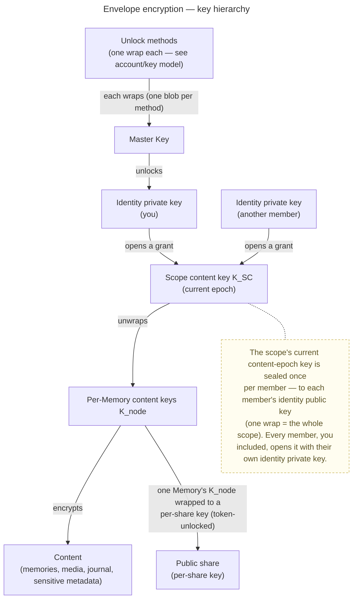

# Security & Encryption Model

> The dominant cross-cutting concept. veyq is **end-to-end encrypted everywhere** — every scope
> (personal, group, tenant). The **server is operator-blind**: it stores ciphertext, opaque
> operational metadata and a blind job queue, and never holds a key that opens content. Every other
> concept — processing, search, sharing, recovery, deletion — is designed around this.
>
> Plain-language companions for end users (docs site): [Is my data safe?](../../site/src/content/docs/privacy/is-my-data-safe.md) and
> [What happens to my photos when quantum computers arrive?](../../site/src/content/docs/privacy/quantum-computers-and-your-photos.md);
> for operators, [Running your own instance](../../site/src/content/docs/run/index.md).
> For a Server Owner handling a reported share: [Moderation](../../site/src/content/docs/run/moderation.md).
> For security researchers, the docs site's Security area: [Start here](../../site/src/content/docs/security/start-here.md), [Threat model](../../site/src/content/docs/security/threat-model.md), [What the server sees](../../site/src/content/docs/security/what-the-server-sees.md), [Cryptography](../../site/src/content/docs/security/cryptography.md), [Key hierarchy](../../site/src/content/docs/security/key-hierarchy.md), [Protocols](../../site/src/content/docs/security/protocols.mdx), [Known limitations](../../site/src/content/docs/security/known-limitations.md), [Roadmap](../../site/src/content/docs/security/roadmap.md), [Reporting a vulnerability](../../site/src/content/docs/security/reporting.md).
> Sibling engineering docs: the [account & key model](../features/account/enablers/en.account.key-model.md), the
> [scopes & tenancy model](scopes-and-tenancy.md); byte formats live in the conformance-pinned suite ([`packages/crypto/src/v1.ts`](../../packages/crypto/src/v1.ts)) and its vectors ([`contracts/crypto/vectors/v1.json`](../../contracts/crypto/vectors/v1.json)), and what every seal binds is [ADR 0072](../decisions/0072-a-seal-binds-its-object.md).

This document is the **target model**. What ships in the first build is tracked via the inbox and
change-requests, not here — with one exception: [§ What holds today](#what-holds-today-on-a-client-the-operator-does-not-serve)
states, per attack, which parts of the model are built against an active operator.

## The one guarantee

A user's **unshared** content is confidential **even from the operator**. The server enforces
*authorization* on opaque identifiers; the client enforces *confidentiality* with keys the server
never sees. Confidentiality is therefore cryptographic, not a server-side access-control promise.

## Threat model & trust boundaries

| We protect against | How |
|---|---|
| Stolen disk / DB dump / subpoena of data at rest | All content E2E-encrypted; the server holds no content keys |
| Passive operator reading the database | Cannot recover content — every blob and sensitive metadata field is encrypted |
| Offline brute-force of a weak password → **content** | **Secret Key (2SKD)**: the unlock KEK derivation folds in a high-entropy Secret Key the server never stores ([account key model](../features/account/enablers/en.account.key-model.md#unlock-methods--kek-derivation)), so a cracked password alone unlocks nothing |
| Offline brute-force of a weak password → **server login** | The server stores only an Ed25519 **auth public key** (not a credential); the raw password never reaches the server. Forging a login means brute-forcing the password through Argon2id — yielding a session + operational metadata, **never content** (see [ADR 0003](../decisions/0003-operator-blind-password-auth.md)). Holding because nothing a session can do leads to a key: admitting a member needs an admission tag only a key-holder computes ([ADR 0020](../decisions/0020-grant-distribution-invite-wrap.md) move 6), and every request that replaces the identity or mints a cold credential needs a signature only the Secret Key derives ([ADR 0060](../decisions/0060-key-rotation-after-compromise.md) Decision 2) |
| The server swapping or replaying ciphertexts between objects | Every seal binds its purpose **and** the object it is stored as, so a ciphertext served for another object fails to open ([ADR 0072](../decisions/0072-a-seal-binds-its-object.md)). **Freshness is not covered:** the server still chooses which authentic version of an object, and which epoch's grant, a client receives |
| **Online** brute-force / credential-stuffing / DoS on the public auth surface | **Per-IP rate limiting** of the public auth endpoints (`@RateLimit(key = IP)` → token-bucket `429`) — defense-in-depth, **honestly limited** (per-instance, resets on restart). Mechanism + verification: [cc.security.rate-limit](cc.security.rate-limit.md) |
| Active operator doing key-substitution during key exchange | **Partly, and honestly limited** — see *Key-directory trust* below |

We do **not** claim immunity to an *actively malicious* operator before key transparency exists; we
state that gap plainly. In a **self-hosted** deployment the operator is the user, so that threat is moot.

### The operator we blind is the *veyq* operator — third-party services are a separate, consented boundary

"Operator-blind" names one adversary: **the veyq server / operator.** It does **not** mean the client never
talks to any external service. A feature may let the client reach a **third party directly** — today the
opt-in **reverse-geocoding** lookup that turns a photo coordinate into a place name
([ADR 0016](../decisions/0016-geocoding-provider-neutrality.md)) and the automatic **breached-password check**
(below), tomorrow map tiles for the tenant map. Such a
request is a **different trust boundary** the user consents to, and it is fenced so it can never widen the veyq
operator's view:

- **Client-direct, never proxied through the veyq backend.** Routing it through veyq's server would hand the
  operator the coordinate — so these requests go **straight from the device to the provider**. Proxying is
  explicitly disallowed.
- **No veyq identity, no content context.** The provider receives only what its function needs — a bare
  coordinate (+ the client IP) — never a user id, a Memory id, or any veyq token.
- **Opt-in + transparent — and opt-in is standing consent** (one stated exception: the breached-password check,
  below). Off by default; enabling it is an explicit choice
  with a plain-language note that a request leaves the device. Once enabled it may run **automatically** (e.g. a
  reverse lookup on the first geotagged media of an auto-location) — enabling it *is* the consent to those
  requests; it **never** fires without opt-in. A blind, request-free alternative stays available (e.g. typing a
  place name).
- **Results are sealed content.** Anything fetched (e.g. a resolved place name) is sealed into the node's meta, under
  a field key derived from `K_node` like any other field — so it is shareable to other members **without their device making a request**, and the veyq
  operator still sees only ciphertext.

**The breached-password check is the second instance, and the one exception to opt-in.** The four dialogs that
choose a password (set up the server, join a tenant, change a password, recover access) ask the Have I Been Pwned
range API whether the password appears in known breaches. The fences apply like this:

- **Only a 5-hex SHA-1 prefix leaves the device** (k-anonymity, padded response); the match against the returned
  suffixes is computed locally.
- **Over a finished password only — when the field is left, and on submit — never while typing.** A query at every
  typing pause (a debounce) sends the prefix of each *partial* password. A short one, or a few keystrokes added to one
  already recovered, has so few candidates that its 20-bit prefix all but identifies it, so the sequence hands over
  the password a few keystrokes at a time. Leaving the field is when a person treats the password as done, so the
  check runs then (owner decision 2026-10-14), and once more on submit when the password changed since; every query
  is a whole candidate, never a fragment.
- **Automatic, not opt-in** (owner decision 2026-10-14). It is the one third-party request that runs without consent,
  and the reason is what crosses: a 5-hex prefix carries no content and no identity, where a geocoding request
  carries the coordinate itself. **What it does disclose, stated:** the browser's `Origin` header names the veyq
  instance, so HIBP (and the CDN in front of it) learns that this IP uses this instance and is choosing a password.
  The docs site says so, in [Is my data safe?](../../site/src/content/docs/privacy/is-my-data-safe.md) and
  [Change your password](../../site/src/content/docs/account/change-password.mdx). A one-sentence note under the password field says what leaves the device.
- **Its address is the Server Owner's** ([ADR 0088](../decisions/0088-the-capability-register-is-a-tree-switched-by-operator-and-tenant.md)
  decision 7): the register entry `core.breached-password` carries it, a new instance starts with the HIBP range API, a
  mirror can replace it, and an instance with none configured (or the entry switched off) runs no check at all, sends
  nothing and says nothing.
- **It advises, never gates.** A hit shows a warning that needs an **explicit "Use it anyway"** before the dialog
  submits that password; the result is not stored. **A check that could not run** (offline, firewalled, the admin
  container with no route out) **does not stop anything**: the dialog submits and says, in one line, that the
  password could not be checked. Stopping there would block every password choice on an instance with no
  internet, for a check nobody opted into.

**Verification:** [`passwordWarning.test.ts`](../../web/src/features/account/passwordWarning.test.ts) (identical
in `admin-web/`) pins the rule on the request itself: nothing while typing; one prefix of the finished password on
blur; no second request for an unchanged blur; a password changed since is queried again on submit; nothing for a
password the policy refuses; a hit blocks the submit until "Use it anyway"; an edit clears that acceptance; a check
that could not run goes ahead. Each dialog's own test (`ChangePasswordPanel.policy`, `TenantJoinView.passwordPolicy`,
`RecoverView`, admin-web's `SetupView`) pins that its password field's blur runs the check, that its submit awaits
it, the note and the one line for a check that could not run; `TenantJoinView.passwordPolicy` also pins that the
sign-in password, which chooses nothing, is never sent.

So the veyq operator stays blind by construction; what crosses goes straight to the provider, never through veyq: a
consented, identity-free request the **user** turned on, or the breached-password check's 5-hex prefix.

## What is encrypted vs. server-visible

- **Encrypted (server-blind):** media bytes and all derivatives; journal text and embeds; sensitive
  metadata — titles, captions, descriptions, places, people/faces, participant relationships, tags;
  track and playlist details; GPS and capture time (sealed client-side, never read off the file); a blob's
  **type, upload name and modification time** (the `blob-meta` seal under the blob's own `K_blob`, declared once at
  the upload and never rewritten — padded to a 256-byte bucket, so its length tells the operator one of four sizes,
  never how long a name is; the plaintext size and upload time are left out because the server already observes
  both — the size on the blob row, the upload time live and in the object store's own write time of each chunk;
  a Memories original's file name and media type — photo, video or PDF — live there, so the operator learns neither).
- **Server-visible (low-sensitivity operational metadata):** existence and IDs of memories, media and
  shares; scope and membership (who belongs to which tenant/group); a member's **per-tenant username,
  identity public key, and group-add-consent flag** — visible to, and effectively **enumerable by**, any
  fellow tenant member (anyone can create a group to run the member-resolve, [ADR 0014](../decisions/0014-group-scopes-and-governance.md) §5);
  whether a member **has a profile picture** and how often it changed (`avatar_revision`; the picture itself is a
  constant-size sealed blob, [ADR 0084](../decisions/0084-a-members-profile-picture-is-a-sealed-attribute-of-their-tenant-profile.md); contract, crypto and backend built, the web client not yet);
  server timestamps (created, changed, trashed, last rotated) for ordering — stored as written, to the second (a
  medium's change time and a node's creation time to the millisecond — the latter served to members on the node
  listing, `NodeSummary.createdAt`, as the order equal-named siblings are told apart by, [ADR 0015](../decisions/0015-operator-blind-readable-urls.md)); nothing rounds them, so they tell *when*, never *what*.
  **A time is stored only where something reads it** — a sort, a purge or expiry cutoff, a served field, or,
  named as such, an operator reading the database for audit evidence (inbox #318; the root test
  `EveryStoredTimeHasAReaderTest` names each stored time's reader and turns red on one without).
  So the database does **not** hold when an account, tenant, tenant profile, scope, blob, upload session, attachment
  or medium's derivative was created, when a share link was deleted (its tombstone is a flag), a medium's creation
  apart from its change time (which starts at the attach, inbox #398), when a scope's key epoch rotated, when a member re-sealed
  their favorites, device register or identity pins, when a share guest joined, when a job was declined, or when
  first-run setup completed; the request time the server observes live is not kept for them. What it does hold, by
  reader: session family creation + last refresh (served), token/challenge/invite/share/recovery/pairing/
  confirmation expiries, a recovery/pairing/confirmation/invite/job/reclaim row's creation (purge or order), a
  membership's creation (the orphan rule's successor), a node's creation (served) and trash time, a group's and a
  medium's trash time and a medium's change time (cursor + purge; set at attach, so also its creation), a bucket's
  creation (order), a share's creation (served), `email_confirmed_at` (its presence shows "confirmed"; the time is
  [ADR 0074](../decisions/0074-address-control-is-recorded-where-nothing-else-proves-it.md) Decision 1's record,
  kept by decision, inbox #398), and when a member accepted each terms revision they
  accepted (a history, one row per revision — audit evidence, served by no API — below); sizes; job-queue and op-log offsets; presence facts; a media
  item's **trash state** (a trashed flag + who trashed it + when, until the scheduled purge); a media item's
  **uploader attribution + bucket structure** (an opaque `owner_key` per medium — `user:{id}` / `share:{id}` —
  plus its `bucket_id` and the bucket rows' shape: node, parentage, `is_primary`, per-bucket counts; the
  bucket/uploader **names stay sealed** under a field key derived from `K_node` — a WRITE_ONLY guest's from its own key, [ADR 0034](../decisions/0034-media-uploader-buckets.md),
  [ADR 0031](../decisions/0031-uploader-public-share.md) point 7); a Depot file's **uploader attribution** (the member
  or guest identity that uploaded its current content, on its attachment - served to members only, as `uploaderKey`
  `user:{id}` / `share:{id}`; [ADR 0083](../decisions/0083-memory-participants-are-a-sealed-list-in-the-memorys-metadata.md) Decision 8);
  the **last editor of each sealed field group** — a node's name and meta, a share's name, note and private label, a
  group's name and icon, a bucket's name, a medium's meta: the member or guest identity whose write the ciphertext is,
  served to no client and never what was written ([ADR 0093](../decisions/0093-a-report-opens-one-window-for-the-moderator-and-a-hold-copies-never-blocks.md)
  § 8, [en.platform.field-editor](../features/platform/enablers/en.platform.field-editor.md));
  while the Server Owner keeps it switched on (off by default in the *private* operating mode), the **guest-write
  record**: per write a link's guest makes that enters it as a last editor, the client address of core's one resolver
  (never one the client chose, [ADR 0094](../decisions/0094-a-clients-address-is-the-hop-the-network-vouches-for.md)),
  its source port where known and the time to the millisecond, with the guest identity and the object — kept N days
  (1 to 30, default 7), copied by a hold, left out of the instance backup's rows; never a member's write, a read, a
  User-Agent or content ([ADR 0093](../decisions/0093-a-report-opens-one-window-for-the-moderator-and-a-hold-copies-never-blocks.md)
  § 10, [en.moderation.guest-write-record](../features/moderation/enablers/en.moderation.guest-write-record.md));
  per-parent blinded tokens; to a **public share's guest**, the shared node's **scope id** — every `K_node` seal the
  viewer opens is bound to it ([ADR 0072](../decisions/0072-a-seal-binds-its-object.md)), so it rides with the
  subtree, and two links into one space are therefore linkable by anyone holding both (the ids of the shared
  node and its media already made the subtree linkable; the scope id extends that to sibling Memories of one
  space); the tenant's **terms text + `terms_revision`** (the space owner's *public* policy,
  served to everyone incl. pre-auth) and a member's **accepted terms revisions** and **when they accepted each**
  (one row per accepted triple — the space's revision, the operator section's revision and its variant — never
  overwritten; `accepted_at`, the server's own clock, written once per revision — audit
  evidence for a dispute, also about a superseded revision; restored by owner decision 2026-10-09 after #318 had
  dropped it, kept as a history since #402) (acceptance metadata, like membership — never content, [ADR 0035](../decisions/0035-server-terms-of-service.md)); the **account email**
  (plaintext — the login identifier and the source of the deterministic auth salt,
  [ADR 0003](../decisions/0003-operator-blind-password-auth.md); named here to close a prior inventory gap); a
  tenant's **per-tenant SMTP config** (host/port/from/username/TLS + the owner-authored invite **template text** —
  operator-visible operational config) and the **send-fact** of every mail veyq sends — a member invite, a
  password-recovery link and an address confirmation (recipient + send time, once a tenant has configured
  SMTP), plus the account's **`email_confirmed_at`** (when its holder last showed they read that address —
  operational metadata of the address's own class, gating nothing,
  [ADR 0074](../decisions/0074-address-control-is-recorded-where-nothing-else-proves-it.md)), while the SMTP **password is a server-held secret sealed at rest** (AES-256-GCM
  under a server-managed KEK — ciphertext + nonce only, [ADR 0050](../decisions/0050-operator-config-secret-encryption.md):
  the KEK is a `0600` key **file** generated on first start, plus a non-invertible HKDF **fingerprint**
  of it on the instance singleton so a lost/changed key is detected, never a silent unseal — the fingerprint is a
  hash of a full-entropy key, not the key, so the "no usable secret in a DB dump" property holds); a mail itself
  carries only link + domain + expiry + neutral copy, never sealed metadata
  ([ADR 0049](../decisions/0049-email-delivery-boundary.md)).
  The **instance's own mail settings** are of the same class (host/port/from/username/TLS, the password sealed the
  same way, the hash of the outstanding confirmation code, and which address the Server Owner confirmed and when), and
  so is the **release check** — its switch, its source, its last success and the notices it found, which describe
  published software only ([ADR 0097](../decisions/0097-an-instance-looks-for-new-releases-and-mails-its-server-owner.md)).
  Its daily request names no release, and the notice mail carries release numbers, a date and a link, no user data.

**Applications widen what is visible by one fact: the node `kind`.** The kind of every node is a server-visible
column already (`FOLDER`, `MEMORY`, `CHAPTER`, `FILE`, `DEPOT_DROPBOX` today). Once an application adds kinds, it also shows the operator
**which applications a scope uses**, and the rows, timestamps and sizes each kind produces
([ADR 0079](../decisions/0079-veyq-is-a-platform-memories-is-its-first-application.md)). Each application's concept
doc lists the further metadata its own kinds expose ([docs/apps](../apps/README.md)).

These operational fields are exactly what lets the server **sort, paginate, route, authorize and
bill** without decrypting. It is a conscious trade-off: a stricter "encrypt operational metadata too"
mode is possible at the cost of those capabilities. The server never sees content — only structure.

**One access-pattern finer than a per-blob timestamp is knowingly conceded, for range-streamed video playback.**
Every non-streamed read fetches a blob **whole**, so the operator normally learns only *that* a blob was accessed.
Playing a video streams it **range by range** ([ADR 0047](../decisions/0047-inline-video-playback-range-streaming.md)):
the object store then observes **which ciphertext chunks a playing client fetches, and when** — an *intra-media*
access pattern (which parts were watched, re-watched, skipped, seeked to), more granular than the
timestamps or sizes above. The owner accepted this for playback: hiding it would mean either downloading the whole
original first or proxying bytes through the server (breaking operator-blindness). It is scoped to playback and
changes nothing about content, which the server still never reads. A **file download** streams through the same
key-free Service Worker ([ADR 0047 § The download route](../decisions/0047-inline-video-playback-range-streaming.md#the-download-route))
but reads every chunk in order, so it shows the operator no more than a whole-blob read.

This split is written in *kinds*; the contracts are written in *field names*. [ADR 0044](../decisions/0044-field-visibility-declared-at-the-field.md)
is what connects them: every field in `contracts/api/` declares which of these kinds it is, or the build fails.
This section stays the reason; the ADR carries the mechanism and does not restate it.

## Central axis: shared vs. unshared

The deciding property for risk is **whether content is shared**, not which scope it lives in. A
personal memory that is publicly shared becomes "shared" for these purposes.

| State | Meaning |
|---|---|
| **Unshared** | Only the owner's keys. Maximum confidentiality; the one guarantee applies in full. |
| **Shared** (group, tenant, public view, public uploader) | Content keys wrapped to other parties by the owner's explicit, informed action. Confidentiality from the *operator* still holds; from the *recipients* it is intentionally given up — except from a public uploader, who is handed no content key at all, only the Memory's drop public key ([ADR 0031](../decisions/0031-uploader-public-share.md) point 7). |

## Key hierarchy (envelope encryption)

Content is protected by layered envelopes so grants are cheap and shares are least-privilege. The
byte-level detail lives in the conformance-pinned suite ([`packages/crypto/src/v1.ts`](../../packages/crypto/src/v1.ts)) and its vectors ([`contracts/crypto/vectors/v1.json`](../../contracts/crypto/vectors/v1.json)), and every seal binds the object it belongs to ([ADR 0072](../decisions/0072-a-seal-binds-its-object.md)); account-level detail (unlock methods, recovery) in the account/key
model. The shape:

- **Cheap grants, scoped shares.** Adding a member = one seal of the scope's current content-epoch key to
  their identity (an X-Wing encapsulation to their identity public key, then AES-256-GCM under the derived key;
  [Cryptographic stance](#cryptographic-stance)). A public share = one node's content key (a Memory's, a chapter's or a folder's —
  [ADR 0080](../decisions/0080-every-node-carries-a-key-a-folders-key-behaves-like-a-memorys.md)) wrapped to a per-share key. **Revoking a member
  = rotate `K_SC` forward into a new epoch** granted to the remaining members
  ([ADR 0024](../decisions/0024-scope-key-rotation.md)); already-read content cannot be retroactively pulled
  back (a documented limitation). The concrete per-Memory key model — `K_SC` (scope), `K_node` (per Memory, the
  random, many-wrapped **share grain**), `K_blob` (per blob) — is pinned in
  [ADR 0012](../decisions/0012-content-key-hierarchy.md).
- **A field seals under a key of its own.** Every text or icon field — a node's name and meta, a medium's two
  metadata tiers, a bucket's name, a guest's display name, a share's note, name and label, a member's name and
  picture — seals under `K_field = HKDF(K_parent, salt, "veyq/v1/field/<purpose>")`, where `K_parent` is the key the
  field belongs under (the parent's `K_node` for a name, the node's own for its meta, `K_share`, `K_tenant`) and the
  16-byte salt is fresh per write and travels in the field's envelope (all the server learns: one random salt per
  write, nothing about a key). One revision's `K_field` opens that revision
  of that field and nothing else, which is what a report of a field will hand over
  ([ADR 0093](../decisions/0093-a-report-opens-one-window-for-the-moderator-and-a-hold-copies-never-blocks.md) § 9,
  [en.platform.field-key](../features/platform/enablers/en.platform.field-key.md)).
- The identity private key is protected by the **Master Key**, itself wrapped **separately by each
  unlock method**. Adding or removing a method changes one wrap, never the content.

## Applications are compiled in — never loaded

veyq's applications are first-party and built into the release; there is no runtime loading of application code
on the server or in the client. Code running in the client reaches every key of the user's unlocked scopes, so a
way to add code after the fact would be a way to read everything, and the release identity
([ADR 0057](../decisions/0057-release-identity-and-deployment-recipe.md)) and the client trust tiers
([ADR 0026](../decisions/0026-client-trust-tiers.md)) would no longer say what runs
([ADR 0079](../decisions/0079-veyq-is-a-platform-memories-is-its-first-application.md) Decision 5).

**Known gap, per application:** the server holds an application's entries and chooses what it serves. Binding an
entry to its object ([ADR 0072](../decisions/0072-a-seal-binds-its-object.md)) does not bind it to its
neighbours, so for an append-only application (a ledger) a server can **drop or reorder** entries unless a
sequence number or hash chain is bound into each entry's associated data. That is the same limit as freshness
above, and each such application states it in its concept doc ([docs/apps](../apps/README.md)).

## Cryptographic stance

Standard, well-reviewed primitives only (no home-grown crypto); **post-quantum from the start** for encryption
(a hybrid KEM, secure if either component holds) because decade-lived memories make harvest-now-decrypt-later
real, while signatures stay classical for now; and **crypto-agility** via a versioned suite id, so upgrades never
break old data. The hybrid KEM is **X-Wing** (X25519 + ML-KEM-768, `draft-connolly-cfrg-xwing-kem-11` — an
individual Internet-Draft, not an RFC) through `@noble/post-quantum`, held to the draft's own published test
vectors; a wrap to a public key is X-Wing, then HKDF-SHA256 over the seal's context into an AES-256-GCM key —
HPKE-like in shape, **not** RFC 9180 HPKE. Built today, the suite id is stored **per account** (`veyq_user.suite_id`) and bound into every wrap's
authenticated data (`wrapAad`), not carried in the bytes of each artifact — enough while one suite exists, so a
second suite has to bring a per-artifact label first; nothing re-wraps old data onto a newer suite. Content itself is
AES-256-GCM alone; the hybrid KEM wraps keys. The strategy, its rejected alternatives, and the conformance
vectors that pin a suite's bytes are all
[ADR 0017](../decisions/0017-crypto-primitives-and-post-quantum-strategy.md).

## Names & blinded tokens

Names (folders, memories, chapters, files) are encrypted, yet navigation uses human-readable permalinks. One
server-blind token makes this work without the server ever seeing a name:

- **Slug token** — `HMAC-SHA256(slugKey, NFC(fold(name)))`, with
  `slugKey = HKDF(parentKey, "veyq/v1/slug-token:" + parentSlot)`. It is keyed by the **parent node's content
  key** (`K_SC` at the root) and the parent slot (the parent's node id, or the scope id at the root), so the same
  name under two parents yields unrelated tokens
  ([ADR 0080](../decisions/0080-every-node-carries-a-key-a-folders-key-behaves-like-a-memorys.md) Decision 2;
  `slugToken` in [`v1.ts`](../../packages/crypto/src/v1.ts), vectors `slug_token` and `directory_entry`).
  `fold` is the node kind's slug function — `slugify` for containers, `fileNameSlug` for files — and is frozen into
  every stored token. The server enforces uniqueness per parent (`UNIQUE(parent_id, slug_token)`) without seeing
  names. A keyed MAC (not a plain hash), so the operator — lacking the parent's key — cannot reverse low-entropy
  slugs; whoever holds that key (a member, or a guest of the Memory it belongs to) can. It is a **consistency aid,
  not an authenticity control**: the client computes it; the server cannot recompute it.
- **No content dedup.** Content dedup is **declined**
  ([ADR 0013](../decisions/0013-blob-storage-presigned-direct-to-store.md#5-no-content-dedup)): every blob has a
  random `K_blob`, so identical bytes are two ciphertexts and two stored objects, and the server learns no content
  equality inside a scope. Any dedup that saves storage must let one stored object serve several references, which
  shows the operator that two blobs are the same — the leak that was declined. The suite still pins a keyed
  `dedupToken` (vector `dedup_token`), but no client calls it; [ADR 0024](../decisions/0024-scope-key-rotation.md)
  says how a future dedup slice would key it across epochs.

## Sharing & share-boundary Trust & Safety

- A **public share** wraps the subtree's content keys to a per-share key. The **share secret lives in
  the URL fragment (`#…`)** and never reaches the server. Anyone with the link decrypts client-side.
- **Trust & Safety operates at the share boundary**
  ([ADR 0093](../decisions/0093-a-report-opens-one-window-for-the-moderator-and-a-hold-copies-never-blocks.md)). A
  report carries a report share for exactly what was reported, sealed to the **instance moderation key**, so the
  operator side **can decrypt what was reported, and nothing else**, to verify, hold evidence and act; an
  authority's order acts on ids without a report. That key is one key in epochs, granted to each **moderator** the
  Server Owner appoints (the Server Owner among them) and rotated forward when one leaves
  ([ADR 0099](../decisions/0099-moderators-share-one-instance-moderation-key-and-review-without-a-vault.md)).
  Review and decisions run in `web/`'s moderation surface, gated by a `MODERATOR` role **and** a signature with
  the moderation key, and the page that renders a report holds that key and nothing of the moderator's vault. A
  moderator blocks a share, its content or a guest uploader; blocking a member and taking a tenant offline stay
  the Server Owner's. A second moderator reviews an objection where there is one. Against the operator this is
  accountability, not a control: the Server Owner owns the server and the roster, and the surface is
  operator-served, passive-operator-safe only ([ADR 0026](../decisions/0026-client-trust-tiers.md)).
  **Built today: the intake, the review and the measures.** A member or a guest reports what they see: their client
  seals the report share and their text to the current epoch — their address apart, so it can go alone six months
  after the decision was told — the server stores the category, time and ids in the
  clear, opens one case per item and takes a **hold** — a copy of the reported rows and a pin on their store objects
  that the reclaim sweep skips, so a delete after the report removes the item for everyone but the moderators
  ([uc.moderation.report](../features/moderation/use-cases/uc.moderation.report.md),
  [en.moderation.hold](../features/moderation/enablers/en.moderation.hold.md)). A moderator lists the queue in clear
  fields, opens a case's sealed reports in the browser, and reviews the held snapshot in the share viewer's moderation
  mode on the reported tenant's host, over moderation reads behind the role and a key proof per operation and case that
  serve only the hold's ciphertext and log an *opened* event per fetch — never a guest endpoint, a link's password or
  a scope client ([uc.moderation.review-a-case](../features/moderation/use-cases/uc.moderation.review-a-case.md)). The
  decisions are rows by id that delete nothing and lift by closing the row: dismissing (the hold ends at once),
  extending a hold with a sealed reason, barring a reporter, and the measures — a link blocked (every guest path answers
  as an unknown link), content blocked (`451 blocked_by_operator` on every byte path, the two `presignGets` callers held
  by `PresignGetsHonourContentBlocksTest`, listings marking it), a guest uploader blocked with its link — while a
  member's sign-in block (every session ended, every sign-in refused) and a tenant's suspension are the Server Owner's,
  on the admin channel, taken or declined from a moderator's proposal
  ([uc.moderation.take-a-measure](../features/moderation/use-cases/uc.moderation.take-a-measure.md)). Measures are clear
  metadata, since the server must refuse what they name; notes and reasons are sealed (`moderation-note` [epoch,
  caseId]). A moderator's measure carries its **statement of reasons**: the ground in the clear, the facts sealed twice
  in the moderator's browser — to the moderation key, and to each affected member's identity (`moderation-facts`
  [caseId, accountId]) — so the affected read them on the placeholder and the server holds neither in the clear; the
  instance mail tells them it is there, never the facts. An affected member **objects** once per measure, sealed to the
  moderation key (`moderation-objection` [epoch, statementId]); the server refuses its decision from the moderator who
  took the measure while another holds the key ([uc.moderation.object-to-a-measure](../features/moderation/use-cases/uc.moderation.object-to-a-measure.md)).
  The identity a moderator seals the facts to is the one the server serves, unpinned — the moderation surface holds no
  Master Key to read a pin store — which costs nothing against the operator: the Server Owner holds the moderation key
  and reads the log's copy of the same facts anyway. An **authority's order** acts on ids without a key: entered by a
  moderator with the key proof or by the Server Owner on the admin channel, its reference sealed by the entering client
  to the moderation key's public half (`moderation-order` [epoch, orderId]), it blocks a link and its content and holds
  them to the end it sets; an **Art. 18 export** carries only the clear fields the server holds — held metadata and the
  guest-write record — never content ([uc.moderation.authority-order](../features/moderation/use-cases/uc.moderation.authority-order.md),
  [uc.moderation.report-to-an-authority](../features/moderation/use-cases/uc.moderation.report-to-an-authority.md)).
  A child-sexual-abuse case's hold ends at the recorded handover, at the latest 90 days after the report; no measure
  or statement keeps it longer (§ 184b(5) StGB). **Retention:** a closed case's records — reports with their sealed
  parts and report shares, measures, statements, objections, orders — go with its log at 31 December of the third year
  after the close, never while a measure of it is in force ([en.moderation.log](../features/moderation/enablers/en.moderation.log.md)).
  Not built, open legally: a hold until the handover beyond 90 days, and an authority's link to a held copy. No
  moderation path has run on a deployed instance.
  The fixed **operator section** every space's terms carry
  states all this to members and guests — the notice path, what is kept, the measures, the statement and the
  objection, in the club, organisation or company mode the authorities, and while the guest-write record is on its
  GDPR Art. 13 information — veyq's text filled with the operator's published values, public without an account
  ([ADR 0035](../decisions/0035-server-terms-of-service.md) decision 6); it is a draft until a qualified legal review.
  Each field revision seals under a `K_field` of its own, which opens nothing else, so a report hands over exactly
  the revisions it names ([en.platform.field-key](../features/platform/enablers/en.platform.field-key.md)).
- **Consequently:** private (unshared) content is **unscannable** by design; public shares are
  decryptable-on-report — notice-and-takedown works exactly where content is distributed.
- **A guest's write keeps where it came from, briefly** ([en.moderation.guest-write-record](../features/moderation/enablers/en.moderation.guest-write-record.md)).
  A link guest has no account, so the evidence a report about its upload can carry is the connection: while the
  Server Owner keeps the record on, each write that enters a guest as last editor stores the client address the
  network vouches for, its source port and a millisecond time, for N days (1 to 30, default 7); a report's hold copies
  the rows of what it concerns. Guests are told before their first write, with N and the right to object, and linked
  to the full Art. 13 text in the operator section of the terms. The record
  adds operator-visible metadata about guests, never content, and nothing about members or readers; an address
  without a port may name no single subscriber behind carrier-grade NAT, and on Helm the address is only as strong as
  an enforced NetworkPolicy ([ADR 0094](../decisions/0094-a-clients-address-is-the-hop-the-network-vouches-for.md)
  decision 6).
- **A link's id alone opens no write.** The share id is stored raw (members rebuild links from it, seals bind it,
  every guest request path carries it), so a database copy or an access log holds every id. Naming yourself as a
  guest — the one write the id used to open — presents a token derived from `K_share`, of which the share keeps only
  the hash; without the fragment no guest is named and nothing is uploaded
  ([ADR 0076](../decisions/0076-a-guest-write-proves-it-holds-the-links-key.md)). Reads by an id holder stay
  possible and serve ciphertext only. A layer-1 control: the operator, being the server, could write anyway.
- **Revocation is soft, and independent of scope rotation.** Disabling a share / expiry stops *new* access;
  already-downloaded content is not retractable. A scope key rotation (a member removal) does **not** revoke a
  share — a shared `K_node` is wrapped independently of `K_SC` — so shares are revoked **separately** (a removed
  member with the link keeps reading until then). The no-install web viewer is operator-served, so it is
  **passive-operator-safe** (the client-integrity tier, [ADR 0026](../decisions/0026-client-trust-tiers.md)), not
  operator-proof against a *foreign* operator; the viewer surfaces this honestly via a footer link here.
- **Full mechanism:** the [Sharing](../features/sharing/_index.md) feature
  ([ADR 0029](../decisions/0029-public-viewer-share.md) — the public share resource + anonymous access path; a
  Memory of any scope the curator belongs to, §6).
- **An editable curator note (+ private name)** rides the same blind path: an optional **per-locale** message the
  sharer attaches (sealed under a field key derived from `K_share`, rendered on the share page in the viewer's
  locale) and an optional **private name** (the same, a **management-only** label the viewer never receives). To make them
  editable **in place**, the share also stores `sealed_share_key` — a recoverable copy of the per-share key sealed
  under the scope key **`K_SC` at the scope's current epoch** (stored with that epoch), openable **only with `K_SC`**,
  which neither the operator nor any share link holds, so `K_share` never enters the operator's reach. The
  conscious consequence: a **scope member** can now **derive** `K_share` for that Memory's shares — harmless (they
  already read the content, and revoke stays owner-gated). It is deliberately *not* every `K_node`-holder: a READ or
  READ_WRITE link holds `K_node`, and a copy under it would open every sibling share's password, label and note to
  that link plus a dump. Recorded in [ADR 0036](../decisions/0036-editable-share-note-recoverable-share-key.md)
  point 4.
- **A link a departed member could copy is re-issued, never revived**
  ([ADR 0075](../decisions/0075-a-link-a-departed-member-could-copy-is-reissued.md)). Every member can rebuild
  **every** link of a Memory from its recovery copy, so a member removed from a group or the tenant may hold every
  link that existed on its Memories while they belonged — and using one needs **no dump**: against an honest server
  the link is a bearer capability, and `K_node` never re-keys. A **re-issue** (one request, one transaction: a new
  id and a fresh `K_share` carrying the old settings, the old link deleted) is what cuts them off. Re-activation is
  refused (`reissue_required`) for a share whose owner has left, whose copy predates the scope's current epoch or
  its last member removal (a scope counts its removals, because the tenant never rotates on one), or that a bulk
  switch-off marked — every link of the space, one already off included; a group or tenant removal can opt to turn off every link of its space in the same
  transaction, and any owner of a space can do so at any time. This is the
  **honest-server** cut: with a dump the departed member already holds `K_node` and reads the Memory whatever the
  link does — the ADR 0012 class.
- **An optional share password** is an **operator-blind access-control gate**, *not* a cryptographic one
  ([ADR 0037](../decisions/0037-password-protected-shares.md)): the content stays E2EE under the unchanged
  `K_share` fragment, and the password gates **what the server serves** (a locked resolve returns only the
  challenge; no `wrap`/name/note/media without a valid token) — the same shape as the `contributorToken`. The
  server holds only `password_required` (coarse metadata) + `pw_salt` + `pw_verifier` (= `SHA-256` of the
  client-side `Argon2id(pw)` token) + `sealed_password` (one more opaque `K_share`-sealed ciphertext, a
  curator-only reveal copy) — never the raw password. **Honest limit:** it defends a **leaked link against an
  honest operator** (the realistic self-hosted / trusted case), not a malicious one who could bypass the check and
  serve ciphertext to a colluder holding the fragment — the same posture as the passive-operator-safe web viewer
  ([ADR 0026](../decisions/0026-client-trust-tiers.md)). A crypto-gate (fold `Argon2id` into the key) is a
  documented future upgrade.
- **The accountless-visitor terms acceptance is client-only** ([ADR 0035](../decisions/0035-server-terms-of-service.md)
  §3, [uc.sharing.share-accept](../features/sharing/use-cases/uc.sharing.share-accept.md)): before viewing, an
  account-less share visitor accepts the space's terms, but the acceptance lives in **localStorage** (per
  tenant, holding the accepted revision with the operator section's revision and variant) — the server records **nothing** about the visitor, so opening a share stays anonymous. The
  terms are **public operational content** (no blindness cost), served from the *share* via a guest
  `GET /api/shares/{shareId}/terms` keyed on the non-enumerable `shareId` (no `tenantId` existence oracle). It is an
  **operational gate, not enforcement** — bypassable by an accountless visitor and no legal-non-repudiation record;
  the operator's real remedy for a public share is the **decryptable-on-report** review-and-removal path above, not
  this prompt.

## Key-directory trust — TOFU pinning + out-of-band verification ([ADR 0028](../decisions/0028-identity-authenticity-tofu-verification.md))

Wrapping a content key to "Bob" needs Bob's identity public key, which the operator-blind server relays
from its directory. A malicious server could serve an attacker's key instead (key-substitution / MITM)
and read what is wrapped to it. The defense is **trust-on-first-use pinning + safety-number verification**:

- **Pin on first use (TOFU).** The first time a client wraps to Bob's identity key it **pins** the full
  identity public bundle (`kem`, the X-Wing encapsulation key over X25519 + ML-KEM-768, + `sign` Ed25519), keyed by `userId`, and
  proceeds (*pinned, unverified*). The **pin store is client-side, synced across the user's devices, and
  sealed under the master key** — the server never sees a pin or the who-trusts-whom graph (operator-blind).
- **A key change is surfaced, split by whether a human is present.** A key ≠ pin is "**attack OR a
  legitimate identity rotation**" ([ADR 0060](../decisions/0060-key-rotation-after-compromise.md)),
  indistinguishable on-wire. In the **UI** it is
  a **notice** (not a lock-out); the user reviews and, on **accept**, re-pins. The **automated grant-delivery
  worker** (no human) **blocks** — it will not wrap `K_SC` to a changed key (delivery is irreversible) — and
  **declines the job** back to the server (`identity_changed`). The human review is the UI's changed-key review:
  accepting there re-pins and clears that account's declines, so the next claim delivers.
- **Verification** is the **identity fingerprint / safety number** — a deterministic digest of the identity
  public bundle. Two users compare it out-of-band; the ergonomic form is **QR** (scan the other device's
  fingerprint → the app compares it against the pin → feedback). It elevates *pinned* → *verified*. **Built on
  the member's profile** ([uc.spaces.enforce-verified-identities](../features/spaces/use-cases/uc.spaces.enforce-verified-identities.md)):
  each member shows their own number and a QR of its digest; another member scans it or compares the digits, and a
  match marks them verified (pinning an unpinned member with the compared key). The changed-key review is still how a
  legitimately rotated key is accepted — as `pinned`; *verified* returns only through a new compare.
- **Opt-in strict mode** turns the change-notice into a **hard block** and requires *verified*-before-share;
  the worker then skips unverified members (they stay *awaiting access*) until a human verifies them. **Not
  built, and its shape is open:** a per-account flag cannot protect a shared scope, which any co-member can key
  ([uc.spaces.require-verified-identities](../features/spaces/use-cases/uc.spaces.require-verified-identities.md)).
- **The first-use gap (honest, unchanged):** if the operator substitutes Bob's key *before* Alice ever
  pinned the real one — and re-wraps genuine content too — nothing looks wrong until the two **compare safety
  numbers** on their profiles or **Key Transparency** exists (the eventual end-state). TOFU cannot detect a lie told
  before first sight; the compare can, for those who make it.
- **First-online-wins is a per-key-holder honesty measure (keyed on the declining account, so its other
  devices are excluded too), not a global veto:** a key-holder who pinned the old
  key refuses + flags, but a *different* key-holder who never saw Bob has no conflicting pin and TOFU-accepts.
  Deliberate — the blind server must not adjudicate a crypto claim, and a global quarantine on one worker's
  say-so would be a DoS. The value is raised detection.
- **Trust anchors stay client-side:** a client verifies against its own sealed pin, never the server's copy.
- **The receiving side is checked too.** Every grant carries its granter's signature, and a client opens it only
  if the signature verifies — for the personal scope only under its **own** key, so the server cannot plant a
  personal scope key; for a shared scope under the granter's pinned key
  ([ADR 0028](../decisions/0028-identity-authenticity-tofu-verification.md) Decision 6).
- **The operator cannot invent a member.** A wrap to anyone else needs an admission tag that only a holder of
  the scope's current epoch key computes, so what TOFU leaves open is a substituted key on an admission the
  owner really made — not a member made up by the server ([ADR 0020](../decisions/0020-grant-distribution-invite-wrap.md) move 6).
- **Rotation is how a compromise ends, and it is the only remedy that reaches key material.** A revoke takes
  server access and never keys ([ADR 0058](../decisions/0058-revoke-never-takes-key-material.md)); rotation
  replaces the Master Key and the identity together and re-keys every scope
  ([ADR 0060](../decisions/0060-key-rotation-after-compromise.md)). It is **forward secrecy, not repair** —
  what was already read stays read — it is gated on the **Secret Key**, checked by the server, so the attacker
  it defends against cannot rotate first, and re-admission to each shared scope runs through the human
  change-review above, which
  is what stops a stolen identity rotating its way back in.
- **First consumer:** adding a member to a shared scope ([uc.spaces.add-member](../features/spaces/use-cases/uc.spaces.add-member.md),
  [ADR 0020](../decisions/0020-grant-distribution-invite-wrap.md)) is the first flow to wrap a scope key to
  *another* member via this directory; it adopts the model above.

## Client integrity & trust tiers — what a malicious operator can do

Confidentiality (Layer 2 below) is enforced by the **client**, so it holds against an *actively* malicious
operator **only on a client whose code the operator cannot silently alter**. This splits by client, and we state
it plainly ([ADR 0026](../decisions/0026-client-trust-tiers.md)):

- **Self-hosted:** operator = user → moot. No adversary serves you your own code. This is veyq's **default
  posture**, and therefore its high-assurance answer — the question dissolves rather than being mitigated.
- **Operator-served web:** the operator serves the code each load → an active operator can serve tampered code
  that captures keys/plaintext. **Protects against a *passive* operator only** (honest serving + at-rest),
  honestly labelled and surfaced in-client — never claimed operator-proof.
- **Trusted central / attested web** (code from an origin the operator does *not* control, reproducibly built —
  SaaS-era): restores the full guarantee in the browser, for the no-install flows (a public-share/upload
  viewer). An **operator-owned** domain is *always* operator-served — it owns its DNS, so it controls delivery.

Constant on every tier: the server can **never** read already-stored content (no keys); it **always** sees
operational metadata, can deny/alter access, and can *attempt* key-substitution on new exchanges (detectable,
above). **The honest boundary: passive operator → protected everywhere; active operator → protected when you
host it yourself, passive-only on someone else's instance.** Stating this precisely is a trust asset, as it is
for Signal and Proton.

### What holds today on a client the operator does not serve

A web client you serve yourself against someone else's server, a trusted/attested origin, and later the native
apps: there, confidentiality is **designed** to hold against an actively malicious operator. This table is the
one place that says how much of that design is **built**. Self-hosted, none of it is live (the operator is you);
on operator-served web, the answer is "passive only" whatever the table says. A change-request that closes a row
edits that row in its docs phase. **A check the server runs never closes a row here** — the operator *is* the
server, and skips the check or writes the table behind it; only something a client verifies with a key the
operator lacks can.

| An active operator … | Today | Closed by |
|---|---|---|
| reads content already stored | **Cannot** — it holds no key | — |
| gets a scope's key through an owner's session alone by admitting an account of its own | **Cannot** — every wrap to another member needs an admission tag that only a holder of the scope's current epoch key computes, and every key-holder's client checks it before it wraps; a session without the vault, and the operator, can create a membership but not a tag. What remains is a key substituted on an admission the owner really made (below) | [ADR 0020](../decisions/0020-grant-distribution-invite-wrap.md) move 6 |
| plants a scope key of its own choosing in a grant | **Cannot** in the personal scope — its grant opens only if it is self-signed under the vault's own key, and the signed kind stops a group's grant posing as it — nor under a granter the recipient has already pinned. **Can** under a granter identity it fabricates, which the recipient pins on first use (below) | [ADR 0028](../decisions/0028-identity-authenticity-tofu-verification.md) Decision 6 |
| installs an identity of its own on an account | **Can** — it writes the directory itself. Through the API a session or a password no longer suffices: rotation, change-password and recovery need a signature of the Secret-Key proof key ([ADR 0060](../decisions/0060-key-rotation-after-compromise.md) Decision 2), which binds every caller but the operator | Key Transparency ([ADR 0060](../decisions/0060-key-rotation-after-compromise.md) (g)); until then a member who pinned the old key sees `changed` ([ADR 0028](../decisions/0028-identity-authenticity-tofu-verification.md)) |
| serves a ciphertext as another object's — incl. a shared Memory's key on a private one, which then takes its uploads | **Cannot** — every seal binds its purpose and the object it is stored as, and a client opens it only at the address it asked for; what remains is *which authentic version* it is served — held only where a device keeps a mark, the two rows below — and, among one node's item marks, *which entry is the caller's own* (below) | [ADR 0072](../decisions/0072-a-seal-binds-its-object.md) |
| links a device of its own while the user links theirs | **Cannot** — the QR carries a secret the relay never receives, and both relayed values carry a MAC under the channel key it derives: the trusted device seals only to an answer whose MAC verifies, the new device opens only an envelope whose MAC does. What remains is an attacker who also reads the QR (below) | [ADR 0059](../decisions/0059-device-linking.md) §11 |
| gets a removed group member re-granted by the removal's own rotation | **Cannot** — the removal and its rotation are one request, and the remover's client wraps the new epoch only to the members it picked from, minus the one it removes, however the server lists them afterwards. A rotation *queued* to another key-holder is outside this row (below) | [ADR 0024](../decisions/0024-scope-key-rotation.md) Decision 4 |
| has a member seal new content under an epoch the removed member holds | **Cannot** once the member's device has held the newer epoch — each device remembers the highest epoch it has held for each scope and opens no older grant, whatever current epoch the operator pairs it with. A member who never learnt of the newer epoch is the fork (below) | [ADR 0024](../decisions/0024-scope-key-rotation.md) Decision 6 |
| wipes or rolls back the pin store or the device register, so a detected key change becomes a silent first use | **Cannot** on a device that has held one — it keeps the highest revision it opened and refuses an older store, a missing one and one that does not open, before every read and every write; a linked device starts from its linker's marks. A device with no mark yet trusts the first store it is served (below). **Residual, consented:** a refused document's one way back is the user starting it over (empty) after a confirmation that names the cost — no server response reaches that write, but a server that keeps a document refused can wait for the user to press it; the downgrade is visible and consented now, not silent. On a client the operator serves, it could ship a client that writes the empty store itself ([ADR 0026](../decisions/0026-client-trust-tiers.md)) | [ADR 0028](../decisions/0028-identity-authenticity-tofu-verification.md) Decision 7 |
| reads an uploader link's Memory — with the link and a dump; no activity needed | **Cannot** — an uploader link carries no wrap of `K_node`, only the Memory's drop public key; its guests seal under keys of their own, wrapped to that drop key, so the link plus a dump reads what its guests uploaded and nothing else — no other media, no sibling share's key | [ADR 0031](../decisions/0031-uploader-public-share.md) point 7 |
| reads another share's password, private label or note, or rebuilds its link — with a viewer or contributor link of the same Memory and a dump | **Cannot** — each share's recovery copy of `K_share` is sealed under the scope key `K_SC`, which no share link carries; the link's `K_node` and its own `K_share` open none of it. A member removed from a group may still hold the old links (below) | [ADR 0036](../decisions/0036-editable-share-note-recoverable-share-key.md) point 4 |
| makes every unlock derive near-forever | **Cannot** — a client derives only with the profile it writes | [ADR 0017](../decisions/0017-crypto-primitives-and-post-quantum-strategy.md) rule 5 |

**What stays open once every row reads *Cannot*** — each named where it is decided:
- a key substituted before anyone pinned it, between members who never compared safety numbers (TOFU's first-use
  gap, ADR 0028), which also covers a device with
  no trust-state mark yet (Decision 7), a genuine tenant invite redeemed with the operator's key (ADR 0020 move 6),
  and a shared grant signed by a granter identity the operator fabricated (ADR 0028 Decision 6);
- a rotation withheld from members who never saw it (a fork), and rotations queued to another key-holder, which
  know only the server's member list (ADR 0024 § Guarantee);
- a departing member who tagged a sockpuppet with the operator's help before the removal (ADR 0020);
- an attacker who both reads a pairing QR and runs the relay (ADR 0059 §11);
- item favorites, sealed under `E_0` by choice ([ADR 0068](../decisions/0068-favorites-two-confidentiality-levels.md)),
  so a former member can read a set written after their removal. Which entry is the caller's own is proven by a
  self-tag only their client computes (ADR 0068 §9), but the operator can still serve the caller an older genuine
  version of their own set (freshness), and it can inflate or deflate a node's mark count — withholding entries,
  serving stored sets again as extra entries on its own, forging entries with any present or past member
  (ADR 0068 §9);
- a member removed from a group or the tenant: every member can rebuild every link of a Memory, so they may hold
  every link that existed on its Memories while they belonged, and use one with no dump at all until it is
  **re-issued** — which cuts them off against an honest server; the removal, or any owner of the space later, can
  turn every link of it off at once ([ADR 0075](../decisions/0075-a-link-a-departed-member-could-copy-is-reissued.md)). With a dump they also
  read the old share's later password, label or note edits, and the Memory's content under `K_node` stays readable
  whatever the link does (the ADR 0012 class);
- the names a Memory's guests gave, to an operator holding a viewer or contributor link of it. No link is served
  a guest's name, but the names stay sealed under field keys derived from `K_node` (a contributor's) or from an
  uploader's own key, which the
  link opens through the drop key — and the operator holds that ciphertext. Accepted: that link already decrypts
  every medium of the Memory ([ADR 0030](../decisions/0030-contributor-public-share.md) point 8).

**A stronger unlock method does not move this boundary** ([ADR 0026](../decisions/0026-client-trust-tiers.md)
records why): the operator ships the code that consumes whatever the unlock produces. Unlock convenience and
client integrity are orthogonal.

## Recovery — no escrow

A memories product must not turn "forgot password" into permanent loss, yet there is **no escrow** — the
same property that stops the operator reading data stops it rescuing data. Independent ways back in
(detail in the account/key model):

1. **Another enrolled device** still holds the keys.
2. **Emergency Kit (Secret Key) + master password** on a fresh device.
3. **Emergency Kit alone, after a mailed link** — a forgotten password with no device. The Secret Key opens the
   account's `RECOVERY` wrap, which the server releases only against a one-time token mailed to the account
   address ([uc.account.recover-access](../features/account/use-cases/uc.account.recover-access.md),
   [ADR 0054](../decisions/0054-password-recovery-two-factor-release.md)). There is no separate recovery code:
   the Secret Key *is* the recovery factor.

Losing **all** paths is the documented, accepted residual loss.

## Revocation — two layers

These are the two general **enforcement layers** ([ADR 0026](../decisions/0026-client-trust-tiers.md) — L1 access
control, honest-operator; L2 crypto, the only real operator boundary), here applied to revocation:

1. **Server-side access invalidation — instant, no keys.** The server stops honoring the revoked share
   token / membership and serves no further blobs. This is access control, which the server is allowed
   to do (it reads no content). Effective immediately, no client required.
2. **Content-key rotation — eventual, by a key-holder.** A client mints a new content-key **epoch** and
   re-wraps it to the remaining parties ([ADR 0024](../decisions/0024-scope-key-rotation.md)) — defense-in-depth
   against a revoked party who cached ciphertext *and* a **malicious operator** who would feed them post-removal
   ciphertext (an honest operator is already stopped by layer 1). May be queued until a key-holder is online; not a
   hole, because layer 1 already blocks new fetches.

**Whether layer 2 fires is a per-scope policy** ([ADR 0025](../decisions/0025-forward-secrecy-policy-per-scope.md)),
because rotation re-grants **every** remaining member (`O(N)`): **groups** rotate automatically on removal (small,
sensitive sharing); the **tenant** (the primary, potentially large content home) uses layer 1 alone by default and
rotates only on an **explicit re-key** for the compromise case; **personal** never rotates. Layer 1 is unconditional
for all three.

**Honest limit:** content the revoked party already downloaded and decrypted cannot be retracted — rotation
protects only future content. Where layer 2 is policy-deferred (the tenant default), a revoked member who **both**
hoarded the key/ciphertext **and** colludes with a malicious operator retains that narrow residual until an explicit
re-key — the same posture 1Password takes for shared vaults.

## Deletion & erasure

One mechanism serves both data-loss protection and erasure: **soft-delete → trash → retention window →
scheduled hard-purge**. In backups the target is a capture kept at most B days and an erasure ledger a restore
re-applies before it serves ([ADR 0056](../decisions/0056-instance-durable-state-and-cold-logical-backup.md)
decision 8) — **decided, not built**: today only the cluster's gate and the object pool rotate, by count, Compose's
captures are kept until the operator deletes them, and a restore brings back what was erased after its capture. An
account is erased on request and an active tenant can be deleted
([ADR 0101](../decisions/0101-an-account-is-erased-on-request-and-only-what-the-law-keeps-stays.md), decided, not
built; today no path deletes an account). The two steps carry
different authority. **Trashing is reversible** — an item moves to a trash and is restorable for the retention
window — so it may be done by **any member of the scope** (recovery, not destruction), and it is **audited**:
the trashed record carries **who** trashed it and **when**, so the action is accountable rather than anonymous.
The trash's grain is deliberately not uniform: a node (Memory/Chapter) moves to the **scope's** trash, reachable
without its own container ([ADR 0061](../decisions/0061-node-deletion-reversible-node-trash.md)); a medium moves
to a tab on **its Memory's** trash, a narrower "start light" scope with no cross-scope trash
([uc.memory.delete-media](../features/memory/use-cases/uc.memory.delete-media.md)). **Purging is irreversible** — the blob-level hard-purge that erases an item across all references. It
happens two ways: the **scheduled retention job** (or an explicit erasure request), and — for an item **already in
the trash** — a member may **expedite** its purge by hand (the item was already reversibly removed, so this only
brings the inevitable purge forward, bypassing the retention window). A member cannot purge a **live** item
directly: destruction always goes **trash → purge**, never a one-step "delete forever" of another member's live
content. A deletion audit records accountability without retaining the erased data.

**A public link goes with what it shows** ([ADR 0029](../decisions/0029-public-viewer-share.md) §7). Purging a
Memory deletes every link on it, and a curator can delete a link by hand: the share row becomes a tombstone that
keeps only its id, scope, Memory, role and dates — the sealed title, note, label, recovery copy, password fields and
key wrap are erased — so the link can never answer again and its id is never minted again. A guest's identity row
(their sealed name and wrapped key) is erased once its link is deleted and nothing of theirs remains: no photo,
trashed or not, and no bucket. The photos guests added belong to the Memory, not to the link, and go only with it.
Purging a whole space removes its links outright and retires their ids. As for every erasure here, a dump or a
backup taken before keeps the old rows.
