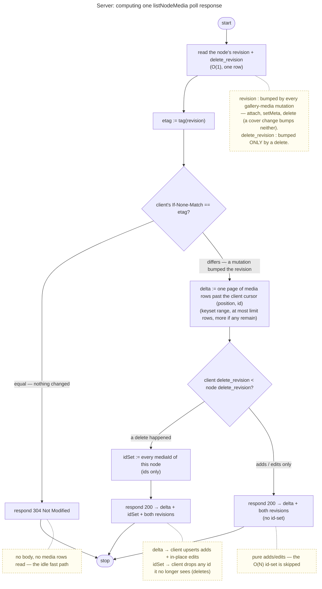

# ADR 0033 — Live item lists: a per-node revision counter + conditional GET + keyset delta, short-polled

- Status: Accepted (decision 6, the list in pages, and decision 3's keyset on a position: 2026-10-19, `cr-gallery-list-paging`)
- Date: 2026-07-09

## Context

An open Memory gallery should reflect **other members' media changes live** — a contributor's uploads appear,
a removed member's photos disappear — without a manual reload (inbox #48). Two coupled needs: a **cheap
"did it change?"** check (fast opens, no work when idle) and **live insert/remove** of others' changes. The
server is **operator-blind**: it sees opaque `mediaId`s + node membership + exact timestamps (a medium's
`updated_at` to the millisecond), never content.

**This is the platform's mechanism, with Memories' media as its first user** (inbox #410). The counter, the
conditional read and the delete-gated id set are written once, in core, for any application that keeps a list of
**records** (not nodes) inside a node; the text below says "media" because that is the list that exists, and says
where core's part ends and the application's begins.

The obvious shape — and the one an earlier version of this product shipped — is a **hanging long-poll** carrying
a **keyset cursor** `(updatedAt, id)` for adds/edits **plus a SHA-256 hash over the sorted `mediaId` set** for
deletes (a count would miss a delete+add that nets zero; a set-hash catches it). It works and is real-time, at a
real cost: the server recomputes that **O(N) id-scan + hash on every ~750 ms tick, per open gallery**, and holds
a connection per viewer. We want the same **delete-robustness** without the per-tick O(N) cost, and simpler.

Today the fresh stack has none of the pieces: `listNodeMedia` (`GET /api/scopes/{scopeId}/nodes/{nodeId}/media`)
returns the full `MediaSummary[]` with **no timestamp, no cursor, no conditional**; `veyq_media` has only
`created_at` (no `updated_at`, so an in-place meta edit touches no clock); there is no change signal on the node.

## Decision

**A per-node media-revision counter is the cheap change signal; a conditional GET short-circuits the idle case;
on a change the client pulls a keyset delta + reconciles deletes against the returned id-set. Short-poll v1.**

1. **The node's item revision — a per-node counter, the cheap signal.** A monotonic `INT` per node in **core's**
   `veyq_node_items_revision(node_id, revision, delete_revision)` (a `veyq_node` column until inbox #341, Memories'
   own `veyq_media_revision` row until inbox #410; no row reading as 0, the first change birthing it), written only
   through core's `NodeItemsRevisions.bump(scopeId, nodeId, deleted)`, which the writer calls **in its own
   transaction** as it changes a record. For Memories' gallery it is **bumped on every media mutation**: attach
   (curator + contributor/uploader upload complete), meta edit (`updateMediaMeta`, cr-0068), delete (the trash and
   the share delete-own, cr-0102), restore, and the two re-bucketings that change a row's `bucketId`
   (`deleteBucketReparent`, `moveMedia`). **Cover changes are excluded** —
   `commitCover`/`clearCover` write no `veyq_media` row and never list, so a cover swap must not force a re-list.
   Reading it is **O(1)** — this is what replaces the O(N)-per-tick hash. It is opaque operational metadata
   (a number), so it is **operator-blind**.

2. **Conditional GET on the list.** The response carries an **ETag derived from the revision**; a poll
   sends `If-None-Match` (`listNodeMedia` for Memories; the wire pieces — the header, the `304`, the `since` and
   `sinceDelete` parameters — are shared contract components in `_common.openapi.yaml`, and core's
   `NodeItemsRevisions.read` is the one place that decides *304 / delta / delta + id set*). Unchanged ⇒ **`304 Not Modified`** (tiny, no body, no media query) — the common idle
   case. Changed ⇒ `200` with the delta below. One endpoint covers both #48 sub-ideas (skip-when-unchanged +
   fetch-on-change).

3. **On change, a keyset delta — never a full re-list.** The client sends its cursor `(position, id)`; the
   server returns **only media past it** (tie-broken by id). A medium's **position** is the node's item revision its
   last change bumped to: `bump` returns it, and the writer stamps it on the row (`veyq_media.item_position`) in the same
   transaction, while the revision row's lock — which the bump holds to the commit — is still held. So positions become
   visible in the order they were handed out, and a client that has passed one never sees a row land behind it. A
   **timestamp cannot promise that**, and the keyset was one until 2026-10-19: `updated_at`, stamped before the revision
   lock, let a writer that took its stamp first and committed last land behind a cursor a poll in between had already
   passed — its change was never delivered (`MediaKeysetRaceSliceTest`, red on `updated_at` on H2, green on the position;
   a millisecond tie broke the same way). Every writer that moves a medium to the end of the list stamps it — an attach,
   a meta edit, a restore, a block or its lift; a move between buckets and a reparent bump the revision without moving
   the row. `updated_at` stays the medium's change time (set at attach, bumped on the same writes; since inbox #398 its
   only creation time) and is served as such. So an **active upload streams the handful of new items each poll**, not the
   whole gallery every interval — the failure mode a full-re-list-on-change would have. The client upserts the delta by
   `mediaId` and continues from the `cursor` the server answered: opaque to it, never assembled from a row's fields.

4. **Delete-reconcile via the current id-set, gated by a second counter.** A keyset delta is add/edit-only — it
   cannot express a removal. So a `200` **may** also carry the node's **current `mediaId` set** (ids only); the
   client **drops any id it no longer sees** — this catches deletes and, because it is the *set* (not a count), a
   **net-zero delete+add** too — the insight worth keeping. But the id-set is **O(N)**, so it must not ride *every*
   change — an active upload would re-send the growing full set each poll. A **second per-node counter,
   `delete_revision`, bumped *only* on a delete** (never on attach/meta-edit — so a delete bumps *both* counters,
   an add/edit only the revision) gates it: the client echoes its last-seen `delete_revision`, and the server
   includes the id-set **only when `client.delete_revision < node.delete_revision`** — i.e. only when a delete
   actually happened since the client last synced. Pure adds/edits stay **delta-only**; the O(N) id-set scan is
   paid solely on real deletes (rare, and self-limiting — one reconcile re-syncs the client). Both counters live on
   the same row, so a single read returns a **consistent pair** — no torn read can strand a delete.

5. **Short-poll transport for v1.** A client with a Memory open polls on an interval, **gated on tab visibility**
   (core's `createLivePoller`, `shared/state/livePoller.ts`, the loop the level views run on too: a `visibilitychange`
   or focus event ticks immediately on foreground, the interval pauses when hidden — a background poll is pure
   waste — and it is jittered ±20 % and backs off on errors). The cadence is 20 s (`ITEMS_POLL`), the one the
   gallery already had; it replaced a fixed 20 s `createVisibilityPoller` and so gained the jitter, the back-off on
   a failing server and the focus catch-up, and lost nothing. The conditional read, the delta merge and the cursor
   are core's too (`core/items/itemsLive.ts`: `itemsPollTick`, `reconcileItems`), so an application supplies only
   its fetch and its reducer. Stops when the
   Memory closes; a poll still in flight then writes nothing, and a tick never overlaps the previous one. With the delta, even an active upload is cheap per poll. A few seconds of latency is fine for a photo
   grid; **long-poll / a push channel** (sub-second, shared later with #6 live journal) is a deferred upgrade.

6. **The first load is the same keyset, in pages.** A list read without `since` is not special: it is a delta from the
   beginning. Every read takes a `limit` (1–1000, absent = 1000; the response's `media` carries the cap as its
   `maxItems`) and answers `more` when rows remain past the page, and the page's `cursor`; the client asks again with that
   cursor, and without `If-None-Match`, until `more` is false. A poll whose delta is longer than a page pages the same
   way. **The revisions a client keeps are the first page's, the cursor the last page's.** The server reads the
   revisions before the rows (as ADR 0081 decision 3 orders it), so a change committed while the client pages moves the
   revision past the one it kept, and its next poll pulls that change as a delta; an edit to a row already paged moves
   the row to the end, where it is delivered again and upserted; a delete moves `delete_revision` past the kept one, so
   the next poll carries the id set (`MediaListPagingSliceTest`, red when the client keeps the last page's revisions).
   Each page is read with the same number of queries whatever it holds — its originals, their derivatives and every blob
   they name, one query each (`MediaListQueryCountSliceTest`; one query per photo and per derivative cost 40,017 SELECTs
   for 10,000 photos). Paging bounds one answer's size and the server's memory for it. It does not give the client its
   first screen: the gallery's order is the sealed capture time, which only the device reads, so the page order is not
   the display order and the client needs every page before the order is final
   ([ADR 0105](0105-a-gallery-renders-what-is-near-the-viewport-and-opens-its-listing-in-a-worker.md) decision 4). The
   Trash tab's listing (`state=trashed`) pages on the same keyset, its order by `deletedAt` the client's once it holds
   every page. **A guest's listing (`listShareMedia`) pages by the same rule on another key: the media id**, continued
   `after` the last id it was given, and it lists the one node a guest has open (`nodeId`) rather than the whole shared
   subtree. A position is the order of the Memory's changes, and a guest is told no time of the Memory's activity (ADR
   0081 decision 4; it is served no `updatedAt` either), so its key is the one it already holds. Without a live poll for
   guests (inbox #497) nothing depends on a guest's page order matching commit order: a medium added while a guest pages is
   in its next load.

How the server computes one `listNodeMedia` poll response (core's `NodeItemsRevisions.read` decides it) — the **O(1) revision compare short-circuits the idle
case** (no media query at all), and only a genuine change runs the two queries (keyset delta + current id-set):

The revision is a monotonic count of *mutations* (not of media), so any change moves it — that is what turns
the idle case into an `O(1)` `304`. On a change, adds + in-place meta edits ride the **keyset delta** (keyed by
`mediaId`). The full `mediaId` **set** rides along **only when `delete_revision` advanced** — a real delete — and
the client diffs it to drop removals, catching a **net-zero delete+add** too (a *set*, not a count). A pure
add/edit never carries the O(N) id-set, and nothing does per idle tick.

## Consequences

- **Idle is cheap (O(1) 304), an active upload is cheap (delta only — no id-set until a delete), deletes are robust
  (the id-set, gated by `delete_revision`), and it stays operator-blind** — two counters + opaque ids + exact
  timestamps, no content, no new operator-visible signal beyond the poll access-pattern the operator already sees
  on reads.
- **A live poll also tightens the `auto`-date self-heal window** ([uc.memory.date](../features/memory/use-cases/uc.memory.date.md)):
  the reconcile sees others' new media sooner. **The item revision is a read-cache validator, never a write
  precondition** — it moves on every attach, trash, restore, move and meta change, so a compare-and-set on it would
  turn every concurrent upload into a date-edit conflict. The sealed meta blobs carry their own `metaRevision` for
  that ([ADR 0077](0077-a-write-carries-the-version-it-read.md)).
- **New server state:** a `revision INT` + a `delete_revision INT` per node (columns on `veyq_node` then;
  Memories' `veyq_media_revision` from inbox #341 to #410; core's `veyq_node_items_revision` now, with a foreign key
  onto `veyq_node` that does not cascade — the node-subtree eraser at phase 300 and the scope's node eraser delete the
  row before the node goes), an `updated_at
  TIMESTAMP` on `veyq_media` (backfilled `= created_at` then; `NOT NULL` and the only creation time since inbox #398), and
  the keyset's `item_position INT` on `veyq_media` with the index `(node_id, item_position, id)` (decision 3, 6); `listNodeMedia` gains a conditional GET (`If-None-Match`
  → `304`), a `since` cursor (keyset delta), and the current-id-set on a `200` **only when the client's
  `delete_revision` lags** (a delete occurred). All opaque/operational — no key, no plaintext.
- **Scope: own-node list only.** The gallery lists the open node's own media (chapters open to their own
  galleries), so a **per-node** revision suffices. A Memory+chapters **subtree** aggregation (inbox #16) would
  need a subtree-max revision — **out of scope**, a later slice. The scope's *node list* is a different signal
  ([ADR 0081](0081-a-scopes-tree-revision-is-the-level-views-change-signal.md)); this one covers the records inside
  one node.
- **Lock order, and why the table sits where it does.** `bump` runs after the writer's record rows and takes **no scope
  lock** (unlike ADR 0081's `bumpTree`: gallery writers lock a media row, not the scope), so the first-bump insert is
  decided under the **node row's** lock with the UPDATE asked again beneath it — `record rows -> node row -> revision
  row`, the order every gallery writer already takes (`MediaLockOrderRaceSliceTest`), the revision row a leaf nothing
  waits behind. `NodeItemsRevisionsCoreSliceTest` pins the arithmetic, the two racing first bumps, that a bump of an
  existing row waits for no node lock, the read's three answers and the erasure; `NodeItemsRevisionBumpsTest` reads
  Memories' sources and is red on a media writer that does not bump.
- **Adding a second user.** An application with its own records inside a node (Expenses' entries, Inventory's items)
  adds its keyset query, calls `bump` from each writer and a `NodeItemsRevisionBumpsTest` entry, `$ref`s the shared
  contract components in its list operation and builds its view on `itemsPollTick`/`reconcileItems`: the recipe is in
  [docs/apps/README.md](../apps/README.md). It owns no counter table of its own.
- **A member-visible curator delete is a separate surface.** Today the only media-row deletes are the share
  delete-own (cr-0102) and node-delete; there is no authenticated curator "delete my photo" endpoint. The
  delete-reconcile works for the deletes that exist; a curator delete endpoint is net-new (not in this feature).
- **Rejected — an O(N) set-hash per tick:** correct + delete-robust, but recomputes the whole id-scan +
  SHA-256 every ~750 ms per open gallery; the revision counter delivers the same robustness at O(1). We
  keep the *set-not-count* insight (via the on-change id-set), drop the per-tick cost.
- **Rejected — full re-list on any change:** re-downloads + re-decrypts the entire gallery every poll during an
  active upload (the primary live case) — the keyset delta exists precisely to avoid this.
- **Rejected — a counter table per application, or a generic table keyed by a list name:** each application would
  re-implement the first-bump race and the erasure ordering (the bug that bought the lock-order tests), and nothing
  would stop one from forgetting. A node holds one list today (a node's kind decides which application owns it), so a
  second list in one node would add a `list` column to the key — not built until a kind needs it.
- **Rejected — a count-only or `max(updated_at)`-only signal:** a count misses a net-zero delete+add; a max misses
  a delete of a non-newest media. The counter (bumped on *every* mutation) + the id-set reconcile cover both.
- **Rejected (deferred) — WebSocket/SSE push:** lower latency, but more infra and a **held per-viewer connection
  is a stronger presence signal** to the operator than a coarse poll; folded into a later push channel shared with
  #6 (live journal co-edit).
