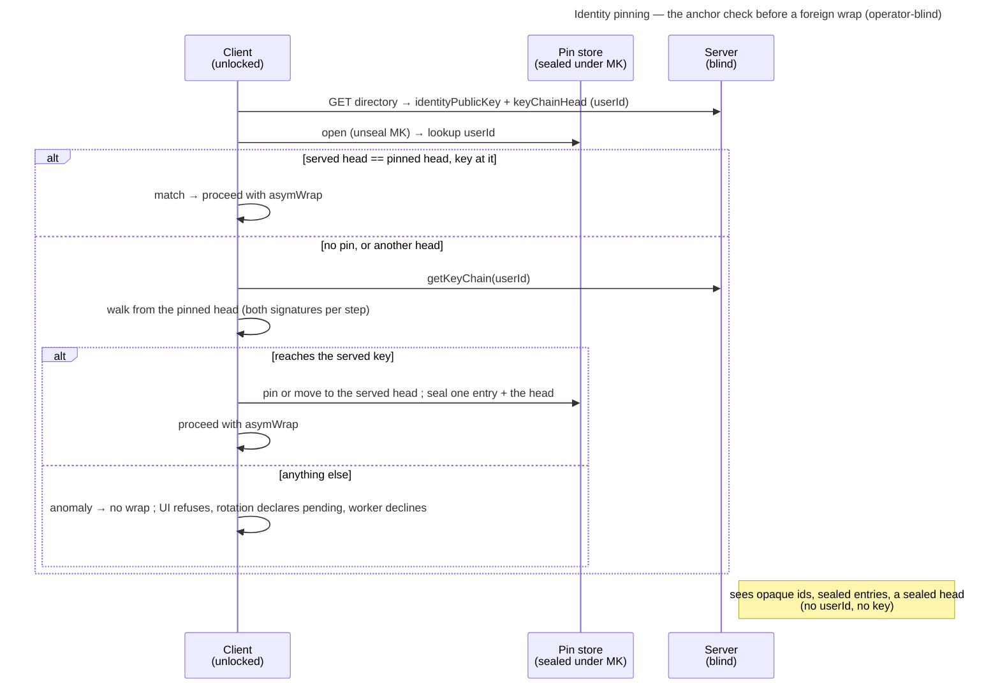

# Enabler: Identity pinning — trust-on-first-use of a key chain + a sealed pin store

- **ID:** en.account.identity-pinning
- **Type:** **Enabler** — the substrate under
  [ADR 0028](../../../decisions/0028-identity-authenticity-tofu-verification.md); no standalone end-user goal
  ([features/README → use-case vs enabler vs ADR vs change-request](../../README.md#use-case-vs-enabler-vs-adr-vs-change-request)).
- **Provides:** an **operator-blind, cross-device memory of each contact's key-chain head**, and the one check every
  wrap to **another** account's key and every grant from one goes through: a key the contact's doubly signed key chain
  reaches from the pinned head is followed, anything else is an **anomaly** — so a **substituted** key (an active
  operator's MITM) is caught after first sight and a legitimate rotation needs nobody; in a tenant the person's
  owner-rooted **join record** decides first, so the pin there is the counter, not the anchor
  ([ADR 0028](../../../decisions/0028-identity-authenticity-tofu-verification.md) Decision 2,
  [ADR 0111](../../../decisions/0111-an-invitee-grants-itself-a-rotator-re-keys-its-own-scopes-and-a-key-chain-anchors-trust.md)
  decisions 7, 12, 15, 16). The one wrap that does not go through it is a moderation statement's facts, sealed to
  the keys the server serves (ADR 0111 § What stays open).
- **The model** this check sits in — the key chain, the join record, verifications and what a member sees, the
  grants it guards — is the topic's current picture,
  [keys, grants and trust § Trust](../../../crosscutting/keys-grants-and-trust.md#trust-who-is-who). This enabler keeps
  the pin store, the check's states and their sync.
- **Serves (use-cases):** [uc.spaces.verify-identity](../../spaces/use-cases/uc.spaces.verify-identity.md) (the
  passive half — pin on first sight, follow the chain, surface an anomaly),
  [uc.spaces.enforce-verified-identities](../../spaces/use-cases/uc.spaces.enforce-verified-identities.md) (the
  compare, which starts from this check),
  [uc.spaces.require-verified-identities](../../spaces/use-cases/uc.spaces.require-verified-identities.md) (strict
  mode, which would gate on *verified*; planned) and
  [uc.account.rotate-keys](../use-cases/uc.account.rotate-keys.md) (which produces the one legitimate key
  change: a step of the account's key chain).
- **Depends on:** [en.account.key-model](en.account.key-model.md) — the Master Key that seals the pin store, so
  the account must be **unlocked** for any of this to run.
- **Postconditions:** after wrapping to a contact for the first time, the client holds a **pin** of that contact's
  key-chain head and the identity at it; a later key the chain reaches moves the pin, and one it does not reach is
  never wrapped to and never accepted as a granter. The server saw opaque ids, sealed entries and a sealed head —
  never a `userId` or a pinned key; it does see how many pins there are.

## What it is — the sealed pin store

**One sealed entry per pin, held together by a sealed head**
([ADR 0104](../../../decisions/0104-the-identity-pin-store-is-one-sealed-entry-per-pin-under-a-sealed-head.md)),
synced with the account like the other Master-Key-sealed material. The server stores and relays opaque rows and
never interprets them:

```
entry at pinId = HMAC-SHA256(K_pinIndex, userId):   seal("identity-pin" ‖ pinId, { u: userId, f: fingerprint, h: head, i: index, t: firstSeenAt, r: replaced } padded to 192 bytes)
head at revision n:                                 seal("identity-pins" ‖ n,     { version: 2, count, digest })
```

- **`pinId`** — an opaque 32-byte id (64 hex characters), keyed by a Master-Key-derived key: stable while the Master
  Key is, unlinkable across accounts. A reader refuses an entry whose `userId` does not derive its id.
- **`fingerprint`** — the contact's identity **fingerprint hash** (the SHA-256 over their full identity public bundle
  that the safety number and its QR already are), not the bundle: every reader compares it with a served key's or
  shows its safety number, both functions of the hash. It is the key at the pinned head.
- **`head`** — the head of the contact's key chain this account pinned (32 bytes): where every later walk starts.
  It pins the identity **and** the Secret-Key proof key, so an invented chain that names the pinned identity beside a
  proof key of the operator's choosing does not start from it. The keys are single letters so an entry with its head
  stays inside the 192-byte padding; an entry without a 32-byte head does not open.
- **`index`** — the index of the pinned head's step in the chain: it tells a pin the join-anchored chain does not hold from a rollback (§ Main flow, `replaced`).
- **`firstSeenAt`** — when this contact was first pinned (kept when the pin moves along the chain, new at a
  replacement); a member reads *New* while it is under 14 days old.
- **`replaced`** — the join record replaced this pin (the profile says so). There is **no state**: whether someone is
  verified is a signed statement in the tenant
  ([uc.spaces.enforce-verified-identities](../../spaces/use-cases/uc.spaces.enforce-verified-identities.md)).
- **The head's `digest`** — SHA-256 over every entry in `pinId` order, so the set is one object the device can check
  (§ Sync & merge). Vector-pinned: `contracts/crypto/vectors/v1.json#identity_pin`.

**Account-global, keyed by `userId`.** Identity is one keypair per account across all tenants
([ADR 0023](../../../decisions/0023-per-tenant-member-identity.md)), so there is **one pin per contact**. The anchor
and *verified* are per tenant (ADR 0111 decision 15): a person is anchored by their join record in each tenant, and a
verification counts only in the tenant it was written in. A store holds at most 25,000 pins: the rotation and the
reset write the whole set in one request, and that request must fit the server's body limit — computed from the
contract's caps by `scripts/validate_rotation_shape.py`, measured at the cap by `rotationAtPinCap.measure.e2e.test.ts`.

## Main flow — the anchor check before every foreign wrap and grant

1. A client is about to `asymWrap` to a directory-returned identity key for `userId`, served with that contact's
   key-chain head — a rotation's re-grant, a grant-delivery job, a group add and its name key, an open invite's carry,
   a moderation delivery — or to trust a grant that contact signed.
2. **In a tenant, ask the person's standing there first** (`loadTenantView`, `src/web/src/features/account/tenantTrust.ts`;
   ADR 0111 decisions 12, 15 and 21): their join record must open under the tenant key, verify owner → invite →
   newcomer and name an owner the server lists whose key in it is anchored in the tenant in turn (`joined`) — a key
   that owner has since retired only with their `join-endorsement` of the record by their current key; an owner with
   no join record is a `root`; anyone else — a non-owner without a join record, a record that does not verify — is
   `unanchored`, and a tenant this device cannot read is `unavailable`. `unanchored` is an **anomaly** with no chain
   read; so is `unavailable` for a wrap. A `joined` person's chain is always read and walked from the step that
   installs the identity **and** proof key the record names (`readJoinedChain`), whatever prefix the server serves
   before it. A `root`, and every check outside a shared tenant (a moderation delivery), go by the pin alone, below;
   the invite accept goes by the pin and the chain its invite serves (step 5).
3. **Open the pin store** (unseal under the Master Key) and judge the served key and head (`anchorIdentity`):
   - **`match`** — the served head is the pinned head and the served key the key at it; no chain read (for a `joined`
     person: the pinned head is on the chain and carries the pinned key).
   - **`firstUse`** — no pin: read the chain (`getKeyChain`), require its head to be the served one and its newest key
     the served key, **pin the head**, then proceed (trust-on-first-use — the bootstrap; blocking first contact would
     be a chicken-and-egg).
   - **`advanced`** — the chain walks from the pinned head to the served one, every step signed by both keys it
     retires (the identity and the Secret-Key proof key), each naming its predecessor, the key at the pinned head equal
     to the pinned fingerprint, and it ends at the served key: the pin moves to the new head.
   - **`replaced`** — a `joined` person only: the pinned head is not on the chain the join record anchors, and that
     chain is at least as long as the pinned one was (`index`): the pin was a key that was not theirs, so it moves to
     the anchored head, marked `replaced`. A shorter chain is an anomaly — it may be a rollback.
   - **`anomaly`** — anything else: a served head older than the pinned one (a rollback), a step not signed by both
     keys, a chain the server does not serve. **Never wrapped to and never offered to a human to accept**: a UI-path
     wrap (the group add) refuses with `IdentityUnanchoredError` and shows "Can't confirm this key", a rotation declares
     the member pending, the human-less grant-delivery worker **declines the job** (`identity_unanchored`), and a grant
     the contact signed is refused (`granter_key_unanchored`).
4. **A key served without a head** — the per-grant copy of the granter's key — is judged by `anchorChainKey`: is it
   the key at the pinned head, or a **retired** key of the chain this device walked? For a `joined` person only a key
   at or after the joined step counts; a `root` and an `unavailable` tenant go by the pin. A grant signed by a retired key
   opens only at an epoch at or below this device's floor for the scope, and is refused above it
   (`granter_key_retired`): such grants exist from before the rotation, and a new epoch from a retired key is what a
   thief with the old identity would forge.
5. **The invite accept** is no co-member yet, so `getKeyChain` serves it nothing; the invite's preview serves the
   inviting owner's chain instead, which `checkInvite` has already walked from the head sealed in the link to the
   served owner key (ADR 0111 decision 19). `anchorServedChain` judges that chain against the pin as `readChain`
   does — a pinned head must lie on it and carry the pinned key, else `anomaly` — and on first use pins the walked
   head at its real index. The granter of a grant a rotation carried is judged against its pin only if this account
   pinned them before, and is not pinned here: the grant's epoch link down to the owner's anchor vouches for it, not
   its key, which may be one its granter has since retired — the account pins them at its first contact as a
   co-member.
6. **Verification is not in this store.** A compare of safety number and chain code writes a signed statement into
   the tenant ([uc.spaces.enforce-verified-identities](../../spaces/use-cases/uc.spaces.enforce-verified-identities.md));
   it starts from this check — only a key and head this device anchors in the tenant are compared and signed — and
   the profile and the member lists read who is anchored here and who verified them in the tenant (`personInTenant`,
   `tenantBadges`, `tenantTrust.ts`); a member whose chain read failed gets no badge rather than a false anomaly.
   Requiring *verified* before a share is strict mode
   ([uc.spaces.require-verified-identities](../../spaces/use-cases/uc.spaces.require-verified-identities.md)), whose
   shape is still open (ADR 0028 Decision 4).



## Sync & merge

The head carries the store's one monotonic **`revision`**, beside the ciphertext and bound into its seal
([ADR 0072](../../../decisions/0072-a-seal-binds-its-object.md)). Every write — a pin, a move along the chain, a replacement — is **one
entry plus a new head** in one compare-and-set on that revision; the reset and the rotation write the whole set with
`replaceAll`. If the stored revision moved, nothing of the write lands (`409 stale_revision`), and the client
**re-reads and re-applies** its change before re-sealing. Pins are **append-heavy** (a new contact), so real
conflicts are rare: a first sight claims only an empty slot and a move replaces only the pin it was judged against,
so a device that pinned or moved the contact meanwhile keeps its write. A **new device** lists the entries and
inherits every pin — so the trust state is shared across the account, not re-TOFU'd per device.

A device lists the entries once per head revision, checks them against the head's digest and keeps them for the
session; a later read is the head alone while its revision and digest stay the ones it checked. A mismatch while the
head stayed put is a rollback (below); a head that moved during the listing is read again.

**Which copy a device reads is the server's choice, so the device keeps its own mark**
([ADR 0028](../../../decisions/0028-identity-authenticity-tofu-verification.md) Decision 7): the highest revision
it has opened, held locally and never synced. A served head below the mark, a missing store after one was held,
or a head that does not open is refused — on read and before every write — never read as empty; and an entry set
the head's digest does not describe (one withheld, added, rolled back or moved) is refused the same way
(`trust_state_rolled_back`). A linked
device starts from its linker's marks, and an account-key rotation carries them to the new Master Key; the
marks, their slot and what refuses live in `src/web/src/features/account/trustMarks.ts`.

**A refused store has one way back, and it is the user's.** The rotation cannot produce one any more — it
re-seals the store inside its own request and transaction ([ADR 0060](../../../decisions/0060-key-rotation-after-compromise.md)
§ Consequences) — but a backup restore or corruption at rest still can. Then the settings hub offers *Start a
list over* (`src/web/src/features/account/trustReset/`): after a confirmation naming the cost, it writes the empty
store one revision above the served one — never over a copy that opens — and sets this device's mark to that
revision, the only write that lowers a mark. Only the confirm dialog may import it (`veyq/trust-reset-one-door`
in `src/web/eslint.config.js`), so no server response reaches it. A device whose mark sat at or below the served
revision reads the new store with no action; one whose mark sat above it is offered the same reset.

## Quality notes

- **Operator-blind, except the count.** Opaque ids and Master-Key-sealed entries; the server never learns whom you
  pinned (whom you verified it learns from the tenant's verification rows, ADR 0111 § Consequences). It does learn how many pins there are — as it always could from the single blob's length, and
  from the grant rows it holds anyway — and which entry a write touched
  ([ADR 0104](../../../decisions/0104-the-identity-pin-store-is-one-sealed-entry-per-pin-under-a-sealed-head.md)
  decisions 5 and § Consequences). A store keyed by plain `userId` would leak the trust set — rejected
  ([ADR 0028](../../../decisions/0028-identity-authenticity-tofu-verification.md)).
- **The first-use gap (honest).** A pin can only catch a key that *changes* after first sight. If the operator
  substitutes a contact's key **before** this client ever pinned the real one, nothing looks wrong until manual
  verification or Key Transparency (the end-state).
- **First-online-wins is per key-holder, not a global veto.** The worker's decline is one honest **account**
  refusing — keyed on the declining user, so that account's other devices are excluded too, which is the correct
  reading of a refusal about an *identity*. Another key-holder without a pin still TOFU-delivers. The value is raised
  detection, not a hard stop — the blind server must not adjudicate a crypto claim (ADR 0028 § Consequences). When
  the target secures their account, its publish clears every decline that targeted it
  ([ADR 0060](../../../decisions/0060-key-rotation-after-compromise.md) Decision 7), so a worker that could not anchor
  the old key tries the new one.
- **Tier-consistent ([ADR 0026](../../../decisions/0026-client-trust-tiers.md)).** Holds against an active
  operator only on a client it does not serve, and there only once the store cannot be rolled back
  ([ADR 0028](../../../decisions/0028-identity-authenticity-tofu-verification.md) Decision 7); honest-operator on
  operator-served web — a tampered client could ignore its own pin.

> **No end-user section.** As an enabler this has no standalone "what this means for you" story — its value reaches
> the user through the verification use-case + the member-add flows it protects (their bilingual sections carry the
> wiki text).

## Related

- Model: [keys, grants and trust](../../../crosscutting/keys-grants-and-trust.md)
- Decisions: [ADR 0028](../../../decisions/0028-identity-authenticity-tofu-verification.md) (the authenticity
  model this realizes), [en.account.key-model](en.account.key-model.md) (the Master Key that seals the store +
  identity rotation, which produces a legitimate key change), [ADR 0023](../../../decisions/0023-per-tenant-member-identity.md)
  (identity is account-global, so pins are too)
- Consumers (the surfaces this gates): a rotation's re-grants and open-invite carry, the grant-delivery worker
  ([ADR 0020](../../../decisions/0020-grant-distribution-invite-wrap.md), [ADR 0021](../../../decisions/0021-operator-blind-background-tasks.md)),
  the group add and its invite name-key ([ADR 0027](../../../decisions/0027-group-invite-name-shared-key.md)), the
  moderation delivery ([ADR 0099](../../../decisions/0099-moderators-share-one-instance-moderation-key-and-review-without-a-vault.md)),
  the invite accept, and the recipient's check of every grant ([ADR 0028](../../../decisions/0028-identity-authenticity-tofu-verification.md)
  Decision 6)
- Use-cases: [uc.spaces.verify-identity](../../spaces/use-cases/uc.spaces.verify-identity.md) (pin on first sight,
  follow the chain, surface an anomaly), [uc.spaces.enforce-verified-identities](../../spaces/use-cases/uc.spaces.enforce-verified-identities.md)
  (the compare, which writes a verification into the tenant), [uc.spaces.require-verified-identities](../../spaces/use-cases/uc.spaces.require-verified-identities.md)
  (strict mode, planned)
- End-user view (docs site): [Verify a person](../../../../site/src/content/docs/account/verify-a-person.mdx)
- End-user view (docs site): [A key can't be confirmed](../../../../site/src/content/docs/help/key-changed.mdx)
- End-user view (docs site): [Start a list over](../../../../site/src/content/docs/help/start-a-list-over.mdx)
