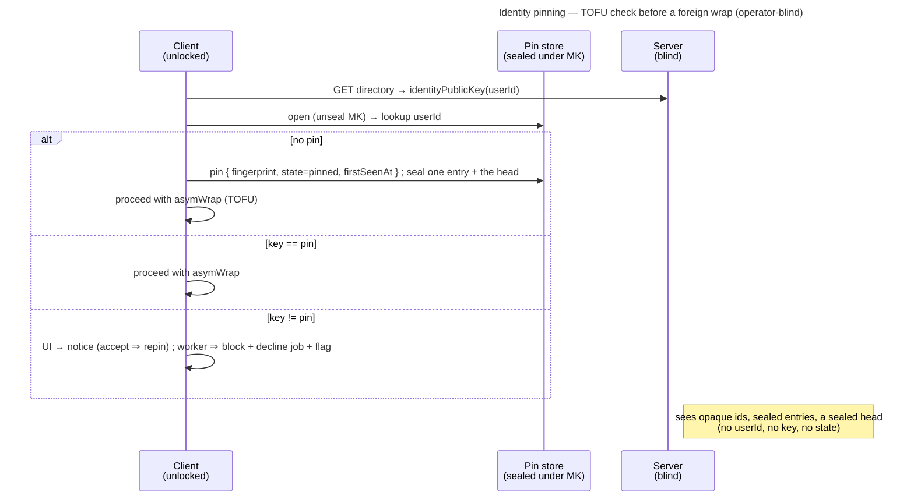

# Enabler: Identity pinning — trust-on-first-use + a sealed pin store

- **ID:** en.account.identity-pinning
- **Type:** **Enabler** — the substrate under
  [ADR 0028](../../../decisions/0028-identity-authenticity-tofu-verification.md); no standalone end-user goal
  ([features/README → use-case vs enabler vs ADR vs change-request](../../README.md#use-case-vs-enabler-vs-adr-vs-change-request)).
- **Provides:** an **operator-blind, cross-device memory of each contact's identity key**, so a **substituted**
  key (an active operator's MITM) is caught on change (TOFU), and out-of-band verification can elevate a contact
  to *verified*. Used by every client that wraps a scope key or invite to **another** member's identity public
  key — the grant authorities, the grant-delivery worker, the invite name-key.
- **Serves (use-cases):** [uc.spaces.verify-identity](../../spaces/use-cases/uc.spaces.verify-identity.md) (the
  passive half — pin on first sight, notice and review a changed key),
  [uc.spaces.enforce-verified-identities](../../spaces/use-cases/uc.spaces.enforce-verified-identities.md) (the
  proactive ceremony that elevates a pin to *verified*),
  [uc.spaces.require-verified-identities](../../spaces/use-cases/uc.spaces.require-verified-identities.md) (strict
  mode, which would gate on *verified*; planned) and
  [uc.account.rotate-keys](../use-cases/uc.account.rotate-keys.md) (which produces the one legitimate key
  change this store exists to let a human accept).
- **Depends on:** [en.account.key-model](en.account.key-model.md) — the Master Key that seals the pin store, so
  the account must be **unlocked** for any of this to run.
- **Postconditions:** after wrapping to a contact for the first time, the client holds a **pin** of that contact's
  identity public key (state *pinned*); a later wrap to a **changed** key is surfaced (UI) or refused (worker),
  never silently trusted. The server saw opaque ids, sealed entries and a sealed head — never a `userId`, a pinned
  key or a state; it does see how many pins there are.

## What it is — the sealed pin store

**One sealed entry per pin, held together by a sealed head**
([ADR 0104](../../../decisions/0104-the-identity-pin-store-is-one-sealed-entry-per-pin-under-a-sealed-head.md)),
synced with the account like the other Master-Key-sealed material. The server stores and relays opaque rows and
never interprets them:

```
entry at pinId = HMAC-SHA256(K_pinIndex, userId):   seal("identity-pin" ‖ pinId, { userId, fingerprint, state, firstSeenAt } padded to 192 bytes)
head at revision n:                                 seal("identity-pins" ‖ n,     { version: 2, count, digest })
```

- **`pinId`** — an opaque 32-byte id (64 hex characters), keyed by a Master-Key-derived key: stable while the Master
  Key is, unlinkable across accounts. A reader refuses an entry whose `userId` does not derive its id.
- **`fingerprint`** — the contact's identity **fingerprint hash** (the SHA-256 over their full identity public bundle
  that the safety number and its QR already are), not the bundle: every reader compares it with a served key's or
  shows its safety number, both functions of the hash. A change is detected by comparing the directory key's
  fingerprint against this.
- **`state`** — `pinned` (trust-on-first-use, unverified) or `verified` (a human compared the safety-number
  out-of-band, [uc.spaces.enforce-verified-identities](../../spaces/use-cases/uc.spaces.enforce-verified-identities.md)).
- **`firstSeenAt`** — when this key was first pinned (for the review surface).
- **The head's `digest`** — SHA-256 over every entry in `pinId` order, so the set is one object the device can check
  (§ Sync & merge). Vector-pinned: `contracts/crypto/vectors/v1.json#identity_pin`.

**Account-global, keyed by `userId`.** Identity is one keypair per account across all tenants
([ADR 0023](../../../decisions/0023-per-tenant-member-identity.md)), so there is **one pin per contact** — a person
you verified in one space is verified everywhere. A store holds at most 25,000 pins: the rotation and the reset
write the whole set in one request, and that request must fit the server's body limit.

## Main flow — the TOFU check before every foreign wrap

1. A client is about to `asymWrap` to a directory-returned identity key for `userId` (a grant re-wrap, a
   grant-delivery job, or an invite name-key).
2. **Open the pin store** (unseal under the Master Key) and look up `userId`:
   - **No pin** → **pin it** (`state = pinned`, record the key's fingerprint + `firstSeenAt`), then proceed with the wrap
     (trust-on-first-use — the bootstrap; blocking first contact would be a chicken-and-egg).
   - **Pin exists, key matches** → proceed.
   - **Pin exists, key differs** → **change response** (ADR 0028): a **UI notice** (the user reviews; on **accept**
     `key := new`) or, on the **human-less grant-delivery worker**, **block the wrap + decline the job** back to
     the server + raise a human-review flag. A change is *attack or a legitimate identity rotation* — resolved by
     a human, never auto-trusted.
3. **Verification** ([uc.spaces.enforce-verified-identities](../../spaces/use-cases/uc.spaces.enforce-verified-identities.md))
   elevates a pin `pinned → verified` on a member's profile, after a safety-number compare (a scanned QR or the
   digits read aloud). `markVerified` stamps `verified` **only** if the pinned fingerprint still equals the compared
   one (else `IdentityMovedError`, nothing written); for a member with no pin it pins the compared fingerprint **already
   verified** in the same one write (`pinIfUnpinned`, ADR 0028 Decision 3) — so no profile view and no compare that
   failed ever pins. It ships without strict mode on purpose (ADR 0028 Decision 3): TOFU cannot see a key substituted
   at first contact, and a compare out-of-band can. A **changed** key still opens the side-by-side review; **accept**
   re-pins as `pinned` (`acceptKeyChange`) even for a contact that was `verified` — *verified* returns only through
   a new compare — and **refuse** leaves it blocked. The badge read (`trustStates`) returns the folded state plus
   whether the pin was `verified`, so a verified contact's change is said louder. Requiring *verified* before a share
   is strict mode ([uc.spaces.require-verified-identities](../../spaces/use-cases/uc.spaces.require-verified-identities.md)),
   whose shape is still open: a *per-account* toggle can't protect shared-scope content, since any co-member can key
   an unverified identity (ADR 0028 Decision 4).



## Sync & merge

The head carries the store's one monotonic **`revision`**, beside the ciphertext and bound into its seal
([ADR 0072](../../../decisions/0072-a-seal-binds-its-object.md)). Every write — a pin, an accept, a verify — is **one
entry plus a new head** in one compare-and-set on that revision; the reset and the rotation write the whole set with
`replaceAll`. If the stored revision moved, nothing of the write lands (`409 stale_revision`), and the client
**re-reads and re-applies** its change before re-sealing. Pins are **append-heavy** (a new contact), so real
conflicts are rare; a same-contact conflict resolves to **`verified` wins**. A **new device** lists the entries and
inherits every pin — so the trust state is shared across the account, not re-TOFU'd per device.

A device lists the entries once per head revision, checks them against the head's digest and keeps them for the
session; a later read is the head alone while its revision and digest stay the ones it checked. A mismatch while the
head stayed put is a rollback (below); a head that moved during the listing is read again.

**Which copy a device reads is the server's choice, so the device keeps its own mark**
([ADR 0028](../../../decisions/0028-identity-authenticity-tofu-verification.md) Decision 7): the highest revision
it has opened, held locally and never synced. A served head below the mark, a missing store after one was held,
or a head that does not open is refused — on read and before every write — never read as empty; and an entry set
the head's digest does not describe (one withheld, added, rolled back or moved) is refused the same way
(`trust_state_rolled_back`). A linked
device starts from its linker's marks, and an account-key rotation carries them to the new Master Key; the
marks, their slot and what refuses live in `web/src/features/account/trustMarks.ts`.

**A refused store has one way back, and it is the user's.** The rotation cannot produce one any more — it
re-seals the store inside its own request and transaction ([ADR 0060](../../../decisions/0060-key-rotation-after-compromise.md)
§ Consequences) — but a backup restore or corruption at rest still can. Then the settings hub offers *Start a
list over* (`web/src/features/account/trustReset/`): after a confirmation naming the cost, it writes the empty
store one revision above the served one — never over a copy that opens — and sets this device's mark to that
revision, the only write that lowers a mark. Only the confirm dialog may import it (`veyq/trust-reset-one-door`
in `web/eslint.config.js`), so no server response reaches it. A device whose mark sat at or below the served
revision reads the new store with no action; one whose mark sat above it is offered the same reset.

## Quality notes

- **Operator-blind, except the count.** Opaque ids and Master-Key-sealed entries; the server never learns whom you
  pinned or verified. It does learn how many pins there are — as it always could from the single blob's length, and
  from the grant rows it holds anyway — and which entry a write touched
  ([ADR 0104](../../../decisions/0104-the-identity-pin-store-is-one-sealed-entry-per-pin-under-a-sealed-head.md)
  decisions 5 and § Consequences). A store keyed by plain `userId` would leak the trust set — rejected
  ([ADR 0028](../../../decisions/0028-identity-authenticity-tofu-verification.md)).
- **The first-use gap (honest).** A pin can only catch a key that *changes* after first sight. If the operator
  substitutes a contact's key **before** this client ever pinned the real one, nothing looks wrong until manual
  verification or Key Transparency (the end-state).
- **First-online-wins is per key-holder, not a global veto.** The worker block is one honest **account**
  refusing — the decline is keyed on the declining user, so that account's other devices are excluded too, which
  is the correct reading of a refusal about an *identity*. Another key-holder without a conflicting pin still
  TOFU-delivers. The value is raised detection, not a hard stop — the blind server must not adjudicate a crypto
  claim (ADR 0028 § Consequences). [ADR 0060](../../../decisions/0060-key-rotation-after-compromise.md)
  Decision 4 now rests on that granularity: the rotation exclusion is a decline row for the rotator, and a
  per-*device* one would be claimable from any other tab.
- **Tier-consistent ([ADR 0026](../../../decisions/0026-client-trust-tiers.md)).** Holds against an active
  operator only on a client it does not serve, and there only once the store cannot be rolled back
  ([ADR 0028](../../../decisions/0028-identity-authenticity-tofu-verification.md) Decision 7); honest-operator on
  operator-served web — a tampered client could ignore its own pin.

> **No end-user section.** As an enabler this has no standalone "what this means for you" story — its value reaches
> the user through the verification use-case + the member-add flows it protects (their bilingual sections carry the
> wiki text).

## Related

- Decisions: [ADR 0028](../../../decisions/0028-identity-authenticity-tofu-verification.md) (the authenticity
  model this realizes), [en.account.key-model](en.account.key-model.md) (the Master Key that seals the store +
  identity rotation, which produces a legitimate key change), [ADR 0023](../../../decisions/0023-per-tenant-member-identity.md)
  (identity is account-global, so pins are too)
- Consumers (the wrap-to-foreign-identity surfaces this gates): grant re-wraps + the grant-delivery worker
  ([ADR 0020](../../../decisions/0020-grant-distribution-invite-wrap.md), [ADR 0021](../../../decisions/0021-operator-blind-background-tasks.md)),
  the group invite name-key ([ADR 0027](../../../decisions/0027-group-invite-name-shared-key.md))
- Use-cases: [uc.spaces.verify-identity](../../spaces/use-cases/uc.spaces.verify-identity.md) (pin on first sight,
  notice and review a changed key), [uc.spaces.enforce-verified-identities](../../spaces/use-cases/uc.spaces.enforce-verified-identities.md)
  (the human ceremony that elevates *pinned* → *verified*), [uc.spaces.require-verified-identities](../../spaces/use-cases/uc.spaces.require-verified-identities.md)
  (strict mode, planned)
- End-user view (docs site): [Verify a person](../../../../site/src/content/docs/account/verify-a-person.mdx)
- End-user view (docs site): [A key changed](../../../../site/src/content/docs/help/key-changed.mdx)
- End-user view (docs site): [Start a list over](../../../../site/src/content/docs/help/start-a-list-over.mdx)
