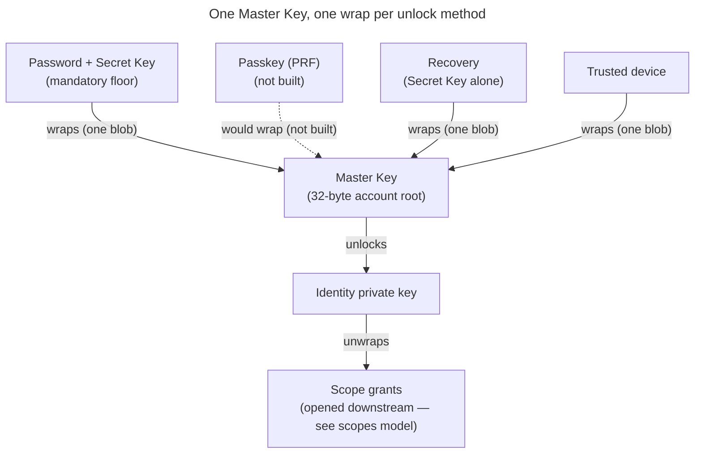

# Enabler: Account keys — identity, Master Key, unlock & recovery

- **ID:** en.account.key-model
- **Type:** **Enabler** — structural foundation, no standalone end-user goal
  ([features/README → use-case vs enabler vs ADR vs change-request](../../README.md#use-case-vs-enabler-vs-adr-vs-change-request)).
- **Provides:** a **single account's** key model — the identity keypair, the one **Master Key** (wrapped once
  per unlock method), the **unlock methods + KEK derivation** that open it, and recovery. It is the **root of
  the key chain** the scope + content keys extend downstream.
- **Serves (use-cases):** [login](../use-cases/uc.account.login.md), [unlock](../use-cases/uc.account.unlock.md),
  [trust-device](../use-cases/uc.account.trust-device.md),
  [remember-this-device](../use-cases/uc.account.remember-this-device.md),
  [rotate-keys](../use-cases/uc.account.rotate-keys.md); and downstream
  [en.spaces.personal-scope](../../spaces/enablers/en.spaces.personal-scope.md) →
  [en.memory.tree](../../memory/enablers/en.memory.tree.md) build their scope/content keys on it.
- **Depends on:** the crypto strategy ([ADR 0017](../../../decisions/0017-crypto-primitives-and-post-quantum-strategy.md))
  + the operator-blind auth/unlock split ([ADR 0003](../../../decisions/0003-operator-blind-password-auth.md),
  [ADR 0005](../../../decisions/0005-unlock-methods-and-device-trust.md)).
- **Out of scope (by design):** **scope, content & share keys** + the invite/onboarding key transfer live in
  [scopes & tenancy](../../../crosscutting/scopes-and-tenancy.md); exact **byte formats** (suite layouts, the X-Wing
  KEM's encodings, seal encodings) in the conformance-pinned suite
  ([`packages/crypto/src/v1.ts`](../../../../src/packages/crypto/src/v1.ts)) and its vectors
  ([`contracts/crypto/vectors/v1.json`](../../../../contracts/crypto/vectors/v1.json)), and what every seal binds is
  [ADR 0072](../../../decisions/0072-a-seal-binds-its-object.md). Whole-system security concern: the sibling
  [Security Model](../../../crosscutting/security-model.md).

> **No end-user section** (enabler) — its value surfaces through the account use-cases it serves. Plain-language
> companion: [docs site: Your Emergency Kit](../../../../site/src/content/docs/getting-started/emergency-kit.mdx). This is the
> **target model**; first-build scope is tracked via the inbox + change-requests.

## Principle: one Master Key, many wraps

There is exactly **one Master Key** per account. It is *wrapped* (locked) **separately by each unlock
method** the user sets up. Any one method opens the **same** Master Key, which unlocks the **identity
private key**, which in turn opens every scope grant the user holds. Adding or removing a method
adds/removes **one wrap** — content is never re-encrypted.

## Account key inventory

Account-level keys only (scope/content/share/invite keys are in the scopes model). A `wrapped*` field is
always ciphertext the server stores but cannot open.

| Name / API field | Kind | Server-visible form | Used for |
|---|---|---|---|
| Account password | Human secret, **never sent to the server** | — (never leaves the device) | Locally derives two domain-separated things: the **auth keypair** (login) and the **unlock KEK** (with the Secret Key, to open a Master Key wrap). |
| Auth keypair (`authPublicKey` / `authPrivateKey`) | Ed25519 signing keypair derived from the password (`seed = Argon2id(password, authSalt)`) | Only the **public** key is stored; the private key is derived on demand, never stored or sent | Login by **challenge-response**: the client signs a server nonce with `authPrivateKey`; the server verifies with `authPublicKey`. Separate from the identity keypair and from content; Ed25519 now, PQ/hybrid later. |
| Secret Key | High-entropy user-held secret (Emergency Kit / enrolled devices) | **Never** stored server-side | Combined with the password for two-secret key derivation (2SKD); protects content unlock after a DB breach. Replaced only when the account is secured, which issues a new Emergency Kit ([Rotation after a compromise](#rotation-after-a-compromise)); a password change, a reset and a change of the sign-in address keep it. The derivation is [Unlock methods & KEK derivation](#unlock-methods--kek-derivation) below; the threat it answers is [Security Model → Threat model](../../../crosscutting/security-model.md#threat-model--trust-boundaries). |
| Master Key | 32-byte symmetric account root | Only as `MasterKeyWrap.wrappedKey`: one `PASSWORD` and one `RECOVERY` wrap, plus one per enrolled device (`DEVICE`, `DEVICE_KEY`); the contract also names `PASSKEY`, which no client writes yet | Opens `wrappedIdentityPrivateKey`. Stable across a password change and a reset (only a rotation replaces it); a credential change rewrites the two cold wraps and deletes every other one (below). |
| Unlock KEK | Derived in-memory wrapping key | **Never** stored server-side | Opens exactly one Master Key wrap. Derived on the client, then discarded. |
| Identity public key (`identityPublicKey`) | `lp(kem) ‖ lp(sign)`: the X-Wing encapsulation key (X25519 + ML-KEM-768, 1216 bytes — [ADR 0017](../../../decisions/0017-crypto-primitives-and-post-quantum-strategy.md) decision 2) + the Ed25519 signing public key | Published in the key directory | Grant address ("mailbox slot"); fingerprint/safety-number input; verifies the grants this user signs ([ADR 0028](../../../decisions/0028-identity-authenticity-tofu-verification.md) Decision 6). |
| Identity private key (`wrappedIdentityPrivateKey`) | `lp(kemSeed) ‖ lp(sign)`: the 32-byte X-Wing seed, which is X-Wing's decapsulation key and derives the encapsulation key, + the Ed25519 signing seed | Only wrapped under the Master Key | Opens scope grants wrapped to this user; signs every grant this user issues. |
| `RECOVERY` wrap | A `MasterKeyWrap` opened by the **Secret Key alone** (`kekRecovery(secretKey, salt)` — no password) | `MasterKeyWrap.wrappedKey`, **withheld** server-side until a two-factor release | Opens the Master Key when the password is gone. There is **no separate recovery code**: the recovery factor *is* the Secret Key from the Emergency Kit ([ADR 0054](../../../decisions/0054-password-recovery-two-factor-release.md)). |
| Secret-Key proof key | Ed25519 signing keypair derived from the **Secret Key alone** | Only the **public** key, registered at account birth and replaced when the account is secured | Signs every request that mints a cold credential — rotation, change-password, recovery completion, a change of the sign-in address — so the **server** can refuse a caller without the Secret Key ([ADR 0060](../../../decisions/0060-key-rotation-after-compromise.md) Decision 2). Replaced with the Secret Key, under a signature of the current one, and named in the account's key chain. Decrypts nothing. |

## Auth vs. unlock — two separate layers

These are deliberately distinct (this is the crux of operator-blind sign-in):

- **Auth (server login):** the **password never reaches the server.** The client derives an Ed25519
  **auth keypair** from the password (`seed = Argon2id(password, authSalt)`) and registers only the
  **public** key. Login is **challenge-response**: the server issues a single-use nonce, the client signs
  it with `authPrivateKey`, the server verifies with the stored `authPublicKey` and issues a session.
  This gates a *session and server role* — it **never** unlocks content. A DB dump yields only the public
  key (not a credential): forging a login means breaking Ed25519 (~2¹²⁸) or brute-forcing the password
  through Argon2id, either way buying a session + operational metadata, **never content**. The auth
  keypair is Ed25519 now and moves to a PQ/hybrid signature later (no harvest-now-decrypt-later for
  authentication — see [Security Model](../../../crosscutting/security-model.md) and [ADR 0003](../../../decisions/0003-operator-blind-password-auth.md)).
- **Unlock (client-side):** a **Unlock KEK** derived on the device opens one Master Key wrap. The KEK's
  source (password+Secret Key, the Secret Key alone, device key — and, once built, a passkey's PRF) is never sent
  to the server.

Don't confuse the public keys: the **identity public key** grants you *access to content* (others wrap
scope keys to it), while the **auth public key** only *proves your login* (verifies your signed
challenge). Separate keys for separate jobs. (A passkey — **not built** — would be an alternative login+unlock method:
its signature would authenticate and its **PRF** secret would derive an unlock KEK.)

## Unlock methods & KEK derivation

| Method | Unlock KEK source | Notes |
|---|---|---|
| **Password + Secret Key** (`PASSWORD`) | `Argon2id(lp(secretKey) ‖ lp(password), salt)` — `kekPasswordSecret` | The **mandatory floor** — always present, cannot be removed. The Secret Key (never sent) is what stops a cracked password from opening content. |
| **Passkey (`PASSKEY`) — not built** | the authenticator's PRF output | **Not built:** the contract and the backend's `WrapMethod` name the method, but no client writes or opens such a wrap. The target: passwordless, one credential covering auth (signature) and unlock (PRF). |
| **Recovery (`RECOVERY`)** | `Argon2id(secretKey, recoverySalt)` — `kekRecovery` | Bypasses the **password**, never the Secret Key. Released only against address control + proof of the Secret Key ([ADR 0054](../../../decisions/0054-password-recovery-two-factor-release.md)). |
| **Trusted device (`DEVICE`)** | `Argon2id(lp(HMAC(deviceKey, "veyq/v1/device-bind")) ‖ lp(password), salt)` — `kekDevicePassword` | Two factors — the password **+** a device-bound key — swapping the *cold* Secret Key for a device-local one; this device unlocks with the **password alone** (no Secret Key). Still password-gated: a stolen device alone opens nothing. |
| **Passwordless device (`DEVICE_KEY`)** | a device-held **random** key `K` (`wrap = symWrap(K, masterKey)`) | **No password** — the device holds `K` ungated, so a stolen *unlocked* device opens content. Explicit opt-in, never a default: [remember-this-device](../use-cases/uc.account.remember-this-device.md). |

The factor comes first and every input is length-prefixed: `lp(x) = u32be(len(x)) ‖ x`, the password as its NFC
UTF-8 bytes. The functions are in [`v1.ts`](../../../../src/packages/crypto/src/v1.ts), pinned by the `kek` vectors in
[`v1.json`](../../../../contracts/crypto/vectors/v1.json).

Each KEK is derived **fresh on the device** with a stored salt (so it reproduces identically), used to
open its wrap, then **discarded**. None is ever stored or sent — which is exactly why the server stays
blind.

**Device keys are bound, not stored raw.** The `DEVICE` `deviceKey` is a **non-extractable** HMAC key (no
script can export its bytes, but the bind it computes is fixed and can be copied once — the password stays the
wrap's real second factor, [ADR 0005](../../../decisions/0005-unlock-methods-and-device-trust.md) §5); the `DEVICE_KEY` `K` is a
random key held by the device. Device trust is **per device**: each trusted/enrolled device writes **its own**
wrap (own key + salt), so a phone and a laptop are two independent wraps on the same Master Key — unlike the
floor methods, `DEVICE`/`DEVICE_KEY`/`PASSKEY` may appear more than once ([ADR 0005](../../../decisions/0005-unlock-methods-and-device-trust.md)).

## Adding / removing unlock methods

Adding a method writes **one new wrap** of the Master Key; removing one deletes that wrap. Content is
never touched. The **password + Secret Key floor cannot be removed** (it guarantees at least one
breach-resistant path always exists).

**A credential change keeps only the two cold wraps.** A password change, a reset and a rotation each keep
`PASSWORD` and `RECOVERY` — rewriting what they must — and delete **every other** wrap. The list names the
survivors, not the victims, and the direction is the point: a method added later is deleted by all three until
it is explicitly declared a survivor, and that declaration is a decision about the method, taken when it is
built. The default protects the case a reset exists for — a device- or authenticator-held KEK (`DEVICE`,
`DEVICE_KEY`, a future `PASSKEY`) would keep opening the account under a credential that was just replaced,
and "someone else holds my device" is a reason people reset. The backend holds this classification once, in
`core/identity`.

## Rotation after a compromise

When key material has been handed to someone it should not have been — a phished device-link grant is the
case that forces it ([ADR 0059](../../../decisions/0059-device-linking.md)), a leaked Secret Key the other — the
Master Key, the identity keypair **and** the Secret Key are replaced **together** (*Secure your account*). There is
one mode and no choice: the identity private key exists only wrapped under the Master Key, so an identity compromise
implies a Master-Key compromise, and rotating the identity alone would re-wrap a new identity under the leaked Master
Key; someone who holds the Secret Key and the password is otherwise indistinguishable from the member. The rotation
is gated on the **current Secret Key** — a cold unlock (`PASSWORD` or `RECOVERY`), never a device wrap — because that
is exactly the material a linked device never received, and an attacker who could rotate first would lock the holder
out permanently. It issues a **new Emergency Kit**, saved and confirmed before anything is published; the `PASSWORD`
and `RECOVERY` wraps are rewritten under the new Secret Key, so the old kit opens nothing.

Each rotation is a step of the account's **key chain**: the new identity and the new Secret-Key proof key, signed by
the old identity **and** the old proof key, hash-chained from an unsigned genesis written at the account's birth. It
holds only public keys and signatures and is served to co-members, who accept the new key because the chain reaches
it from the head they pinned ([en.account.identity-pinning](en.account.identity-pinning.md)).

Rotation is **forward secrecy, not repair**: what was already read stays read. The full decision and its costs are
[ADR 0060](../../../decisions/0060-key-rotation-after-compromise.md), the key chain and the stage of self-grants
[ADR 0111](../../../decisions/0111-an-invitee-grants-itself-a-rotator-re-keys-its-own-scopes-and-a-key-chain-anchors-trust.md);
the flow is [uc.account.rotate-keys](../use-cases/uc.account.rotate-keys.md); the scope-side re-key belongs to
[en.spaces.scope-key-rotation](../../spaces/enablers/en.spaces.scope-key-rotation.md).

## Recovery — three independent paths, no escrow

A forgotten password must not mean lost memories — yet there is **no escrow**. Everything hangs off the
*Master Key / identity key*, not the password, so recovering the key by **any** route restores **all**
scopes at once:

1. **Another enrolled device** — still holds the keys; set a new password from there.
2. **Emergency Kit (Secret Key) + master password** — sign in on a fresh device.
3. **The withheld `RECOVERY` wrap** — released against **two** factors, a mailed one-time token (address
   control) and possession of the Secret Key, proven by a signature of the Secret-Key proof key
   ([ADR 0054](../../../decisions/0054-password-recovery-two-factor-release.md),
   [uc.account.recover-access](../use-cases/uc.account.recover-access.md)).

Every path runs through the Secret Key or an already-enrolled device — there is **no** standalone code, so
losing the Emergency Kit narrows recovery to path 1. After recovery the user sets a new password, which
re-derives the auth keypair and re-registers its public key; the Emergency Kit stays valid, because the
Secret Key is unchanged. The Master Key itself is unchanged, so
content stays intact.

**The one unrecoverable case (stated up front):** losing *every* path — no device, no Emergency Kit,
no password — means the content is gone. The same property that blinds the operator stops
it rescuing data.

## The Emergency Kit

The kit is the Secret Key made portable, and it is a **format with two writers and one reader**: `web` writes
it when an account is born by joining a tenant and when an account is secured (a new Secret Key), `admin-web` when the Server Owner's account is born at setup
([ADR 0065](../../../decisions/0065-admin-ui-cli-separate-service.md)), and only `web` reads it, at unlock.
Two round-trip tests in two packages cannot keep a writer and a reader in agreement, so the codec exists
**once**, in `@veyq/crypto`, pinned by a fixed-literal vector.

- **The token** is `veyqkit:` followed by the unpadded base64url of the UTF-8 bytes of
  `{"v":1,"email":…,"sk":…}` — `sk` being the Secret Key's 32 bytes as padded standard base64. `v` is the
  version. A reader rejects any other `v`, an `email` that is not a non-empty string, and an `sk` that is not 32 bytes.
  The password is never in it.
- **It travels three ways, and each is part of the format:** as the **QR code**; as **printed** email +
  Secret Key for typing; and as a literal string in the PDF's **document information** (`keywords`), because
  a file import finds the kit by scanning the file's bytes for `veyqkit:`. The document information is not a
  compressed stream, so PDF compression leaves it intact. A writer that stops putting the token there breaks
  every import of the kits it writes, while its QR codes keep scanning.
- **The printed text follows the writer's UI language; the token never does.**

## Registration (account creation) — high level

On registration the **device** generates the identity keypair, the **auth keypair** (derived from the
password), and the Master Key, writes one wrap per chosen unlock method, and the user saves the
**Emergency Kit** (the Secret Key). The server only ever receives ciphertext (`wrapped*`) and
public keys — **never the password**. The **onboarding key transfer** that grants a new member access to
an existing space (the temporary invite-wrap) is a scopes & tenancy concern, refined there.

## Related

- Feature: [Account & auth](../_index.md)
- Decisions: [ADR 0003](../../../decisions/0003-operator-blind-password-auth.md) (the auth keypair — why the
  password never reaches the server), [ADR 0005](../../../decisions/0005-unlock-methods-and-device-trust.md)
  (which unlock methods exist and how a device earns one),
  [ADR 0017](../../../decisions/0017-crypto-primitives-and-post-quantum-strategy.md) (the primitives + the
  conformance vectors that pin their bytes)
- Serves: [login](../use-cases/uc.account.login.md), [unlock](../use-cases/uc.account.unlock.md),
  [trust-device](../use-cases/uc.account.trust-device.md),
  [remember-this-device](../use-cases/uc.account.remember-this-device.md)
- Downstream: [en.spaces.personal-scope](../../spaces/enablers/en.spaces.personal-scope.md) →
  [en.memory.tree](../../memory/enablers/en.memory.tree.md) build their scope/content keys on this root
- Concepts: [security-model](../../../crosscutting/security-model.md) (the whole-system boundary),
  [scopes & tenancy](../../../crosscutting/scopes-and-tenancy.md) (the scope/content keys this root extends)
- Security area of the docs site: [Key hierarchy](../../../../site/src/content/docs/security/key-hierarchy.md), [Protocols](../../../../site/src/content/docs/security/protocols.mdx), [Roadmap](../../../../site/src/content/docs/security/roadmap.md)
- End-user view (docs site): [Accept an invitation](../../../../site/src/content/docs/getting-started/accept-an-invitation.mdx)
- End-user view (docs site): [Your Emergency Kit](../../../../site/src/content/docs/getting-started/emergency-kit.mdx)
- End-user view (docs site): [Lost Emergency Kit](../../../../site/src/content/docs/help/lost-emergency-kit.mdx)
