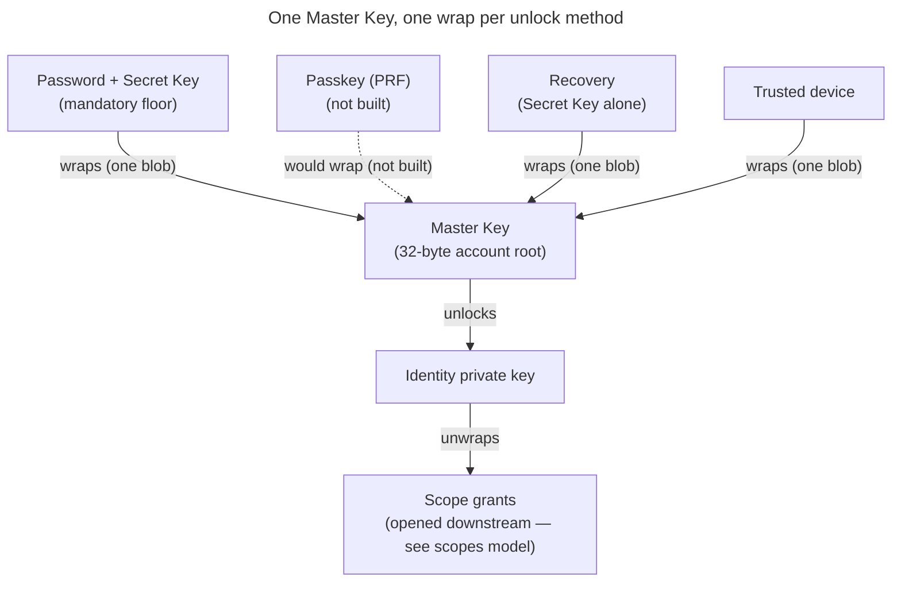

# Enabler: Account keys — identity, Master Key, unlock & recovery

- **ID:** en.account.key-model
- **Type:** **Enabler** — structural foundation, no standalone end-user goal
  ([features/README → use-case vs enabler vs ADR vs change-request](../../README.md#use-case-vs-enabler-vs-adr-vs-change-request)).
- **Provides:** a **single account's** key model — the identity keypair, the one **Master Key** (wrapped once
  per unlock method), the **unlock methods + KEK derivation** that open it, and recovery — plus the sessions
  that sign it in, where its unlocked keys live on a device, how a device is linked and how a session ends. It
  is the **root of the key chain** the scope + content keys extend downstream.
- **Serves (use-cases):** [login](../use-cases/uc.account.login.md), [unlock](../use-cases/uc.account.unlock.md),
  [trust-device](../use-cases/uc.account.trust-device.md),
  [remember-this-device](../use-cases/uc.account.remember-this-device.md),
  [sessions](../use-cases/uc.account.sessions.md),
  [onboard-device](../use-cases/uc.account.onboard-device.md),
  [recover-access](../use-cases/uc.account.recover-access.md),
  [change-password](../use-cases/uc.account.change-password.md),
  [rotate-keys](../use-cases/uc.account.rotate-keys.md); and downstream
  [en.spaces.personal-scope](../../spaces/enablers/en.spaces.personal-scope.md) →
  [en.platform.node-tree](../../platform/enablers/en.platform.node-tree.md) build their scope/content keys on it.
- **Depends on:** the crypto strategy ([ADR 0017](../../../decisions/0017-crypto-primitives-and-post-quantum-strategy.md))
  + the operator-blind auth/unlock split ([ADR 0003](../../../decisions/0003-operator-blind-password-auth.md),
  [ADR 0005](../../../decisions/0005-unlock-methods-and-device-trust.md)).
- **Out of scope (by design):** what the account's keys open — **scope, content and share keys**, grants and the
  invite, scope rotation, securing the account, the key chain and identity trust — is the topic's current picture,
  [keys, grants and trust](../../../crosscutting/keys-grants-and-trust.md); exact **byte formats** (suite layouts, the X-Wing
  KEM's encodings, seal encodings) in the conformance-pinned suite
  ([`packages/crypto/src/v1.ts`](../../../../src/packages/crypto/src/v1.ts)) and its vectors
  ([`contracts/crypto/vectors/v1.json`](../../../../contracts/crypto/vectors/v1.json)), and what every seal binds is
  [ADR 0072](../../../decisions/0072-a-seal-binds-its-object.md). Whole-system security concern: the sibling
  [Security Model](../../../crosscutting/security-model.md).

> **No end-user section** (enabler) — its value surfaces through the account use-cases it serves. Plain-language
> companion: [docs site: Your Emergency Kit](../../../../site/src/content/docs/getting-started/emergency-kit.mdx). Built as
> stated, except the passkey method, marked **not built** where it appears.

## Principle: one Master Key, many wraps

There is exactly **one Master Key** per account. It is *wrapped* (locked) **separately by each unlock
method** the user sets up. Any one method opens the **same** Master Key, which unlocks the **identity
private key**, which in turn opens every scope grant the user holds. Adding or removing a method
adds/removes **one wrap** — content is never re-encrypted.

## Account key inventory

Account-level keys only (scope/content/share/invite keys are in the scopes model). A `wrapped*` field is
always ciphertext the server stores but cannot open.

| Name / API field | Kind | Server-visible form | Used for |
|---|---|---|---|
| Account password | Human secret, **never sent to the server** | — (never leaves the device) | Locally derives two domain-separated things: the **auth keypair** (login) and the **unlock KEK** (with the Secret Key, to open a Master Key wrap). |
| Auth keypair (`authPublicKey` / `authPrivateKey`) | Ed25519 signing keypair derived from the password (`seed = Argon2id(password, authSalt)`) | Only the **public** key is stored; the private key is derived on demand, never stored or sent | Login by **challenge-response**: the client signs a server nonce with `authPrivateKey`; the server verifies with `authPublicKey`. Separate from the identity keypair and from content; Ed25519 now, PQ/hybrid later. |
| Secret Key | High-entropy user-held secret (Emergency Kit / enrolled devices) | **Never** stored server-side | Combined with the password for two-secret key derivation (2SKD); protects content unlock after a DB breach. Replaced only when the account is secured, which issues a new Emergency Kit ([Rotation after a compromise](#rotation-after-a-compromise)); a password change, a reset and a change of the sign-in address keep it. The derivation is [Unlock methods & KEK derivation](#unlock-methods--kek-derivation) below; the threat it answers is [Security Model → Threat model](../../../crosscutting/security-model.md#threat-model--trust-boundaries). |
| Master Key | 32-byte symmetric account root | Only as `MasterKeyWrap.wrappedKey`: one `PASSWORD` and one `RECOVERY` wrap, plus one per enrolled device (`DEVICE`, `DEVICE_KEY`); the contract also names `PASSKEY`, which no client writes yet | Opens `wrappedIdentityPrivateKey`. Stable across a password change and a reset (only a rotation replaces it); a credential change rewrites the two cold wraps and deletes every other one (below). |
| Unlock KEK | Derived in-memory wrapping key | **Never** stored server-side | Opens exactly one Master Key wrap. Derived on the client, then discarded. |
| Identity public key (`identityPublicKey`) | `lp(kem) ‖ lp(sign)`: the X-Wing encapsulation key (X25519 + ML-KEM-768, 1216 bytes — [ADR 0017](../../../decisions/0017-crypto-primitives-and-post-quantum-strategy.md) decision 2) + the Ed25519 signing public key | Published in the key directory | Grant address ("mailbox slot"); fingerprint/safety-number input; verifies the grants this user signs ([ADR 0028](../../../decisions/0028-identity-authenticity-tofu-verification.md) Decision 6). |
| Identity private key (`wrappedIdentityPrivateKey`) | `lp(kemSeed) ‖ lp(sign)`: the 32-byte X-Wing seed, which is X-Wing's decapsulation key and derives the encapsulation key, + the Ed25519 signing seed | Only wrapped under the Master Key | Opens scope grants wrapped to this user; signs every grant this user issues. |
| `RECOVERY` wrap | A `MasterKeyWrap` opened by the **Secret Key alone** (`kekRecovery(secretKey, salt)` — no password) | `MasterKeyWrap.wrappedKey`, **withheld** server-side until a two-factor release | Opens the Master Key when the password is gone. There is **no separate recovery code**: the recovery factor *is* the Secret Key from the Emergency Kit ([ADR 0054](../../../decisions/0054-password-recovery-two-factor-release.md)). |
| Secret-Key proof key | Ed25519 signing keypair derived from the **Secret Key alone** | Only the **public** key, registered at account birth and replaced when the account is secured | Signs every request that mints a cold credential — rotation, change-password, recovery completion, a change of the sign-in address — so the **server** can refuse a caller without the Secret Key ([ADR 0060](../../../decisions/0060-key-rotation-after-compromise.md) Decision 2). Replaced with the Secret Key, under a signature of the current one, and named in the account's key chain. Decrypts nothing. |

## Auth vs. unlock — two separate layers

These are deliberately distinct (this is the crux of operator-blind sign-in):

- **Auth (server login):** the **password never reaches the server.** The client derives an Ed25519
  **auth keypair** from the password (`seed = Argon2id(password, authSalt)`) and registers only the
  **public** key. Login is **challenge-response**: the server issues a single-use nonce, the client signs
  it with `authPrivateKey`, the server verifies with the stored `authPublicKey` and issues a session.
  This gates a *session and server role* — it **never** unlocks content. A DB dump yields only the public
  key (not a credential): forging a login means breaking Ed25519 (~2¹²⁸) or brute-forcing the password
  through Argon2id, either way buying a session + operational metadata, **never content**. The auth
  keypair is Ed25519 now and moves to a PQ/hybrid signature later (no harvest-now-decrypt-later for
  authentication — see [Security Model](../../../crosscutting/security-model.md) and [ADR 0003](../../../decisions/0003-operator-blind-password-auth.md)).
- **Unlock (client-side):** a **Unlock KEK** derived on the device opens one Master Key wrap. The KEK's
  source (password+Secret Key, the Secret Key alone, device key — and, once built, a passkey's PRF) is never sent
  to the server.

Don't confuse the public keys: the **identity public key** grants you *access to content* (others wrap
scope keys to it), while the **auth public key** only *proves your login* (verifies your signed
challenge). Separate keys for separate jobs. (A passkey — **not built** — would be an alternative login+unlock method:
its signature would authenticate and its **PRF** secret would derive an unlock KEK.)

## Sessions

A login (above) or a device-linking grant opens a **session family**; the decision and its rejected alternatives
are [ADR 0004](../../../decisions/0004-session-tokens.md).

- **Two opaque tokens, stored only as hashes.** An **access token** (15 minutes) is the bearer of every request;
  a **refresh token** (30 days, sliding — each refresh re-mints it) goes only to `POST /api/token/refresh`. A
  database dump yields no usable session.
- **What the server keeps per family:** an opaque id, a status, and when it was created and last used — no name,
  no origin, no device string. The display name and the device↔family join live in the Master-Key-sealed
  [device register](en.account.device-register.md). Listing (`/api/sessions`) and revoking need only a session;
  reading the names needs unlock ([uc.account.sessions](../use-cases/uc.account.sessions.md)).
- **Rotation and reuse detection.** Each refresh supersedes the presented token and mints its successor, numbered
  by generation. A superseded token presented again revokes the whole family — unless it is exactly one
  generation behind the family's current one, which rotates instead (the one-generation grace: a refresh whose
  response was lost, or a concurrent one). Superseded rows stay until they expire, each one a tripwire.
- **Transport.** A browser keeps the refresh token only in an httpOnly, `SameSite=Strict` cookie scoped to the
  refresh path (`Secure` outside local development), under a name that encodes its lifetime: `veyq_refresh`
  (persistent, `Max-Age` = the refresh TTL — "remember me") or `veyq_refresh_session` (no `Max-Age`, dropped
  when the browser closes — the default). The client chooses at login (`sessionScope`; the legacy `remember` flag
  means persistent where `sessionScope` is absent). A refresh re-sets the same name and clears the other, so it
  never changes a lifetime; logout clears both. A login that names neither gets its refresh token in the
  response body, and only the admin CLI does that (`src/admin-web/src/cli/`), because Node keeps no cookie jar.
- **Adoption.** A device brought in by a grant receives a refresh token inside the sealed envelope and spends it
  once at `POST /api/token/adopt`, which rotates it and returns the successor in the cookie of the lifetime that
  device chose — the only place besides login where a lifetime is chosen.

## Unlock methods & KEK derivation

| Method | Unlock KEK source | Notes |
|---|---|---|
| **Password + Secret Key** (`PASSWORD`) | `Argon2id(lp(secretKey) ‖ lp(password), salt)` — `kekPasswordSecret` | The **mandatory floor** — always present, cannot be removed. The Secret Key (never sent) is what stops a cracked password from opening content. |
| **Passkey (`PASSKEY`) — not built** | the authenticator's PRF output | **Not built:** the contract and the backend's `WrapMethod` name the method, but no client writes or opens such a wrap. The target: passwordless, one credential covering auth (signature) and unlock (PRF). |
| **Recovery (`RECOVERY`)** | `Argon2id(secretKey, recoverySalt)` — `kekRecovery` | Bypasses the **password**, never the Secret Key. Released only against address control + proof of the Secret Key ([ADR 0054](../../../decisions/0054-password-recovery-two-factor-release.md)). |
| **Trusted device (`DEVICE`)** | `Argon2id(lp(HMAC(deviceKey, "veyq/v1/device-bind")) ‖ lp(password), salt)` — `kekDevicePassword` | Two factors — the password **+** a device-bound key — swapping the *cold* Secret Key for a device-local one; this device unlocks with the **password alone** (no Secret Key). Still password-gated: a stolen device alone opens nothing. |
| **Passwordless device (`DEVICE_KEY`)** | a device-held **random** key `K` (`wrap = symWrap(K, masterKey)`) | **No password** — the device holds `K` ungated, so a stolen *unlocked* device opens content. Explicit opt-in, never a default: [remember-this-device](../use-cases/uc.account.remember-this-device.md). |

The factor comes first and every input is length-prefixed: `lp(x) = u32be(len(x)) ‖ x`, the password as its NFC
UTF-8 bytes. The functions are in [`v1.ts`](../../../../src/packages/crypto/src/v1.ts), pinned by the `kek` vectors in
[`v1.json`](../../../../contracts/crypto/vectors/v1.json).

Each KEK is derived **fresh on the device** with a stored salt (so it reproduces identically), used to
open its wrap, then **discarded**. None is ever stored or sent — which is exactly why the server stays
blind.

**Device keys are bound, not stored raw.** The `DEVICE` `deviceKey` is a **non-extractable** HMAC key (no
script can export its bytes, but the bind it computes is fixed and can be copied once — the password stays the
wrap's real second factor, [ADR 0005](../../../decisions/0005-unlock-methods-and-device-trust.md) §5); the `DEVICE_KEY` `K` is a
random key held by the device. Device trust is **per device**: each trusted/enrolled device writes **its own**
wrap (own key + salt), so a phone and a laptop are two independent wraps on the same Master Key — unlike the
floor methods, `DEVICE`/`DEVICE_KEY`/`PASSKEY` may appear more than once ([ADR 0005](../../../decisions/0005-unlock-methods-and-device-trust.md)).

## Adding / removing unlock methods

Adding a method writes **one new wrap** of the Master Key; removing one deletes that wrap. Content is
never touched. The **password + Secret Key floor cannot be removed** (it guarantees at least one
breach-resistant path always exists).

**A credential change keeps only the two cold wraps.** A password change, a reset and a rotation each keep
`PASSWORD` and `RECOVERY` — rewriting what they must — and delete **every other** wrap. The list names the
survivors, not the victims, and the direction is the point: a method added later is deleted by all three until
it is explicitly declared a survivor, and that declaration is a decision about the method, taken when it is
built. The default protects the case a reset exists for — a device- or authenticator-held KEK (`DEVICE`,
`DEVICE_KEY`, a future `PASSKEY`) would keep opening the account under a credential that was just replaced,
and "someone else holds my device" is a reason people reset. The backend holds this classification once, in
`core/identity`.

## Where the unlocked key lives

Once opened, the Master Key and the identity private key are held in the **page's memory** only
([`src/web/src/app/vault.ts`](../../../../src/web/src/app/vault.ts)) — never persisted, zeroed on sign-out, gone
on a reload. What re-opens them without a prompt is the device's tier
([ADR 0005](../../../decisions/0005-unlock-methods-and-device-trust.md) §18–23):

| Tier | What the device keeps | A reload | The next launch |
|---|---|---|---|
| "Remember me" off — the default | a `DEVICE` wrap; for the browser session, the Master Key's **ciphertext** in `sessionStorage`, sealed under a non-extractable AES-GCM key in IndexedDB | re-opens from the session vault | email + password |
| "Remember me" on | a `DEVICE_KEY` wrap, its key `K` in IndexedDB, a persistent cookie | opens straight in | opens straight in |
| Linked by a grant, "stay signed in" off | the session vault only — no password was ever typed to key a `DEVICE` wrap | re-opens from the session vault | a fresh pairing |
| Linked by a grant, "stay signed in" on | as "remember me" on | opens straight in | opens straight in |

A device's first unlock is the floor (password + Secret Key) unless a grant links it. While the operator's switch
for remembering devices is off, the server withholds the `DEVICE` / `DEVICE_KEY` wraps from the key material
without deleting them ([ADR 0088](../../../decisions/0088-the-capability-register-is-a-tree-switched-by-operator-and-tenant.md)
decision 5).

**Re-lock:** the vault closes when the session ends ([§ Session ending](#session-ending)), and the session tier
dies with the browser session. Nothing locks an open, idle tab: ADR 0005 §6 dropped an idle timeout (inbox #808).

## Device linking

An unlocked device brings in a new one over a channel the server only relays
([ADR 0059](../../../decisions/0059-device-linking.md); the flow is
[uc.account.onboard-device](../use-cases/uc.account.onboard-device.md)).

- **Two directions.** *Add a new device*: the trusted device shows the QR, and both screens show a five-digit code
  the user compares. *Sign in with a QR code*: the new device shows the QR, and the trusted device shows a
  six-digit code the user types into the new device.
- **The QR carries 32 random bytes and never a server address.** Both devices derive from them, under two HKDF
  labels, the channel's routing handle — the only thing the server receives — and a **channel key** that MACs the
  answer (the new device's ephemeral transport key, and the typed code's proof) and the envelope. The bytes are
  pinned by the `pairing_channel` vector in [`v1.json`](../../../../contracts/crypto/vectors/v1.json).
- **The envelope** is `asymWrap`ped to the new device's ephemeral key and carries the Master Key, the refresh token
  of one further session family minted for the account, the label the user typed, and the trusted device's
  identity trust marks. Its pickup is unauthenticated: without the ephemeral private key it is worthless.
- **A channel is single-use, one outstanding per account, and lives ten minutes** (`veyq.pairing.channel.ttl`);
  the endpoints are `/api/pairing/open`, `…/answer`, `…/delegate`, `…/seal` and `…/collect`.
- **The new device adopts first** (§ Sessions), with its own "stay signed in" answer, then unlocks with the
  granted Master Key, writes its register entry, and enrols a `DEVICE_KEY` wrap only if it stays signed in.
- **A grant cannot be taken back.** A revoke ends the session; the Master Key stays on that device. Ending the
  compromise is securing the account ([§ Rotation after a compromise](#rotation-after-a-compromise)).

## Revoke vs. wrap removal

- **A revoke takes no key material** ([ADR 0058](../../../decisions/0058-revoke-never-takes-key-material.md)). It ends
  the family's server access; the revoked device keeps its wrap, so at its next sign-in, which needs only the
  password, that wrap opens the Master Key with no Secret Key — and a `DEVICE_KEY` wrap takes no password at all.
- **"Sign out and remove this device's saved key"** is a separate, named action, offered where the device register
  names that device's wrap. It revokes the family first, then deletes the wrap
  (`DELETE /api/account/wraps/{id}`), restoring the Secret-Key floor for that device; a removal that did not
  finish is retried from [uc.account.sessions § Devices with a saved key](../use-cases/uc.account.sessions.md).
- Wraps the register cannot name are reached only as *"remove every saved key except this device's"*, never by a
  claim about the others.
- No wrap carries a device id, and the register's join never reaches the server — a contract shape
  `scripts/validate_device_shapes.py` holds.
- A password change, a reset and securing the account delete every wrap but the two cold ones, account-wide
  ([§ Adding / removing unlock methods](#adding--removing-unlock-methods)).

## Session ending

How a session ends on the web — sign-out, a refused refresh, another tab ending it — and what stays on the device
afterwards is [uc.account.sign-out](../use-cases/uc.account.sign-out.md). That the ending loads a new document
rather than resetting stores is [ADR 0070](../../../decisions/0070-a-session-ends-with-a-new-document.md).

## Rotation after a compromise

When key material reached someone it should not have — a phished device-link grant
([ADR 0059](../../../decisions/0059-device-linking.md)), a leaked Secret Key — *Secure your account* replaces the
Master Key, the identity keypair **and** the Secret Key together, gated on a cold unlock (password + Secret Key, or
the Secret Key alone through recovery), never a device wrap. It issues a **new Emergency Kit**, saved and confirmed
before anything is published, and rewrites the `PASSWORD` and `RECOVERY` wraps under the new Secret Key, so the old
kit opens nothing; every other wrap is deleted. The new identity is a step of the account's key chain, signed by the
old identity and the old Secret-Key proof key. What it does to the account's spaces — the staged self-grants, the
publish, each next epoch — is [keys, grants and trust § Securing the account](../../../crosscutting/keys-grants-and-trust.md#securing-the-account);
the decision is [ADR 0060](../../../decisions/0060-key-rotation-after-compromise.md), the flow
[uc.account.rotate-keys](../use-cases/uc.account.rotate-keys.md).

## Recovery — three independent paths, no escrow

A forgotten password must not mean lost memories — yet there is **no escrow**. Everything hangs off the
*Master Key / identity key*, not the password, so recovering the key by **any** route restores **all**
scopes at once:

1. **Another enrolled device** — still holds the keys; set a new password from there.
2. **Emergency Kit (Secret Key) + master password** — sign in on a fresh device.
3. **The withheld `RECOVERY` wrap** — released against **two** factors, a mailed one-time token (address
   control) and possession of the Secret Key, proven by a signature of the Secret-Key proof key
   ([ADR 0054](../../../decisions/0054-password-recovery-two-factor-release.md),
   [uc.account.recover-access](../use-cases/uc.account.recover-access.md)).

**The recovery token.** A request (`/api/recovery/request`) answers the same for every address; only for a member
of the tenant it arrived on does it then store a random token's SHA-256 hash with an expiry and mail the raw
token in the link's URL fragment (a tenant that cannot send mail answers `503 mail_unavailable` instead). The
token lives **one hour** (`veyq.recovery.token.ttl=PT1H`); a scheduled sweep marks overdue tokens expired, and
spent or expired rows are purged after seven days (`veyq.recovery.token.retention`), so a replay reads as spent
rather than unknown. Release (`/api/recovery/release`) hands out the withheld wrap; completion
(`/api/recovery/complete`) spends the token by a compare-and-set and, in the same transaction, rewrites the
`PASSWORD` wrap and the auth public key, deletes every other wrap but `RECOVERY`, revokes every session and
records the mailed address as confirmed.

Every path runs through the Secret Key or an already-enrolled device — there is **no** standalone code, so
losing the Emergency Kit narrows recovery to path 1. After recovery the user sets a new password, which
re-derives the auth keypair and re-registers its public key; the Emergency Kit stays valid, because recovery keeps
the Secret Key — only securing the account replaces it, with a new kit. The Master Key itself is unchanged, so
content stays intact.

**The one unrecoverable case (stated up front):** losing *every* path — no device, no Emergency Kit,
no password — means the content is gone. The same property that blinds the operator stops
it rescuing data.

## The Emergency Kit

The kit is the Secret Key made portable, and it is a **format with two writers and one reader**: `web` writes
it when an account is born by joining a tenant and when an account is secured (a new Secret Key), `admin-web` when the Server Owner's account is born at setup
([ADR 0065](../../../decisions/0065-admin-ui-cli-separate-service.md)), and only `web` reads it, at unlock.
Two round-trip tests in two packages cannot keep a writer and a reader in agreement, so the codec exists
**once**, in `@veyq/crypto`, pinned by a fixed-literal vector.

- **The token** is `veyqkit:` followed by the unpadded base64url of the UTF-8 bytes of the compact JSON
  `{"v":3,"email":…,"sk":…,"srv":…}`, in that key order — `sk` being the Secret Key in its text form (below), `srv` the
  origin of the server the kit was made on (`https://veyq.example.com`), left out where the writer knows none. `v` is
  the version. A reader rejects any other `v` (version 1 carried the key as base64, version 2 had no `srv`; neither is in
  use), an `email` that is not a non-empty string, an `sk` that does not read as a Secret Key, and an `srv` that is not
  exactly an http or https origin as the URL standard serializes it (no path, no trailing slash, no default port, a
  lower-case host). The password is never in it. `contracts/crypto/vectors/v1.json` § `emergency_kit_token` pins it, for
  `@veyq/crypto` and the native apps alike.
- **The server is a hint, never a check.** It is there so a reader can say where a kit was made, and a native app can
  fill in the server it signs in to. An account may be reached under several addresses and a domain can change over
  the years a kit lies in a drawer, so no reader refuses a kit for its server: `web` says, as information, where a kit
  made at another address was made ([uc.account.unlock](../use-cases/uc.account.unlock.md)). `web`'s kit takes the
  origin of the page it is made on; `admin-web`'s, served on localhost, takes the address the Server Owner types at setup,
  if any ([uc.admin.setup-server](../../admin/use-cases/uc.admin.setup-server.md)).
- **It travels three ways, and each is part of the format:** as the **QR code**; as **printed** email +
  Secret Key for typing; and as a literal string in the PDF's **document information** (`keywords`), because
  a file import finds the kit by scanning the file's bytes for `veyqkit:`. The document information is not a
  compressed stream, so PDF compression leaves it intact. A writer that stops putting the token there breaks
  the first step of every import of the kits it writes, while its QR codes keep scanning.
- **A kit that is no longer the file the writer made is still a kit.** `web`'s import reads a PDF in this order:
  (a) the token in the file's bytes; (b) the document information's `Keywords` as pdf.js decodes it, for a viewer
  that re-saved the file with that string compressed or re-encoded; (c) the QR, drawn from each of the first three
  pages 2400 px wide and read in both polarities, for a copy printed to PDF (the drawing survives, the document
  information does not) and a photo or scan of the sheet saved as a PDF. An image file goes straight to its QR, drawn
  2400 px on its longer side. What was measured (macOS PDFKit's save keeps the token raw, a Quartz redraw drops it,
  and how much distortion a photographed kit stands) is stated where the fixtures are,
  `src/web/src/features/account/emergencyKit/emergencyKit.import.test.ts`.
- **The printed text follows the writer's UI language; the token never does.** The sheet is one A4 page: the
  email and the Secret Key; where the person signs in — three form fields for addresses, fillable on screen or by
  hand, the first holding the kit's server as a person types it (its host), where the kit has one; the QR with three
  steps, the third saying that the password is deliberately not on the sheet; how to keep it; and the docs site's
  forgot-password page in the writer's language. The layout code is per package (no UI in `@veyq/crypto`), the two kept
  line for line alike.

### The Secret Key's text form

How a Secret Key is printed, typed, carried in the token and compared — the one form, in `@veyq/crypto/secretKey`,
pinned by `contracts/crypto/vectors/v1.json` § `secret_key_text`. The 32 key bytes are written as 52 Crockford base32
symbols (`0-9`, `A-Z` without `I`, `L`, `O`, `U`; the bytes as one big-endian bit string, four zero bits appended),
then **2 check symbols**: the first 10 bits of SHA-256 over the 32 bytes. The 54 symbols are shown as 9 groups of 6
joined by `-` (on the kit, three lines of three groups). A reader folds case, drops spaces and hyphens, and reads `O` as
`0` and `I`, `L` as `1`, as the invite code does. What then is not 54 symbols of the alphabet is **malformed**; 54
symbols that are not exactly the form of the bytes they decode to — a check that disagrees, or padding bits set in
the 52nd symbol — are a **typo**, and the Secret-Key field says so before anything is derived (one misread symbol
slips past the check with probability 2^-10). Every flow that takes a typed key decodes it here; a key that does not
read is a credential that does not match.

## Registration (account creation) — high level

On registration the **device** generates the identity keypair, the **auth keypair** (derived from the
password), and the Master Key, writes one wrap per chosen unlock method, and the user saves the
**Emergency Kit** (the Secret Key). The server only ever receives ciphertext (`wrapped*`) and
public keys — **never the password**. Birth also writes the unsigned genesis of the account's key chain, and joining
a tenant grants the account the tenant's key from its invite
([keys, grants and trust](../../../crosscutting/keys-grants-and-trust.md#a-member-invite-is-a-placeholder-member)).

## Related

- Feature: [Account & auth](../_index.md)
- Decisions: [ADR 0003](../../../decisions/0003-operator-blind-password-auth.md) (the auth keypair — why the
  password never reaches the server), [ADR 0004](../../../decisions/0004-session-tokens.md) (session tokens and
  families), [ADR 0005](../../../decisions/0005-unlock-methods-and-device-trust.md)
  (which unlock methods exist and how a device earns one),
  [ADR 0054](../../../decisions/0054-password-recovery-two-factor-release.md) (recovery's two factors),
  [ADR 0058](../../../decisions/0058-revoke-never-takes-key-material.md) (a revoke takes no key material),
  [ADR 0059](../../../decisions/0059-device-linking.md) (device linking),
  [ADR 0070](../../../decisions/0070-a-session-ends-with-a-new-document.md) (a session ends with a new document),
  [ADR 0017](../../../decisions/0017-crypto-primitives-and-post-quantum-strategy.md) (the primitives + the
  conformance vectors that pin their bytes)
- Serves: [login](../use-cases/uc.account.login.md), [unlock](../use-cases/uc.account.unlock.md),
  [trust-device](../use-cases/uc.account.trust-device.md),
  [remember-this-device](../use-cases/uc.account.remember-this-device.md),
  [sessions](../use-cases/uc.account.sessions.md),
  [onboard-device](../use-cases/uc.account.onboard-device.md),
  [recover-access](../use-cases/uc.account.recover-access.md),
  [change-password](../use-cases/uc.account.change-password.md), [rotate-keys](../use-cases/uc.account.rotate-keys.md)
- Downstream: [en.spaces.personal-scope](../../spaces/enablers/en.spaces.personal-scope.md) →
  [en.platform.node-tree](../../platform/enablers/en.platform.node-tree.md) build their scope/content keys on this root
- Concepts: [keys, grants and trust](../../../crosscutting/keys-grants-and-trust.md) (the keys this root opens, rotation
  and identity trust), [security-model](../../../crosscutting/security-model.md) (the whole-system boundary),
  [scopes & tenancy](../../../crosscutting/scopes-and-tenancy.md) (scopes and membership)
- Security area of the docs site: [Key hierarchy](../../../../site/src/content/docs/security/key-hierarchy.md), [Protocols](../../../../site/src/content/docs/security/protocols.mdx), [Roadmap](../../../../site/src/content/docs/security/roadmap.md)
- End-user view (docs site): [Accept an invitation](../../../../site/src/content/docs/getting-started/accept-an-invitation.mdx)
- End-user view (docs site): [Your Emergency Kit](../../../../site/src/content/docs/getting-started/emergency-kit.mdx)
- End-user view (docs site): [Lost Emergency Kit](../../../../site/src/content/docs/help/lost-emergency-kit.mdx)
