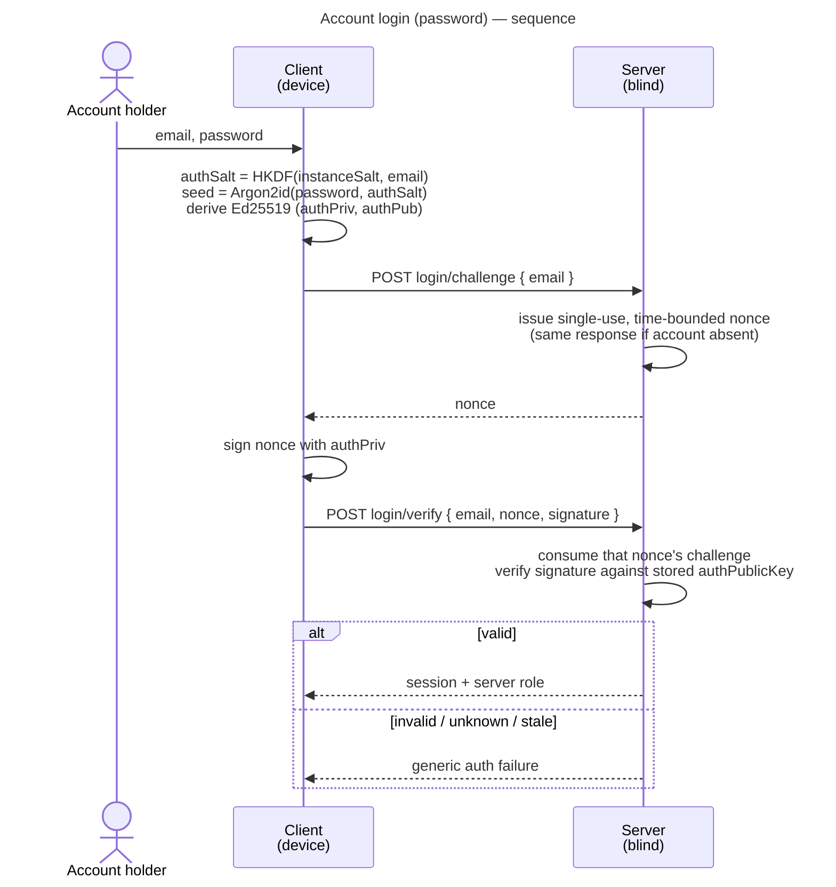
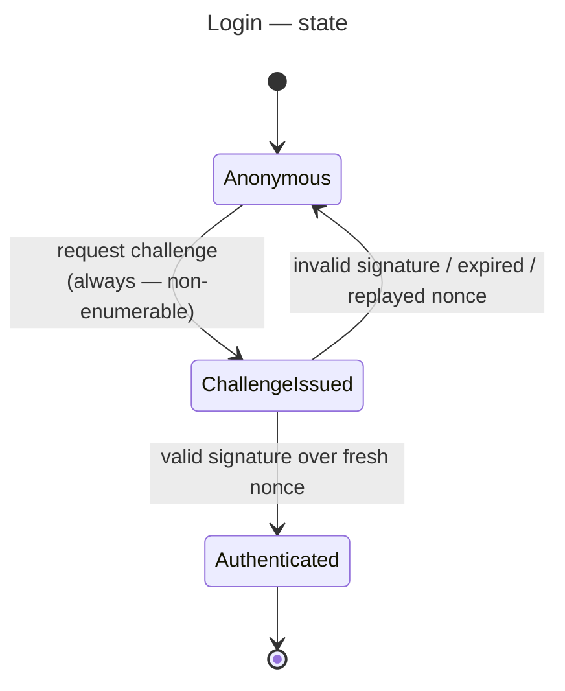

# UC: Account login (password)

- **ID:** uc.account.login
- **Primary actor:** Account holder (a user whose account already exists on the instance)
- **Goal:** Authenticate to the instance using the **password-derived auth keypair** via
  **challenge-response** and obtain a session — without the server ever seeing the password.
- **Preconditions:** The instance is set up; the account exists, i.e. its `authPublicKey` was registered
  at setup ([uc.admin.setup-server](../../admin/use-cases/uc.admin.setup-server.md)) or when joining a
  tenant.
- **Postconditions (success):** The client holds a valid **session** bound to the account and its server
  role; the server has verified a **fresh signed challenge** against the stored `authPublicKey`; no
  password and nothing replayable was transmitted. **No content is unlocked** — opening the Master Key is
  a separate step (see *Related*).

## Main flow

1. The user enters their **email** and **password** (the mandatory auth floor).
2. The client derives, **on device**: `authSalt = HKDF(instanceSalt, normalizedEmail)`, then
   `seed = Argon2id(password, authSalt)`, then the **Ed25519 auth keypair** `(authPriv, authPub)`
   (domain-separated from the unlock KEK). The password never leaves the device.
3. The client requests a **login challenge** for the email; the server issues a **single-use,
   time-bounded nonce**. The server responds **identically** whether or not the account exists
   (non-enumerable). A new challenge never replaces an older one: an email may have several outstanding
   at once, each verifiable on its own.
4. The client **signs the nonce** with `authPriv` and sends the signature together with the email **and
   the nonce it signed**.
5. The server looks up **that** challenge by (email, nonce), consumes it, and **verifies** the signature
   against the stored `authPublicKey`. On success it issues a **session** (and the account's server role);
   on failure it returns a **generic auth failure**. No other outstanding challenge is touched.

## Alternate / exception flows

- **A1 — passkey (deferred):** a registered passkey is an alternate auth method (its signature
  authenticates); covered by a **separate use-case**, not this flow.
- **E1 — wrong password:** the derived keypair does not match the stored `authPublicKey`; signature
  verification fails → **generic auth failure**, indistinguishable from an unknown account.
- **E2 — unknown account:** the server still issues a nonce and still fails verification identically →
  **non-enumerable**; the response never signals whether the account exists.
- **E3 — expired or replayed nonce:** a nonce is single-use and time-bounded; a stale or reused nonce is
  rejected and the client must request a fresh challenge.
- **E4 — someone else asks for a challenge for your email, or sends a bad verify for it:** they get, and
  can only burn, **their own** challenge. The one your device is signing stays outstanding, so your login
  completes. They cannot learn your nonce: it goes only to the client that asked for it.

## Login state

## Quality notes

- **Operator-blind auth.** The password is never sent — at login or anywhere. The server stores only
  `authPublicKey`; a DB dump yields a **public key, not a credential**. Forging a login means breaking
  Ed25519 (~2¹²⁸) or brute-forcing the password through Argon2id. See
  [ADR 0003](../../../decisions/0003-operator-blind-password-auth.md).
- **Non-enumerable.** `authSalt` is deterministic from the email, a nonce is **always** issued, and
  failures are **generic**, so the server behaves identically for existing and non-existing accounts —
  it never reveals who holds an account. See [Security Model](../../../crosscutting/security-model.md).
- **Auth ≠ unlock.** Login only gates a **session + server role**; it **never** unlocks content. The
  **Secret Key is not used here** — it belongs to the *unlock* layer (`Argon2id(password + Secret Key)` →
  Unlock KEK), which is a separate use-case. See
  [Account & Key Model → Auth vs. unlock](../enablers/en.account.key-model.md).
- **Replay-resistant.** Authentication is a signature over a fresh single-use nonce, not a transmitted
  bearer secret. Single use holds **per nonce**: the verify row-locks the one challenge it consumes, so two
  concurrent verifies of the same captured signature cannot both mint a session.
- **Nobody can keep you from signing in.** Challenges are keyed by nonce, not by email. With one challenge
  per email, anyone who knew an address could replace it (a new challenge) or burn it (a garbage verify)
  every second or two, well inside the per-IP rate limit, while the victim's device was still running
  Argon2id, so every fresh login failed. There is deliberately **no cap** on outstanding challenges per
  email: a cap that evicts the oldest, or refuses the newest, is the same displacement lever again. The
  table is bounded instead by the per-IP rate limit ([cc.security.rate-limit](../../../crosscutting/cc.security.rate-limit.md))
  times the challenge TTL, and expired rows are purged.
- **Session shape is decided in [ADR 0004](../../../decisions/0004-session-tokens.md).** Opaque,
  server-stored, rotating access + refresh tokens grouped into named session families; this use-case
  issues such a session on success but does not restate the mechanics.
- **PQ posture.** Ed25519 now; migrate to a PQ/hybrid signature (ML-DSA) later via a suite bump. A login
  signature is a one-time live check — there is no harvest-now-decrypt-later for authentication.

## User impact

You sign in to your space without your password ever leaving your device, so the server cannot learn it or use it to
pose as you.

## Related

- Feature: [Account & auth](../_index.md)
- Concepts: [Account & Key Model](../enablers/en.account.key-model.md) (auth vs. unlock, auth
  keypair), [Security Model](../../../crosscutting/security-model.md) (operator-blind, non-enumerability)
- Decisions: [ADR 0003](../../../decisions/0003-operator-blind-password-auth.md) (password-derived keypair
  + challenge-response), [ADR 0004](../../../decisions/0004-session-tokens.md) (session token form)
- Related use-cases: [sign-out](uc.account.sign-out.md) (the web side of ending the session this login
  opened); [setup-server](../../admin/use-cases/uc.admin.setup-server.md) (registers
  `authPublicKey`); [unlock](uc.account.unlock.md) (opens the Master Key);
  [change-password](uc.account.change-password.md); log in with a passkey — planned
- End-user view (docs site): [Sign in](../../../../site/src/content/docs/getting-started/sign-in.mdx)
