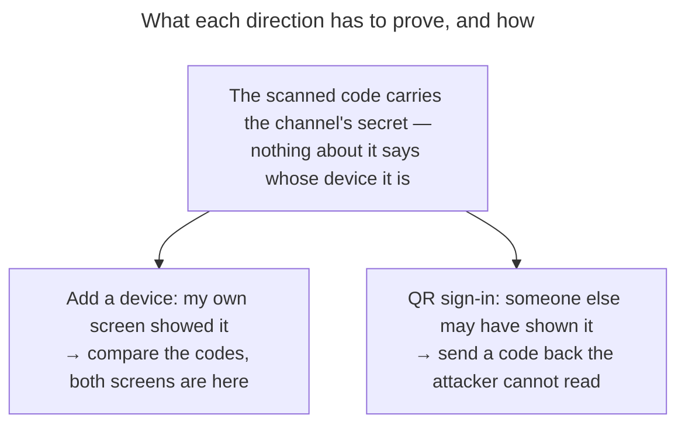

# UC: Onboard a device from one you are already signed in on

- **ID:** uc.account.onboard-device
- **Primary actor:** Account holder holding **two** devices — one signed in and **unlocked**, one that is to
  be let in
- **Goal:** Let the second device sign in **and** unlock without the Secret Key, by having the first one seal
  the Master Key and a session to it over a channel the blind server only relays.
- **Preconditions:** One device with an **unlocked** vault and a live session. The other device has the
  instance open and a camera on at least one of the two. **No Secret Key, and no password on the new device**
  ([ADR 0059](../../../decisions/0059-device-linking.md) §2).
- **Postconditions (success):** The new device holds the Master Key and its own session family, has enrolled a
  `DEVICE_KEY` wrap, and appears named in [uc.account.sessions](uc.account.sessions.md) on every unlocked
  device. The pairing row is spent. The server saw two opaque public keys and one ciphertext envelope, and
  learned no account identifier from the new device at any point.

## Two directions, one mechanism

The sealing is identical in both; what differs is who shows the code, who scans it, and therefore which
binding step is worth anything ([ADR 0059](../../../decisions/0059-device-linking.md) §1, §5). Each device
offers both halves — *show a code* and *scan a code* — so the device with the camera is always the one that
scans, and neither direction is the "phone" one.

- **Add a new device** — you are at the signed-in device and reach for a second. It **displays**; the new one
  scans. Nobody can substitute what your own device shows, so the confirmation is a **comparison**.
- **Sign in with a QR code** — you are at the new device with no Emergency Kit. It **displays**; you pick up
  the signed-in device and scan. Here your device is scanning something from outside, so the confirmation is a
  **transcription in the reverse direction** — and that is the whole reason the two ceremonies differ.

## Main flow — add a new device

1. On the signed-in, unlocked device the account holder opens **add a device**. It mints a 32-byte
   **secret**, derives from it the channel's routing **handle** and a **channel key**, opens the channel on its
   own server under the handle, and displays the secret as a code. The server only ever receives the handle
   ([ADR 0059](../../../decisions/0059-device-linking.md) §11). None of these is a keypair: in this direction the
   trusted device holds none at all — only the new device mints one (§3) — and keeping them apart is what lets
   the displayed code mean one thing in both directions.
2. The new device scans it and derives the same handle and channel key. It mints a single-use **ephemeral
   transport keypair** and posts its public key to that channel, with a MAC over it under the channel key —
   reaching the server it already has open, never one named by the code
   ([ADR 0059](../../../decisions/0059-device-linking.md) §4). The trusted device refuses an answer whose MAC
   does not verify before it shows any number: the relay carries the answer, sees the number the new device
   will show, and could otherwise grind a key of its own to match it (§11).
3. Both devices derive a short **check number** from the answering key. The new device shows it; the trusted
   device shows it inside its confirmation.
4. The account holder confirms that the two match, names the device, and completes a **slide** confirmation
   that states what is being granted and that signing the device out later will not take it back.
5. The trusted device seals the **Master Key, a freshly minted session's refresh token, and the label** to the
   answering public key and posts the envelope, with a MAC over it under the channel key.
6. The new device picks the envelope up, verifies its MAC — anyone can seal to its public key, so only the MAC
   says the grant came from the device that showed the code (§11) — and opens it with its ephemeral private key. Before anything else it
   answers the ordinary *"stay signed in"* question (E5) and **adopts** the handed-over refresh token into a
   session of its own — spending it, and receiving in exchange the same httpOnly cookie every other session
   here rides on ([ADR 0004](../../../decisions/0004-session-tokens.md) § Transport). Only then does it unlock,
   and on that first unlock it writes its own register entry using the label it was handed
   ([en.account.device-register](../enablers/en.account.device-register.md), write moment 1). The order is
   forced twice over: unlocking and the register write need an authenticated session, and the lifetime chosen
   in that one question can never be changed afterwards.
7. It enrols a `DEVICE_KEY` wrap, exactly as any remembered device does, and the pairing row is spent.

## Main flow — sign in with a QR code

1. On the new device the account holder chooses **sign in with a QR code** on the sign-in form — beside
   [uc.account.sessions](uc.account.sessions.md) E3's other two ways in, and like them without a session and
   without a shell route.
2. The new device mints its **ephemeral transport keypair** and a channel **secret**, opens a pairing channel
   under the handle the secret derives on the instance it has open, and displays the secret as a code — the
   same payload the other direction displays, under its own marker so a code shown for one direction cannot be
   scanned into the other. The key
   itself does **not** travel in the code: a post-quantum transport bundle serialises to 1256 bytes, which is a
   153-module QR (version 34) nobody scans reliably and which sits past the decoder defect
   [`web/CLAUDE.md`](../../../../web/CLAUDE.md) grants its QR reader an exception around. Nothing is lost by
   relaying it instead, because the relayed key is MACed under the channel key the secret derives, and the code
   is bound into the same MAC (§5, §11). It sends **no account identifier** — which account this becomes is decided by
   whoever scans.
3. The account holder picks up the signed-in, unlocked device and scans.
4. That device states what is being granted and displays a short **pairing code**, which the account holder
   types into the **new** device.
5. The new device sends its transport public key together with a proof that it knows that code — a MAC over
   the key and the code under the channel key — as the channel's one relayed answer. The trusted device checks
   the proof against the code it displayed. The relay reads the proof and cannot grind the code out of it, nor
   prove it for a key of its own: it does not hold the channel key (§11).
   The transcription is editable until it is sent and there is exactly **one** send: the answer slot is
   write-once and the channel carries no status to refuse through, so a wrong proof abandons the pairing rather
   than offering a retry ([ADR 0059](../../../decisions/0059-device-linking.md) §6).
6. **Only once the proof holds** does the trusted device take the device's name and the **slide** confirmation,
   and seal. The gesture is the last step before the irreversible one in *both* directions, and for the same
   reason: it is a deliberate act over a device that has already proven it is the one in front of you
   ([ADR 0059](../../../decisions/0059-device-linking.md) §7). What is being granted is on screen from step 4 —
   information comes early, the commitment comes last.
7. From here it is steps 5–7 of the other direction, unchanged.

## Alternate / exception flows

- **E1 — the pairing expires.** A channel is short-lived and single-use, and only one is outstanding per
  account. An expired or spent channel answers exactly as an unknown one does, so the endpoint cannot be used
  to probe which pairings exist.
- **E2 — the codes do not match** (add-a-device), **the pairing code is refused** (QR sign-in), or **the answer's
  MAC does not verify** (either direction — something without the code's secret answered). The
  confirmation is declined, nothing is sealed, and the channel is abandoned rather than retried in place: a
  mismatch is the one signal that something other than the intended device answered, and offering "try again"
  on the same channel would invite the user to grant past it. In the QR-sign-in direction the new device learns
  this only as the channel going quiet and then expiring — there is no refusal to relay back to it — so its copy
  tells the account holder to start again rather than to keep waiting.
- **E3 — the new device never picks the envelope up** (it was closed, the network dropped). The envelope
  expires with the row. Because it is sealed to a key only that device holds, an envelope left lying is not a
  secret in the open — but it is still swept, and a new pairing must be started rather than resumed.
- **E4 — the grant was a mistake.** It is contained, then ended — never reversed. The device is visible and
  named in [uc.account.sessions](uc.account.sessions.md), where its session can be revoked and its saved key
  removed, which restores the Secret-Key floor for it but does **not** take back the Master Key it already
  holds ([ADR 0059](../../../decisions/0059-device-linking.md) § Context). The remedy that does take it back
  going forward is [uc.account.rotate-keys](uc.account.rotate-keys.md): the Master Key and the identity are
  replaced together and every scope re-keyed, which locks the granted device out of everything **future**.
  Two things the copy must say and not soften: what that device already read stays read, and rotation needs
  the **Secret Key**, which this device never received — so the Emergency Kit has to be to hand.
- **E5 — the new device is only borrowed.** The ordinary "stay signed in" choice applies: declined, the device
  enrols no wrap and holds the Master Key for the session only, so closing the browser ends it and a later
  visit is a fresh pairing. This is the right shape for a machine that is not yours, and it is the same
  degradation [uc.account.remember-this-device](uc.account.remember-this-device.md) already defines.
- **E6 — the trusted device's session ends during the grant.** A password reset or change, a key rotation or a
  sign-out everywhere else, run from elsewhere while the trusted device delegates or seals, wins: the server
  re-reads the delegating session under the account lock and refuses a dead one with `401`, so no session is
  minted and no envelope sealed. Its refresh is refused too, so the trusted device runs
  [uc.account.sign-out](uc.account.sign-out.md)'s ending — and because that ending replaces the screen, the sign-in
  page says what happened: signed out mid-grant, no device let in, sign in and start again. The new device hears
  nothing (there is no refusal to relay to it, as in E2) and ends at E1 when the channel expires.

## Quality notes

- **Operator-blind.** The server relays two public keys and one ciphertext envelope. It never sees the Master
  Key, the label, the check number or the pairing code, and it learns no account identifier from the new
  device before the grant — the account is decided by the device that scans.
- **The scan is the security boundary, not the convenience.** It is what carries the channel's secret
  out-of-band, past a relay that could otherwise substitute its own key in either direction
  ([ADR 0059](../../../decisions/0059-device-linking.md) §11). The codes of §5 and that secret stop different
  parties: the codes stop someone who is not the relay (a photographed QR, a phisher's QR), the secret stops the
  relay. An attacker who both reads the QR and runs the relay is covered by neither. The digest and the decoder
  reuse [ADR 0028](../../../decisions/0028-identity-authenticity-tofu-verification.md)'s pattern — not its
  pinning decision, which is about a persistent account-global key and does not apply to a single-use one.
- **Nothing here wakes a device.** In both directions the account holder picks the second device up
  themselves, so there is no inbound approval prompt to fatigue — and that absence is deliberate, not a gap
  waiting for push.
- **A linked device is born at the password-less tier** and has never seen the password. Everything downstream
  — the wrap escalation, a password reset's wrap sweep — reaches it exactly as it reaches any remembered
  device, and lands harder, which its copy says.

## What this means for you / Was das für dich bedeutet

**EN —** You can let a new phone or laptop in without digging out your Emergency Kit: one device you are
already signed in on hands the other everything it needs. There are two ways round, and you pick whichever
suits the device in your hand. From the device you are signed in on, choose **"add a device"** — it shows a
code, your new device scans it, both screens then show a short number, and you check they match before sliding
to confirm. Or, standing at the new device with nothing but the app open, choose **"sign in with a QR code"** —
it shows a code, you scan it with your phone, and your phone then gives you a short code to type into the new
device. That last step feels like an extra hoop and it is the one that matters: it is how your phone can tell
that the thing it just scanned is really the device in front of you, and not a code someone sent you. Never
type a code someone gave you over the phone or in a message — nobody legitimate will ever ask you for one. If
the code is typed wrong, that attempt is over: your phone says so, and you simply start the whole thing again on
the new device. Two honest details. Adding a device gives it **everything**, permanently: it can read every memory you have, and
signing it out later stops it reaching the server but does not take the key back — so only ever add a device
you are holding. And a device added this way has no password saved on it, so if it ever forgets its key it
will ask you for your password and your Emergency Kit — or you add it again.

**DE —** Du kannst ein neues Handy oder einen neuen Laptop hereinlassen, ohne das Notfall-Kit herauszusuchen:
ein Gerät, an dem du schon angemeldet bist, gibt dem anderen alles Nötige. Es gibt zwei Wege, und du nimmst
den, der zum Gerät in deiner Hand passt. Am angemeldeten Gerät wählst du **„Gerät hinzufügen"** — es zeigt
einen Code, dein neues Gerät scannt ihn, danach zeigen beide Bildschirme eine kurze Zahl, und du prüfst, dass
sie übereinstimmt, bevor du zur Bestätigung schiebst. Oder du stehst am neuen Gerät und hast nur die App offen:
dann wählst du dort **„Über QR-Code anmelden"** — es zeigt einen Code, du scannst ihn mit deinem Handy, und
dein Handy nennt dir dann eine kurze Zahl, die du am neuen Gerät eintippst. Dieser letzte Schritt wirkt wie
eine Hürde zu viel und ist genau der wichtige: nur so kann dein Handy erkennen, dass das gerade Gescannte
wirklich das Gerät vor dir ist und nicht ein Code, den dir jemand geschickt hat. Tippe deshalb nie eine Zahl
ein, die dir jemand am Telefon oder in einer Nachricht durchgibt — seriös fragt danach niemand. Wird die Zahl
falsch eingetippt, ist dieser Versuch vorbei: dein Handy sagt es dir, und du fängst am neuen Gerät einfach neu
an. Zwei ehrliche Hinweise: Ein hinzugefügtes Gerät bekommt **alles**, dauerhaft — es kann jede deiner Erinnerungen lesen, und
späteres Abmelden hindert es nur daran, den Server zu erreichen, den Schlüssel nimmt es ihm nicht zurück. Füge
also nur Geräte hinzu, die du in der Hand hältst. Und ein so hinzugefügtes Gerät hat kein Passwort gespeichert:
Sollte es seinen Schlüssel je verlieren, fragt es dich nach deinem Passwort und deinem Notfall-Kit — oder du
fügst es erneut hinzu.

## Related

- Feature: [Account & auth](../_index.md)
- Decisions: [ADR 0059](../../../decisions/0059-device-linking.md) (this flow: the two directions, the grant of
  key **and** session, and why each direction's binding step differs),
  [ADR 0005](../../../decisions/0005-unlock-methods-and-device-trust.md) (the wrap the new device enrols, and
  the reservation this fills), [ADR 0004](../../../decisions/0004-session-tokens.md) (the family the grant
  mints), [ADR 0058](../../../decisions/0058-revoke-never-takes-key-material.md) (why a mistaken grant is
  contained rather than reversed), [ADR 0003](../../../decisions/0003-operator-blind-password-auth.md) (auth ≠
  unlock, and the non-enumerability the pairing channel keeps)
- Concepts: [en.account.key-model](../enablers/en.account.key-model.md) (the one Master Key this transfers),
  [en.account.device-register](../enablers/en.account.device-register.md) (who writes the new device's label,
  and why it is not the device that suggested it),
  [Security Model](../../../crosscutting/security-model.md)
- Related use-cases: [sessions](uc.account.sessions.md) (where a linked device is seen, named and severed —
  and whose E3 hosts the QR-sign-in entry),
  [remember-this-device](uc.account.remember-this-device.md) (the tier a linked device is born at),
  [unlock](uc.account.unlock.md) (the Secret-Key path this exists to avoid needing)
- End-user view (docs site): [Adding another device](../../../../site/src/content/docs/account/adding-another-device.md)
- Security area of the docs site: [Protocols](../../../../site/src/content/docs/security/protocols.mdx)
