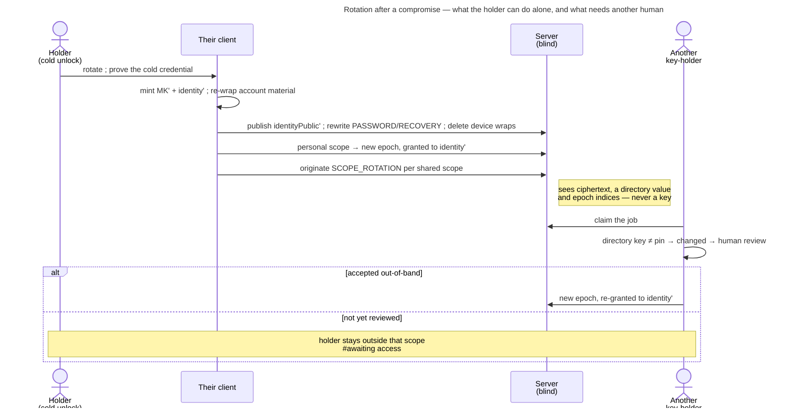

# UC: Rotate my keys after a compromise

- **ID:** uc.account.rotate-keys
- **Primary actor:** The **account holder**, authenticated and unlocked through a **cold** credential, who has
  reason to believe someone else holds their key material — a phished device-link grant
  ([ADR 0059](../../../decisions/0059-device-linking.md)) being the case that forces this feature to exist.
- **Goal:** **End** the compromise. Replace the **Master Key and the identity keypair together**, re-key every
  scope so the old identity reads nothing new, and be re-admitted to each shared scope by a human who checks
  out-of-band ([ADR 0060](../../../decisions/0060-key-rotation-after-compromise.md)).
- **Preconditions:** An authenticated session **and** a vault opened by a **cold** unlock — the `PASSWORD` wrap
  (password + Secret Key) or the released `RECOVERY` wrap (Secret Key + address control,
  [uc.account.recover-access](uc.account.recover-access.md)). A `DEVICE`, `DEVICE_KEY` or restored-session
  unlock does **not** qualify: the Secret Key is precisely what the attacker does not hold, so it is what the
  gate asks for.
- **Postconditions (success):** The account has a **new Master Key** and a **new published identity public
  key**. Every wrap that could not be rewritten (`DEVICE`, `DEVICE_KEY`, `PASSKEY`) is gone; the `PASSWORD` and
  `RECOVERY` wraps are rewritten under the **same** KEKs, so the **Emergency Kit stays valid**. Every
  Master-Key-sealed blob is re-sealed and `recoveryMasterKeyTag` re-derived. Self-served scopes sit at a new
  epoch granted to the new identity; every shared scope carries a queued rotation for another key-holder to
  complete. Every other session is revoked. **What the old identity already read is not retracted.**

## Main flow

1. **Entry.** Settings → Personal → security. The screen states, before any button, the three things that
   decide whether the user should be here at all: it ends the compromise but retracts nothing; it signs every
   other device out and takes their saved keys; and it needs the Emergency Kit.
2. **The cold gate.** The client checks *which* wrap opened this vault. If it was a device wrap or a restored
   session, it asks for the password + Secret Key here and re-derives the floor KEK — the rotation runs from a
   cold credential or it does not run (E1).
3. **Mint.** The device generates a fresh Master Key `MK'` and a fresh identity keypair, entirely on-device.
4. **Re-wrap the account.** `symWrap(MK', identityPriv')` replaces `wrappedIdentityPrivateKey`; the `PASSWORD`
   and `RECOVERY` wraps are rewritten under their existing KEKs; every `DEVICE`, `DEVICE_KEY` and `PASSKEY`
   wrap is **deleted**, because their key material is device-held and cannot be rewritten from here;
   `recoveryMasterKeyTag` is re-derived from `MK'`; the identity-pin store and the device register are
   re-sealed under `MK'`.
5. **Publish.** The new identity public bundle replaces the directory value. From this moment every contact
   who ever pinned this account sees **changed**, and every automated wrap to it declines
   ([ADR 0028](../../../decisions/0028-identity-authenticity-tofu-verification.md)).
6. **Re-key what this account can re-key alone.** For each scope where the holder is the only member — the
   personal scope — the client mints the next epoch, chain-links it and grants it to the **new** identity.
7. **Queue what it must not re-key alone.** For every shared scope, a `SCOPE_ROTATION` job is originated. It is
   completed by a **different** key-holder, never by the rotator: `rotateScope` is owner-gated, and a rotator
   who could drive their own re-grant would let an attacker holding the old identity re-admit only themselves
   ([ADR 0060](../../../decisions/0060-key-rotation-after-compromise.md) Decision 4).
8. **Cut the rest.** Every other session family is revoked, so the granted device loses server access as well
   as its future reads.
9. **Report honestly.** The result screen is a per-scope status, not a success tick: *secured* where step 6
   finished, *waiting for another member* where step 7 queued, and for each of those, that the holder is
   outside that scope until someone there accepts the new key.

## Alternate / exception flows

- **E1 — the vault was opened by a device wrap.** The gate refuses and asks for the password + Secret Key in
  place. This is the flow's whole security value, so it is never softened into a warning: the attacker this
  defends against holds a `DEVICE_KEY` wrap and nothing colder, and if they could rotate they would lock the
  legitimate holder out permanently.
- **E2 — no Emergency Kit.** Rotation is impossible, and the screen says so rather than failing halfway. What
  remains is containment: revoke the sessions and remove the saved keys
  ([uc.account.sessions](uc.account.sessions.md), [ADR 0058](../../../decisions/0058-revoke-never-takes-key-material.md)).
  This is the same no-escrow property that makes losing every path terminal — stated, not engineered around.
- **E3 — no other key-holder comes online.** The queued job stays queued, the scope stays at its old epoch, and
  the old identity keeps reading that scope's new content. The status from step 9 says exactly that; it does
  not resolve itself, and nothing this account does alone can move it.
- **E4 — the rotator is the scope's only owner.** Then nobody may complete the job: `rotateScope` is
  owner-gated and Decision 4 excludes the rotator. The remedy is to **promote a co-owner first**
  ([ADR 0014](../../../decisions/0014-group-scopes-and-governance.md)), the same shape
  [ADR 0006](../../../decisions/0006-cold-tenant-scope-birth.md) already uses for the sole-key-holder case —
  and the entry screen names it as a precondition for those scopes rather than letting the user discover it at
  step 9.
- **E5 — a group invitation to this account is pending.** Its `sealed_name_key` is wrapped to the old identity
  and there is no re-mint path, so the proposal is dead: it must be withdrawn and re-issued after
  re-admission.
- **E6 — a contact accepts the new key but delivery never arrives.** A worker that declined `identity_changed`
  is excluded from that job permanently, so the accept authorises a wrap that nothing performs
  ([ADR 0060](../../../decisions/0060-key-rotation-after-compromise.md) Decision 7). Accepting a changed key
  must clear that exclusion; until it does, this is the failure mode that strands a rotated account.
- **E7 — the rotation is interrupted between steps 4 and 5.** The account holds `MK'` with an unpublished
  identity; the flow is resumable because every step is idempotent against the published state, and the client
  finishes rather than re-mints — re-minting would strand the wraps written in step 4.

## Quality notes

- **Forward secrecy, not repair.** The single sentence every surface of this flow must carry. Rotation ends a
  compromise; it does not undo one.
- **Operator-blind.** The server sees a new directory value, rewritten ciphertext wraps, and epoch indices —
  the same classes it already sees. It learns no key, and the re-admission decision never reaches it.
- **The gate is the feature.** Everything else here is bookkeeping that the built scope-rotation machinery
  already performs; the decision that makes rotation safe to offer is *which credential may start it*.
- **Tier-consistent ([ADR 0026](../../../decisions/0026-client-trust-tiers.md)).** Gate and review are
  client-enforced — crypto-grade self-hosted, honest-operator elsewhere.

## What this means for you / Was das für dich bedeutet

**EN —** If someone got into your account — say you approved a sign-in code that wasn't really your own new
phone — signing that device out isn't enough: it still holds the keys to your memories. Rotating replaces
those keys. Your spaces get new locks, the old device is shut out of everything from that moment on, and
every other device has to sign in again. Two honest limits. Anything that person already saw, they still
have — rotation stops what comes next, it can't take back what's gone. And you need your Emergency Kit to do
it, on purpose: it's the one thing they don't have, which is what stops *them* doing this to *you*. In shared
spaces someone else has to confirm it's really you — best by comparing the security number over a call —
before you're back in.

**DE —** Wenn jemand in dein Konto gekommen ist — etwa weil du einen Anmelde-Code bestätigt hast, der gar
nicht dein neues Handy war — reicht Abmelden nicht: das Gerät hat weiterhin die Schlüssel zu deinen
Erinnerungen. Beim Rotieren werden diese Schlüssel ersetzt. Deine Räume bekommen neue Schlösser, das alte
Gerät ist ab diesem Moment von allem ausgesperrt, und alle deine anderen Geräte müssen sich neu anmelden.
Zwei ehrliche Grenzen. Was diese Person schon gesehen hat, hat sie weiterhin — Rotieren stoppt, was danach
kommt, es holt nichts zurück. Und du brauchst dafür dein Notfall-Kit, mit Absicht: es ist das Einzige, was
die Person nicht hat, und genau das hindert *sie* daran, das mit *dir* zu machen. In geteilten Räumen muss
jemand anderes bestätigen, dass du wirklich du bist — am besten, indem ihr die Sicherheitsnummer am Telefon
vergleicht — bevor du wieder drin bist.

## Related

- Feature: [Account & auth](../_index.md)
- Decisions: [ADR 0060](../../../decisions/0060-key-rotation-after-compromise.md) (the decision this realizes),
  [ADR 0028](../../../decisions/0028-identity-authenticity-tofu-verification.md) (the change-response that
  re-admits a rotated key), [ADR 0059](../../../decisions/0059-device-linking.md) (the obligation),
  [ADR 0058](../../../decisions/0058-revoke-never-takes-key-material.md) (why a revoke is not this),
  [ADR 0025](../../../decisions/0025-forward-secrecy-policy-per-scope.md) (the tenant re-key),
  [ADR 0024](../../../decisions/0024-scope-key-rotation.md) (the epoch mechanism),
  [ADR 0054](../../../decisions/0054-password-recovery-two-factor-release.md) (the cold paths)
- Enablers: [en.account.key-model](../enablers/en.account.key-model.md) (what is replaced and what is not),
  [en.account.identity-pinning](../enablers/en.account.identity-pinning.md) (why the new key is `changed` for
  everyone), [en.spaces.scope-key-rotation](../../spaces/enablers/en.spaces.scope-key-rotation.md) (the
  machinery step 6–7 drive), [en.account.device-register](../enablers/en.account.device-register.md)
  (Master-Key-sealed, so re-sealed)
- Use-cases: [uc.account.sessions](uc.account.sessions.md) (containment, the step before this one),
  [uc.account.onboard-device](uc.account.onboard-device.md) (E4 — the mistake this answers),
  [uc.spaces.verify-identity](../../spaces/use-cases/uc.spaces.verify-identity.md) (the re-admission review),
  [uc.account.recover-access](uc.account.recover-access.md) (the other cold path)
