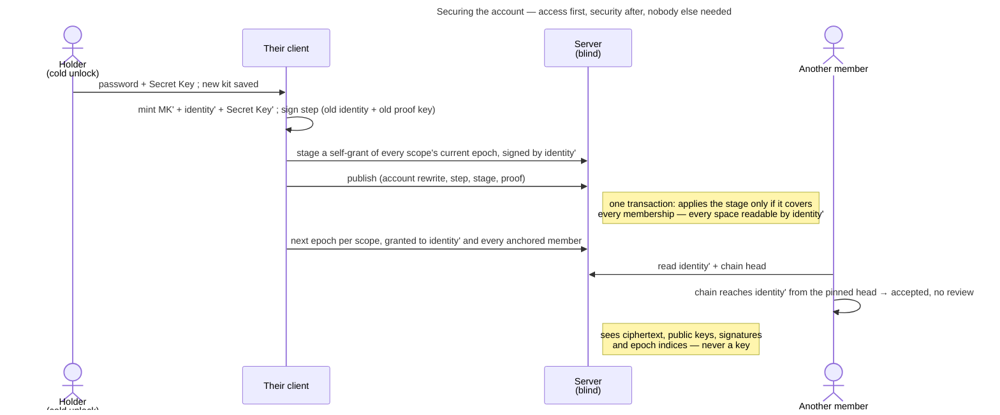

# UC: Secure my account after a compromise

- **ID:** uc.account.rotate-keys
- **Primary actor:** The **account holder**, authenticated and unlocked through a **cold** credential, who has
  reason to believe someone else holds their key material — a phished device-link grant
  ([ADR 0059](../../../decisions/0059-device-linking.md)) being the case that forces this feature to exist, a leaked
  Secret Key the other.
- **Goal:** **End** the compromise and keep every space. Replace the **Master Key, the identity keypair and the Secret
  Key together**, as one step of the account's key chain, get a new Emergency Kit, and re-key every scope so the old
  identity reads nothing new — with nobody else having to act
  ([ADR 0060](../../../decisions/0060-key-rotation-after-compromise.md),
  [ADR 0111](../../../decisions/0111-an-invitee-grants-itself-a-rotator-re-keys-its-own-scopes-and-a-key-chain-anchors-trust.md)
  decisions 6–10, 20 and 21). The product calls it **Secure your account**.
- **Preconditions:** An authenticated session **and** a vault opened by a **cold** unlock — the `PASSWORD` wrap
  (password + Secret Key) or the released `RECOVERY` wrap (Secret Key + address control,
  [uc.account.recover-access](uc.account.recover-access.md)). A `DEVICE`, `DEVICE_KEY` or restored-session
  unlock does **not** qualify: the Secret Key is precisely what the attacker does not hold, so it is what the
  gate asks for.
- **Postconditions (success):** The account has a **new Master Key**, a **new published identity public key** and a
  **new Secret Key**, whose proof key the server verifies every later cold-credential flow against; the key chain holds
  the step old → new, signed by the old identity and the old Secret-Key proof key. The `PASSWORD` and `RECOVERY` wraps
  open under the **new** Secret Key only, so the **old Emergency Kit opens nothing** and the new one, saved before the
  publish, is the account's. Every wrap that could not be rewritten (`DEVICE`, `DEVICE_KEY`, `PASSKEY`) is gone, every
  other session is revoked, and every open change of the sign-in address is void. Every Master-Key-sealed blob is
  re-sealed and the caller's item marks are re-tagged. **Every scope the account held a grant on, in every tenant,
  holds its current epoch for the new identity from the publish on**, and gets its next epoch from the account itself;
  each new epoch re-keys every node of its scope ([ADR 0109](../../../decisions/0109-a-scope-rotation-re-keys-every-node-below-it.md),
  [uc.spaces.rekey-after-rotation](../../spaces/use-cases/uc.spaces.rekey-after-rotation.md)), so once that is done
  the old identity reads nothing added there. **What the old identity already read is not retracted.** What stays in
  its reach: what existed at the rotation, and every link made before, until it is renewed.

## Main flow

1. **Entry.** Settings → **Secure your account**. Before any field the screen says what it does and costs: every
   device is signed out and comes back with the password and the new Emergency Kit; a new kit is saved first and the
   old one stops working; a new password is offered; the holder keeps every space and nobody has to confirm anything;
   what was already seen stays seen; links made before stay open until renewed. From the plan
   (`getAccountRotationPlan`, every scope the account holds a grant on, across every tenant) it lists the spaces that
   cannot get their new lock yet and why — a suspended tenant, a scope being deleted, a grant this device cannot open
   (E4).
2. **The cold gate.** The client asks for the password + Secret Key (the shared control —
   [uc.account.unlock](uc.account.unlock.md) § *One Secret-Key control*) — on **every** path, cold ones included,
   because rewriting the two cold wraps needs the password as material and no KEK survives the unlock — re-derives the
   floor KEK, and requires it to open the stored `PASSWORD` wrap to the Master Key already held. That live proof is
   the client's half of the gate ([ADR 0060](../../../decisions/0060-key-rotation-after-compromise.md) Decision 2),
   and it runs before anything else, so no kit is printed for a credential that then fails. *Which* wrap opened this
   vault is read only to say why the Secret Key is being asked for here (E1). **Also choose a new password** is
   pre-selected, not forced.
3. **The new Emergency Kit** (E11). The client mints the new Secret Key and shows the new kit; the next step stays
   disabled until it is downloaded **and** confirmed saved. Until the result says the account is secured, the old kit
   is the one that works.
4. **Mint and stage.** After the confirm dialog the client reads the account's own key chain (it must end at the
   vault's identity and the proven Secret Key's proof key), then mints `MK'` and a fresh identity keypair, rewrites
   the `PASSWORD` and `RECOVERY` wraps under the new Secret Key, and signs the key-chain step old → new with the old
   identity **and** the old Secret-Key proof key. It opens a **stage** declaring the new identity and uploads, in
   chunks of at most 256, one **self-grant** per scope of the plan: the scope's current epoch key, opened with the old
   identity, granted to the new one, naming it and signed by it. The server verifies each at upload under the identity
   the stage declares and applies nothing yet. A grant this device cannot open is declared instead (E4). The same
   stage takes **what the account rooted** (E3): every open member invite it signed (`getRotationPlanInvites`),
   re-signed by the new identity, and every join record it rooted (`getRotationPlanJoinRecords`), endorsed by the new
   identity — each verified at upload under the stage's identity (`422 invite_resign_invalid`,
   `422 join_endorsement_invalid`).
5. **Publish.** One request, one transaction: the account rewrite, the new proof key with its possession signature,
   the auth key with the current auth key's attestation, the key-chain step, the stage it applies (named by
   `stageId` and its digest, inside the statement the current Secret-Key proof key signs), and the identity-pin store
   and the device register re-sealed under `MK'` — so a rotation that cannot re-seal them does not happen. Each is
   opened under the old key through this device's trust-state marks first (E8). The server checks the step against
   the stored head, identity and proof key, the proof, the possession and the attestation, and applies the stage only
   if every grant-carrying membership of the account is staged at its current epoch or declared unreadable, every
   open invite it signed is staged at its current anchor epoch, and every join record it rooted is staged against the
   record stored now; a membership, an epoch, an invite or a record that moved since — an accept between stage and
   publish included — is `409 rotation_plan_changed`, and the client re-stages only the delta and resubmits the same
   keys, bounded. A `stale_revision` on either document fails that attempt whole; the client re-reads, re-seals and
   resubmits; a request past the server's limit is refused whole and not resubmitted (E10). In the same transaction
   the re-signed invites and the endorsements are written (a declared invite ends), every `DEVICE`, `DEVICE_KEY` and
   `PASSKEY` wrap is **deleted**, every other session family is revoked, every open address change is voided, every decline of a job whose target is this account is cleared, and
   a pending row is written per re-granted scope.
6. **Swap.** As soon as the publish is known committed the vault holds the new keys (the old ones are zeroed), this
   tab's session vault is re-sealed under `MK'`, the Memory pins are re-sealed and the caller's own item marks
   re-tagged — their self-tag's key derives from the Master Key, and only a mark whose tag verifies under the old key
   is carried ([ADR 0068](../../../decisions/0068-favorites-two-confidentiality-levels.md) §9). And the account's own
   **verifications** of other members are re-signed: before the publish the client collected, in every tenant it can
   open, those that verify under the outgoing identity at its head, and now signs each again with the new identity
   and the new head over the old row — so a statement a thief signs with the retired key counts nowhere
   ([ADR 0111](../../../decisions/0111-an-invitee-grants-itself-a-rotator-re-keys-its-own-scopes-and-a-key-chain-anchors-trust.md)
   decision 13). These run best-effort; a verification not re-signed stops counting.
7. **The next epochs.** For each pending row the account mints the scope's next epoch, from any of its unlocked devices
   — this one right after the publish, any other the next time it unlocks, one opened with the new kit included — and
   grants it to its new identity and to every member whose key its client anchors
   ([ADR 0028](../../../decisions/0028-identity-authenticity-tofu-verification.md) Decision 2), declaring the rest
   pending; the server accepts a non-owner's commit only with that row at the current epoch and no removal. A commit
   by someone else in between meets the row. Any member then re-keys the scope's nodes
   ([uc.spaces.rekey-after-rotation](../../spaces/use-cases/uc.spaces.rekey-after-rotation.md)).
8. **Other members follow without a review.** Each contact's client reads the new key with the account's new chain
   head and accepts it because the chain reaches it from the head it pinned (in a tenant, from the step the account's
   join record names); the profile says *new identity, signed by their previous key*, and *verified* drops, since every
   verification names the old head ([uc.spaces.verify-identity](../../spaces/use-cases/uc.spaces.verify-identity.md)).
9. **Report honestly.** The result is a per-scope status, not a success tick, re-read from the **server** on every
   visit and Host-independent: *Not yet* (`waiting`, its next epoch not in), *Fitting the new lock* (`rekeying`, a node
   still carries a key from before), *New lock* (`secured`) or *Not possible yet* (`blocked`, with the reason). Until a
   space reads *New lock*, the old key still reads what is new there. Below it, **Links to renew**: the account's own
   links marked for re-issue, by space; **Renew** opens that node's own share dialog. An upload link is replaced, not
   renewed (make a new one, then switch the old one off), and a link in another tenant is renewed from that tenant. The
   result says the old Emergency Kit no longer works.

## Alternate / exception flows

- **E1 — the vault was opened by a device wrap.** The screen says so and asks for the password + Secret Key in
  place; the session upgrades by supplying them, it is not sent back to sign in. This is the flow's whole
  security value, so the demand is never softened into a warning or made skippable: the attacker this defends
  against holds a `DEVICE_KEY` wrap and nothing colder, so they fail the proof from whichever screen they reach
  it — and if they could rotate they would lock the legitimate holder out permanently. What the "opened by a
  device wrap" record buys is the *explanation*, not the refusal.
- **E2 — no Emergency Kit.** Securing the account is impossible, and the screen says so rather than failing halfway.
  What remains is containment: revoke the sessions and remove the saved keys
  ([uc.account.sessions](uc.account.sessions.md), [ADR 0058](../../../decisions/0058-revoke-never-takes-key-material.md)).
  This is the same no-escrow property that makes losing every path terminal — stated, not engineered around.
- **E3 — the holder signed open invitations, or rooted members' joins.** Neither ends with the rotation
  ([ADR 0111](../../../decisions/0111-an-invitee-grants-itself-a-rotator-re-keys-its-own-scopes-and-a-key-chain-anchors-trust.md)
  decisions 20 and 21). An open invite whose `invite-key` and anchor `grant` signatures both verify under the
  outgoing key is re-signed by the new identity, and the publish installs the new identity as its signer; its invitee
  walks the holder's chain from the head in the link to the new key ([uc.spaces.add-member](../../spaces/use-cases/uc.spaces.add-member.md)
  A4), and the account's own tenant rotation then carries it and moves its anchor. One whose signatures do not verify
  under the outgoing key — not the holder's — is declared, and the publish **ends** it. A join record the holder
  rooted that verifies, names the holder and names the outgoing key (or carries an endorsement by it) is endorsed by
  the new identity over the sealed record as stored; any other is declared and loses its endorsement, so a record the
  retired key signs after the rotation counts nowhere. The entry says nothing about invitations, because nothing is
  lost.
- **E4 — a space cannot get its new lock now.** A suspended tenant or a scope being deleted is re-granted like any
  other and reads *Not possible yet* until it can rotate. A grant this device cannot open (its signature or the epoch
  floor refuses it) is declared, keeps its grant and gets no pending row: it was already closed to the account, and the
  entry says so.
- **E5 — a group invitation to this account is pending.** The publish re-grants it like every scope, so accepting it
  still opens the group; its name key is sealed to the old identity, so it is shown as an unnamed group.
- **E7 — the ceremony is interrupted after the publish.** The answer is lost, the tab closes, a space's new epoch
  fails, or a space is in another tenant. Each space the holder was in already holds its current key for the new
  identity, so nothing is lost. The new epoch follows from any device that unlocks the account, the Emergency Kit's
  included, and the space reads *waiting* until then. A failure the server did not answer is reported as unknown: the
  client re-reads the published identity, and only if it still opens to the old one says nothing was changed;
  otherwise it locks the vault and asks the holder to unlock again with the new kit, never telling them that nothing
  changed. A retry finishes rather than re-mints: the gate opening to a Master Key other than the vault's, one that
  opens the published identity, resumes with no kit step and no second publish.
- **E8 — a trust document this device refuses.** The pin store or the device register is older than one this
  device has held, missing after it held one, or does not open
  ([ADR 0028](../../../decisions/0028-identity-authenticity-tofu-verification.md) Decision 7). The ceremony refuses
  before writing anything and points at the settings hub's *Start a list over*: re-sealing a rolled-back copy
  under `MK'` would make the rollback the rotation's own, and carrying an unreadable one across as empty is the
  wipe Decision 7 refuses. Starting the list over is the user's own, confirmed act, not a side door of this one.
- **E10 — the rotation is larger than the server accepts.** The publish carries the whole pin store (ADR 0104), and a
  body past the instance's request limit is answered `413` before it is read or the caller is authenticated, so
  nothing is written. Trying again sends the same body and fails the same way, so the screen says so and names the
  Server Owner, whose request limit (or a proxy's in front of it) is the remedy; at the default limit a rotation with
  every field at its contract cap fits, which `scripts/validate_rotation_shape.py` computes from the contract
  ([ADR 0111](../../../decisions/0111-an-invitee-grants-itself-a-rotator-re-keys-its-own-scopes-and-a-key-chain-anchors-trust.md)
  decision 22). Any `413` counts, a proxy's bare one included. A failure with no answer (the request never
  got one) is never called too large: the client cannot tell it from being offline. The self-grants do not count
  against it, nor do the re-signed invites and the endorsements: they are staged before the publish.
- **E11 — the new Emergency Kit.** It is shown before the publish, and the publish waits until it is downloaded and
  confirmed. Until the result screen says the account is secured, the old kit is the one that works.

## Quality notes

- **Forward secrecy, not repair.** The single sentence every surface of this flow must carry. Securing the account
  ends a compromise; it does not undo one.
- **Operator-blind.** The server sees a new directory value, a key-chain step (public keys and signatures),
  rewritten ciphertext wraps, staged grants it already holds as grant rows, the new identity's signatures over invites
  and join records it already holds, and epoch indices — the same classes it already sees. It learns no key, and no trust decision reaches it.
- **The gate is the feature.** Everything else here is bookkeeping; the decision that makes rotation safe to offer is
  *which credential may start it*, and the key-chain step is what makes the rotator's own re-grant safe.
- **Tier-consistent ([ADR 0026](../../../decisions/0026-client-trust-tiers.md)).** Both halves of the gate are
  server-enforced (the Secret-Key proof and the auth key's attestation). A contact's acceptance of the new key is
  client-enforced — against an active operator it holds only on a client it does not serve, and only as far as pins
  cannot be rolled back ([ADR 0028](../../../decisions/0028-identity-authenticity-tofu-verification.md) Decision 7);
  honest-operator elsewhere.

## User impact

If someone got into your account, or may have your Secret Key, you can secure it: their device is signed out, you get
a new Emergency Kit, you keep every space, and once each space has its new lock they cannot read what is added there,
except through a link made before until you renew it.

## Related

- Model: [keys, grants and trust](../../../crosscutting/keys-grants-and-trust.md) (securing the account)
- Feature: [Account & auth](../_index.md)
- Decisions: [ADR 0060](../../../decisions/0060-key-rotation-after-compromise.md) (the decision this realizes),
  [ADR 0111](../../../decisions/0111-an-invitee-grants-itself-a-rotator-re-keys-its-own-scopes-and-a-key-chain-anchors-trust.md)
  (the key chain, the stage, the rotator's own re-grant), [ADR 0028](../../../decisions/0028-identity-authenticity-tofu-verification.md)
  (how a contact follows the new key), [ADR 0059](../../../decisions/0059-device-linking.md) (the obligation),
  [ADR 0058](../../../decisions/0058-revoke-never-takes-key-material.md) (why a revoke is not this),
  [ADR 0025](../../../decisions/0025-forward-secrecy-policy-per-scope.md) (the tenant re-key),
  [ADR 0024](../../../decisions/0024-scope-key-rotation.md) (the epoch mechanism),
  [ADR 0054](../../../decisions/0054-password-recovery-two-factor-release.md) (the cold paths)
- Enablers: [en.account.key-model](../enablers/en.account.key-model.md) (what is replaced),
  [en.account.identity-pinning](../enablers/en.account.identity-pinning.md) (how a contact follows the new key),
  [en.spaces.scope-key-rotation](../../spaces/enablers/en.spaces.scope-key-rotation.md) (the machinery step 7
  drives), [en.account.device-register](../enablers/en.account.device-register.md) (Master-Key-sealed, so re-sealed),
  [en.memory.favorites](../../memory/enablers/en.memory.favorites.md) (the Memory pins re-sealed, the item marks
  re-tagged)
- Use-cases: [uc.account.sessions](uc.account.sessions.md) (containment, the step before this one),
  [uc.spaces.rekey-after-rotation](../../spaces/use-cases/uc.spaces.rekey-after-rotation.md) (the re-key every
  rotated scope runs),
  [uc.account.onboard-device](uc.account.onboard-device.md) (E4 — the mistake this answers),
  [uc.spaces.verify-identity](../../spaces/use-cases/uc.spaces.verify-identity.md) (how other members follow the new
  key), [uc.account.recover-access](uc.account.recover-access.md) (the other cold path)
- End-user view (docs site): [Secure your account](../../../../site/src/content/docs/account/replace-your-keys.mdx),
  [Your Emergency Kit](../../../../site/src/content/docs/getting-started/emergency-kit.mdx),
  [Lost Emergency Kit](../../../../site/src/content/docs/help/lost-emergency-kit.mdx)
- Security area of the docs site: [Protocols](../../../../site/src/content/docs/security/protocols.mdx)
- Run area of the docs site (E10's remedy): [Troubleshooting](../../../../site/src/content/docs/run/troubleshooting.md)
