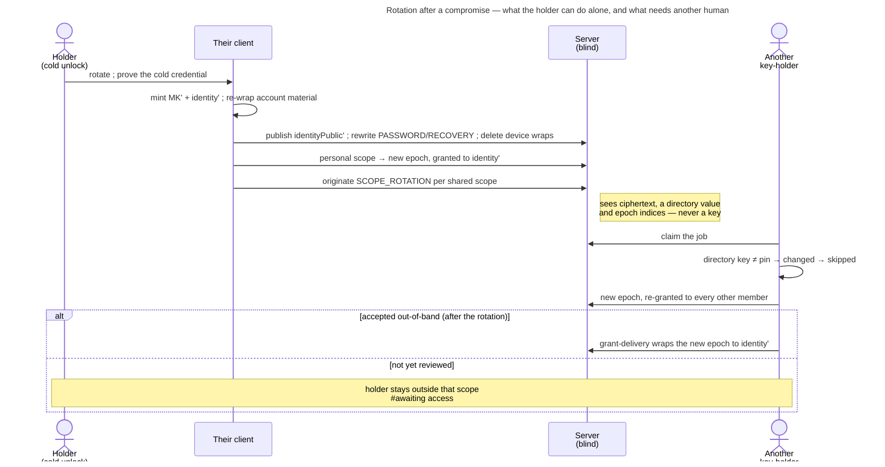

# UC: Rotate my keys after a compromise

- **ID:** uc.account.rotate-keys
- **Primary actor:** The **account holder**, authenticated and unlocked through a **cold** credential, who has
  reason to believe someone else holds their key material — a phished device-link grant
  ([ADR 0059](../../../decisions/0059-device-linking.md)) being the case that forces this feature to exist.
- **Goal:** **End** the compromise. Replace the **Master Key and the identity keypair together**, re-key every
  scope so the old identity reads nothing new, and be re-admitted to each shared scope by a human who checks
  out-of-band ([ADR 0060](../../../decisions/0060-key-rotation-after-compromise.md)).
- **Preconditions:** An authenticated session **and** a vault opened by a **cold** unlock — the `PASSWORD` wrap
  (password + Secret Key) or the released `RECOVERY` wrap (Secret Key + address control,
  [uc.account.recover-access](uc.account.recover-access.md)). A `DEVICE`, `DEVICE_KEY` or restored-session
  unlock does **not** qualify: the Secret Key is precisely what the attacker does not hold, so it is what the
  gate asks for.
- **Postconditions (success):** The account has a **new Master Key** and a **new published identity public
  key**. Every wrap that could not be rewritten (`DEVICE`, `DEVICE_KEY`, `PASSKEY`) is gone; the `PASSWORD` and
  `RECOVERY` wraps are rewritten under the **same** KEKs, so the **Emergency Kit stays valid**. Every
  Master-Key-sealed blob is re-sealed and the caller's item marks are re-tagged; the Secret-Key proof key is
  unchanged. Self-served scopes sit at a new
  epoch granted to the new identity; every shared scope carries a queued rotation for another owner of it to
  complete. Every other session is revoked. **What the old identity already read is not retracted.** A new epoch
  re-keys no node yet ([ADR 0109](../../../decisions/0109-a-scope-rotation-re-keys-every-node-below-it.md) decides
  it, not built): what is added inside a folder, Memory or chapter that existed before still seals under node keys
  the old identity holds.

## Main flow

1. **Entry.** Settings → Personal → security. The screen states, before any button, the three things that
   decide whether the user should be here at all: it ends the compromise but retracts nothing; it signs every
   other device out and takes their saved keys; and it needs the Emergency Kit.
2. **The cold gate.** The client asks for the password + Secret Key (the shared control —
   [uc.account.unlock](uc.account.unlock.md) § *One Secret-Key control*) — on **every** path, cold ones included,
   because rewriting the two cold wraps needs both as material and no KEK survives the unlock — re-derives the
   floor KEK, and requires it to open the stored `PASSWORD` wrap to the Master Key already held. That live
   proof is the client's half of the gate ([ADR 0060](../../../decisions/0060-key-rotation-after-compromise.md)
   Decision 2): the rotation runs from a cold credential proven **now**, or it does not run. The server
   enforces the other half in step 4. *Which* wrap opened this vault is read only to say why the Secret Key is
   being asked for here (E1).
3. **Mint.** The device generates a fresh Master Key `MK'` and a fresh identity keypair, entirely on-device.
4. **Re-wrap the account.** `symWrap(MK', identityPriv')` replaces `wrappedIdentityPrivateKey`; the `PASSWORD`
   and `RECOVERY` wraps are rewritten under their existing KEKs; every `DEVICE`, `DEVICE_KEY` and `PASSKEY`
   wrap is **deleted**, because their key material is device-held and cannot be rewritten from here; the
   identity-pin store and the device register are re-sealed under `MK'` and travel in the **same request**,
   written in the same transaction — so a rotation that cannot re-seal them does not happen, rather than
   leaving them under a key that no longer exists. Each is opened under the old key through this device's
   trust-state marks first (E8), and a `stale_revision` on either fails that attempt whole: the client re-reads,
   re-seals and resubmits. The Memory pins are re-sealed under `MK'` and the caller's own item marks re-tagged —
   their self-tag's key derives from the Master Key, and only a mark whose tag verifies under the old key is
   carried ([ADR 0068](../../../decisions/0068-favorites-two-confidentiality-levels.md) §9); these two run
   best-effort once the server has accepted the request. The request carries a signature of the **Secret-Key
   proof key** over what it installs — the two documents aside, which a session can write anyway — and the
   server refuses it without one that verifies.
5. **Publish.** The new identity public bundle replaces the directory value. From this moment every contact
   who ever pinned this account sees **changed**, and every automated wrap to it declines
   ([ADR 0028](../../../decisions/0028-identity-authenticity-tofu-verification.md)).
6. **Re-key what this account can re-key alone.** For each scope where the holder is the only member — the
   personal scope — the client mints the next epoch, chain-links it and grants it to the **new** identity. That moves
   `K_SC` only; every node keeps its key until ADR 0109's re-key is built.
7. **Queue what it must not re-key alone.** For every shared scope, a `SCOPE_ROTATION` job is originated, and the
   rotator is excluded from every live rotation job of that scope. It is completed by **another owner** of the
   scope, never by the rotator: a rotator who could drive their own re-grant would let an attacker holding the old
   identity re-admit only themselves
   ([ADR 0060](../../../decisions/0060-key-rotation-after-compromise.md) Decision 4). The exclusion binds where the
   commit lands, not only at the queue: `rotateScope` refuses the rotator while a live job carries their exclusion
   (`403 rotation_excluded`), and afterwards while their own grant is behind (`409 stale_epoch`), until a human
   there re-admits them. The full lifecycle of the queued job is
   [uc.spaces.complete-queued-rotation](../../spaces/use-cases/uc.spaces.complete-queued-rotation.md).
8. **Cut the rest.** Every other session family is revoked, so the granted device loses server access as well
   as its future reads.
9. **Report honestly.** The result screen is a per-scope status, not a success tick: *secured* where step 6
   finished, and for every scope step 7 queued, the **server's** state of its covering rotation, re-read on every
   visit rather than synthesised once: *waiting* (an owner who may complete it exists), *stalled* (none does — E4),
   *secured* (the rotation landed, or the holder's own grant is already behind, so the old identity holds no grant
   to the current epoch) or *failed* (the job dead-lettered — E3). Until it is *secured*, the old key still reads
   what is new in that space, and for each such scope the holder is outside it until someone there accepts the new
   key. *Secured* reaches the scope's root only: inside a folder, Memory or chapter that existed before, the old key
   still reads what is added (ADR 0109, not built), and the result screen says so.

## Alternate / exception flows

- **E1 — the vault was opened by a device wrap.** The screen says so and asks for the password + Secret Key in
  place; the session upgrades by supplying them, it is not sent back to sign in. This is the flow's whole
  security value, so the demand is never softened into a warning or made skippable: the attacker this defends
  against holds a `DEVICE_KEY` wrap and nothing colder, so they fail the proof from whichever screen they reach
  it — and if they could rotate they would lock the legitimate holder out permanently. What the "opened by a
  device wrap" record buys is the *explanation*, not the refusal.
- **E2 — no Emergency Kit.** Rotation is impossible, and the screen says so rather than failing halfway. What
  remains is containment: revoke the sessions and remove the saved keys
  ([uc.account.sessions](uc.account.sessions.md), [ADR 0058](../../../decisions/0058-revoke-never-takes-key-material.md)).
  This is the same no-escrow property that makes losing every path terminal — stated, not engineered around.
- **E3 — no other owner completes it.** While no owner comes online the job waits, the scope stays at its old
  epoch, and the old identity keeps reading that scope's new content; step 9 says *waiting*. An owner whose
  attempts keep failing spends the job's attempts, and after the last one it **dead-letters**: step 9 says
  *failed*, and from there the holder can **queue it again** — a fresh job, the holder still excluded from it —
  and so can any owner of the scope, who sees the same state on their own row of that space
  ([uc.spaces.complete-queued-rotation](../../spaces/use-cases/uc.spaces.complete-queued-rotation.md)). The
  exclusion's one bound: between the dead-letter and the re-queue, `rotateScope` no longer refuses the holder on the
  strength of a live job; their grant is still current, so the behind check does not either. That window is
  visible as *failed*, never silent.
- **E4 — the rotator is the scope's only owner.** Then nobody may complete the job: `rotateScope` is
  owner-gated and Decision 4 excludes the rotator. The job is offered only to owners, so it does not dead-letter
  on members who could never complete it: it waits, and step 9 reads *stalled* — as it does wherever every other
  owner holds no grant or has declined the job. The remedy is to **promote a co-owner first**
  ([ADR 0014](../../../decisions/0014-group-scopes-and-governance.md)), the same shape
  [ADR 0006](../../../decisions/0006-cold-tenant-scope-birth.md) already uses for the sole-key-holder case —
  and the entry screen names it as a precondition for those scopes rather than letting the user discover it at
  step 9.
- **E5 — a group invitation to this account is pending.** Its `sealed_name_key` is wrapped to the old identity
  and there is no re-mint path, so the proposal is dead: it must be withdrawn and re-issued after
  re-admission.
- **E6 — a contact accepts the new key but delivery never arrives.** A worker that declined `identity_changed`
  is excluded from that job permanently, so an accept alone would authorise a wrap that nothing performs
  ([ADR 0060](../../../decisions/0060-key-rotation-after-compromise.md) Decision 7). Accepting a changed key
  therefore clears the accepting account's own declines against that contact, and the next claim delivers.
- **E7 — the rotation is interrupted between steps 4 and 5.** The account holds `MK'` with an unpublished
  identity; the flow is resumable because every step is idempotent against the published state, and the client
  finishes rather than re-mints — re-minting would strand the wraps written in step 4.
- **E8 — a trust document this device refuses.** The pin store or the device register is older than one this
  device has held, missing after it held one, or does not open
  ([ADR 0028](../../../decisions/0028-identity-authenticity-tofu-verification.md) Decision 7). The rotation refuses
  before writing anything and points at the settings hub's *Start a list over*: re-sealing a rolled-back copy
  under `MK'` would make the rollback the rotation's own, and carrying an unreadable one across as empty is the
  wipe Decision 7 refuses. Starting the list over is the user's own, confirmed act, not a side door of this one.
- **E9 — another member accepts the new key before the covering rotation reached them.** Every grant this
  account signed with its old identity is served with the key that signed it
  ([ADR 0028](../../../decisions/0028-identity-authenticity-tofu-verification.md) § What is still open), so it
  keeps opening for each member whose pin still holds that key — including the owner who will complete the
  queued rotation. A member whose pin moves to the new key first refuses those grants (`granter_key_changed`):
  the retired key is never trusted again. So accepting a changed key first runs one pass of the scope-rotation
  worker, and an owner who is online covers the scope before their pin moves. What the pass cannot cover (a job
  leased to someone else at that moment, or a scope where the accepting member is not an owner) stays refused
  for them until another owner completes it, and the review dialog says so before the accept. The covering
  rotation itself never needs the new key accepted: its re-grant skips a member whose key reads `changed`, and
  this account's re-admission follows by grant-delivery once somebody accepts.

## Quality notes

- **Forward secrecy, not repair.** The single sentence every surface of this flow must carry. Rotation ends a
  compromise; it does not undo one.
- **Operator-blind.** The server sees a new directory value, rewritten ciphertext wraps, and epoch indices —
  the same classes it already sees. It learns no key, and the re-admission decision never reaches it.
- **The gate is the feature.** Everything else here is bookkeeping that the built scope-rotation machinery
  already performs; the decision that makes rotation safe to offer is *which credential may start it*.
- **Tier-consistent ([ADR 0026](../../../decisions/0026-client-trust-tiers.md)).** The gate's Secret-Key half is
  server-enforced. Its password half and the review are client-enforced — against an active operator they hold
  only on a client it does not serve, and the review only once pins cannot be rolled back
  ([ADR 0028](../../../decisions/0028-identity-authenticity-tofu-verification.md) Decision 7); honest-operator
  elsewhere.

## User impact

If someone got into your account, you can replace your keys so that their device is signed out and shut out of each
space's own new key; what is added inside folders and Memories that already existed stays in its reach until node keys
are replaced too.

## Related

- Feature: [Account & auth](../_index.md)
- Decisions: [ADR 0060](../../../decisions/0060-key-rotation-after-compromise.md) (the decision this realizes),
  [ADR 0028](../../../decisions/0028-identity-authenticity-tofu-verification.md) (the change-response that
  re-admits a rotated key), [ADR 0059](../../../decisions/0059-device-linking.md) (the obligation),
  [ADR 0058](../../../decisions/0058-revoke-never-takes-key-material.md) (why a revoke is not this),
  [ADR 0025](../../../decisions/0025-forward-secrecy-policy-per-scope.md) (the tenant re-key),
  [ADR 0024](../../../decisions/0024-scope-key-rotation.md) (the epoch mechanism),
  [ADR 0054](../../../decisions/0054-password-recovery-two-factor-release.md) (the cold paths)
- Enablers: [en.account.key-model](../enablers/en.account.key-model.md) (what is replaced and what is not),
  [en.account.identity-pinning](../enablers/en.account.identity-pinning.md) (why the new key is `changed` for
  everyone), [en.spaces.scope-key-rotation](../../spaces/enablers/en.spaces.scope-key-rotation.md) (the
  machinery step 6–7 drive), [en.account.device-register](../enablers/en.account.device-register.md)
  (Master-Key-sealed, so re-sealed), [en.memory.favorites](../../memory/enablers/en.memory.favorites.md) (the
  Memory pins re-sealed, the item marks re-tagged)
- Use-cases: [uc.account.sessions](uc.account.sessions.md) (containment, the step before this one),
  [uc.account.onboard-device](uc.account.onboard-device.md) (E4 — the mistake this answers),
  [uc.spaces.verify-identity](../../spaces/use-cases/uc.spaces.verify-identity.md) (the re-admission review),
  [uc.account.recover-access](uc.account.recover-access.md) (the other cold path)
- End-user view (docs site): [Replace your keys](../../../../site/src/content/docs/account/replace-your-keys.mdx)
