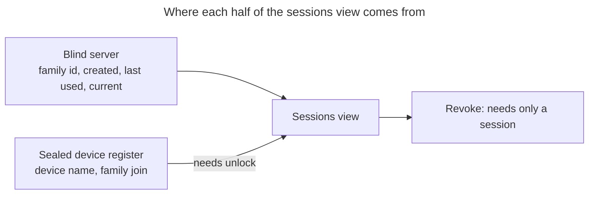

# UC: Manage active sessions (see every login, sign out remotely)

- **ID:** uc.account.sessions
- **Primary actor:** Account holder with an **authenticated session** — unlocked or not
- **Goal:** See **every** active session of the account and end any of them **remotely**, so a login on a
  device that is lost, borrowed or no longer trusted can be cut off from the device still in hand.
- **Preconditions:** An authenticated session exists. **No unlock is required** — this is an auth-layer
  control ([ADR 0004](../../../decisions/0004-session-tokens.md)).
- **Postconditions (success):** The chosen session families are `REVOKED`; their refresh tokens are dead, so
  the devices holding them fall back to a full login. The caller's own session is untouched unless the caller
  revoked it explicitly. No content key, and no wrap, is affected — a revoked session takes away *access to
  the server*, never the ability to open already-held ciphertext.

## Two layers, one list

The list is assembled from **two sources with different gates**, and keeping them apart is what makes this
use-case work on a locked device:

- **The set** — which families exist, when each was created, when each was last used, which one is *you* —
  comes from the server and needs **only a session**. So does revoking.
- **The names** — "Kevin's iPhone" — come from the client's **Master-Key-sealed device register** and
  therefore need an **unlocked** vault ([en.account.identity-pinning](../enablers/en.account.identity-pinning.md)
  is the same shape: one sealed, synced blob the server cannot read).

A locked device therefore shows a complete and fully actionable list — every session, every revoke — with
coarse dates instead of names. That is the whole degradation, and it is deliberate: **the security action
must never be gated behind the cosmetic half.** What a locked device still lacks is a *way in* — see **E3**,
which owns that obligation.

## Main flow — see the sessions

1. The client asks the server for the account's **active** session families.
2. The server returns, per family, its **opaque id**, its **created** and **last-used** timestamps, and a
   flag marking the family the request itself arrived on. Nothing else exists to return — the server holds
   no name, no user-agent and no address for a family.
3. If the vault is unlocked, the client reads its sealed device register and labels each family it recognises.
   Families the register does not know stay **unnamed and still revocable**; the register is an annotation
   layer over the server's list, never the list itself.
4. While it is there, the client **prunes** register entries whose families the server no longer lists. Without
   that, every login in a private window — where the local device id does not survive the window's close —
   would add an entry nobody ever removes.

## Main flow — sign out

- **One session:** the client asks the server to revoke that family id. The family is marked `REVOKED`; its
  refresh token stops working at the next rotation attempt, and its access token dies with its own short TTL.
- **Everywhere else:** one call revokes **every family except the caller's own**. Signing yourself out of the
  device you are holding is [uc.account.login](uc.account.login.md)'s logout, not this; a "sign out everywhere"
  that also ejects the person using it to secure the account is a footgun, not a feature.

Revocation is a **status flip on the family**, which is what makes it instant and total: the family is the
unit rotation and reuse-detection already work on ([ADR 0004](../../../decisions/0004-session-tokens.md)),
so nothing new has to be tracked to make revoking reliable.

## What a revoked session can still do — and what it cannot

Revoking a session removes **server access**, not **key material**. A device whose session was revoked keeps
whatever convenience wrap it enrolled ([uc.account.trust-device](uc.account.trust-device.md),
[uc.account.remember-this-device](uc.account.remember-this-device.md)) — auth and unlock are separate layers.
It can therefore still open content it already holds locally, and it can sign in again with the credentials it
has. **Cutting a device off completely — session *and* wrap — is a further step** that needs the register's
device↔family join, and it is out of scope here (below).

The client on the revoked device is not left in a broken state: a failed refresh at boot already drops both
local unlock tiers, so the next start on that device is a clean, fully-locked login screen.

## Alternate / exception flows

- **E1 — revoking a family that is already gone** (it expired, or another device revoked it a second earlier):
  the call succeeds and changes nothing. Revocation is **idempotent**, and an unknown or foreign id is a silent
  no-op with the same response as a real one — the same non-enumerability posture the wrap endpoints already
  take, so the list cannot be used to probe which ids exist.
- **E2 — the caller revokes its own family:** permitted, and it means "log me out here too". The client treats
  the response as a logout and returns to the sign-in screen rather than continuing with dead tokens.
- **E3 — locked vault:** the list renders with ids and coarse dates, no names. Revoking works normally.
  **This flow needs an entry point of its own, and that entry point is owed.** Every shell route requires an
  unlocked vault, and the sign-in form will not submit without a Secret Key on a device that holds no wrap for
  the account — so on the fresh or foreign device this flow exists for, the locked state cannot be reached at
  all. It belongs on the **sign-in form**: log in without attempting an unlock, then offer *"sign out
  everywhere else"* — the one action that is complete without names. Two obligations follow. **The
  plain-language section below must not be assembled into `wiki/` before it exists**, because that section
  promises the Secret Key is not needed and for this flow it still is. And **the locked ceiling does not rise
  with the later increments**: the names and the device↔family join both live in the Master-Key-sealed
  register, so a locked caller never gets them — the locked list stays anonymous and the locked action stays
  session-level, by construction rather than by omission. Do not plan a richer locked screen for "after
  naming"; there is no such thing.
- **E4 — the register is missing or stale** (a new device, cleared storage, a write that never landed): the
  affected families render unnamed. Nothing is blocked, and nothing is silently hidden — a session the register
  cannot name must still be visible, or a lost device could hide from the very screen that exists to find it.

## Quality notes

- **Operator-blind.** The server gains **nothing** from this use-case: it already stores the family id and both
  timestamps ([ADR 0004](../../../decisions/0004-session-tokens.md)), and this adds no column. In particular
  **no name, no user-agent and no device string is ever sent to the server** — the display name exists only
  inside the sealed register.
- **Why the name is not stored per family.** An earlier design put a client-encrypted name *on the family*.
  A name blob re-sent unchanged across logins would let the operator **link a device's re-logins**, re-joining
  families that are otherwise unlinkable — so that design carried a standing obligation to re-encrypt with a
  fresh nonce every single login. Storing the name only in the register removes the mechanism instead of
  guarding it: with no per-family ciphertext there is nothing to correlate. **This is why a per-family name
  field must not come back**, however convenient it looks.
- **Metadata the operator sees is unchanged:** a family count, coarse timestamps, opaque ids. The count was
  already accepted ([uc.account.trust-device](uc.account.trust-device.md) makes the same trade for wraps).
- **The current session is marked by the server**, not guessed by the client. The server knows which family
  the request arrived on; that is self-knowledge about the caller, not a new fact about the account. The flag
  exists so the UI can keep "this is you" and "sign out everywhere else" honest.
- **Only active families are listed.** Revoked and expired ones are noise, and the purge removes them anyway.
- **A best-effort name is a starting point, not an identity.** A browser cannot read a machine name, so the
  register seeds a device's label from a browser + platform guess — and, because the label lives in a
  user-owned register rather than on a per-login family, the user can **rename it**. Two identical guesses are
  no longer a dead end.

## Out of scope (separate increments)

- **Naming the sessions.** The sealed device register — the label, the stable client-side device id, and the
  device↔family join — is its own increment; this use-case is built to degrade to unnamed and stay useful.
- **"Revoke this device everywhere"** — dropping a device's session **and** its convenience wrap in one action.
  It needs the register's join and belongs with it.
- **Device linking** (authorising a new device from a trusted one) is a separate use-case; it is the feature
  this one exists to make reversible.

## What this means for you / Was das für dich bedeutet

**EN —** You can see every place you are currently signed in, and sign any of them out from here — useful when
a laptop is lost, or you signed in on someone else's machine and forgot to sign out. "Sign out everywhere else"
ends every other session in one go and keeps you signed in where you are. You don't need your Secret Key for
any of this. Two honest details: the server never learns your device names — those are stored scrambled and are
readable only after you unlock, so on a locked screen you'll see dates instead of names. And signing a device
out stops it reaching the server, but it does not reach into that device — if it is truly gone, also remove its
saved key on the device page.

**DE —** Du siehst hier jede Stelle, an der du gerade angemeldet bist, und kannst jede davon von hier aus
abmelden — praktisch, wenn ein Laptop weg ist oder du dich auf einem fremden Rechner angemeldet und das
Abmelden vergessen hast. „Überall sonst abmelden" beendet alle anderen Sitzungen auf einmal und lässt dich
dort angemeldet, wo du gerade bist. Deinen Secret Key brauchst du dafür nicht. Zwei ehrliche Hinweise: Die
Gerätenamen erfährt der Server nie — sie liegen verschlüsselt und sind erst nach dem Entsperren lesbar, auf
einem gesperrten Bildschirm siehst du deshalb Daten statt Namen. Und ein abgemeldetes Gerät kommt nicht mehr an
den Server, aber die Abmeldung greift nicht auf das Gerät selbst durch — ist es wirklich weg, entferne auf der
Geräteseite zusätzlich seinen gespeicherten Schlüssel.

## Related

- Feature: [Account & auth](../_index.md)
- Concepts: [Account & Key Model](../enablers/en.account.key-model.md) (auth ≠ unlock),
  [en.account.identity-pinning](../enablers/en.account.identity-pinning.md) (the sealed-synced-blob shape the
  device register reuses), [Security Model](../../../crosscutting/security-model.md)
- Decisions: [ADR 0004](../../../decisions/0004-session-tokens.md) (families, rotation, reuse detection,
  revocation, and where a session name may live), [ADR 0003](../../../decisions/0003-operator-blind-password-auth.md)
  (auth vs. unlock)
- Related use-cases: [login](uc.account.login.md) (creates a family; logout ends the caller's own),
  [trust-device](uc.account.trust-device.md) + [remember-this-device](uc.account.remember-this-device.md) (the
  wraps a revoked session deliberately does **not** touch); onboard device — planned
