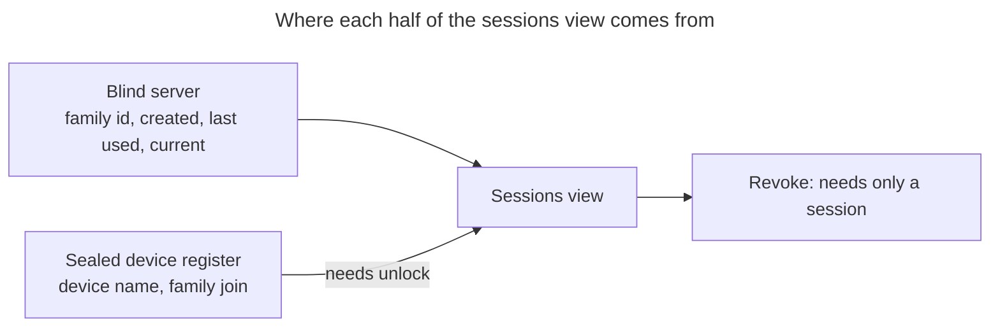

# UC: Manage active sessions (see every login, sign out remotely)

- **ID:** uc.account.sessions
- **Primary actor:** Account holder with an **authenticated session** — the list is shown unlocked; a locked
  device reaches only E3's sign-out-everywhere
- **Goal:** See **every** active session of the account and end any of them **remotely**, so a login on a
  device that is lost, borrowed or no longer trusted can be cut off from the device still in hand.
- **Preconditions:** An authenticated session exists. Listing and revoking need **no unlock** at the server —
  this is an auth-layer control ([ADR 0004](../../../decisions/0004-session-tokens.md)); the screen that shows
  the list sits in the settings hub, which does (§ Two layers, one list).
- **Postconditions (success):** The chosen session families are `REVOKED`; their refresh tokens are dead, so
  the devices holding them fall back to a full login. The caller's own session is untouched unless the caller
  revoked it explicitly. No content key, and **no wrap, is affected by a revoke** — a revoked session takes away
  *access to the server*, never the ability to open already-held ciphertext. Removing a device's wrap is a
  separate action of this use-case, and where it ran, that device's convenience wrap is gone server-side and it
  is back to needing the password **and** the Secret Key.

## Two layers, one list

The list is assembled from **two sources with different gates**, and keeping them apart is what keeps revoking
available to a locked device:

- **The set** — which families exist, when each was created, when each was last used, which one is *you* —
  comes from the server and needs **only a session**. So does revoking.
- **The names** — "Kevin's iPhone" — and with them the device↔wrap join that the "remove this device's saved
  key" escalation needs, come from the client's **Master-Key-sealed device register**
  ([en.account.device-register](../enablers/en.account.device-register.md)) and therefore need an **unlocked**
  vault ([en.account.identity-pinning](../enablers/en.account.identity-pinning.md) is the same shape: one
  sealed, synced blob the server cannot read).

**The security action must never be gated behind the cosmetic half**, which is why a revoke needs only a
session. A locked device does not see the list, though: the panel mounts only in the settings hub, whose route
requires an unlocked vault (`router.ts`). What a locked device gets is E3's card, whose one action is to sign
every device out — complete without names, and E3 says why it shows no list.

## Main flow — see the sessions

1. The client asks the server for the account's **active** session families.
2. The server returns, per family, its **opaque id**, its **created** and **last-used** timestamps, and a
   flag marking the family the request itself arrived on. Nothing else exists to return — the server holds
   no name, no user-agent and no address for a family.
3. If the vault is unlocked, the client reads its sealed device register and labels each family it recognises.
   Families the register does not know stay **unnamed and still revocable**; the register is an annotation
   layer over the server's list, never the list itself.
4. While it is there, the client **reconciles** the register against the list it is holding — which is the only
   moment it can, since the server's set is the authority and this is where that set is in hand. Two removals,
   and they are deliberately not the same removal
   ([en.account.device-register](../enablers/en.account.device-register.md) § Sync & merge owns the rule):
   **family rows** whose families the server no longer lists are dropped straight away, as an explicit list of
   ids — never as "keep only what I just saw", which would delete a family another device created between this
   client's read and its write. **Device entries are kept**, because a device whose sessions have all expired is
   still a device the user named; the register's growth is bounded by evicting the least-recently-seen devices
   instead. Without that bound, every login in a private window — where the local device id does not survive
   the window's close — would add an entry nobody ever removes.

## Main flow — sign out

- **One session:** the client asks the server to revoke that family id. The family is marked `REVOKED`; its
  refresh token stops working at the next rotation attempt, and its access token at its next request: every
  authenticated read checks that the family is still `ACTIVE` (`SessionService.resolveUserId`).
- **Everywhere else:** one call revokes **every family except the caller's own**. Signing yourself out of the
  device you are holding is [uc.account.sign-out](uc.account.sign-out.md), not this; a "sign out everywhere"
  that also ejects the person using it to secure the account is a footgun, not a feature.

Revocation is a **status flip on the family**, which is what makes it instant and total: the family is the
unit rotation and reuse-detection already work on ([ADR 0004](../../../decisions/0004-session-tokens.md)),
so nothing new has to be tracked to make revoking reliable.

## What a revoked session can still do — and what it cannot

Revoking a session removes **server access**, not **key material**, and it does so *on purpose*
([ADR 0058](../../../decisions/0058-revoke-never-takes-key-material.md)). A device whose session was revoked
keeps whatever convenience wrap it enrolled ([uc.account.trust-device](uc.account.trust-device.md),
[uc.account.remember-this-device](uc.account.remember-this-device.md)) — auth and unlock are separate layers.
It can therefore still open content it already holds locally, and it can sign in again with the credentials it
has: **on a trusted device that means the password alone reopens the vault, with no Secret Key.**

**A device that was set to stay signed in is the sharper case, and every confirmation here has to say so.** Its
convenience tier is a password-*less* saved key, and enrolling one **drops** the password wrap
([ADR 0005](../../../decisions/0005-unlock-methods-and-device-trust.md) §9) — so once its next boot fails to
restore and it drops that local key, there is nothing left below it but the Secret Key. *"It will have to sign
in again"* understates a revoke there by a whole factor: what it will actually need is the Emergency Kit. The
copy on the revoke, the sign-out-everywhere-else and the locked entry all name that consequence, in the same
tone the wrap escalation beside them already uses.

**Cutting a device off completely is therefore a second, separately named action**, offered beside the revoke
wherever the register can name that device's wrap: *sign out **and** remove this device's saved key.* What it
buys is exact — it restores the **Secret-Key floor** for that one device, so the password stops being enough
there. It is deliberately not a default and not a checkbox: it costs the person holding that device their
Emergency Kit, which is right for a lost laptop and wrong for tidying up an old login.

**It is offered on every row but your own.** Your own device's equivalent sits on that row instead — the
untrust/forget of [uc.account.trust-device](uc.account.trust-device.md) § Untrust, which removes the local key
*as well as* the server wrap; the remote-only half here would leave this browser holding a record whose wrap is
gone — a state that use-case's E1 tolerates when an operator withholds a wrap, and that this screen must not
create on purpose. The two live one row apart and must never converge into one control: only the local half can
reach a local key, and only on the device in hand.

The two calls run in that order — **family first, then wrap** — because the revoke is what stops an attacker
who is online *now*, while the wrap only matters at a future sign-in; the urgent half must not be blocked by the
other. The cost is that a successful revoke removes the row the second half was offered from, so a wrap deletion
that fails is retried from § Devices with a saved key rather than from the session list.

The client on the revoked device is not left in a broken state: a failed refresh at boot already drops both
local unlock tiers, so the next start on that device is a clean, fully-locked login screen. Nothing done from
here reaches into that device — its local key material is untouched, and after its wrap is gone that key is an
unusable handle, which is exactly what [uc.account.trust-device](uc.account.trust-device.md) E1 already
describes.

## Devices with a saved key

Below the session list, the view names the devices the **register** knows that hold a convenience wrap the
server still serves and have **no active session** — a device that has been signed out but whose saved key
outlived it. Each can have that key removed from here.

The set is derived from two lists the view is already holding, so it invents nothing: the register's own
device↔wrap join, and the server's family list. It is the retry surface for an escalation whose wrap deletion
failed, and the only place a device that is signed out but still password-unlockable becomes visible at all.

One action stands apart from it, and it is the only handle on a wrap the register has *never* known — one
orphaned before the join shipped, or by a device that dropped its local key with no session to authorise the
server delete: **remove every saved key except this device's.** It is defined by excluding what this client can
verify locally, never by a claim about the others
([ADR 0058 §5](../../../decisions/0058-revoke-never-takes-key-material.md) — a list of "wraps no device
recognises" cannot tell an orphan from a device that has not signed in yet, and must not be offered). Its
consequence is stated plainly where it is offered: every other device will need the password **and** the Secret
Key again.

## Alternate / exception flows

- **E1 — revoking a family that is already gone** (it expired, or another device revoked it a second earlier):
  the call succeeds and changes nothing. Revocation is **idempotent**, and an unknown or foreign id is a silent
  no-op with the same response as a real one — the same non-enumerability posture the wrap endpoints already
  take, so the list cannot be used to probe which ids exist.
- **E2 — the caller revokes its own family:** permitted, and it means "log me out here too". The client runs
  [uc.account.sign-out](uc.account.sign-out.md)'s sequence rather than continuing with dead tokens.
- **E3 — locked vault, and the way in.** A locked device sees no list; signing every device out works with a
  session alone. *Reaching* that state is the half that had to be built: every shell route requires an unlocked
  vault — permanently now, `scripts/validate_shell_route_gate.py` — and the sign-in form's Secret-Key field is
  `required` on a device holding no wrap for the account, so on the fresh or foreign device this flow exists
  for there was no way in at all. The entry point therefore sits **on the sign-in form, not behind it**: a
  secondary action offered exactly where that field is, which logs in and attempts **no** unlock — not
  unlocking is the intent here, so a failed unlock would be the screen contradicting the button that reached
  it. What it then offers is decided, not incidental — **three ways on, and still no list**:
  - **A way in, and it is the constructive answer to the button's own sentence.** *"I don't have my Secret Key
    with me"* has two honest endings, and only one of them existed before device linking: *"…but I have another
    device"* is [uc.account.onboard-device](uc.account.onboard-device.md)'s **sign in with a QR code**, offered
    first because it is what most people arriving here actually want. It needs nothing this state cannot
    supply — an ephemeral keypair, a rendered code, a poll — and in particular it never reads the register, so
    it is not the locked ceiling rising ([ADR 0059](../../../decisions/0059-device-linking.md) §1). *"…and the
    device is gone"* is the sign-out below. The entry point conflated the two only because one answer existed.
  - **No locked list — and that argument is about the *list*, not about how many actions belong here.**
    *Sign out everywhere* is complete without names; a per-row pick is not.
    An anonymous list with dates loses on four counts, and the third is the one to keep: **the input that would
    justify sparing a row is unreadable in exactly this state.** The one reason to spare a row is *"that is my
    phone, which will otherwise ask for my Emergency Kit"* — and that fact lives in the register's `wraps` map,
    which a locked caller structurally cannot read. The other three: precision only pays for someone who wants
    to **keep** other sessions, which is not the goal anyone arrives here with; `lastUsedAt` is rewritten on
    every refresh, so a lost laptop that kept refreshing shows a *recent* date and only `createdAt` anchors
    anything; and the failure modes are asymmetric — the bulk action **cannot** miss the lost device, an
    anonymous per-row pick can, and leaves the user believing they cut it off. Do not re-open this without
    answering the third count.
  - **Then this device signs out too** — revoke first, logout second. *"I cut everything off"* means
    everything, and nothing remains to do **once that path is taken**: no unlock (no kit, by premise), no list,
    and a second revoke is idempotently pointless — and the constructive way on is gone with the sessions it
    just ended, which is the correct reading of a user who chose it. Leaving a live authenticated session
    standing on a stranger's browser as a receipt would trade the exact asset the flow protects for a UI
    nicety. A logout that fails is reported as such, and the sign-in card's own sign-out button is the visible
    fallback.
  - **`SESSION` scope is forced, and the copy says so.** The entry passes `SESSION` regardless of the
    remember-me toggle and enrols no wrap; without the force, an abandoned flow leaves a **persistent** refresh
    cookie on a foreign browser. Because that toggle is visible on the form the action sits on, the locked
    state carries a line saying this device keeps nothing — otherwise a visible control silently lies.
  - **A way back to unlocking is offered, and it persists nothing.** It re-uses the form's own Secret-Key path
    but suppresses every convenience tier — no wrap, no session vault, at any trust level — because that path
    otherwise ends in an enrolment that would hand a foreign machine a saved key. The ambiguity behind it
    (*"my kit was in my bag after all"* vs *"this is my new laptop"*) is resolved in favour of the flow's own
    premise; the new-laptop case is one sign-out and one ordinary sign-in away from the full normal behaviour.
  - **The two traces the way back still leaves are named, not suppressed:** `veyq:device-id` in
    `localStorage`, and a device entry + family join in the sealed register. Both hang off `noteThisDevice()`
    inside `openVault` — the one choke point every unlock path passes through, which is why the join
    self-heals. Threading an opt-out through it would cost that property to avoid one evictable, sealed,
    non-key-material row that only the user can ever read. **The pure entry path — log in, sign out everywhere,
    sign out here — persists nothing at all.**

  And **the locked ceiling does not rise with the later increments**: the names and both joins — device↔family
  and device↔wrap — live in the Master-Key-sealed register, so a locked caller never gets them. There is no
  locked list, the locked *revoke* stays session-level (every device at once), and the wrap escalation is simply absent there, by
  construction rather than by omission. Do not plan a richer locked screen for "after naming"; there is no such
  thing. Device linking is not the exception it looks like: it adds an action that reads **nothing** sealed —
  it is a way *out* of the locked state, not a locked view of what unlocking would show.
- **E4 — the register is missing or stale** (a new device, cleared storage, a write that never landed): the
  affected families render unnamed and offer no wrap escalation, since there is no wrap to name. Nothing is
  blocked, and nothing is silently hidden — a session the register cannot name must still be visible and still
  be revocable, or a lost device could hide from the very screen that exists to find it. A register this device
  **refuses** — older than one it has held, missing after it held one, or unopenable — renders the same way, and
  the view says why ([ADR 0028](../../../decisions/0028-identity-authenticity-tofu-verification.md) Decision 7)
  and links to the settings hub's *Start a list over*. A refused register does not repair itself: only the user,
  on a device, after a confirmation that names the cost — every device unnamed until it next signs in, and no
  saved-key removal offered until then — starts it over, empty. No server response reaches that write.
- **E5 — the escalation half-succeeds.** The session is revoked and the wrap deletion fails (offline, a server
  error). The user is told exactly that: signed out, saved key **not** removed. The register keeps the join row —
  it is pruned only from a later read of the server's wrap list, never from a delete this client merely
  attempted — so the device reappears under § Devices with a saved key and the removal is retried from there.
  The reverse half-failure cannot occur: the wrap deletion is not attempted unless the revoke succeeded.

## Quality notes

- **Operator-blind.** The server gains **nothing** from this use-case: it already stores the family id and both
  timestamps ([ADR 0004](../../../decisions/0004-session-tokens.md)), and this adds no column. In particular
  **no name, no user-agent and no device string is ever sent to the server** — the display name exists only
  inside the sealed register.
- **Why the name is not stored per family.** An earlier design put a client-encrypted name *on the family*.
  A name blob re-sent unchanged across logins would let the operator **link a device's re-logins**, re-joining
  families that are otherwise unlinkable — so that design carried a standing obligation to re-encrypt with a
  fresh nonce every single login. Storing the name only in the register removes the mechanism instead of
  guarding it: with no per-family ciphertext there is nothing to correlate. **This is why a per-family name
  field must not come back**, however convenient it looks.
- **Metadata the operator sees is unchanged:** a family count, two timestamps per family (created, last used —
  stored to the second, not rounded), opaque ids. The count was
  already accepted ([uc.account.trust-device](uc.account.trust-device.md) makes the same trade for wraps).
- **The current session is marked by the server**, not guessed by the client. The server knows which family
  the request arrived on; that is self-knowledge about the caller, not a new fact about the account. The flag
  exists so the UI can keep "this is you" and "sign out everywhere else" honest.
- **Only active families are listed.** Revoked and expired ones are noise, and the purge removes them anyway.
- **A best-effort name is a starting point, not an identity.** A browser cannot read a machine name, so the
  register seeds a device's label from a browser + platform guess — and, because the label lives in a
  user-owned register rather than on a per-login family, the user can **rename it**. Two identical guesses are
  no longer a dead end.

## Out of scope (separate increments)

- **Naming the sessions.** The sealed device register — the label, the stable client-side device id, and the
  device↔**family** join — is its own increment, now refined as
  [en.account.device-register](../enablers/en.account.device-register.md); this use-case is built to degrade to
  unnamed and stay useful.
- **Reaching into a signed-out device.** Removing its wrap takes away what the *server* held for it; the key
  material on that device stays until that device itself drops it, and no design here can change that. The
  screen must not imply otherwise.
- **Device linking** (authorising a new device from a trusted one) is its own use-case,
  [uc.account.onboard-device](uc.account.onboard-device.md) — this screen is where a linked device is seen,
  named and severed, and it hosts that flow's locked entry (E3) without owning it. What it gives a mistaken
  grant is **containment, not reversal**: a revoke and a wrap removal cannot take back a Master Key already
  handed over ([ADR 0059](../../../decisions/0059-device-linking.md) § Context). The earlier framing here —
  that this use-case makes linking reversible — was wrong, and no copy on either screen may imply it.

## What this means for you / Was das für dich bedeutet

**EN —** You can see every place you are currently signed in, and sign any of them out from here — useful when
a laptop is lost, or you signed in on someone else's machine and forgot to sign out. "Sign out everywhere else"
ends every other session in one go and keeps you signed in where you are. You don't need your Secret Key for
any of this — and that holds on a borrowed or brand-new device too, which is the one you are most likely to be
holding when a laptop goes missing. On the sign-in screen there, choose **"I don't have my Secret Key with
me"**: you sign in, your memories stay locked, and what you can do there is sign every device out, this one
included (or, if the kit turns up after all, unlock without saving anything). It keeps nothing afterwards — no
saved key, and you stay signed in only until the browser closes. (If you still have a device you are signed in
on, you don't need this: choose **"Sign in with a QR code"** on the sign-in screen instead and let this one in
properly.) If a device is really gone, use **"Sign out + remove key"** on its row instead: signing out alone
stops it reaching the server, but that device could still open your memories with just your password.
Removing its saved key means whoever has it needs your password *and* your Secret Key — so keep that for
devices you have actually lost, because it is your own device that will ask you for the Emergency Kit next
time. Two honest details: the server never learns your device names — those are stored scrambled and only your
unlocked app can read them. And none of this reaches into the lost device itself; what it takes away is what
the server was keeping for it. If this device ever can't read that list of names, every session still shows and
can still be ended — just unnamed. You can start the list over in the settings; only you can, and until each
device signs in again it stays unnamed.

**DE —** Du siehst hier jede Stelle, an der du gerade angemeldet bist, und kannst jede davon von hier aus
abmelden — praktisch, wenn ein Laptop weg ist oder du dich auf einem fremden Rechner angemeldet und das
Abmelden vergessen hast. „Überall sonst abmelden" beendet alle anderen Sitzungen auf einmal und lässt dich
dort angemeldet, wo du gerade bist. Deinen Secret Key brauchst du dafür nicht — auch nicht auf einem geliehenen
oder nagelneuen Gerät, und genau so eines hast du meistens in der Hand, wenn ein Laptop verschwunden ist. Wähle
auf dessen Anmeldeseite „Ich habe meinen Secret Key nicht dabei": Du meldest dich an, deine Erinnerungen
bleiben gesperrt, und tun kannst du dort eines: jedes Gerät abmelden, dieses eingeschlossen (oder, falls das
Kit doch auftaucht, entsperren, ohne etwas zu speichern). Das Gerät behält danach nichts: keinen gespeicherten
Schlüssel, und angemeldet bleibst du nur, bis der Browser geschlossen wird. (Hast du noch ein Gerät, an dem du
angemeldet bist, brauchst du das nicht: Wähle auf der Anmeldeseite stattdessen **„Über QR-Code anmelden"** und
lass dieses Gerät richtig herein.) Ist ein Gerät wirklich weg, nimm stattdessen **„Abmelden + Schlüssel
entfernen"** in seiner Zeile: Abmelden allein hindert das Gerät nur daran,
den Server zu erreichen — deine Erinnerungen könnte es mit deinem Passwort weiterhin öffnen. Ohne seinen
gespeicherten Schlüssel braucht es dein Passwort *und* deinen Secret Key. Heb dir das also für wirklich
verlorene Geräte auf, denn beim nächsten Mal fragt dich dein eigenes Gerät nach dem Notfall-Kit. Zwei ehrliche
Hinweise: Die Gerätenamen erfährt der Server nie — sie liegen verschlüsselt, und lesen kann sie nur deine
entsperrte App. Und nichts davon greift auf das
verlorene Gerät selbst durch; entzogen wird ihm, was der Server für es aufbewahrt hat. Kann dieses Gerät die
Liste der Namen einmal nicht lesen, wird trotzdem jede Sitzung angezeigt und lässt sich beenden — nur ohne Namen.
Du kannst die Liste in den Einstellungen neu beginnen; nur du kannst das, und bis sich jedes Gerät wieder anmeldet,
bleibt es unbenannt.

## Related

- Feature: [Account & auth](../_index.md)
- Concepts: [Account & Key Model](../enablers/en.account.key-model.md) (auth ≠ unlock),
  [en.account.device-register](../enablers/en.account.device-register.md) (the sealed register this view reads
  its names from, writes to and repairs),
  [en.account.identity-pinning](../enablers/en.account.identity-pinning.md) (the sealed-synced-blob shape the
  device register reuses), [Security Model](../../../crosscutting/security-model.md)
- Decisions: [ADR 0004](../../../decisions/0004-session-tokens.md) (families, rotation, reuse detection,
  revocation, and where a session name may live), [ADR 0003](../../../decisions/0003-operator-blind-password-auth.md)
  (auth vs. unlock), [ADR 0058](../../../decisions/0058-revoke-never-takes-key-material.md) (a revoke never
  takes key material; removing a wrap is a named escalation, and why no "unrecognised wraps" list may be
  offered), [ADR 0054](../../../decisions/0054-password-recovery-two-factor-release.md) §3 (the account-wide
  form of the same coupling, and the argument this one is the per-device version of)
- Related use-cases: [login](uc.account.login.md) (creates a family; logout ends the caller's own),
  [trust-device](uc.account.trust-device.md) + [remember-this-device](uc.account.remember-this-device.md) (the
  wraps a revoked session deliberately does **not** touch),
  [onboard-device](uc.account.onboard-device.md) (the flow whose locked entry E3 hosts, and whose grants this
  screen contains)
- End-user view (docs site): [Devices and sessions](../../../../site/src/content/docs/account/devices-and-sessions.mdx)
