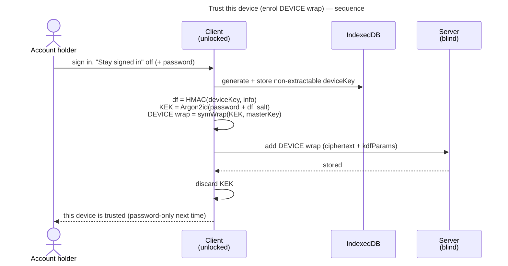
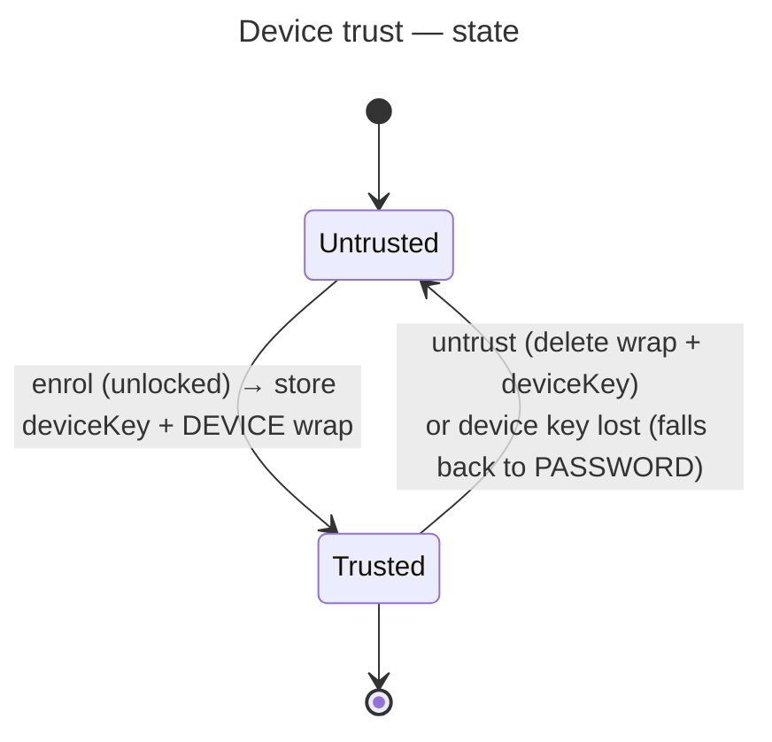

# UC: Trust this device (DEVICE wrap — unlock with only the password)

- **ID:** uc.account.trust-device
- **Primary actor:** Account holder, authenticated **and currently unlocked** on a device (the Master Key
  is in memory)
- **Goal:** Enrol a **device-local DEVICE `MasterKeyWrap`** so that future unlocks on *this* device need only
  the **password** — the high-entropy **Secret Key** is no longer required here. Entirely client-side; the
  server stores only the new ciphertext wrap.
- **Preconditions:** An **authenticated session** exists; the device is being (or has just been)
  **unlocked**, so the in-memory Master Key can be wrapped under a new KEK **and** the account password is
  still in hand (the unlock flow clears it right after — enrolment runs *at the sign-in that unlocks*, see
  [uc.account.remember-this-device](uc.account.remember-this-device.md)); WebCrypto + IndexedDB are available, and
  the operator has not disabled the `core.remember-device` capability.
- **Postconditions (success):** A **DEVICE** wrap (ciphertext) exists server-side; this device's IndexedDB
  holds its **non-extractable** device key plus the wrap's **salt** and server **id**; subsequent unlocks on
  this device open the Master Key from **password + device key** (2-factor, no Secret Key). The Secret Key
  was **never read or stored** — enrolment uses the already-unlocked Master Key.

## Many devices, one Master Key

Device trust is **per device** — trusting a phone *and* a laptop yields **two** independent DEVICE wraps on
the same Master Key, not a shared one; untrusting a device deletes only its wrap. (The wrap layout + the
per-device KEK derivation live in
[account-key-model → Unlock methods & KEK derivation](../enablers/en.account.key-model.md).)

## Why this is safe (still 2-factor, operator-blind)

The DEVICE wrap keeps **two factors** — it swaps the *cold* Secret Key for a *device-bound* key, but the
**password stays a real factor**, so a stolen device alone cannot unlock (**not** "raw key at rest"). The
device key is a **non-extractable** HMAC key, so no script can export its bytes — but the device factor it
computes is fixed, so an injected script that runs once can copy that, and the password is then what still
protects the wrap ([ADR 0005](../../../decisions/0005-unlock-methods-and-device-trust.md) §5). The KEK derivation
(`Argon2id(password + device-bind, …)`) is
[en.account.key-model](../enablers/en.account.key-model.md); storing the Secret Key or the raw Master Key
at rest is the **rejected** anti-pattern ([ADR 0005](../../../decisions/0005-unlock-methods-and-device-trust.md)).

## Main flow — enrol ("trust this device")

Enrolment happens **at sign-in**, not as a later "settings" action, and there is **no "Trust this device"
tick**: login and unlock are one screen ([uc.account.remember-this-device](uc.account.remember-this-device.md)),
and its single toggle, **"Stay signed in on this device"** (off by default), picks the wrap. Off → this DEVICE
wrap, enrolled automatically; on → the password-less `DEVICE_KEY` wrap instead. The unlock flow
([uc.account.unlock](uc.account.unlock.md)) **clears the password immediately after** deriving the KEK, so
enrolment runs **right after a successful unlock**, reusing the password just entered — which is
**known-correct** (it just opened the floor wrap) and not yet cleared.

1. The user signs in with "Stay signed in" off (this first time with password + Secret Key). On success,
   before the password is cleared, enrolment runs:
2. The client generates a **non-extractable** HMAC `deviceKey` and stores it in **IndexedDB** (this device
   only; it never syncs).
3. The client derives the device KEK from the **password + the device key** (a fresh salt; the exact
   derivation is [en.account.key-model](../enablers/en.account.key-model.md)).
4. The client wraps the **in-memory** Master Key under that KEK — the **DEVICE wrap**.
5. The client **adds** the DEVICE wrap (+ its `kdfParams` = Argon2id params ‖ salt) to the server, which
   appends a new wrap row and returns its **id**. The client stores `{deviceKey, salt, wrapId}` in
   IndexedDB and discards the KEK.
6. **Trusted:** the server holds the DEVICE ciphertext; this device holds its non-extractable key + the salt
   and id it needs to find and remove that wrap later.

## Routine unlock on a trusted device (the DEVICE path of uc.account.unlock)

The actual unlock is [uc.account.unlock](uc.account.unlock.md); trust-device adds the DEVICE method it can
choose: with a device key in IndexedDB, the client finds **its own** DEVICE wrap in the fetched set by the
stored salt, uses the **password only**, recomputes `df = HMAC(deviceKey, info)`, derives the same KEK, and
`symUnwrap`s the Master Key — no Secret Key. The web client takes the password from the login that just
happened, so on a trusted device the unlock **folds into login**: a successful sign-in unlocks
**immediately**, with no separate "unlock" step (the redundant password re-prompt is dropped). **Method
precedence is client-side** ([ADR 0005](../../../decisions/0005-unlock-methods-and-device-trust.md)): a
trusted device defaults to password-only, and the PASSWORD floor stays always reachable — if the device key
or its server wrap is unusable (E1), the client **falls back to the Secret-Key floor automatically**.

## Untrust ("forget this device")

Delete **this device's** DEVICE wrap server-side (by its stored id) **and** delete the IndexedDB entry. The
account falls back to the PASSWORD floor on this device; other trusted devices keep their own wraps. Removing
a trust removes **one wrap**; content is never re-encrypted. The endpoint deletes **only device-local
convenience wraps** (whitelist: DEVICE and DEVICE_KEY): the PASSWORD floor *and* the RECOVERY/PASSKEY methods
are out of its reach, so this control can never strip the 2SKD floor or a recovery path.

**The control is named by its row, not by a rubric of its own.** It lives on the current device's row in the
settings hub's *Devices and sessions* rubric ([uc.account.sessions](uc.account.sessions.md)) — the row that
already exists to say *"you are here"*. There is no separate "This device" section: a device's unlock tier and
its logins are two answers about one object, and stating the tier twice, in two vocabularies, is how the two
statements start to disagree. The consequence that binds the layout is below — the forget action sits **beside**
the escalation it must never be mistaken for.

**A device's trust can also be removed from another device.** The wrap endpoint is account-scoped, not
device-scoped, so the same deletion is what
[uc.account.sessions](uc.account.sessions.md)'s *"sign out and remove this device's saved key"* performs — for
a device that is lost, where nobody can press "untrust" on the device itself. The two therefore keep **separate
labels, separate confirmations and separate severities** even now that they sit on the same row: forgetting
reaches this device's local key as well as its server wrap and leaves the session alone, while the escalation
ends a session and can only ever reach the server's wrap. The server cannot reach a remote device's local key,
and that asymmetry is what forbids the cheap-looking simplification of one "remove this device" button. What
reaches the removed device
is nothing: its IndexedDB entry survives as an unusable handle and it falls back to the Secret-Key floor, which
is E1 below reached deliberately instead of by accident. Whether a wrap may be removed remotely at all, and why
a plain revoke does *not* do it, is [ADR 0058](../../../decisions/0058-revoke-never-takes-key-material.md).

## Alternate / exception flows

- **E1 — device key absent or wrap missing**: if the local key is gone (cleared storage, a different
  browser/profile) the server's DEVICE wrap is unusable here; if the server has no matching wrap, the local
  key opens nothing. Either way the client falls back to the **PASSWORD floor** — and it does **not** destroy
  the local key on a single server response (a blind operator could otherwise withhold the wrap to force
  every trusted device to wipe its key). A stale key/wrap is harmless ciphertext + an unusable handle;
  explicit untrust, or a re-trust (which replaces), is what cleans it up.
- **E2 — enrol without a successful unlock:** there is no in-memory Master Key (and no in-hand password) to
  wrap → nothing to enrol. Enrolment is bound to the unlock action, so it can only succeed when the unlock it
  rides on succeeds.
- **E3 — wrong password at unlock:** the KEK fails to open the wrap (AEAD tag mismatch) → **generic unlock
  failure**, identical to the PASSWORD path; the server is uninvolved.
- **E4 — WebCrypto / IndexedDB unavailable** (a locked-down browser), or the operator disabled
  `core.remember-device`: trust-device is **unsupported** → only the PASSWORD floor is offered, and the
  *Devices and sessions* row says so. No silent downgrade. The check is presence only
  (`isRememberSupported`): an ordinary private window has both APIs, so it **enrols** — its local key dies with
  the window and its server wrap is left as harmless E1 ciphertext.

## Trust state

## Quality notes

- **Secret Key stays cold.** Enrolment wraps the **already-unlocked** Master Key; it never reads, derives
  from, or stores the Secret Key. The Secret Key lives only in the Emergency Kit.
- **Non-extractable ≈ HSM *interface*, not *grade*.** A non-extractable WebCrypto key is a **software**
  boundary (browser-enforced) that stops a script exporting the key, not copying the fixed factor it computes
  ([ADR 0005](../../../decisions/0005-unlock-methods-and-device-trust.md) §5); a true hardware root (passkey /
  Enclave) is the separate **PASSKEY** method.
- **Device-local, no sync.** A DEVICE wrap is usable only where its key is present; each device enrols its
  own. Wraps are **combinable** on one Master Key (DEVICE + PASSWORD + future PASSKEY/RECOVERY).
- **Operator-blind.** The server holds only the DEVICE **ciphertext** wrap + opaque metadata — never the
  KEK, the device key, or the Master Key. The add/remove-wrap endpoints are **authenticated** and act only
  on the **caller's own** wraps.
- **Metadata exposed: a trusted-device count.** Because each trusted device is its own persistent wrap row,
  the operator can see *how many* devices an account trusts. A wrap row stores no time; when a device was
  enrolled is visible only as the request the server answered at that moment — the same
  device-*count* visibility already accepted for sessions ([ADR 0004](../../../decisions/0004-session-tokens.md)).
  Nothing per-login is re-uploaded on either side: a DEVICE wrap is inherently per-device and long-lived, and
  a session family carries no client blob at all, so there is nothing to correlate that the count doesn't
  already imply.
- **A password change ends every DEVICE wrap.** Since `KEK = Argon2id(deviceFactor + password)`, a new
  password would leave every DEVICE wrap un-openable anyway — the password-change client can **not** re-wrap
  them (it lacks the other devices' `deviceFactor`) — so the server **deletes** them with every other
  non-survivor wrap ([uc.account.change-password](uc.account.change-password.md) step 8, the survivor rule in
  [en.account.key-model](../enablers/en.account.key-model.md)). Each other device falls back to the PASSWORD
  floor (password + Secret Key) and re-enrols at that sign-in; the changing device is offered a re-enrol.
- **Reuse the affordance, never the naive data layer.** The obvious way to build "remember login" is to put
  the Secret Key or the raw Master Key in browser storage — which is exactly the pattern
  [ADR 0005](../../../decisions/0005-unlock-methods-and-device-trust.md) rejects, and it is what an earlier
  version of this product did. This use-case takes only the *idea* of a "trust this device" control.

## Out of scope (separate increments)

- **Reload persistence** ([ADR 0005](../../../decisions/0005-unlock-methods-and-device-trust.md) §6): keeping the
  unlocked Master Key across a reload is orthogonal (it applies to *every* method) and lives in the session vault
  of [uc.account.remember-this-device](uc.account.remember-this-device.md).
- **Biometric / passkey unlock** (PASSKEY method, WebAuthn PRF) — planned, nothing but the wrap method exists —
  and **cross-device onboarding** ([uc.account.onboard-device](uc.account.onboard-device.md)) are their own
  use-cases.

## What this means for you / Was das für dich bedeutet

**EN —** The first time you open your memories on a new device you use your **password** and your **Secret
Key** (from your Emergency Kit). From then on that device needs only your **password** — veyq sets this up by
itself at that first sign-in, and your Secret Key goes back in the drawer. It works by locking a key *inside
this browser* that can't be copied out; opening still needs your password too, so a stolen laptop alone isn't
enough. The server never sees any of this — only scrambled data. You can make a device **forget** its saved
key whenever you want (under *Devices and sessions*), and a device without one always falls back to
password + Secret Key.

**DE —** Wenn du deine Erinnerungen das erste Mal auf einem neuen Gerät öffnest, brauchst du dein **Passwort**
und deinen **Secret Key** (aus dem Notfall-Kit). Ab dann braucht dieses Gerät nur noch dein **Passwort** — das
richtet veyq bei dieser ersten Anmeldung von selbst ein, und der Secret Key wandert zurück in die Schublade.
Das funktioniert über einen Schlüssel, der *in diesem Browser* eingeschlossen ist und nicht herauskopiert
werden kann; zum Öffnen braucht es trotzdem dein Passwort, ein gestohlener Laptop allein genügt also nicht.
Der Server sieht davon nichts — nur verschlüsselte Daten. Du kannst ein Gerät seinen gespeicherten Schlüssel
jederzeit **vergessen** lassen (unter *Geräte und Sitzungen*), und ein Gerät ohne ihn nimmt immer den Weg über
Passwort + Secret Key.

## Related

- Feature: [Account & auth](../_index.md)
- Concepts: [Account & Key Model](../enablers/en.account.key-model.md) (one Master Key / many wraps),
  [Security Model](../../../crosscutting/security-model.md) (Secret Key / 2SKD, operator-blind)
- Decisions: [ADR 0005](../../../decisions/0005-unlock-methods-and-device-trust.md) (DEVICE wrap = device
  key + password; non-extractable backing; re-lock; method precedence), [ADR 0003](../../../decisions/0003-operator-blind-password-auth.md)
  (auth vs. unlock)
- Related use-cases: [unlock](uc.account.unlock.md) (the DEVICE wrap is one of its unlock paths; PASSWORD is
  the floor); [remember this device](uc.account.remember-this-device.md) (the sign-in screen that enrols it);
  [onboard device](uc.account.onboard-device.md); [sessions](uc.account.sessions.md); passkey — planned
  (biometric / WebAuthn PRF)
- End-user view (docs site): [Account keys & recovery](../../../../site/src/content/docs/account-keys-and-recovery.md)
