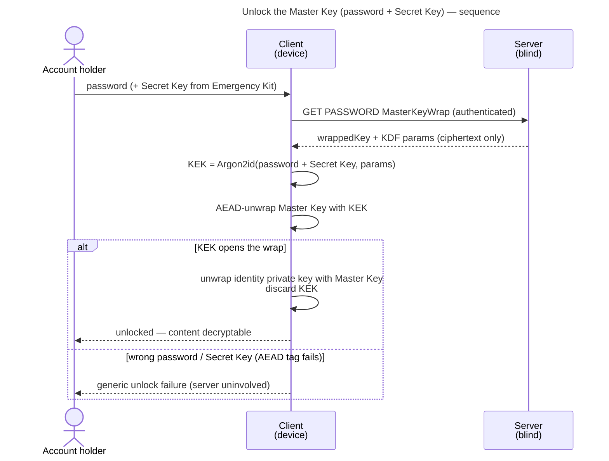

# UC: Unlock the Master Key (password + Secret Key)

- **ID:** uc.account.unlock
- **Primary actor:** Account holder, authenticated, on a device whose account is currently **locked**
- **Goal:** Open the account's **Master Key** on the device from the **PASSWORD wrap** using **password +
  Secret Key** (two-secret key derivation), making content decryptable — entirely client-side; the server
  learns nothing.
- **Preconditions:** An **authenticated session** exists (so the client can retrieve its wraps; see
  [uc.account.login](uc.account.login.md)); the account is **locked** (no Master Key in memory); a
  **PASSWORD** `MasterKeyWrap` exists (created at setup/join).
- **Postconditions (success):** The **Master Key** and the **identity private key** are held **in client
  memory**; scope grants and content can now be decrypted; the **Unlock KEK is discarded**; no password,
  Secret Key, KEK, or unwrapped key material ever left the device.

## Main flow

1. From an **authenticated-but-locked** state, the client obtains the **password** (reused from a login
   that just happened, or re-prompted on a fresh app session) and the **Secret Key** (from the Emergency
   Kit, or already held by an enrolled device). The Secret Key may be **typed/pasted** in its text form
   ([en.account.key-model § The Secret Key's text form](../enablers/en.account.key-model.md#the-secret-keys-text-form))
   or **imported from the Emergency Kit** — uploading the kit file (the PDF, also one re-saved, printed to PDF, or
   photographed or scanned into a PDF, or a picture of its QR), scanning its QR code, or pasting its
   machine-readable token in place of the key, all decoded **on-device** (the token never leaves the device). This is **one control**,
   not a per-screen affordance — see *One Secret-Key control* under Quality notes.
2. The client retrieves its **PASSWORD `MasterKeyWrap`** (the wrapped key + its KDF parameters/salt) from
   the server.
3. The client checks the wrap's KDF profile is the one it writes (E3), then derives the **Unlock KEK**
   `= Argon2id(password + Secret Key, wrap KDF params)` — **domain-
   separated** from the auth-keypair derivation, so the same password yields unrelated values for the two
   jobs.
4. The client **unwraps** (AEAD-decrypts) the **Master Key** with the KEK.
5. The client uses the Master Key to unwrap the **identity private key** (`wrappedIdentityPrivateKey`).
6. **Unlocked:** the Master Key + identity private key are in memory; the KEK is discarded. Content and
   scope grants are now openable.

## Alternate / exception flows

- **A1 — other unlock methods (deferred):** a **passkey** (PRF-derived KEK) or a **trusted device** (DEVICE
  wrap) each open the **same** Master Key via their own wrap — separate use-cases, not this flow. So does the
  Secret Key alone, through the `RECOVERY` wrap, but only to reset a forgotten password
  ([recover-access](uc.account.recover-access.md)); there is no separate recovery code.
- **A2 — unlocking on a session the sign-in found (web, inbox #454):** a device that reaches the sign-in screen
  with a live session — one boot restored without opening the vault — unlocks **inside** that session when the
  address entered is the session's account, as the server names it: the password is not first spent on a second
  login, and no second session family appears in Devices and sessions. A different account first ends that family
  and signs in ([login](uc.account.login.md) A2). The unlock itself is unchanged: the password and the Secret Key
  are derived on the device, and the server sees no secret.
- **E1 — wrong password or Secret Key:** the KEK fails to open the wrap (AEAD tag mismatch) → **generic
  unlock failure**; the server is **uninvolved** and learns nothing; the user retries locally.
- **E1a — a typo in the Secret Key:** a typed key of the full length whose check symbols disagree is named a typo
  in the Secret-Key field itself, before anything is derived; a key that does not read at all says nothing while it
  is typed. Submitted anyway, either is refused like a wrong key.
- **E2 — no PASSWORD wrap / not authenticated:** the wrap cannot be fetched or does not exist; the user
  must (re-)login or use a recovery/alternate method.
- **E3 — a served key-derivation profile the client does not write:** the client derives only with the
  Argon2id profile it writes itself, so any other served profile is **refused before deriving** — on this path
  and on every other that derives from a served wrap. It is the server's fault, not the person's: the screen
  fails the unlock without saying the password or Secret Key was wrong
  ([ADR 0017](../../../decisions/0017-crypto-primitives-and-post-quantum-strategy.md) rule 5).

## Unlock state

```mermaid
---
title: Unlock — state
---
stateDiagram-v2
  [*] --> Locked
  Locked --> Unlocking : password + Secret Key<br>+ fetch PASSWORD wrap
  Unlocking --> Unlocked : KEK opens wrap;<br>identity key unwrapped
  Unlocking --> Locked : wrong password / Secret Key (AEAD fail)
  Unlocked --> Locked : app restart / sign-out / timeout<br>(Master Key is in-memory only)
  Unlocked --> [*]
```

## Quality notes

- **Two-secret key derivation (2SKD).** Content needs the password **and** the Secret Key. A server/DB
  breach yields only ciphertext + `authPublicKey` + wrapped blobs — none of which derive the Master Key
  without the Secret Key, which **never reaches the server**. See
  [Security Model](../../../crosscutting/security-model.md).
- **Operator-blind, fully client-side.** The server serves only the wrapped blob; the KEK, the Master Key
  and the identity private key exist **only in client memory**.
- **Auth ≠ unlock.** A valid session does **not** imply unlocked — the Master Key is opened only here. The
  counterpart [uc.account.login](uc.account.login.md) gates a session but never unlocks content.
- **Ephemeral by default.** This flow holds the Master Key in memory for the working session only; it does
  **not** persist it. Routine re-unlock without re-entering the high-entropy Secret Key (a DEVICE wrap /
  biometric) is [uc.account.trust-device](uc.account.trust-device.md), enrolled automatically at sign-in — so
  this floor path is typically the *first* unlock
  on a device.
- **One Secret-Key control, wherever the Secret Key is asked for.** This use-case owns the property, and the
  other screens that ask for a Secret Key — the recovery reset ([uc.account.recover-access](uc.account.recover-access.md)),
  the authenticated password change ([uc.account.change-password](uc.account.change-password.md)), the key
  rotation ([uc.account.rotate-keys](uc.account.rotate-keys.md)) and a tenant-invite acceptance by someone who
  already has an account ([uc.admin.create-tenant](../../admin/use-cases/uc.admin.create-tenant.md)) — offer
  the *same* import, because a person opening their Emergency Kit under stress must meet what they already
  know. It is one component for a second reason too: a screen that renders a bare input instead is
  indistinguishable from one that simply has not been built yet, which is how the import came to exist on
  exactly one of five screens while three use-cases asserted it everywhere.
- **A kit from the wrong account warns; it never blocks.** Where the screen already knows which account is
  expected (an invite's owner e-mail, the recovery material's e-mail, the signed-in account), an imported kit
  carrying a *different* e-mail says so. It cannot be an error: the e-mail in a kit is metadata, an account may
  have changed address since, and only the wrap can decide whether a key is right. The alternative to warning
  is not a stricter check — it is the generic AEAD tag mismatch of E1, which tells the person their password
  might be wrong when in fact they picked up the wrong kit.
- **A kit made at another address says where; it never blocks either.** A kit carries the origin of the server it
  was made on, where its writer knew one ([en.account.key-model § The Emergency Kit](../enablers/en.account.key-model.md#the-emergency-kit)).
  An imported kit whose server is not the page's own says, as information, where it was made and where the person is.
  An account may be reached under several addresses, so the server is a hint, never a check.
- **Unlocks the E2EE layer.** Once unlocked, the account key is available — this is what lets the client
  decrypt **E2EE session names** (planned — `uc.account.sessions` is reserved in ADR 0004, not yet written) and all content.

## User impact

Your password and Secret Key open what you keep on your own device, so nobody running the server can read your
Memories.

## Related

- Feature: [Account & auth](../_index.md)
- Concepts: [Account & Key Model](../enablers/en.account.key-model.md) (one Master Key / many
  wraps, the Unlock KEK, 2SKD), [Security Model](../../../crosscutting/security-model.md) (Secret Key /
  2SKD, operator-blind)
- Decisions: [ADR 0003](../../../decisions/0003-operator-blind-password-auth.md) (the auth-vs-unlock
  split), [ADR 0005](../../../decisions/0005-unlock-methods-and-device-trust.md) (wrap methods, device
  trust, re-lock & precedence — this PASSWORD path is the floor of that spectrum)
- Related use-cases: [login](uc.account.login.md) (gates the session that lets you fetch the wrap); [trust
  this device](uc.account.trust-device.md) (DEVICE wrap for routine re-unlock); [recover access](uc.account.recover-access.md)
  (RECOVERY wrap); [manage active sessions](uc.account.sessions.md) (its E2EE names need this unlock)
- End-user view (docs site): [Sign in](../../../../site/src/content/docs/getting-started/sign-in.mdx)
