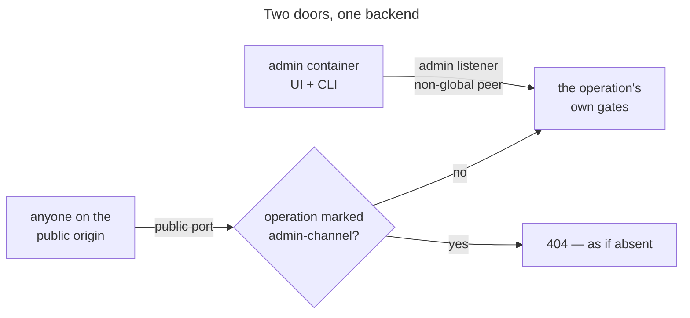

# UC: Administer the instance only through the admin container

- **ID:** uc.admin.admin-channel
- **Primary actor:** **Server Owner**, who administers through the `admin` container — and, as the party the
  property exists against, **anyone who can reach the instance's public origin**, including in the minutes after
  `up -d` when no Server Owner exists yet. The two never meet; the second only ever finds that the operations
  are not there.
- **Goal:** Every Server-Owner operation — first-run setup, tenant administration, the instance reads — answers
  only for a request that arrived through the admin container. On the public origin it does not exist.
- **Preconditions:** The instance runs a shipped deployment target (the production compose file or the Helm
  chart), which points the admin container at the backend's **admin listener** and routes nothing else to it
  ([ADR 0065](../../../decisions/0065-admin-ui-cli-separate-service.md)).
- **Postconditions (success):** A Server-Owner operation executed only on the admin channel. The same call on the
  public origin executed nothing and was answered as if the operation did not exist — or, for an anonymous
  caller of a role-gated operation, with the 401 it always got (A1).

## Main flow

1. The Server Owner opens the admin surface — over the localhost path by default, or at `ADMIN_DOMAIN` — or
   runs the `veyq-admin` CLI inside the admin container.
2. The admin container sends every `/api/*` call to the backend's admin listener, never to its public port.
3. The backend classifies the request **by its real socket, whatever the PROXY protocol states**: it is on the
   admin channel iff it arrived on the admin listener and its peer address is not globally routable. No header takes
   part — not `Host`, not `Forwarded`, not `X-Forwarded-*` — and neither does a PROXY header's destination or source
   ([ADR 0094](../../../decisions/0094-a-clients-address-is-the-hop-the-network-vouches-for.md) decision 7).
4. If the matched operation is marked `x-veyq-channel: admin` in `contracts/` and the request is on the admin
   channel, it proceeds to the gates it always had: the session and the Server-Owner role for tenant
   administration and the instance reads, the single-owner lock for setup
   ([setup-server](uc.admin.setup-server.md)).
5. The same operation reached on the public port is refused with the 404 an unknown `/api` path gets, before its
   handler runs. An unmarked operation answers identically on both channels.

## Alternate / exception flows

- **A1 — anonymous call to a role-gated operation on the public origin:** 401, as before. The security layer runs
  before the channel filter (measured), so the filter never sees the request — and nothing executes. The
  operation list is in a public repository; a uniform 404 would hide nothing.
- **A2 — forged forwarding headers on the public origin** (`Forwarded: host=…:<admin port>`,
  `X-Forwarded-Host`, `X-Forwarded-Port`, `X-Forwarded-For: 10.…`): still 404. The classification reads only the
  socket, and the forwarding layer rewrites exactly the values it does not read.
- **A2b — a PROXY header naming the admin listener** (the PROXY protocol on, `PROXY TCP4 10.… <public> <port>
  <admin port>`, a Server-Owner call on the public port): still 404. Vert.x hands a PROXY header's addresses out as
  the connection's addresses; the classification reads the channel's real ones.
- **A3 — the admin listener reached from a globally routable peer** (host networking, a published port): the
  request is on the public channel. A NAT that rewrites the peer to a private address defeats this, which is why
  it is a belt behind the precondition, not the guarantee.
- **A4 — the operations both channels need:** setup status (the web app boots from it, and both targets' probes
  poll it) and sign-in — login challenge and verify, refresh, logout — which the admin surface and the CLI call
  too. None of them is marked.
- **A5 — `ADMIN_DOMAIN` set before setup:** the admin container is itself on the internet, and so is the admin
  channel — the window step 5 closes on the public origin is open again on that one. Setup therefore runs over
  the localhost path first and the domain is set afterwards. Documented in the docs site's [Set up a new instance](../../../../site/src/content/docs/run/new-instance.mdx), not enforced.
- **E1 — a Server-Owner operation added without the marker:** the build fails. The backend's gate implies the
  channel, and a sweep holds every operation carrying the Server-Owner gate to its marker (and every marker to a
  resource method that exists).
- **E2 — the admin listener cannot bind:** the backend does not start. A backend that serves its public port with
  no admin door is an instance nobody can set up or administer, and it would look healthy to every probe.

## Quality notes

- **Reachability, not authorization.** The channel adds a layer in front of the Server-Owner gate; it replaces
  none. On the admin channel the owner's login is still required, and an unmarked operation gains nothing by
  arriving there. See [Authorization](../../../crosscutting/cc.security.authorization.md) for the layers it sits
  in front of.
- **Held in the backend, not at the edge.** The one component every deployment shares is the backend, so a
  self-hoster's own reverse proxy cannot drop the property by not knowing about it. What the shipped targets add —
  the listener not `EXPOSE`d, its own Service, a NetworkPolicy — narrows who can reach the listener; the residuals
  that remain are named in [ADR 0065](../../../decisions/0065-admin-ui-cli-separate-service.md).
- **The marker is contract, the set is derived.** `x-veyq-channel: admin` is declared per operation because
  `tenants.openapi.yaml` mixes Server-Owner operations with ones every member reaches (invite accept, terms). The
  backend builds its set from the specs; nobody lists it.

## User impact

Nobody who finds a freshly installed server can claim it first, and nobody can administer it from the internet,
because its controls answer only on a separate admin surface reached privately.

## Related

- Feature: [Administration & Operations](../_index.md)
- Use-cases: [setup-server](uc.admin.setup-server.md) (the anonymous operation this exists for),
  [create-tenant](uc.admin.create-tenant.md), [suspend-tenant](uc.admin.suspend-tenant.md),
  [identify-instance-release](uc.admin.identify-instance-release.md) (the role-gated ones)
- Concepts: [Authorization](../../../crosscutting/cc.security.authorization.md) (the layers behind the channel)
- Decisions: [ADR 0065](../../../decisions/0065-admin-ui-cli-separate-service.md) (the mechanism, the rejected
  alternatives, the residuals), [ADR 0008](../../../decisions/0008-centralized-http-auth.md) (why the marker is not
  authorization in the contract)
- Run area of the docs site: [First-run setup and the admin console](../../../../site/src/content/docs/run/first-run.mdx)
