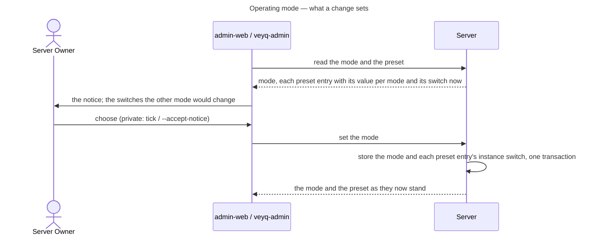

# UC: Choose the operating mode and publish who runs the instance

- **ID:** uc.admin.operator-details
- **Primary actor:** The **Server Owner**, in the admin console and in `veyq-admin`
- **Goal:** Say how the instance is run — *private* (family, circle of friends) or *club, organisation or company* —
  on the operator's own assessment, and set the values a host publishes about itself: the instance contact, the
  provider identification and the competent data-protection supervisory authority
  ([ADR 0093](../../../decisions/0093-a-report-opens-one-window-for-the-moderator-and-a-hold-copies-never-blocks.md)
  §§ 11 and 14, [ADR 0035](../../../decisions/0035-server-terms-of-service.md) decisions 6–7,
  [ADR 0088](../../../decisions/0088-the-capability-register-is-a-tree-switched-by-operator-and-tenant.md) decision 14).
- **Preconditions:** A set-up instance ([uc.admin.setup-server](uc.admin.setup-server.md), which asks the mode). For
  the notification address's code: instance mail configured and its address confirmed
  ([uc.admin.learn-of-new-releases](uc.admin.learn-of-new-releases.md)).
- **Postconditions (success):** The mode is stored, and the instance-level switch of every register entry the catalog
  marks per mode is set to that mode's value; the values are stored, the public ones served before sign-in, the
  notification address only on the admin channel and confirmed by a code before anything is mailed to it.

## Main flow

1. The Server Owner opens Server → Operating mode. It shows the mode in effect (an instance where none was ever chosen
   runs as *club, organisation or company*), the notice — that the choice is the operator's own assessment, what
   *private* leaves off and why a public link probably ends the household exemption — and, for the other mode, every
   switch its preset would change.
2. Choosing *private* needs a tick that the notice was read. Setting the mode stores it and, in the same transaction,
   sets the instance-level switch of each entry the catalog's `modes` names to that mode's value. A tenant's switches
   and every entry without a preset stay as they are; each preset switch stays an ordinary switch afterwards.
3. The Server Owner opens Server → Operator and enters, each optional: the instance contact (an address and the
   languages it answers in), the address statements and disclosures name (may equal the contact), the notification
   address, the provider identification (name, address for service, email, and for a legal person its
   representative), and the supervisory authority. Saving stores them.
4. A saved notification address that is not confirmed gets a one-time code through instance mail; typing it into the
   same panel confirms it. Moderation notices reach it only once confirmed.
5. The contact with its languages, the statement address, the identification and the supervisory authority are served
   before sign-in, the same on every host; the web app shows the identification on the login and the share pages.

## Alternate / exception flows

- **A1 — Values left empty.** Nothing is refused, in either mode. In *club, organisation or company* the admin console
  warns while public links (`core.public-shares`) are on and no contact is set, and, independently, while the
  identification is empty. In *private* neither warning shows; a value that is set is still published.
- **A2 — Instance mail not ready.** A notification address saved while instance mail is not configured and confirmed
  gets no code; the panel says so, and saving again once instance mail is confirmed sends one.
- **A3 — A wrong or stale code.** It is refused and spends one of a few attempts; a code expires; a changed
  notification address unconfirms the old confirmation without any further write, and asks again.
- **A4 — `veyq-admin`.** `mode show` prints the mode, the notice and the preset; `mode set private` refuses without
  `--accept-notice` and prints the notice either way. `operator show|set|clear` sets the values; the code is typed in
  the console only, as instance mail's is.
- **A5 — The public read fails.** The login and share pages show no identification and block nothing.

## User impact

Members and guests can see who runs the instance and how to reach them; a family instance is not nagged into an
imprint it may not need, and the operator's choice is theirs and stated as such.

## Related

- [ADR 0093](../../../decisions/0093-a-report-opens-one-window-for-the-moderator-and-a-hold-copies-never-blocks.md)
  §§ 11, 14; [ADR 0035](../../../decisions/0035-server-terms-of-service.md) decisions 6–7;
  [ADR 0088](../../../decisions/0088-the-capability-register-is-a-tree-switched-by-operator-and-tenant.md) decision 14;
  [ADR 0097](../../../decisions/0097-an-instance-looks-for-new-releases-and-mails-its-server-owner.md) decisions 3, 5;
  [ADR 0089](../../../decisions/0089-instance-settings-live-in-admin-web-the-environment-only-bootstraps.md)
- [uc.admin.setup-server](uc.admin.setup-server.md) (the first choice of the mode),
  [uc.admin.switch-capabilities](uc.admin.switch-capabilities.md) (the switches a preset sets),
  [uc.admin.learn-of-new-releases](uc.admin.learn-of-new-releases.md) (instance mail)
- Run area of the docs site: [Moderation](../../../../site/src/content/docs/run/moderation.md) (the mode, the values,
  the warnings), [First-run setup](../../../../site/src/content/docs/run/first-run.mdx) (the setup step, the panels, the
  CLI), [Configuration](../../../../site/src/content/docs/run/configuration.md); Use area:
  [What a guest sees](../../../../site/src/content/docs/sharing/what-guests-see.mdx) (the identification on the share page)
