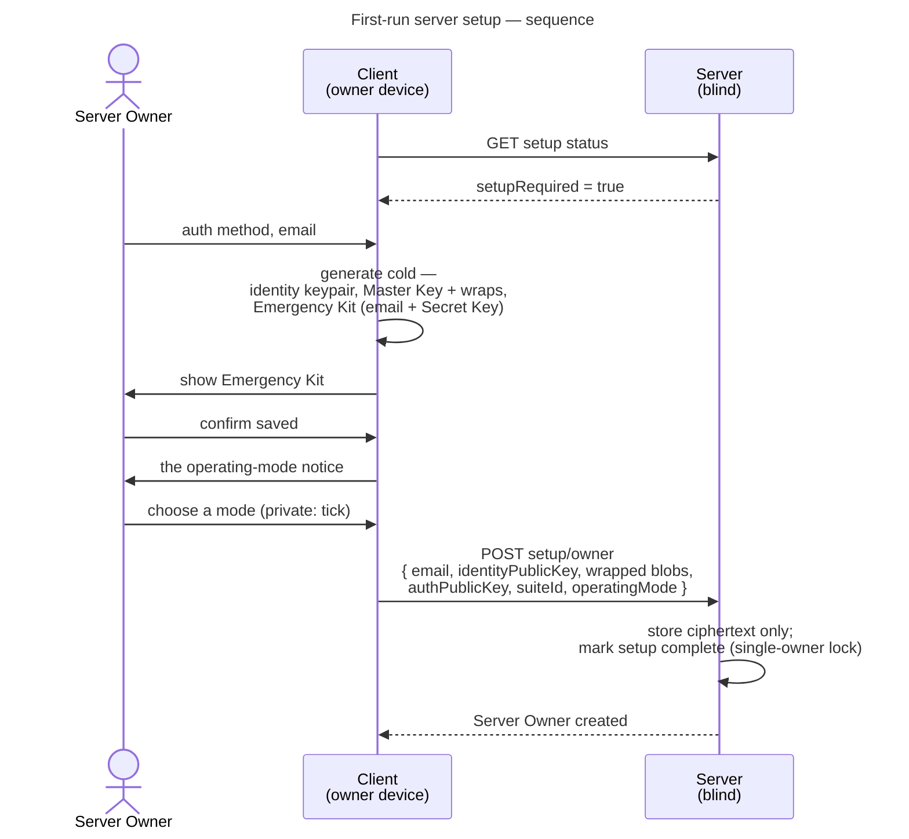
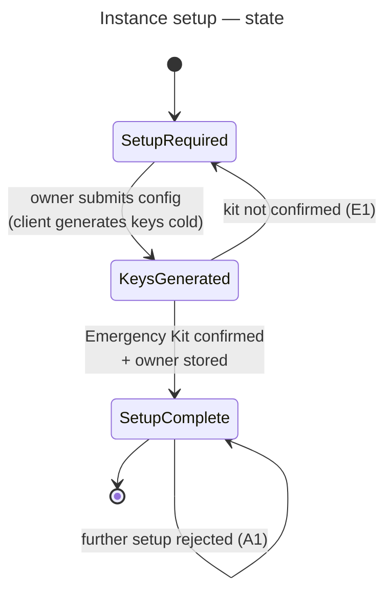

# UC: First-run server setup

- **ID:** uc.admin.setup-server
- **Bootstrap happens in the browser**, while the operator is at the machine they are installing the server
  on — a one-time act, at the point of installation.
- **Primary actor:** Server Owner (the person installing the instance)
- **Goal:** Bootstrap a fresh instance — create the first account (Server Owner) as an end-to-end
  encrypted account and mark the instance set up.
- **Preconditions:** A freshly installed instance with setup **not yet completed**.
- **Postconditions (success):** The Server Owner account exists with its own identity keys, Master Key
  wraps and a saved Emergency Kit; the instance is marked set up; the operator holds **no** content keys. The
  instance moderation key has its epoch 1, granted to the Server Owner alone, so reporting is on from the first day
  ([uc.moderation.appoint-moderators](../../moderation/use-cases/uc.moderation.appoint-moderators.md)). The
  operating mode the Server Owner chose is stored, with its preset's switches
  ([uc.admin.operator-details](uc.admin.operator-details.md)).

## Main flow

1. On first run the client checks setup status; the setup flow is reachable **only** while setup is
   incomplete.
2. The Server Owner chooses an auth method — **password + Secret Key** (the mandatory floor) and optionally
   a **passkey** — and enters their **email**. (No display name is collected: the account carries only email +
   keys; a name/handle is a **per-tenant** concern set when joining a tenant — [ADR 0023](../../../decisions/0023-per-tenant-member-identity.md).
   No instance name either: the instance is identified by its host — see Quality notes.)
3. The client generates, **cold** (no invite, no temp-wrap — this is the root of the owner's own key
   tree): the **identity keypair**, the **Master Key** with one wrap per chosen unlock method, and the
   **Emergency Kit** (email + Secret Key — its format is [en.account.key-model § The Emergency Kit](../../account/enablers/en.account.key-model.md#the-emergency-kit)), then forces the owner to confirm they saved the kit.
4. Once the kit is confirmed, the Server Owner chooses the instance's **operating mode** — *private (family, circle
   of friends)* or *club, organisation or company* — after the notice that this is their own assessment, not veyq's
   ([ADR 0093](../../../decisions/0093-a-report-opens-one-window-for-the-moderator-and-a-hold-copies-never-blocks.md)
   § 14); *private* needs a tick that the notice was read. The setup request cannot be sent without a mode.
5. The client uploads the **identity public key + wrapped blobs + a password-derived auth *public* key**
   (operator-blind password auth, [ADR 0003](../../../decisions/0003-operator-blind-password-auth.md):
   the server never sees the password and stores no credential/verifier — login is challenge-response);
   the server stores ciphertext + the public key only and **marks setup complete** (single-owner lock). With it go
   epoch 1 of the instance moderation key — its public bundle and `M_1` sealed to the identity just born, `M_1` then
   forgotten ([ADR 0099](../../../decisions/0099-moderators-share-one-instance-moderation-key-and-review-without-a-vault.md)
   § 3) — stored in the same transaction, the Server Owner its first moderator; and the operating mode, whose preset
   sets its instance-level switches in that same transaction
   ([ADR 0088](../../../decisions/0088-the-capability-register-is-a-tree-switched-by-operator-and-tenant.md) decision 14).

## Alternate / exception flows

- **A1 — already set up:** after setup completes, the setup endpoint is **closed**; there is no second
  bootstrap.
- **E1 — kit not confirmed:** if the Emergency Kit backup is not confirmed, setup is **not finalized**: nothing
  has been sent, so a tab closed on the kit screen leaves setup open and the keys minted for it are simply gone.
  The owner is posted only after the confirmation (admin-web's `SetupView`, the order web's member registration
  already keeps). If someone else finishes setup in between, the post is refused (A1) and the console says the
  kit belongs to no account.

## Setup state

## Quality notes

- **Operator-blind from account #1.** Even the Server Owner's content is E2E-encrypted; the server never
  holds content keys. See [Security Model](../../../crosscutting/security-model.md).
- **Cold key birth.** Unlike invitation-based registration there is no temp-wrap to import — the first
  user is the root of their own key tree. See [Account & Key Model](../../account/enablers/en.account.key-model.md).
- **Tenant routing is Host-based.** The reverse proxy forwards the request and the backend resolves the
  active tenant from the `Host` (tenant↔domain) — see
  [Scopes & Tenancy](../../../crosscutting/scopes-and-tenancy.md). At first-run there is no tenant yet
  (tenant creation is a separate use-case); setup establishes the Server Owner only. **No instance name is
  collected** — a single operator-set, cleartext, server-wide name is the wrong altitude when one server
  hosts many tenants (each resolved by its `Host`/domain) added over time; the host already identifies the
  instance, and any human label belongs to a **tenant** (keyed to its domain) or an E2EE space name, never
  to server setup (cr-0006).
- **Tenant creation is separate** — it is its own use-case, not part of bootstrap.
- **Reachable before DNS and TLS exist, on both deployment targets.** Setup is served from the administration
  surface, which proxies the API from its own origin
  ([ADR 0065](../../../decisions/0065-admin-ui-cli-separate-service.md)), so `http://localhost:<port>` is
  enough to create the first account while the instance's domain resolves nowhere. The property is the same on
  both targets and the mechanism differs: compose binds the surface to `127.0.0.1:<port>` of the host; the Helm
  chart ([ADR 0064](../../../decisions/0064-kubernetes-helm-deployment-target.md)) gives it a `ClusterIP`
  `Service` and **no** route by default, reached with `kubectl port-forward` — in a namespace under the
  `restricted` PodSecurity standard, because every image the instance runs, this surface's included, runs
  unprivileged. Exposing it on a hostname of its own is the operator's opt-in on either target.
- **No personal scope at first-run.** Personal scopes are **per-tenant**, created when a user joins a
  tenant (see [ADR 0002](../../../decisions/0002-personal-scope-per-tenant.md)); at first-run no tenant
  exists, so the owner has no personal scope until they create or join one.

## User impact

The very first account on a new server is end-to-end encrypted from its first moment, with keys made on your own
device and an Emergency Kit you keep, and setup can never run again.

## Related

- Feature: [Administration & Operations](../_index.md)
- Concepts: [Security Model](../../../crosscutting/security-model.md) (key hierarchy, operator-blind),
  [Account & Key Model](../../account/enablers/en.account.key-model.md) (cold key birth, Emergency Kit),
  [Scopes & Tenancy](../../../crosscutting/scopes-and-tenancy.md) (tenant routing, scopes)
- Decisions: [ADR 0065](../../../decisions/0065-admin-ui-cli-separate-service.md) — this flow is served from
  the separate admin surface, not the main app, by decision (the most privileged single action an instance
  takes is also the one moved furthest from the public origin); the flow itself is unchanged by that move.
- Related use-cases: [admin-channel](uc.admin.admin-channel.md) — the property that keeps this anonymous
  operation off the public origin, so "first caller after `up -d`" is never a stranger; [account login](../../account/use-cases/uc.account.login.md),
  [create-tenant](uc.admin.create-tenant.md)
- Run area of the docs site: [First-run setup and the admin console](../../../../site/src/content/docs/run/first-run.mdx)
