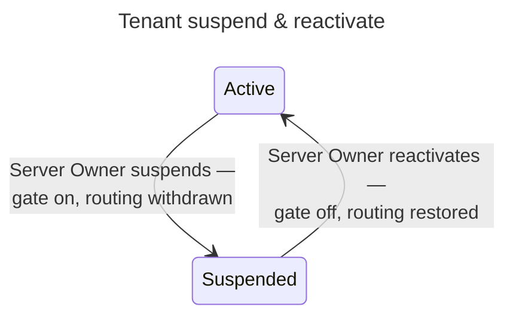

# UC: Suspend & reactivate a tenant

- **ID:** uc.admin.suspend-tenant
- **Primary actor:** **Server Owner**.
- **Goal:** Take an **`ACTIVE`** tenant offline **without touching its content** — an availability lever, not
  a confidentiality one — and bring it back later, exactly as it was.
- **Preconditions:** The actor is a **Server Owner**; the target tenant is `ACTIVE` (to suspend) or
  `SUSPENDED` (to reactivate).
- **Postconditions (success):** The tenant's status flips (`ACTIVE ⇄ SUSPENDED`); while `SUSPENDED`, **every**
  operation acting on that tenant is refused — from whichever domain it arrives, whether or not the caller
  holds a valid session — its public links stop answering, and no background job in it runs; no key, grant, or
  content row is read, written, or rotated by either transition.

## Main flow — suspend

1. The Server Owner suspends an `ACTIVE` tenant.
2. The server flips its status to `SUSPENDED`.
3. From this instant, **every** operation that acts on the tenant — its scopes, its own tenant routes, its
   shares, its background jobs — is refused by the one scope-access gate each of them calls
   ([uc.spaces.scope-access](../../spaces/use-cases/uc.spaces.scope-access.md)): a member gets
   `403 tenant_suspended`, reads included; anyone else gets the same answer as if the tenant's scopes did not
   exist, and a share guest the answer of a revoked link. It holds on **any** domain, because the gate decides
   by the tenant the operation acts on, not by the `Host` it arrived on — the space switcher reaches every
   tenant by id from whichever domain the app is open on. On the tenant's **own** domain a `Host` filter
   additionally refuses every API request — sign-in included — before authentication is evaluated. A request with a
   still-valid access token is refused exactly like a brand-new one, and no session is touched — which is
   what keeps a member who also belongs to another, unaffected tenant signed in there
   ([ADR 0066](../../../decisions/0066-tenant-suspension.md) — a session cannot be revoked per-tenant, only
   per-account). The member's space switcher still lists the tenant, marked offline and not enterable.
4. The tenant's ingress routing is withdrawn — its domain stops resolving at the network edge too. That
   projection is [tenant-reachability](uc.admin.tenant-reachability.md)'s, which this transition is a trigger
   of; it is a second, **independent** layer, and the guarantee in step 3 does not depend on it. Which is why
   the gate shipped a slice ahead of it, and why an operator whose topology exposes the app by some other path
   is still fully covered.

## Main flow — reactivate

5. The Server Owner reactivates a `SUSPENDED` tenant.
6. Its status flips back to `ACTIVE`, the gate lets its members through again, its links answer again and its
   waiting jobs are claimable, and the same projection puts its routers back. A member whose session was still
   technically valid throughout simply resumes — nothing needed to be preserved, because nothing was torn
   down.

## Alternate / exception flows

- **A1 — suspend a non-`ACTIVE` tenant:** rejected (409) — suspension is only defined from `ACTIVE`; a
  `PENDING` tenant is withdrawn via the existing `revokeTenant` (delete), not this transition.
- **A2 — reactivate a non-`SUSPENDED` tenant:** rejected (409), symmetrically.
- **A3 — a member's request arrives while suspension is in flight:** there is no window where the tenant
  reads `SUSPENDED` but an operation still passes, because the gate reads the same row the flip wrote, on
  every call.
- **A4 — on a moderator's proposal** ([uc.moderation.take-a-measure](../../moderation/use-cases/uc.moderation.take-a-measure.md)):
  admin-web's moderation panel and `veyq-admin moderation proposals` list a proposal to take the tenant offline with its
  case; suspending the tenant settles every open such proposal as taken, and the Server Owner may decline one instead.
- **A5 — over content** ([ADR 0093](../../../decisions/0093-a-report-opens-one-window-for-the-moderator-and-a-hold-copies-never-blocks.md) § 7):
  the Server Owner says the suspension is over content, or a moderator's proposal to take the tenant offline is open (the
  server then refuses it without one, `400 statement_required`), and enters the statement of reasons with it — in
  admin-web one checkbox and one statement above both measures, offline and delete, held ticked while such a proposal is
  open; in `veyq-admin` `--over-content`. It is mailed with the facts to each owner of the tenant once the suspension
  committed ([uc.moderation.object-to-a-measure](../../moderation/use-cases/uc.moderation.object-to-a-measure.md) A7);
  reactivating lifts its record. A suspension for any other reason carries none.
- **A6 — the statement does not reach everyone**: the answer (`statementDelivery`) says the mail did not reach
  everyone and names every address it did not reach — the instance mail is not set up, or the send failed. admin-web
  says so under the tenant's header, where it stays until dismissed, with the statement's words read-only beside it and
  a copy button, so the Server Owner tells those through the instance contact; before the step, the statement's fields
  warn while no instance mail is set up. `veyq-admin` prints it and warns on stderr, exiting 0. A tenant with nobody to
  tell (no owner) is said as such, and an answer the server cannot give (the recipients unreadable after the commit) as
  that. The suspension stands either way: it is never refused for want of mail.
- **E1 — the Server Owner themselves holds a membership in the suspended tenant** (the on-premise
  collapsed case, see *create-tenant*'s note): they are refused exactly like any other member. Server-Owner
  status is global and lets them *reactivate* the tenant through the (unaffected) server-admin surface, but
  it does not exempt their own membership from the gate while suspended.

## Quality notes

- **Availability, never confidentiality — the same line `create-tenant` already drew.** Suspension reads and
  writes exactly one thing: the tenant's `status` column. It is never in the path of a scope key, a grant, a
  content row, or a session — a session cannot even be scoped to one tenant, since accounts are global to the
  server and may hold memberships in several ([ADR 0066](../../../decisions/0066-tenant-suspension.md)).
- **The per-operation gate is the guarantee; the `Host` filter and routing withdrawal are not.** An operator's
  own network topology may expose the app by a path the reverse proxy does not control, and the app itself
  reaches every tenant from every tenant's domain — the gate in step 3 is what makes the lockout real
  regardless of either, per [ADR 0066](../../../decisions/0066-tenant-suspension.md).
- **Reversible by design, unlike `revokeTenant`.** Revoking a `PENDING` tenant is a hard delete because
  nothing has ever been active; suspending an `ACTIVE` one must not be, because a whole scope's content and
  membership sit behind it.
- **No grace period, no soft-block.** The decision, made explicit rather than defaulted: suspension blocks
  every request from the moment it takes effect, including reads already in flight against a still-valid
  session — not "new sessions only" or "writes only."

## User impact

The person running a server can take a whole space offline and bring it back exactly as it was, without ever being
able to read or change what is inside.

## Related

- Feature: [Administration & Operations](../_index.md)
- Decisions: [ADR 0066](../../../decisions/0066-tenant-suspension.md) (the per-operation gate, the `Host` filter
  beside it, and why a session-revoke was considered and rejected), [ADR 0063](../../../decisions/0063-database-driven-tenant-ingress.md)
  (the ingress-projector consumer of this transition).
- Related use-cases: [scope-access](../../spaces/use-cases/uc.spaces.scope-access.md) (the gate, and what
  every caller is told), [create-tenant](uc.admin.create-tenant.md) (named this as future work),
  [tenant-reachability](uc.admin.tenant-reachability.md) (step 4's routing withdrawal, and where it is
  verified).
- Run area of the docs site: [Moderation](../../../../site/src/content/docs/run/moderation.md)
- End-user view (docs site): [Offline or unreachable](../../../../site/src/content/docs/help/offline.mdx)
