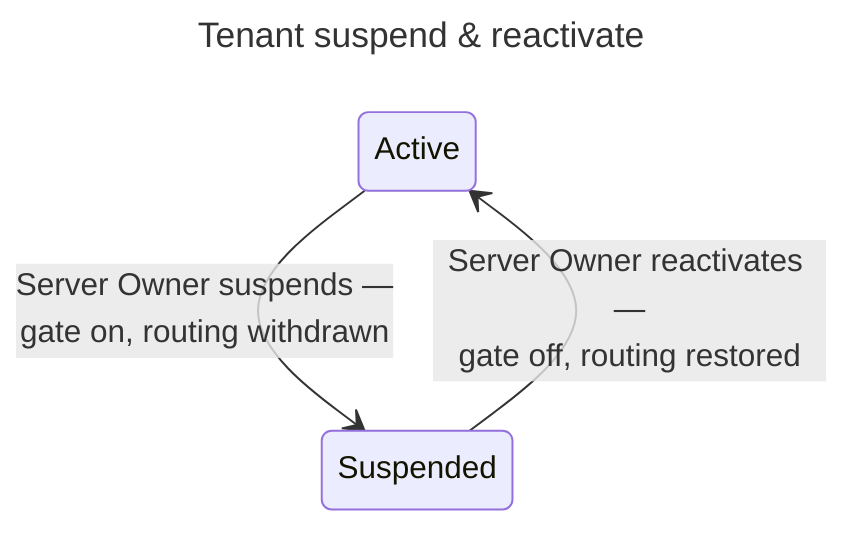

# UC: Suspend & reactivate a tenant

- **ID:** uc.admin.suspend-tenant
- **Primary actor:** **Server Owner**.
- **Goal:** Take an **`ACTIVE`** tenant offline **without touching its content** — an availability lever, not
  a confidentiality one — and bring it back later, exactly as it was.
- **Preconditions:** The actor is a **Server Owner**; the target tenant is `ACTIVE` (to suspend) or
  `SUSPENDED` (to reactivate).
- **Postconditions (success):** The tenant's status flips (`ACTIVE ⇄ SUSPENDED`); while `SUSPENDED`, **every**
  request against that tenant's domain is refused, regardless of who makes it or whether they hold a valid
  session; no key, grant, or content row is read, written, or rotated by either transition.

## Main flow — suspend

1. The Server Owner suspends an `ACTIVE` tenant.
2. The server flips its status to `SUSPENDED`.
3. From this instant, **any** request whose resolved tenant is `SUSPENDED` is refused `403 tenant_suspended`
   at the request boundary, before authentication is evaluated — a request that was mid-flight with a
   still-valid access token is refused exactly like a brand-new, unauthenticated one. No session is touched:
   the gate is keyed on the `Host` the request arrives on, not on who presents it, which is what makes it
   correct for a member who also belongs to another, unaffected tenant ([ADR 0066](../../../decisions/0066-tenant-suspension.md)
   — a session cannot be revoked per-tenant, only per-account).
4. The tenant's ingress routing is withdrawn — its domain stops resolving at the network edge too. That
   projection is [tenant-reachability](uc.admin.tenant-reachability.md)'s, which this transition is a trigger
   of; it is a second, **independent** layer, and the guarantee in step 3 does not depend on it. Which is why
   the gate shipped a slice ahead of it, and why an operator whose topology exposes the app by some other path
   is still fully covered.

## Main flow — reactivate

5. The Server Owner reactivates a `SUSPENDED` tenant.
6. Its status flips back to `ACTIVE`, the request-boundary gate stops firing for it, and the same projection
   puts its routers back. A member whose session was still technically valid throughout simply
   resumes — nothing needed to be preserved, because nothing was torn down.

## Alternate / exception flows

- **A1 — suspend a non-`ACTIVE` tenant:** rejected (409) — suspension is only defined from `ACTIVE`; a
  `PENDING` tenant is withdrawn via the existing `revokeTenant` (delete), not this transition.
- **A2 — reactivate a non-`SUSPENDED` tenant:** rejected (409), symmetrically.
- **A3 — a member's request arrives while suspension is in flight:** the request-boundary gate and the
  status flip are the same transaction's visible effect — there is no window where the tenant reads
  `SUSPENDED` but a request still passes, because the gate reads the same row the flip wrote.
- **E1 — the Server Owner themselves holds a membership in the suspended tenant** (the on-premise
  collapsed case, see *create-tenant*'s note): they are refused exactly like any other member. Server-Owner
  status is global and lets them *reactivate* the tenant through the (unaffected) server-admin surface, but
  it does not exempt their own membership from the gate while suspended.

## Quality notes

- **Availability, never confidentiality — the same line `create-tenant` already drew.** Suspension reads and
  writes exactly one thing: the tenant's `status` column. It is never in the path of a scope key, a grant, a
  content row, or a session — a session cannot even be scoped to one tenant, since accounts are global to the
  server and may hold memberships in several ([ADR 0066](../../../decisions/0066-tenant-suspension.md)).
- **The gate is the guarantee; routing withdrawal is not.** An operator's own network topology may expose the
  app by a path the reverse proxy does not control — the request-boundary check in step 3 is what makes the
  lockout real regardless of topology, per [ADR 0066](../../../decisions/0066-tenant-suspension.md).
- **Reversible by design, unlike `revokeTenant`.** Revoking a `PENDING` tenant is a hard delete because
  nothing has ever been active; suspending an `ACTIVE` one must not be, because a whole scope's content and
  membership sit behind it.
- **No grace period, no soft-block.** The decision, made explicit rather than defaulted: suspension blocks
  every request from the moment it takes effect, including reads already in flight against a still-valid
  session — not "new sessions only" or "writes only."

## What this means for you / Was das für dich bedeutet

**EN —** As the operator, you can temporarily take a whole space offline — for maintenance, a dispute, or any
reason of your own — without ever being able to read what's inside it. The moment you do, nobody in that
space can get in any more, even if they were already signed in; bringing it back online undoes exactly that,
and nothing else. Your own data, wherever it lives, is never touched by this.

**DE —** Als Betreiber kannst du einen ganzen Bereich vorübergehend offline nehmen — für Wartung, einen
Streitfall oder aus eigenem Ermessen — ohne jemals lesen zu können, was darin liegt. Ab diesem Moment kommt
niemand mehr in diesen Bereich hinein, auch nicht, wer gerade angemeldet war; ihn wieder online zu nehmen
macht genau das rückgängig, und nichts sonst. Die Daten selbst werden davon nie berührt.

## Related

- Feature: [Administration & Operations](../_index.md)
- Decisions: [ADR 0066](../../../decisions/0066-tenant-suspension.md) (the request-level gate mechanism, and
  why a session-revoke was considered and rejected), [ADR 0063](../../../decisions/0063-database-driven-tenant-ingress.md)
  (the ingress-projector consumer of this transition).
- Related use-cases: [create-tenant](uc.admin.create-tenant.md) (named this as future work),
  [tenant-reachability](uc.admin.tenant-reachability.md) (step 4's routing withdrawal, and where it is
  verified).
