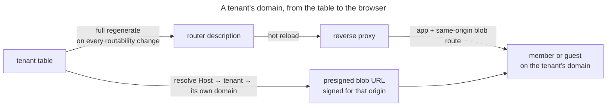

# UC: Reach a tenant at its own domain

- **ID:** uc.admin.tenant-reachability
- **Primary actor:** **Server Owner** (whose tenant actions decide which domains exist) and every
  **member or guest** who then opens one. Two parties again, but unlike *create-tenant* they never meet:
  the second one only ever experiences whether the first one's action took effect.
- **Goal:** Every tenant on the instance answers at **its own** domain — the app and its media on that one
  origin — as a **consequence of the `tenant` table**, with no deployment-time edit between creating a tenant
  and being able to reach it.
- **Preconditions:** The instance is set up and reached through a reverse proxy the backend can project into
  (the docker-compose stack wires this; an instance without one has no routing to project and is covered by A1);
  the domain's DNS points at this host.
- **Postconditions (success):** Every non-`SUSPENDED` tenant's domain routes to the app **and** to the blob
  path on that same origin; a suspended or revoked tenant's does not; and a presigned blob URL handed to a
  client on that domain is signed **for that domain**, so the browser's fetch is same-origin.

## Main flow

1. The Server Owner does anything that changes which domains should route: creates a tenant, moves one to a
   different domain, revokes a pending one, suspends or reactivates one
   ([create-tenant](uc.admin.create-tenant.md), [suspend-tenant](uc.admin.suspend-tenant.md)).
2. After that change has committed, the backend regenerates the **complete** router description from the
   `tenant` table — every tenant whose status is not `SUSPENDED`, minus the bootstrap domain, which the
   deployment already routes statically. It is never a patch of the previous one
   ([ADR 0063](../../../decisions/0063-database-driven-tenant-ingress.md)).
3. The reverse proxy picks the new description up without restarting and, for each domain that appears,
   obtains a certificate for it. Each domain gets the **same pair** of routes the bootstrap domain has: the
   app, and the blob path on that same origin with its prefix and `Host` preserved
   ([ADR 0013 §4](../../../decisions/0013-blob-storage-presigned-direct-to-store.md)).
4. A member or guest opens that domain. The request resolves to its tenant by the `Host` it arrived on —
   the one canonical resolution every gate and handler shares.
5. When that client asks for media, the server signs the presigned URL for **the resolved tenant's own
   registered domain**, read from the `tenant` table rather than echoed back from the request's header. The
   client fetches the bytes from the origin it is already on, so no CORS policy has to exist for it to work.
6. The same regenerate runs once at startup, before the instance serves traffic — so a wiped volume, a fresh
   proxy container or a file somebody edited is repaired without anyone noticing it was broken.

## Alternate / exception flows

- **A1 — no proxy to project into:** with no dynamic-config path configured the projection is a clean no-op,
  not a degraded mode. This is the `%dev`/`%test` default and what lets a self-hoster run the backend directly;
  the deployment's own static route for the bootstrap domain is unaffected either way.
- **A2 — the request's `Host` names no tenant** (the bootstrap domain, an unknown name, a direct container
  port): it resolves to no tenant and nothing narrows — the request proceeds as it always did, and its
  presigned URLs are signed against the configured default.
- **A3 — the `Host`/`X-Forwarded-Host` is spoofed:** identical to A2 by construction, and that is the point.
  The signing domain is looked up in the `tenant` table, so a name no tenant claims can only fall back to the
  default — it can never make the server sign a URL for an origin the caller chose.
- **A4 — the projection is wiped, corrupted, or hand-edited:** nothing detects it. The next regenerate — any
  tenant change, or the next start — overwrites it in full, which is the whole reason it is not a patch.
- **A5 — the object store is not behind this deployment's proxy** (external S3, or any store already reachable
  at its own hostname): the tenant's domain plays no part in signing, because the store's origin has nothing to
  do with it. Same-origin is the docker-compose branch of
  [ADR 0013 §4](../../../decisions/0013-blob-storage-presigned-direct-to-store.md), not a universal one.
- **E1 — the domain's DNS does not point at this host:** the routing description is correct and the domain
  still does not resolve. Outside the server's reach entirely, and the one failure that looks identical from
  the browser to a projection that never ran.
- **E2 — certificates are rate-limited:** domains can now be added as fast as tenants are created, and each
  new one is a certificate order. Point the ACME client at a staging directory while testing a deployment —
  [`infra/README.md`](../../../../infra/README.md) carries the setting.

## Quality notes

- **Full regeneration is the design, not an implementation detail.** An incremental "add one router" would be
  smaller and would make every state in A4 permanent, because nothing else ever revisits the file. Re-deriving
  the whole thing is what makes the projection *self-healing* rather than merely *usually correct*.
- **Two independent layers, and only one of them is a guarantee.** Withdrawing a suspended tenant's routing is
  a real effect, but the lockout is the request-boundary gate ([suspend-tenant](uc.admin.suspend-tenant.md)
  step 3): an operator's own topology may expose the app by a path no proxy controls, and the gate is what
  holds regardless. Never state routing withdrawal as the reason a suspended tenant is unreachable.
- **A domain is operational metadata, and this changes nothing about that.** Host routing needs it in cleartext
  anyway; the projection and the signer hold no key material and derive none, so operator-blindness is exactly
  where it was.
- **The bootstrap domain stays statically routed.** It is how an operator reaches `/api/setup` and creates the
  *first* tenant, before any row exists to project — and it is excluded from the projection, because two
  routers claiming one `Host` makes the proxy drop both.
- **The same projection serves Kubernetes, and that is why it is a projection.** ADR 0064's Ingress objects are
  a second sink for the identical table-derived description — **not built**; the wildcard-subdomain shortcut
  that would have avoided all of this was rejected precisely because it could not be extended to it
  ([ADR 0063](../../../decisions/0063-database-driven-tenant-ingress.md) § Consequences).

## What this means for you / Was das für dich bedeutet

**EN —** Each space has its own web address, and it simply works: as soon as it is created — or moved to a
different address — that address opens it, without anyone having to reconfigure the server. Photos and videos
come from that same address too, which is what keeps them loading quickly and without browser warnings. If the
operator takes a space offline, its address stops answering as well. None of this involves your content: the
server routes traffic by address, and what is inside stays encrypted for it either way.

**DE —** Jeder Bereich hat seine eigene Web-Adresse, und die funktioniert einfach: sobald er angelegt — oder auf
eine andere Adresse umgezogen — ist, öffnet diese Adresse ihn, ohne dass jemand den Server umkonfigurieren muss.
Fotos und Videos kommen von derselben Adresse, was sie schnell und ohne Browser-Warnungen laden lässt. Nimmt der
Betreiber einen Bereich offline, antwortet auch seine Adresse nicht mehr. Mit deinen Inhalten hat das nichts zu
tun: der Server leitet nur nach Adresse weiter, und was darin liegt, bleibt für ihn so oder so verschlüsselt.

## Related

- Feature: [Administration & Operations](../_index.md)
- Decisions: [ADR 0063](../../../decisions/0063-database-driven-tenant-ingress.md) (the routing is generated
  from the database, never hand-edited — and why the wildcard shortcut was rejected),
  [ADR 0013](../../../decisions/0013-blob-storage-presigned-direct-to-store.md) §4 (same-origin blob transport,
  amended by 0063 to per-request signing),
  [ADR 0064](../../../decisions/0064-kubernetes-helm-deployment-target.md) (the second sink, not built).
- Related use-cases: [create-tenant](uc.admin.create-tenant.md) (where a domain comes from, and where it is
  moved), [suspend-tenant](uc.admin.suspend-tenant.md) (the transition whose routing withdrawal this carries).
- Operations: [`infra/README.md`](../../../../infra/README.md) (the shared volume the projection is written to,
  and why it is never hand-edited).
