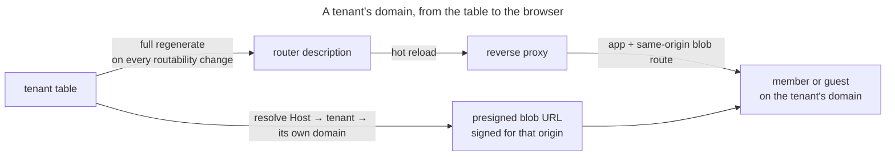

# UC: Reach a tenant at its own domain

- **ID:** uc.admin.tenant-reachability
- **Primary actor:** **Server Owner** (whose tenant actions decide which domains exist) and every
  **member or guest** who then opens one. Two parties again, but unlike *create-tenant* they never meet:
  the second one only ever experiences whether the first one's action took effect.
- **Goal:** Every tenant on the instance answers at **its own** domain — the app and its media on that one
  origin — as a **consequence of the `tenant` table**, with no deployment-time edit between creating a tenant
  and being able to reach it.
- **Preconditions:** The instance is set up and reached through a reverse proxy the backend can project into
  (the docker-compose stack wires Traefik's file provider, the Helm chart wires the Kubernetes Gateway API;
  an instance with neither has no routing to project and is covered by A1); the domain's DNS points at this
  host.
- **Postconditions (success):** Every non-`SUSPENDED` tenant's domain routes to the app **and** to the blob
  path on that same origin; a suspended or revoked tenant's does not; and a presigned blob URL handed to a
  client on that domain is signed for an origin **that client can actually reach**. Where the store is behind
  this deployment's own proxy — the shape the main flow describes — that origin is the tenant's own domain and
  the fetch is same-origin; A5 is where it is not.

## Main flow

1. The Server Owner does anything that changes which domains should route: creates a tenant, moves one to a
   different domain, revokes a pending one, suspends or reactivates one
   ([create-tenant](uc.admin.create-tenant.md), [suspend-tenant](uc.admin.suspend-tenant.md)).
2. After that change has committed, the backend regenerates the **complete** router description from the
   `tenant` table — every tenant whose status is not `SUSPENDED`. The bootstrap domain is routed from
   configuration and only once, whichever tenant carries it. It is never a patch of the previous one
   ([ADR 0063](../../../decisions/0063-database-driven-tenant-ingress.md)).
3. The reverse proxy picks the new description up without restarting and, for each domain that appears,
   obtains a certificate for it — on compose through Traefik's ACME resolver, on Kubernetes through the
   operator's issuer — or the one the chart templates on opt-in — which acts on the annotations and the
   certificate reference the projection carries **by a named mode** (`none`, `per-domain`, `shared`; [ADR 0064](../../../decisions/0064-kubernetes-helm-deployment-target.md)):
   under `per-domain` each domain's own `ListenerSet` beside its `HTTPRoute`, under `shared` the chart's one
   HTTPS listener every route attaches to.
   A custom domain that is nobody's subdomain gets its certificate the same way; only the operator's own
   choice of a shared wildcard certificate excludes it, knowingly. On compose each domain gets the **same
   pair** of routes the bootstrap domain has: the app, and the configured bucket's path on that same origin with
   its prefix and `Host` preserved ([ADR 0013 §4](../../../decisions/0013-blob-storage-presigned-direct-to-store.md)); on
   Kubernetes the store has a host of its own and each domain gets the app route alone (A5).
4. A member or guest opens that domain. The request resolves to its tenant by the `Host` it arrived on —
   the one canonical resolution every gate and handler shares.
5. When that client asks for media, the server signs the presigned URL for **the resolved tenant's own
   registered domain**, read from the `tenant` table rather than echoed back from the request's header. The
   client fetches the bytes from the origin it is already on, so no CORS policy has to exist for it to work.
   This is the signing mode's **default** and one of three (the bundled hint's `veyq.bundled-store.signing-mode`; a store the Server Owner enters signs its public endpoint verbatim, or its own endpoint when it has none,
   [ADR 0067](../../../decisions/0067-store-provisioning-from-a-declared-type.md) Decision 5): it is the right
   one exactly while the store is served on the tenant's own domain by this deployment's proxy, which is what
   step 3 arranges. A5 carries the two shapes where it is not, and which mode is in force is **deployment
   configuration, never inferred** — a tenant being created can change which domains exist, never how a
   running instance signs.
6. The same regenerate runs once at startup, before the instance serves traffic — so a wiped volume, a fresh
   proxy container or a file somebody edited is repaired without anyone noticing it was broken.

## Alternate / exception flows

- **A1 — no proxy to project into:** with no dynamic-config path configured (and the sink left at its
  default) the projection is a clean no-op, not a degraded mode. This is the `%dev`/`%test` default and what
  lets a self-hoster run the backend directly, with a proxy of their own in front if they want one. A Kubernetes sink whose TLS mode names a shared `Secret` that is not configured is
  refused the same way — loud, disabled, and never a failed boot — rather than projecting routes without TLS.
- **A2 — the request's `Host` names no tenant** (the bootstrap domain, an unknown name, a direct container
  port): it resolves to no tenant and nothing narrows — the request proceeds as it always did, and its
  presigned URLs are signed against the configured default.
- **A3 — the `Host`/`X-Forwarded-Host` is spoofed:** identical to A2 by construction, and that is the point.
  The signing domain is looked up in the `tenant` table, so a name no tenant claims can only fall back to the
  default — it can never make the server sign a URL for an origin the caller chose. This holds in **every**
  signing mode and gets stronger in A5's second shape, where the resolved domain does not reach the signed URL
  at all: there is no value a header could carry that would move the origin.
- **A4 — the projection is wiped, corrupted, or hand-edited:** nothing detects it. The next regenerate — any
  tenant change, or the next start — overwrites it in full, which is the whole reason it is not a patch.
- **A5 — the object store is not behind this deployment's proxy:** the tenant's domain plays no part in
  signing, because the store's origin has nothing to do with it. Same-origin is the docker-compose branch of
  [ADR 0013 §4](../../../decisions/0013-blob-storage-presigned-direct-to-store.md), not a universal one. This
  splits in two, and the split is the whole of it — they differ in **which** origin is signed, not in whether
  the domain is used:
  - **The store is reachable at exactly the endpoint the backend uses** (an external S3): that endpoint is
    signed. `signing-mode=internal-endpoint`, which is also where a blank `public-endpoint` lands, since
    nothing else is left to sign against.
  - **The store is reachable at an address of its own that the backend does *not* use** — Garage on its own
    host on the chart's `Gateway` ([ADR 0064](../../../decisions/0064-kubernetes-helm-deployment-target.md)), where the backend
    reaches it in-cluster; a tenant on their own bucket. The client-reachable address is signed **verbatim**,
    the same one for every tenant. `signing-mode=store-origin`.

  **This second shape needs a bucket CORS policy and the server cannot tell whether it has one.** It is
  [ADR 0013 §4](../../../decisions/0013-blob-storage-presigned-direct-to-store.md)'s non-same-origin branch, so
  the fetch is cross-origin by construction; a missing policy is a correctly signed URL, a healthy server, and
  a browser that refuses. The policy is written by store provisioning
  ([ADR 0067](../../../decisions/0067-store-provisioning-from-a-declared-type.md)) for a store veyq brought up,
  and by the operator for one it did not.
- **E1 — the domain's DNS does not point at this host:** the routing description is correct and the domain
  still does not resolve. Outside the server's reach entirely, and the one failure that looks identical from
  the browser to a projection that never ran.
- **E2 — certificates are rate-limited:** domains can now be added as fast as tenants are created, and each
  new one is a certificate order. Point the ACME client at a staging directory while testing a deployment —
  the docs site's [Set up a new instance](../../../../site/src/content/docs/run/new-instance.mdx) and
  [Kubernetes](../../../../site/src/content/docs/run/kubernetes.md) carry the setting for both targets: `VEYQ_ACME_CASERVER` on
  compose, the chart's `gateway.tls.acme.server` on Kubernetes (or, with an issuer of the operator's own, a
  staging issuer named through the same annotation the production one is). What production limits is an hour's
  lockout of a hostname after repeated failed validations and a weekly cap on issued certificates per
  registered domain; staging certificates are not browser-trusted.

## Quality notes

- **Full regeneration is the design, not an implementation detail.** An incremental "add one router" would be
  smaller and would make every state in A4 permanent, because nothing else ever revisits the file. Re-deriving
  the whole thing is what makes the projection *self-healing* rather than merely *usually correct*.
- **Two independent layers, and only one of them is a guarantee.** Withdrawing a suspended tenant's routing is
  a real effect, but the lockout is the per-operation scope-access gate ([suspend-tenant](uc.admin.suspend-tenant.md)
  step 3): an operator's own topology may expose the app by a path no proxy controls, and the gate is what
  holds regardless. Never state routing withdrawal as the reason a suspended tenant is unreachable.
- **A domain is operational metadata, and this changes nothing about that.** Host routing needs it in cleartext
  anyway; the projection and the signer hold no key material and derive none, so operator-blindness is exactly
  where it was.
- **The bootstrap domain is routed from configuration, not from a row.** That is how it is reachable before
  any row exists to project. It is routed **once**: on compose the sink renders it and skips a tenant row that
  carries the same domain, and on Kubernetes the chart's own `HTTPRoute` routes it and the sink leaves it out.
  Two routers claiming one `Host` make the proxy drop both.
- **The same projection serves Kubernetes, and that is why it is a projection.** ADR 0064's Gateway API objects
  are a second sink for the identical table-derived description, and the chart that deploys it lives in
  `charts/veyq`; the wildcard-subdomain shortcut that would have avoided all of this was rejected precisely
  because it could not be extended to it ([ADR 0063](../../../decisions/0063-database-driven-tenant-ingress.md)
  § Consequences), and the wildcard *certificate* is offered on that target only as the operator's own choice,
  never as the default, for the same reason.

## User impact

Each space opens at its own web address as soon as it is created or moved, with its photos and videos loading from
there too, without anyone reconfiguring the server.

## Related

- Feature: [Administration & Operations](../_index.md)
- Decisions: [ADR 0063](../../../decisions/0063-database-driven-tenant-ingress.md) (the routing is generated
  from the database, never hand-edited — and why the wildcard shortcut was rejected),
  [ADR 0013](../../../decisions/0013-blob-storage-presigned-direct-to-store.md) §4 (same-origin blob transport,
  amended by 0063 to per-request signing, and the measured limits of the CORS policy A5's second shape needs),
  [ADR 0067](../../../decisions/0067-store-provisioning-from-a-declared-type.md) Decision 5 (the signing mode
  itself — one named mechanism, so a store on its own address is not a deployment's special case),
  [ADR 0064](../../../decisions/0064-kubernetes-helm-deployment-target.md) (the second sink and the chart that
  deploys it, TLS as a passthrough to the operator's issuer or the chart's ACME opt-in — and one of that mode's
  two callers).
- Related use-cases: [create-tenant](uc.admin.create-tenant.md) (where a domain comes from, and where it is
  moved), [suspend-tenant](uc.admin.suspend-tenant.md) (the transition whose routing withdrawal this carries).
- Operations: [Set up a new instance](../../../../site/src/content/docs/run/new-instance.mdx) (the shared volume the projection is written to,
  and why it is never hand-edited).
- Run area of the docs site: [Networking and TLS](../../../../site/src/content/docs/run/networking.md), [Troubleshooting](../../../../site/src/content/docs/run/troubleshooting.md)
- End-user view (docs site): [Offline or unreachable](../../../../site/src/content/docs/help/offline.mdx)
