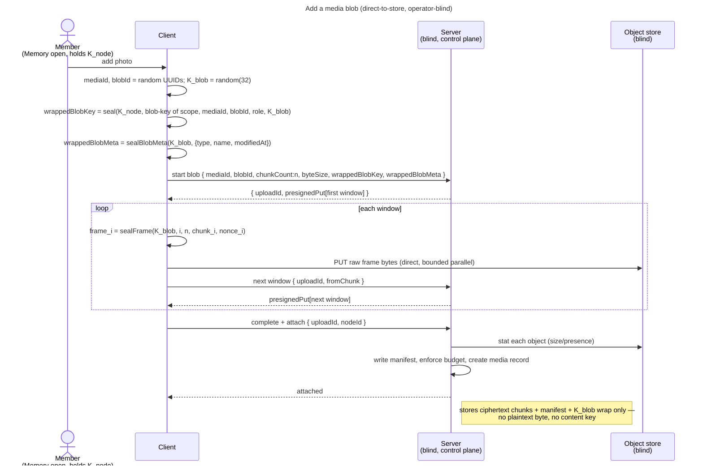

# Enabler: Media blobs in a Memory (`K_blob` + chunked AEAD, direct-to-store)

- **ID:** en.memory.media
- **Type:** **Enabler** — structural foundation, no standalone end-user goal
  ([features/README → use-case vs enabler vs ADR vs change-request](../../README.md#use-case-vs-enabler-vs-adr-vs-change-request)).
- **Provides:** the **encrypted media data layer** for a Memory — a media **blob** sealed client-side as
  **chunked AEAD** under a fresh random **`K_blob`** (wrapped under the Memory's `K_node`), transferred
  **direct-to-store** via presigned URLs ([ADR 0013](../../../decisions/0013-blob-storage-presigned-direct-to-store.md)),
  and **attached** to a node (a Memory or one of its Chapters). Bytes only — the *curation* of media into a
  gallery (covers, ordering, captions, the UI) is the use-case on top.
- **Serves (use-cases):** [uc.memory.upload](../use-cases/uc.memory.upload.md) (add media — the value-bearing
  flow + UI) and [uc.memory.gallery](../use-cases/uc.memory.gallery.md) (reads the blobs back), plus later
  *journal attachments* / *places & tracks* media. Storing one encrypted blob is not itself a user goal; it is
  the substrate those carry.
- **Depends on:** [en.platform.node-tree](../../platform/enablers/en.platform.node-tree.md) (a **Memory** exists and owns a `K_node`) → through it
  [en.spaces.personal-scope](../../spaces/enablers/en.spaces.personal-scope.md) and `uc.account.unlock`
  (identity → scope key → `K_SC` → `K_node`).
- **Preconditions:** an **unlocked** vault; an **open Memory** whose `K_node` is unwrapped (the blob keys wrap
  under it); a store that has passed its check — a **hard requirement of a working instance**
  ([ADR 0013](../../../decisions/0013-blob-storage-presigned-direct-to-store.md) § 1): without one no tenant can be
  created, so a Memory always has a byte path. The store itself is
  [cc.storage.object-lifecycle](../../../crosscutting/cc.storage.object-lifecycle.md).
- **Postconditions (success):** the blob's **ciphertext chunks** live in the object store; the server holds the
  blob's **metadata + chunk manifest + the `K_blob` wrap**, a **media** record on the node, and one row of core's blob
  service per blob held by the medium in its role ([ADR 0113](../../../decisions/0113-memories-media-are-blobs-of-cores-blob-service.md)).
  The server learned **no bytes of plaintext** and holds **no content key**.

## Key & blob model (ADR 0012 + ADR 0013)

- **`K_blob`** — a fresh **random 32-byte key per blob**, wrapped under the Memory's **`K_node`**
  (`symWrap(K_node, K_blob)`) — or, for a media a WRITE_ONLY guest added, under that guest's own identity key, which
  every reader opens through the Memory's drop key; its metadata tiers follow the same key, including after a
  member edits them ([ADR 0031](../../../decisions/0031-uploader-public-share.md) point 7). It encrypts that blob's chunk frames and nothing else. **No scope-wide
  dedup** — identical content yields a different `K_blob` and a different ciphertext; only inside one node does an
  equal file share a stored object (a cover, a banner, a gallery original equal to the video banner), as a second blob
  row with the same `K_blob` wrapped again ([ADR 0013 §5](../../../decisions/0013-blob-storage-presigned-direct-to-store.md#5-one-stored-object-for-an-equal-file-inside-one-node-nothing-wider)).
- **An original's `blob-meta`** carries its type, the name it was picked under, its modified time and **`sha256`**,
  the SHA-256 of its bytes (base64url), so a later upload of the same file into the cover or banner dialog finds it.
  New uploads only: a medium uploaded before the digest has none and is never matched. The client reads each picked
  original once more, frame by frame, to hash it before it is planned.
- **`chunk_frame`** (vector-pinned, `v1.json`) — each chunk is `nonce(12) ‖ AEAD(K_blob, nonce, plaintext,
  aad = u32be(index) ‖ u32be(total))`. The **AAD binds each frame to its position**, so the server cannot
  reorder, drop, or splice chunks without detection on `openFrame`. Every frame but the last carries exactly
  256 KiB of plaintext — a contract constant, so `chunkCount` and each chunk's size follow from `byteSize`
  ([ADR 0013 §3](../../../decisions/0013-blob-storage-presigned-direct-to-store.md#3-anti-abuse-is-declare-then-verify-and-the-frame-size-fixes-what-can-be-declared)).
  Small media = one frame; large media = many.
- **blob** — the unit of stored bytes: an id, `chunkCount`, `byteSize`, the chunk manifest (per-chunk size),
  the `K_blob` wrap and its **blob meta** — what the upload declared about these bytes, sealed under the blob's own
  `K_blob` (core's `blob-meta` seal, [ADR 0072](../../../decisions/0072-a-seal-binds-its-object.md) Decision 2, inbox
  #397), written once at the declare and served back on every listing beside the wrap. A media's **original** declares
  `{type, name, modifiedAt}` — the picked file's type (else sniffed from its first bytes, else
  `application/octet-stream`), its file name and modified time; a THUMBNAIL/PREVIEW tier and a derived cover declare
  `{type: image/jpeg}`. Lives in a scope.
- **media** — the link record attaching a blob to a **node** (a Memory or a Chapter), carrying any per-use
  metadata under field keys derived from `K_node` (purposes `media-meta`, `media-exif`) — capture time, GPS and the resolved place name in the listed tier (written whole by
  any member, so every write carries the tier's `metaRevision` and a stale one answers `409 stale_revision` —
  [ADR 0077](../../../decisions/0077-a-write-carries-the-version-it-read.md)), and the camera/editor bundle in the
  lazy EXIF tier. The original's **filename and media type** are not in either tier: they are the original's blob
  meta (above), read synchronously from the listing — the name is shown in the detail panel and is the original's
  download name, the type draws the video badge and the lightbox's `<video>` branch — and neither is ever sent in the
  clear: the server's view of a media is still no pixel, no name and no type. (Before inbox #397 the name rode the
  EXIF tier, #395 F10, and the type the listed tier with a lazy backfill on the first download; both copies are gone,
  and the listed tier shrank by the type.) A blob row is referenced by exactly one record of core's blob service (a
  medium's original or derivative, or a receipt) or one attachment; its `K_blob` wrap is sealed to its owner and role,
  ADR 0072 — the medium for a medium's blobs; a cover or banner equal to a stored
  file is a second blob row on the same stored object, never a second record on one blob row
  ([cc.storage.object-lifecycle](../../../crosscutting/cc.storage.object-lifecycle.md) § What names a stored object).
  Each media record also carries its **bucket
  linkage** — a **`bucket_id`** (nullable; `null` = the uploader's primary) and a denormalized **`created_by`** =
  the uploader's opaque **`owner_key`** (`user:{id}` / `share:{id}`), the operator-visible attribution the
  [buckets](../use-cases/uc.memory.buckets.md) grouping reads. The bucket data model + the sealed names
  live in [en.memory.buckets](en.memory.buckets.md)
  ([ADR 0034](../../../decisions/0034-media-uploader-buckets.md)).

## Main flow — add a media blob to a Memory (operator-blind)

> The control-plane endpoints are **batch-shaped** (each takes a list + returns a per-item result, [ADR 0013](../../../decisions/0013-blob-storage-presigned-direct-to-store.md));
> this enabler describes a **single** blob for clarity, and the first slice sends length-1 lists. A
> gallery later sends longer lists — same shape, no contract change.

1. The client has the Memory open: `K_node` is unwrapped (via `K_SC`, en.platform.node-tree).
2. **Key:** mint the media's and the blob's ids (UUIDv4 — the client names what it seals,
   [ADR 0072](../../../decisions/0072-a-seal-binds-its-object.md)), generate a random **`K_blob`** and seal it
   under `K_node` bound to the scope, the media, the blob and its role. The blob's `byteSize` and `chunkCount`
   are known from the plaintext length alone, before any frame is sealed.
3. **Start:** POST a blob-start declaring the ids, `byteSize` + `chunkCount` (+ the `K_blob` wrap and the blob meta
   sealed under `K_blob`, `wrappedBlobMeta`); the server checks
   the pair against the frame size, opens an upload session **bound to the caller**, and returns presigned
   `PUT` URLs for the **first window** of chunks, each signed for its chunk's exact size.
4. **Transfer, streaming:** the client reads the plaintext one chunk at a time, `sealFrame(K_blob, index,
   total, chunk, nonce)`s it and `PUT`s the **raw sealed frame bytes** straight to the object store (no base64)
   — a bounded number in parallel — bypassing the backend. Before a window runs out it asks for the next one;
   each request is authorized again, and a window that expired is simply asked for again.
5. **Complete + attach:** POST complete-and-attach `{ uploadId, nodeId }` as the session's opener; the server
   **stats** each object to confirm presence + exact size, writes the chunk manifest, enforces the byte budget,
   promotes the staged objects to blobs, and creates the **media** record, under the id the client minted, on the
   node, with its blobs as core's blob service's rows held by it (one per role: an item naming a tier twice is
   refused), in one transaction.
6. **Read back:** to display, the client asks for **presigned `GET` URLs**, fetches the raw frames directly,
   unwraps `K_blob` (via `K_node`), and `openFrame`s each (the AAD position check verifies order/count).

## Which media a photo view shows

A medium's kind is what its original's sealed `blob-meta` type says, read on the device; the server stores and lists a
medium of a size and never learns it. Three kinds share the one media layer:

- **Photos and videos** (`image/*`, `video/*`): the gallery, the lightbox, the item count, the organizer, the date and
  place reconcile and the search's documents. One positive predicate decides it, `isGalleryMedium`
  (`src/web/src/features/memories/galleryMedium.ts`), which every photo view asks. A medium whose original carries no
  `blob-meta` at all is shown too: it predates every typed medium that is no photo.
- **GPX tracks** (`application/gpx+xml`, [uc.memory.tracks](../use-cases/uc.memory.tracks.md)): the Map tab.
- **Music tracks** (`audio/*`, [uc.memory.background-music](../use-cases/uc.memory.background-music.md)): the Music tab
  and core's audio player. Their facts - the length and the trimmed span - ride the listed tier, sealed at birth.

A type nobody decided on is in no photo view: a new kind of medium gets its own list, and the photo views never need
to learn to leave it out.

## Reading back: playback and download

Why each piece is shaped this way is [ADR 0047](../../../decisions/0047-inline-video-playback-range-streaming.md); what
is built:

- **Playback** of a video or audio goes through the media Service Worker (`src/web/src/sw/mediaSw.ts`), a key-free
  range shim: the page registers an opaque per-playback handle with the blob's `{chunkCount, byteSize}` and a
  `MessagePort`, sets `<video src="/__media/<handle>">`, and answers the worker's chunk requests with plaintext it
  presigned, fetched and opened itself (the page-side chunk provider, `core/blob/transport.ts`). Every caller registers
  the same way: the lightbox, a Memory's banner, a Memory's music (core's audio player, through Memories' queue,
  `features/memories/music/musicQueue.ts`), Depot's file page (which registers the sniffed container, never the claimed
  type). Without a worker the medium is decrypted whole first.
- **What the shim serves is inert:** a handle is given only to one well-formed `video/<subtype>` or `audio/<subtype>`
  essence (`isStreamableMediaType`, `src/web/src/sw/protocol.ts`); a navigation to `/__media/<handle>` is `404`; every
  answer carries `X-Content-Type-Options: nosniff` and `Content-Security-Policy: sandbox; default-src 'none'`.
- **A download** picks the first of three save targets (`src/web/src/shared/saveStream.ts`): a file picked through the
  File System Access API; the worker's download route, `/__download/<handle>` (`src/web/src/sw/downloadRoute.ts`); an
  in-memory `Blob`, capped at 512 MiB (`BLOB_SAVE_CAP`) — above it, with neither streaming target, the download is
  refused with a message. The route answers one `GET` navigation per handle, which expires 30 s unfetched
  (`DOWNLOAD_HANDLE_TTL_MS`); an unknown handle answers `204`, which leaves the tab where it is. The answer is an
  attachment (`application/octet-stream`, a sanitised `filename` and the exact `filename*`, `nosniff`, the sandbox CSP,
  `Cache-Control: no-store`, the exact `Content-Length`); a short or overlong stream, a page failure or an ended session
  errors the body, and the worker reports every end and every refusal to the page. A ZIP download announces the built
  file's length (`zipLength`).
- **The file name** is core's one rule (`core/blob/meta.ts` `downloadName`): the name sealed in the original's blob meta,
  else one derived on device (a Memory's medium: the Memory's name and its gallery position), the extension from the
  blob meta's type, else `.bin`.
- **The page and the worker** speak a versioned protocol (`PROTOCOL_VERSION`, 6); a worker of another version fails the
  handshake and the page falls back as without one. The worker confirms a playback's registration on its port
  (`veyq-playback-registered`), and `registerPlayback` hands out the `/__media/` URL only then: the registration and the
  element's fetch reach the worker on separate queues, and a fetch that came first was a `404` (about one in three in
  headless Chrome, measured by cr-background-music-from-own-audio). Without a confirmation in 3 s the page falls back.

## Alternate / exception flows

- **E1 — no object store set:** the instance boots, but refuses every upload with `store_unavailable` and creates no
  tenant until a store has passed its check; there is no flag a client soft-gates on. Only the `%test` slice profile
  runs the in-memory stub (metadata only, no transport)
  ([ADR 0013](../../../decisions/0013-blob-storage-presigned-direct-to-store.md) § 1).
- **E2 — declared shape refused** (a `chunkCount` that does not follow from `byteSize`, or a size over the
  ceiling), **or actual objects that do not match it at complete** (a chunk missing, or not at its exact size):
  the server rejects and **purges** the staged objects (declare-then-verify, ADR 0013 §3).
- **E2a — the request does not fit the storage quota** (the tenant's, or a link's per-link limit): every
  admissible item of the `start` is refused `quota_exceeded` and no session exists — the declared size is what
  a session reserves ([ADR 0073](../../../decisions/0073-storage-quota-belongs-to-whoever-pays-for-the-store.md)).
- **E3 — abandoned upload:** a session that has not asked for a window within the retention → reclaimed by the
  stale-session GC, row and staged objects both.
- **E3a — the upload right is gone mid-upload** (membership removed, share revoked or expired): the next window
  or the complete is refused; what was already staged is reclaimed as an abandoned upload.
- **E4 — vault locked / Memory not open:** without `K_node` the client can neither key nor read a blob → the
  action is unavailable until unlock + the Memory is opened.
- **E5 — chunk tampered / reordered:** `openFrame` fails the AAD position check → the frame is rejected (the
  server cannot forge a valid frame without `K_blob`).
- **E6 — the store refuses the delete:** nothing user-facing is affected — the item has already left every read; the
  key waits on the durable reclaim list and is retried, and a permanent failure is countable
  ([cc.storage.object-lifecycle](../../../crosscutting/cc.storage.object-lifecycle.md) § Reclaim,
  [ADR 0062](../../../decisions/0062-store-object-reclaim-is-a-durable-work-list.md)).

## Quality notes

- **Operator-blind.** Server + object store only ever hold AEAD ciphertext chunks + opaque metadata (ids,
  sizes, manifest, the `K_blob` wrap and the sealed blob meta, the node link). Never a plaintext byte, never a
  content key, never a filename or a media type in clear (both are the original's sealed blob meta).
- **No scope-wide dedup — by decision.** The same file in two nodes, or twice in one gallery, is stored twice; the
  operator never learns that. Inside one node a cover, a banner or a gallery original equal to the video banner shares
  the stored object, and the operator learns which blob it shares - accepted (inbox #505,
  [ADR 0013 §5](../../../decisions/0013-blob-storage-presigned-direct-to-store.md#5-one-stored-object-for-an-equal-file-inside-one-node-nothing-wider)). An object goes only
  with the last row naming it.
- **Backend is never a byte bottleneck.** It signs short-TTL, single-object, single-method (and, for a `PUT`,
  single-size) capabilities; the bytes go client↔store. Credentials never reach the client.
- **Position-bound chunks.** The `chunk_frame` AAD (`index ‖ total`) makes reorder/drop/splice detectable —
  integrity of a multi-chunk blob without trusting the store.
- **An upload is bounded by a ceiling, not by the clock.** A session outlives any one URL, so the presign TTL
  covers one window, not one file, and a stalled chunk is re-signed rather than restarting the file. Resuming
  **across a page reload** is deferred ([ADR 0013](../../../decisions/0013-blob-storage-presigned-direct-to-store.md)).
  The **thumbnail / preview / original tiers** ([en.memory.derivatives](en.memory.derivatives.md)) reuse this
  transport verbatim — a derivative is just another blob.

> **No end-user section.** As an enabler this has no standalone "what this means for you" story — its end-user
> value surfaces through the use-case it *serves* ([add media to a Memory](../_index.md)), whose bilingual
> section carries the wiki text.

## Related

- Feature: [Memory](../_index.md)
- Decisions: [ADR 0013](../../../decisions/0013-blob-storage-presigned-direct-to-store.md) (S3-only, presigned
  direct-to-store, a stored object shared only inside one node), [ADR 0012](../../../decisions/0012-content-key-hierarchy.md) (`K_blob` under
  `K_node`), [ADR 0017](../../../decisions/0017-crypto-primitives-and-post-quantum-strategy.md) (`chunk_frame` vector)
- Concepts: [Security Model](../../../crosscutting/security-model.md) (key hierarchy),
  [Account & Key Model](../../account/enablers/en.account.key-model.md)
- Related enablers: [en.platform.node-tree](../../platform/enablers/en.platform.node-tree.md) (the Memory + `K_node` this attaches media to),
  [en.memory.derivatives](en.memory.derivatives.md) (the thumbnail/preview/original tiers built on this transport)
