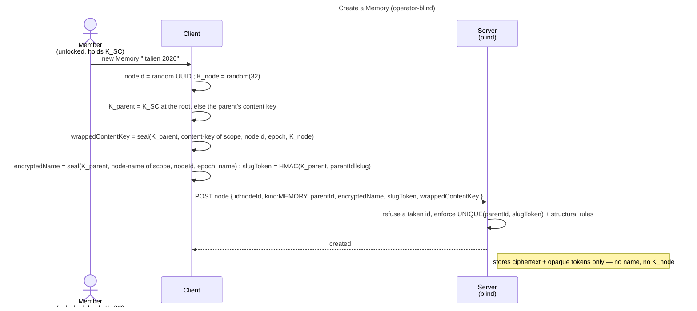

# Enabler: The Memory tree (encrypted folder/Memory nodes)

- **ID:** en.memory.tree
- **Type:** **Enabler** — structural foundation, no standalone end-user goal
  ([features/README → use-case vs enabler vs ADR vs change-request](../../README.md#use-case-vs-enabler-vs-adr-vs-change-request)).
- **Provides:** the **encrypted node tree** inside a scope — **folders** (organization only) and **Memories**
  (the content unit, nested **Chapters**) — with **encrypted names**, **blinded slug tokens** for permalinks,
  and a **per-Memory content key `K_node`** born on creation. Tree + names + keys only.
- **Serves (use-cases):** [uc.memory.browse](../use-cases/uc.memory.browse.md) (tree navigation + node CRUD),
  [uc.memory.gallery](../use-cases/uc.memory.gallery.md), [uc.memory.chapters](../use-cases/uc.memory.chapters.md),
  [uc.memory.delete-node](../use-cases/uc.memory.delete-node.md) (the node lifecycle — delete, trash, restore, purge).
  Media, the sealed node-meta (date / place), journal and sharing build on it **indirectly**, through
  [en.memory.media](en.memory.media.md) / [en.memory.node-meta](en.memory.node-meta.md). Creating an empty named
  node is not itself a user goal; it is the substrate those carry.
- **Depends on:** [en.spaces.personal-scope](../../spaces/enablers/en.spaces.personal-scope.md) (content lives
  in a scope) → and through it `uc.account.unlock` (the identity + scope key).
- **Preconditions:** An **unlocked** vault (identity → scope key → `K_SC` available for the active scope); a
  scope to write in (e.g. the [personal scope](../../spaces/enablers/en.spaces.personal-scope.md)).
- **Postconditions (success):** The node exists server-side as opaque ciphertext (encrypted name, `parentId`,
  `kind`, ordering, `slugToken`) plus a fresh random **content key** wrapped under its parent's key (`K_SC` at
  the scope root; every kind, folders included —
  [ADR 0080](../../../decisions/0080-every-node-carries-a-key-a-folders-key-behaves-like-a-memorys.md)). The server
  learned **no name** and holds **no content key**.

## Node model

A **node** has an opaque id, a `parentId` (or the scope root), a `kind`, an **encrypted name**, an
**`orderIndex`**, and a **`slugToken`**:

- **FOLDER** — organization; **owns a random content key** like every node (wrapped under its parent's key,
  `K_SC` at the root — ADR 0080 Decision 1), so whatever is created below it wraps under that key.
- **MEMORY** — the content unit; **owns a random `K_node`** (wrapped under its parent's key: `K_SC` at the root, the
  folder's key inside a folder). Its media/journal live under `K_node`.
- **CHAPTER** — a section **inside a Memory**, itself a content unit: it **owns its own random `K_node`**, wrapped
  under its **parent Memory's `K_node`** (recursive `K_node`, one level deeper — *not* the parent's key, *not* a
  separate `K_chapter` type).

**Recursive `K_node` (chapters — [ADR 0012](../../../decisions/0012-content-key-hierarchy.md)).** Every
node (FOLDER, MEMORY *and* CHAPTER — ADR 0080 Decision 1) carries its own random key, wrapped under the **content
key of its parent** — a scope-root node under `K_SC`, a Memory inside a folder under the folder's key, a chapter
under its parent Memory's `K_node` (same `content-key`
purpose, bound to the node the key belongs to — [ADR 0072](../../../decisions/0072-a-seal-binds-its-object.md)).
A media's **`K_blob` is wrapped under the `K_node` of its *direct* parent node** (chapter media
under the chapter's key). Consequence of this layout: every content node is a **sharing unit**, and a move is a
single **re-wrap, never a data re-encrypt** — the *decision + rationale* (why recursive, not "shares the
parent's key") is ADR 0012.

A node's **directory entry** — its name and its slug token — lives under the **same parent key** its content key
wraps under (`K_SC` at the node's epoch for a scope-root entry, the parent node's key below it — [ADR 0080](../../../decisions/0080-every-node-carries-a-key-a-folders-key-behaves-like-a-memorys.md)
Decision 2). A member, holding `K_SC`, decrypts the whole tree top-down in one pass (each node's key opens the
names below it); whoever holds one node's key — a share guest — reads every name below that node and nothing
above it. Dedup keys off `K_SC`; a Memory's *content* needs its `K_node` ([ADR 0012](../../../decisions/0012-content-key-hierarchy.md)).

## Main flow — create a folder / a Memory

1. The client picks a name; it computes the **slug token** `HMAC/HKDF(K_parent, parentId ‖ slugify(name))` (blind;
   the server can't reverse it) and **encrypts the name** under `K_parent` — the parent's content key, `K_SC` at the
   scope root.
2. Generate a fresh random content key (a Memory's **`K_node`**, a folder's key) and wrap it under `K_parent`.
3. POST the node: `{ nodeId, parentId, kind, encryptedName, slugToken, orderIndex, wrappedContentKey? }` — the
   client mints `nodeId`, and the name and wrap are sealed bound to it
   ([ADR 0072](../../../decisions/0072-a-seal-binds-its-object.md)); all opaque to the server. The server refuses
   a taken id (`409 id_taken`), enforces `UNIQUE(parentId, slugToken)` (slug uniqueness per parent) and the
   structural rules (no cycle; no folder inside a Memory).
4. The client renders the tree by **decrypting names with `K_SC`**; opening a Memory's content (later slices)
   unwraps its `K_node` with `K_SC`.

## Organize — rename / move / reorder

- **Move and rename are one placement write** ([ADR 0080](../../../decisions/0080-every-node-carries-a-key-a-folders-key-behaves-like-a-memorys.md)
  Decision 3; a rename is a move to the same parent): the node's own key is **re-wrapped** under the destination
  parent's key, its name re-sealed and its **slug token recomputed** under that key, all bound to the next
  `placementRevision`, which the request states it was built on. The server compare-and-sets it
  (`409 stale_placement`: the client re-reads and rebuilds once) and checks structure only — a live destination in
  the same scope, the kind's placement rule, no cycle, a free slug — under the tree's scope lock. An entry at the
  scope root is sealed at the **current** epoch (`409 stale_epoch` otherwise); between two non-root parents the
  node keeps its epoch; an epoch above the current one is `409 stale_epoch` at any destination. `placeNode` in `web/src/core/node/tree.ts` is the one client function. **No
  cross-scope move** — that is a copy + re-encrypt under the target scope's `K_SC`/`K_node` (a separate use-case),
  never a tree move.
- **Reorder:** update `orderIndex` among siblings.

## Delete — soft-delete, trash, purge

A node delete is **reversible** and takes the **whole subtree** with it
([ADR 0061](../../../decisions/0061-node-deletion-reversible-node-trash.md),
[uc.memory.delete-node](../use-cases/uc.memory.delete-node.md)). It is the same
**soft-delete → trash → retention → scheduled hard-purge** mechanism the
[security model](../../../crosscutting/security-model.md) mandates for every destruction — a node is not an
exception to it.

- **Delete:** mark the node and every descendant `deletedAt = now` in one transaction. **Nothing is destroyed** —
  the subtree's media, derivatives, buckets and blobs are untouched, which is what makes a restore complete. An
  already-trashed *root* is a no-op; an already-trashed *descendant* is **re-stamped**, so the whole subtree ages
  out on one timestamp and the purge can never reach half of it.
- **The slug is freed at delete**, so the name is immediately reusable: the deleted root's `slugToken` is replaced
  by its own id. Only the root's — a descendant's name lives under a trashed parent, where create, move and restore
  are all refused, so it keeps its token and returns valid (inbox #357). `UNIQUE(parentId, slugToken)` is a plain unique index and the schema is held to the H2 ∩ MariaDB
  subset, so a partial index over live rows is not available. The server **cannot** recompute a slug token (it is
  a blinded MAC under the parent's key), so the original is not kept — **restore carries a freshly client-computed token**,
  and a collision is the ordinary disambiguation a create already handles. A descendant holding a freed token — the
  root of an earlier, narrower delete — therefore does not come back with its ancestor's restore: it stays in the
  trash with its subtree, on the one marker, as a trash root of its own (inbox #357).
- **Hidden, not marked.** Every user- and guest-facing read carries `deletedAt is null`. Four reads deliberately
  do **not**: slug uniqueness (it must keep seeing the row, or validation passes and the database rejects the
  insert afterwards), the delete's own subtree traversal (or re-deleting a partially deleted subtree stops early),
  the delete's own scope binding (or a re-delete 404s instead of being the promised no-op — the *update* path
  keeps the filtering lookup, so these are two lookups of one node, not one), and the whole-space erase (which
  must remove trashed rows too).
- **Restore takes a trash ROOT only**, and may re-seal the name in the same write — that is the taken-name retry.
  Clearing a trashed node under a trashed parent would leave a live node hanging under a dead one, which no
  listing can show: the client assembles the tree by `parentId`, and the parent is filtered out.
- **Both share reads carry the predicate** — the anonymous resolve *and* the blob authorization. With `deletedAt`
  set but these unfiltered, a share on a deleted Memory serves the full sealed subtree and presigns every blob
  under it. The row surviving is exactly what makes this dangerous.
- **Purge:** a scheduled job hard-erases expired subtrees — media, derivative, bucket and blob rows in FK order,
  then the store objects, then the node rows. The **cover-blob reclaim belongs here, not in the delete**, or a
  restore returns a Memory whose cover is already gone.

## Alternate / exception flows

- **E1 — slug collision** (same parent already has that slug): the server rejects on `UNIQUE(parentId,
  slugToken)`; the client disambiguates (append a counter) and retries.
- **E2 — illegal structure:** a folder inside a Memory, or a cycle on move → rejected (structural invariant).
- **E3 — vault locked / no scope key:** without `K_SC` the client can neither name nor key a node → the
  action is unavailable until unlock + the scope is open.
- **E4 — not a member of the scope:** the server has no grant for the caller → the scope (and its tree) is
  not reachable.

## Quality notes

- **Operator-blind.** The server stores ciphertext names + opaque `parentId`/`kind`/`orderIndex`/`slugToken`
  + the `K_node` wrap; it never sees a name or a content key. It learns only the **shape** of the tree.
- **`K_node` is the share grain** ([ADR 0012](../../../decisions/0012-content-key-hierarchy.md)): every content
  node — a Memory **or a chapter** — is born with a random `K_node` so it can later be shared (an extra wrap of
  `K_node`) without exposing `K_SC`, the parent, or any other node. A folder carries a key of its own as well and
  can be a share root ([ADR 0080](../../../decisions/0080-every-node-carries-a-key-a-folders-key-behaves-like-a-memorys.md)).
- **Blinded permalinks.** The slug token gives human-readable, unique-per-parent permalinks without the
  operator ever seeing or reversing a name (keyed MAC under the parent's key).
- **Scope of this slice.** Tree + names + `K_node` only. **Media (`K_blob` + chunked AEAD), journal, places &
  tracks, sharing, and rich curation** are their own slices on top of this.

> **No end-user section.** As an enabler this has no standalone "what this means for you" story — its
> end-user value surfaces through the use-cases it *serves* (add media / journal / organize / share), whose
> bilingual sections carry the wiki text.

## Related

- Feature: [Memory](../_index.md)
- Concepts: [Security Model](../../../crosscutting/security-model.md) (key hierarchy, blinded tokens),
  [Scopes & Tenancy](../../../crosscutting/scopes-and-tenancy.md) (navigation contract; content in a scope),
  [Account & Key Model](../../account/enablers/en.account.key-model.md)
- Decisions: [ADR 0012](../../../decisions/0012-content-key-hierarchy.md) (`K_SC`/`K_node`/`K_blob`),
  [ADR 0017](../../../decisions/0017-crypto-primitives-and-post-quantum-strategy.md) (vector-pinned content crypto)
- Related: [en.spaces.personal-scope](../../spaces/enablers/en.spaces.personal-scope.md) (the enabler this
  builds on — where the first tree lives), and the planned add-media / journal / share-a-Memory use-cases
  ([Memory feature](../_index.md)) this serves
