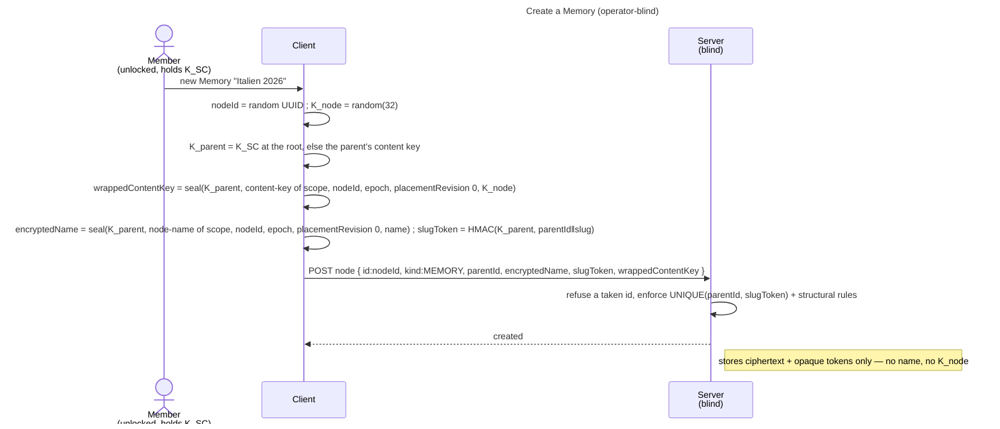

# Enabler: The node tree — core's encrypted tree of every kind's nodes

- **ID:** en.platform.node-tree
- **Type:** **Enabler** — structural foundation, no standalone end-user goal
  ([features/README → use-case vs enabler vs ADR vs change-request](../../README.md#use-case-vs-enabler-vs-adr-vs-change-request)).
- **Provides:** core's **encrypted node tree** inside a scope, for the nodes of every kind — core's **folders**
  (organization only) and each application's kinds: **Memories** (the content unit, nested **Chapters**), Depot's
  files and drop boxes ([Depot](../../../apps/depot.md)), Expenses' Pots ([Expenses](../../../apps/expenses.md)) —
  with **encrypted names**, **blinded slug tokens** for permalinks,
  and a **content key on every node**, born on creation. Tree + names + keys, and what every node shares: its
  address, its sealed-meta writes, its trash, the guests' tree operations, the live refresh and the download.
- **Serves (use-cases):** [uc.memory.browse](../../memory/use-cases/uc.memory.browse.md) (tree navigation + node CRUD),
  [uc.memory.gallery](../../memory/use-cases/uc.memory.gallery.md), [uc.memory.chapters](../../memory/use-cases/uc.memory.chapters.md),
  [uc.memory.delete-node](../../memory/use-cases/uc.memory.delete-node.md) (the node lifecycle — delete, trash, restore, purge).
  Media, the sealed node-meta (date / place), journal and sharing build on it **indirectly**, through
  [en.memory.media](../../memory/enablers/en.memory.media.md) / [en.memory.node-meta](../../memory/enablers/en.memory.node-meta.md). Creating an empty named
  node is not itself a user goal; it is the substrate those carry.
- **Depends on:** [en.spaces.personal-scope](../../spaces/enablers/en.spaces.personal-scope.md) (content lives
  in a scope) → and through it `uc.account.unlock` (the identity + scope key).
- **Preconditions:** An **unlocked** vault (identity → scope key → `K_SC` available for the active scope); a
  scope to write in (e.g. the [personal scope](../../spaces/enablers/en.spaces.personal-scope.md)).
- **Postconditions (success):** The node exists server-side as opaque ciphertext (encrypted name, `parentId`,
  `kind`, ordering, `slugToken`) plus a fresh random **content key** wrapped under its parent's key (`K_SC` at
  the scope root; every kind, folders included —
  [ADR 0080](../../../decisions/0080-every-node-carries-a-key-a-folders-key-behaves-like-a-memorys.md)). The server
  learned **no name** and holds **no content key**.

## Node model

A **node** has an opaque id, a `parentId` (or the scope root), a `kind`, an **encrypted name**, an
**`orderIndex`**, and a **`slugToken`**:

- **FOLDER** — organization; **owns a random content key** like every node (wrapped under its parent's key,
  `K_SC` at the root — ADR 0080 Decision 1), so whatever is created below it wraps under that key.
- **MEMORY** — the content unit; **owns a random `K_node`** (wrapped under its parent's key: `K_SC` at the root, the
  folder's key inside a folder). Its media/journal live under `K_node`.
- **CHAPTER** — a section **inside a Memory**, itself a content unit: it **owns its own random `K_node`**, wrapped
  under its **parent Memory's `K_node`** (recursive `K_node`, one level deeper — *not* the parent's key, *not* a
  separate `K_chapter` type).

**Recursive `K_node` (chapters — [ADR 0012](../../../decisions/0012-content-key-hierarchy.md)).** Every
node (FOLDER, MEMORY *and* CHAPTER — ADR 0080 Decision 1) carries its own random key, wrapped under the **content
key of its parent** — a scope-root node under `K_SC`, a Memory inside a folder under the folder's key, a chapter
under its parent Memory's `K_node` (same `content-key`
purpose, bound to the node the key belongs to — [ADR 0072](../../../decisions/0072-a-seal-binds-its-object.md)).
A media's **`K_blob` is wrapped under the `K_node` of its *direct* parent node** (chapter media
under the chapter's key). Consequence of this layout: every content node is a **sharing unit**, and a move is a
single **re-wrap, never a data re-encrypt** — the *decision + rationale* (why recursive, not "shares the
parent's key") is ADR 0012.

A node's **directory entry** — its name, sealed under a field key derived from it, and its slug token — lives under
the **same parent key** its content key wraps under (`K_SC` at the node's epoch for a scope-root entry, the parent node's key below it — [ADR 0080](../../../decisions/0080-every-node-carries-a-key-a-folders-key-behaves-like-a-memorys.md)
Decision 2). A member, holding `K_SC`, decrypts the whole tree top-down in one pass (each node's key opens the
names below it); whoever holds one node's key — a share guest — reads every name below that node and nothing
above it. Dedup keys off `K_SC`; a Memory's *content* needs its `K_node` ([ADR 0012](../../../decisions/0012-content-key-hierarchy.md)).

## Main flow — create a folder / a Memory

1. The client picks a name; it computes the **slug token** `HMAC/HKDF(K_parent, parentId ‖ slugify(name))` (blind;
   the server can't reverse it) and **encrypts the name** under a field key derived from `K_parent` — the parent's content key, `K_SC` at the
   scope root.
2. Generate a fresh random content key (a Memory's **`K_node`**, a folder's key) and wrap it under `K_parent`.
3. POST the node: `{ nodeId, parentId, kind, encryptedName, slugToken, orderIndex, wrappedContentKey? }` — the
   client mints `nodeId`, and the name and wrap are sealed bound to it
   ([ADR 0072](../../../decisions/0072-a-seal-binds-its-object.md)); all opaque to the server. The server refuses
   a taken id (`409 id_taken`), enforces `UNIQUE(parentId, slugToken)` (slug uniqueness per parent) and the
   structural rules (no cycle; no folder inside a Memory).
4. The client renders the tree top-down: each name opens under its parent's key (`K_SC` at the scope root), and
   each node's key unwraps under its parent's, so opening a Memory's content needs the chain from `K_SC` to its
   `K_node`.

## Organize — rename / move / reorder

- **Move and rename are one placement write** ([ADR 0080](../../../decisions/0080-every-node-carries-a-key-a-folders-key-behaves-like-a-memorys.md)
  Decision 3; a rename is a move to the same parent): the node's own key is **re-wrapped** under the destination
  parent's key, its name re-sealed (under a field key derived from that key, freshly salted) and its **slug token recomputed** under that key, all bound to the next
  `placementRevision`, which the request states it was built on. The server compare-and-sets it
  (`409 stale_placement`: the client re-reads and rebuilds once) and checks structure only — a live destination in
  the same scope, the kind's placement rule, no cycle, a free slug — under the tree's scope lock. A placement never changes the
  node's epoch: it states the node's own (`409 stale_epoch` otherwise, at any destination); an entry at the scope root
  lives under `K_SC` at that epoch, so a node the last rotation's re-key has not reached may not go to the root, and a
  destination parent not yet re-keyed refuses too (both `409 node_rekey_pending`,
  [ADR 0109](../../../decisions/0109-a-scope-rotation-re-keys-every-node-below-it.md) point 6). `placeNode` in
  `src/web/src/core/node/tree.ts` is the one client function. **No
  cross-scope move** — that is a copy + re-encrypt under the target scope's `K_SC`/`K_node` (a separate use-case),
  never a tree move.
- **Reorder:** update `orderIndex` among siblings.

## Delete — soft-delete, trash, purge

A node delete is **reversible** and takes the **whole subtree** with it
([ADR 0061](../../../decisions/0061-node-deletion-reversible-node-trash.md),
[uc.memory.delete-node](../../memory/use-cases/uc.memory.delete-node.md)). It is the same
**soft-delete → trash → retention → scheduled hard-purge** mechanism the
[security model](../../../crosscutting/security-model.md) mandates for every destruction — a node is not an
exception to it.

- **Delete:** mark the node and every descendant `deletedAt = now` in one transaction. **Nothing is destroyed** —
  the subtree's media, derivatives, buckets and blobs are untouched, which is what makes a restore complete. An
  already-trashed *root* is a no-op; an already-trashed *descendant* is **re-stamped**, so the whole subtree ages
  out on one timestamp and the purge can never reach half of it.
- **The slug is freed at delete**, so the name is immediately reusable: the deleted root's `slugToken` is replaced
  by its own id. Only the root's — a descendant's name lives under a trashed parent, where create, move and restore
  are all refused, so it keeps its token and returns valid. `UNIQUE(parentId, slugToken)` is a plain unique index and the schema is held to the H2 ∩ MariaDB
  subset, so a partial index over live rows is not available. The server **cannot** recompute a slug token (it is
  a blinded MAC under the parent's key), so the original is not kept — **restore carries a freshly client-computed token**,
  and a collision is the ordinary disambiguation a create already handles. A descendant holding a freed token — the
  root of an earlier, narrower delete — therefore does not come back with its ancestor's restore: it stays in the
  trash with its subtree, on the one marker, as a trash root of its own.
- **Hidden, not marked.** Every user- and guest-facing read carries `deletedAt is null`. Four reads deliberately
  do **not**: slug uniqueness (it must keep seeing the row, or validation passes and the database rejects the
  insert afterwards), the delete's own subtree traversal (or re-deleting a partially deleted subtree stops early),
  the delete's own scope binding (or a re-delete 404s instead of being the promised no-op — the *update* path
  keeps the filtering lookup, so these are two lookups of one node, not one), and the whole-space erase (which
  must remove trashed rows too).
- **Restore takes a trash ROOT only**, and may re-seal the name in the same write — that is the taken-name retry.
  Clearing a trashed node under a trashed parent would leave a live node hanging under a dead one, which no
  listing can show: the client assembles the tree by `parentId`, and the parent is filtered out.
- **Both share reads carry the predicate** — the anonymous resolve *and* the blob authorization. With `deletedAt`
  set but these unfiltered, a share on a deleted Memory serves the full sealed subtree and presigns every blob
  under it. The row surviving is exactly what makes this dangerous.
- **Purge:** a scheduled job (`NodeSubtreePurge`) hard-erases expired subtrees — each application's rows through its
  `NodeSubtreeEraser`, by phase (Memories' `MediaNodeSubtreeEraser` routes each medium through
  `MediaStore.purgeMediaRows`: derivative, media and blob rows in FK order, the store objects on the reclaim list in
  the same transaction), then the node rows. The **cover-blob reclaim belongs here, not in the delete**, or a
  restore returns a Memory whose cover is already gone. A member brings it forward for one trash ROOT (`purgeNode`,
  `NodeSubtreePurge.eraseTrashRoot`): the same erase, decided under the scope lock as a restore is; a live node or
  one under a trashed parent is a `404` ([ADR 0061](../../../decisions/0061-node-deletion-reversible-node-trash.md)
  decision 6).
- **Placement and trash agree** ([ADR 0080](../../../decisions/0080-every-node-carries-a-key-a-folders-key-behaves-like-a-memorys.md) decision 8): create, move and restore refuse a trashed
  parent, so no child row outlives the parent whose key wraps its own. `veyq_node.parent_id` carries no foreign key;
  the trash consistency tests are the guarantee.

## Addressing (URLs)

A node's address is a readable path in the URL **fragment**, resolved on the device and never sent
([ADR 0015](../../../decisions/0015-operator-blind-readable-urls.md)). The one module is
`src/web/src/core/node/location.ts`: `parseHash` and `buildHash` (a folder ends in a slash, kept on parse, emitted on
build), `segmentsOf` (equal slugs numbered per class — `anna`, `anna-2` — in `compareByCreation` order: the
server-observed `NodeSummary.createdAt`, `veyq_node.created_at DATETIME(3)`, then the node id) and `personHash`
(`#people/<userId>`, ADR 0083). An application decides its route segment once in the registry (`app.route(slug)`; Depot alone
takes `app.route(null)`; `RESERVED_ROUTE_SEGMENTS` cannot be claimed —
[Applications](../../../apps/README.md)). A group token resolves through `openGroupByToken`
(`src/web/src/features/spaces/scopes.ts`): a slug two of the member's groups share opens neither.
`scripts/validate_web_fragment_paths_via_location.py` is red on a file that splits or hand-builds a fragment path.

## Names and slugs

A node's name folds to its slug by its kind ([ADR 0080](../../../decisions/0080-every-node-carries-a-key-a-folders-key-behaves-like-a-memorys.md) decision 16): a container through `slugify`, a
file through `fileNameSlug` (both `src/web/src/shared/naming.ts`). A kind's descriptor may register `slug`, else its
names fold through `slugify`. A name is unique **within its route group** (ADR 0080
decision 16): `registry.tokenInputFor(kind, name)` is what the slug token HMACs —
`<routeSlug>/<slug>` for a kind whose application claimed a route slug (`memories/rom`, `expenses/rom`), the bare slug
for a folder, Depot's kinds and a kind nobody claimed — so a Memory and an Expenses Pot of one name coexist, a folder and
a Depot file of one name still meet. `slugTokenFor` (`core/node/tree.ts`) derives every token through it and takes the
node's kind on every write — create, rename and move, restore, a re-key, a guest's create and placement. The client names
a colliding sibling before it sends, comparing token inputs, so only a sibling of the same group: a guest's pre-check
(`core/sharing/guestTree.ts`) and a member's create, rename and move dialogs (core's `FolderNameDialog` and
`MoveNodeDialog`, Memories', the Pot's and the drop box's create) check the loaded tree (`core/node/siblingCollision.ts`)
and name the sibling by its kind's `nounWithArticle`; an import or a copy (`core/export/importSubtree.ts`) and a folder
upload number a name only against its group's siblings. A member's file upload onto a non-file sibling still ends on the
server's `409 slug_taken`. A ZIP download names its directories by its own rule, so a Memory and a Pot of one name are
`Rom` and `Rom (2)` there ([ADR 0082](../../../decisions/0082-a-node-and-everything-under-it-exports-as-a-plaintext-zip-and-imports-under-the-importer.md)
decision 3), and an import gives both their own name back. Both foldings are pinned by the `name_folding` vectors in
`contracts/crypto/vectors/v1.json`, generated by an independent Python implementation and consumed by
`src/web/src/shared/naming.conformance.test.ts`.

## Sealed-meta writes

A node's sealed payload (`wrappedMeta`) and a medium's are written whole, so each write states the revision it read
([ADR 0077](../../../decisions/0077-a-write-carries-the-version-it-read.md)): `metaRevision`, compare-and-set by the
server, a miss `409 stale_revision` with the current blob and revision (`StaleSealedMeta`). The client's one loop is
`core/node/sealedMetaWrite.ts` (re-run the writer's edit on the conflict body's blob, at most
`MAX_META_WRITE_ATTEMPTS` = 5 times). A cover's blob and meta are one request (`setNodeCover`, `removeNodeCover`;
`409 cover_stale` when the slot holds another blob than the one stated). Every edit operation declares its
concurrency in the contract (`x-veyq-concurrency`: `revision`, `last-writer-wins` with a reason, or `node-epoch`),
which `scripts/validate_write_concurrency.py` checks. The payload's fields, columns and self-heals:
[en.memory.node-meta](../../memory/enablers/en.memory.node-meta.md).

## Guest tree operations

A `READ_WRITE` guest's create, move and rename are core's node operations behind the share's guest gate
(`ShareGuestGate`; `createShareNode`, `updateShareNode`, `ShareNodesHandler`), structure only
([ADR 0080](../../../decisions/0080-every-node-carries-a-key-a-folders-key-behaves-like-a-memorys.md) decisions 6, 10 and 11):
- **What may be created where.** Under a `FOLDER` core allows a `FOLDER` and the kinds an application declares
  guest-creatable (`GuestCreatableKinds`: Depot's `FILE`); inside an application's container that application's
  `GuestNodeRules` decide, and a kind no implementation handles — or two do — allows nothing. Placement is
  `NodeKindRules`'. Which roles a kind may be shared with is `ShareRoots`, apart from its guest writes
  (`ShareGuestWrites`).
- **Placeholders.** A guest takes back only its own empty upload placeholder (`abandonShareNode`): erased at once
  through `NodeSubtreePurge.erase`, on the conditions of decision 6, with the kind's owner declaring it empty
  (`GuestPlaceholders`: Depot's `FILE` whose slot never held a blob, core's `FOLDER` with no attachment and no sealed
  metadata). `ShareNodeAbandonCoreSliceTest` pins that a move counts as naming.
- **Identity folders.** A drop-box guest's folder is a core `FOLDER` carrying `veyq_node.share_identity_id` (unique per
  parent), created only by core's `IdentityFolders` behind the application's own operation; inside it a `WRITE_ONLY`
  guest creates the kinds `WriteOnlyGuestKinds` declares, and any guest's placement of it or of anything in it is
  `422 illegal_structure` (`ShareNodesHandler`). After a rotation such folders and their drop box are re-keyed by an
  owner only (`OwnerOnlyRekey`, `403 not_scope_owner`, ADR 0109 point 7). The Depot side:
  [docs/apps/depot.md](../../../apps/depot.md) § The drop box.

## Live refresh

An open page of the tree re-reads it conditionally ([ADR 0081](../../../decisions/0081-a-scopes-tree-revision-is-the-level-views-change-signal.md)).
The scope's counter is its own row, `veyq_scope_tree_revision`, bumped by `NodesStore.bumpTree` under the scope lock
(`NodesStore.lockScope`) as each write's last statement; `TreeRevisionBumpsTest` reads the sources and lists the
writers that bump (`NodesStore.create`, `createIdentityFolder`, `applyUpdate`, `deleteSubtree`, `restoreSubtree`,
`NodeSubtreePurge.erase`, `AttachmentStore.attach`, `attachShared`, `detach`, `SharingStore.create`,
`RekeyStore.commit`) and the exempt erasers; the per-path tests (`TreeRevisionCoreSliceTest`,
`DepotTreeRevisionSliceTest`) and `TreeRevisionRaceCoreSliceTest` (MariaDB) hold where each bump sits. `listNodes`
answers the revision as its `ETag` and a `304` to a matching `If-None-Match`; a guest's `resolveShare` is tagged by
`ShareETag`, a truncated SHA-256 over the unlocked share as served and its attachments. The client is
`core/node/useLevelLive.ts` (`LIVE_POLL`: about every 5 s ± 20 %), driven by `treeStore.pollTree` for a member and the
guest's poll for a share page; a re-read tree keeps the page's node by id and its key object while it is the same key
(`sameKeyOr`). A moderator's block rides this revision (`CaseDecisions.announce`), not a node's item revision; an idle
tree poll costs the same statements whatever the scope holds (`OpenMemoryTreePollSliceTest`). What the user sees:
[uc.memory.browse](../../memory/use-cases/uc.memory.browse.md#live-refresh).

## Out and in (download, import, copy)

Any node and everything under it downloads as a plaintext ZIP that unpacks as the tree, and a member imports such a
ZIP or the unpacked directory again, or copies a subtree within the space
([ADR 0082](../../../decisions/0082-a-node-and-everything-under-it-exports-as-a-plaintext-zip-and-imports-under-the-importer.md)).
All of it is client-side, in `src/web/src/core/export/`: the walk (`exportSubtree.ts`, `importSubtree.ts`,
`copySubtree.ts`), the streaming ZIP writer and reader (`zip.ts`, ZIP64 and data descriptors; `zipLength` the
archive's exact length before its first byte, which the save target `shared/saveStream.ts` `openSaveTarget` is opened
with), the safe names (`archiveName.ts`) and the manifest (`manifest.ts`, format version 2 written, 1 and 2 read). A
kind brings its content through its registration (`exportContent`, `importContent`, `contentSchema`,
`downloadsAsFile`, `importsAsFolder`). The manifest's schema is
[`contracts/export/veyq-subtree.schema.json`](../../../../contracts/export/veyq-subtree.schema.json), core's envelope, with
each application's `content` in its own `contracts/export/<application>/content.schema.json` beside it; the flows are
[uc.platform.export-import](../use-cases/uc.platform.export-import.md) and
[uc.platform.copy-node](../use-cases/uc.platform.copy-node.md).

## Alternate / exception flows

- **E1 — slug collision** (same parent already has that slug): the server rejects on `UNIQUE(parentId,
  slugToken)`; the client disambiguates (append a counter) and retries.
- **E2 — illegal structure:** a folder inside a Memory, or a cycle on move → rejected (structural invariant).
- **E3 — vault locked / no scope key:** without `K_SC` the client can neither name nor key a node → the
  action is unavailable until unlock + the scope is open.
- **E4 — not a member of the scope:** the server has no grant for the caller → the scope (and its tree) is
  not reachable.

## Quality notes

- **Operator-blind.** The server stores ciphertext names + opaque `parentId`/`kind`/`orderIndex`/`slugToken`
  + the `K_node` wrap; it never sees a name or a content key. It learns only the **shape** of the tree.
- **`K_node` is the share grain** ([ADR 0012](../../../decisions/0012-content-key-hierarchy.md)): every content
  node — a Memory **or a chapter** — is born with a random `K_node` so it can later be shared (an extra wrap of
  `K_node`) without exposing `K_SC`, the parent, or any other node. A folder carries a key of its own as well and
  can be a share root ([ADR 0080](../../../decisions/0080-every-node-carries-a-key-a-folders-key-behaves-like-a-memorys.md)).
- **Blinded permalinks.** The slug token gives human-readable, unique-per-parent permalinks without the
  operator ever seeing or reversing a name (keyed MAC under the parent's key).
- **What this doc does not hold.** **Media (`K_blob` + chunked AEAD), journal, places & tracks, sharing and rich
  curation** have docs of their own on top of this one.

> **No end-user section.** As an enabler this has no standalone "what this means for you" story — its
> end-user value surfaces through the use-cases it *serves* (add media / journal / organize / share), whose
> bilingual sections carry the wiki text.

## Related

- Feature: [Platform](../_index.md) — core's, for every kind ([Applications](../../../apps/README.md)); the
  FOLDER / MEMORY / CHAPTER examples above are Memories', the first application's
  ([Memory feature](../../memory/_index.md))
- Concepts: [Security Model](../../../crosscutting/security-model.md) (key hierarchy, blinded tokens),
  [Scopes & Tenancy](../../../crosscutting/scopes-and-tenancy.md) (navigation contract; content in a scope),
  [Account & Key Model](../../account/enablers/en.account.key-model.md)
- Decisions: [ADR 0012](../../../decisions/0012-content-key-hierarchy.md) (`K_SC`/`K_node`/`K_blob`),
  [ADR 0017](../../../decisions/0017-crypto-primitives-and-post-quantum-strategy.md) (vector-pinned content crypto),
  and this topic's own: [ADR 0015](../../../decisions/0015-operator-blind-readable-urls.md),
  [ADR 0061](../../../decisions/0061-node-deletion-reversible-node-trash.md),
  [ADR 0077](../../../decisions/0077-a-write-carries-the-version-it-read.md),
  [ADR 0080](../../../decisions/0080-every-node-carries-a-key-a-folders-key-behaves-like-a-memorys.md),
  [ADR 0081](../../../decisions/0081-a-scopes-tree-revision-is-the-level-views-change-signal.md),
  [ADR 0082](../../../decisions/0082-a-node-and-everything-under-it-exports-as-a-plaintext-zip-and-imports-under-the-importer.md)
- Related: [en.spaces.personal-scope](../../spaces/enablers/en.spaces.personal-scope.md) (the enabler this
  builds on — where the first tree lives), and the planned add-media / journal / share-a-Memory use-cases
  ([Memory feature](../../memory/_index.md)) this serves
