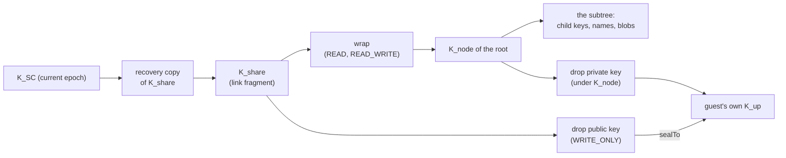
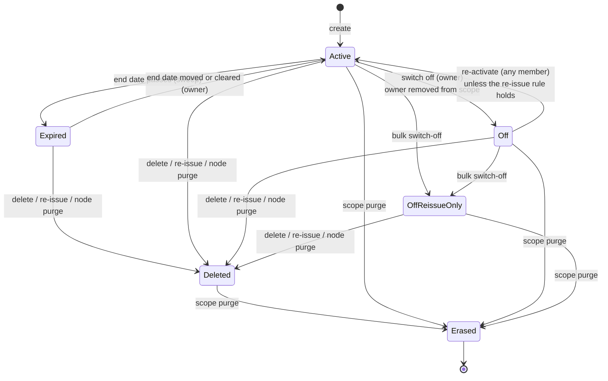

# Enabler: Public links and guests (the share record, its keys, its gates and its lifecycle)

- **ID:** en.sharing.public-link
- **Type:** **Enabler** — structural foundation, no standalone end-user goal
  ([features/README → use-case vs enabler vs ADR vs change-request](../../README.md#use-case-vs-enabler-vs-adr-vs-change-request)).
  It is the current picture of the topic *Sharing: public links and guests* in the
  [ADR index](../../../decisions/README.md#topics): what is true now, as built. It decides nothing; each part links the
  ADR that did.
- **Provides:** the public link — one node and what lies below it handed to anyone, account or not — as one model:
  the share record the server keeps, the key path per role, who may create, edit, switch off, re-issue and delete a
  link, how a guest gets an identity and proves it holds the link's key, and every state a link passes through,
  including what a scope rotation, a node re-key, a close, a removal and a deletion do to it.
- **Serves (use-cases):** [uc.sharing.share-public-viewer](../use-cases/uc.sharing.share-public-viewer.md),
  [uc.sharing.share-contributor](../use-cases/uc.sharing.share-contributor.md),
  [uc.sharing.share-uploader](../use-cases/uc.sharing.share-uploader.md),
  [uc.sharing.share-shared-scope](../use-cases/uc.sharing.share-shared-scope.md),
  [uc.sharing.share-note](../use-cases/uc.sharing.share-note.md),
  [uc.sharing.share-password](../use-cases/uc.sharing.share-password.md),
  [uc.sharing.share-link-storage-limit](../use-cases/uc.sharing.share-link-storage-limit.md),
  [uc.sharing.share-accept](../use-cases/uc.sharing.share-accept.md),
  [uc.sharing.close-link-rekeys-subtree](../use-cases/uc.sharing.close-link-rekeys-subtree.md),
  [uc.sharing.keep-a-received-link](../use-cases/uc.sharing.keep-a-received-link.md) (a received link kept as a node, the
  link's shape read and its key sealed; [ADR 0120](../../../decisions/0120-a-received-link-is-kept-as-a-bookmark-node-that-opens-and-reports-where-the-share-lives.md)).
- **Depends on:** [keys, grants and trust](../../../crosscutting/keys-grants-and-trust.md) (the keys a link hangs
  off: `K_SC`, node keys, the node re-key), [en.platform.node-tree](../../platform/enablers/en.platform.node-tree.md)
  (the node tree and its keys), [scopes and tenancy](../../../crosscutting/scopes-and-tenancy.md) (who is a member,
  who owns a scope). What each application lets a guest do inside its own kinds is its role matrix
  ([Memories](../../../apps/memories.md#what-a-guest-may-do--the-role-matrix), [Depot](../../../apps/depot.md),
  [Expenses](../../../apps/expenses.md)); a Memory's per-uploader grouping is [en.memory.buckets](../../memory/enablers/en.memory.buckets.md).

*(No `## User impact` — an enabler has no standalone end-user story; its value surfaces through the use-cases above.)*

## The link

A link is `/s/{shareId}#k=<base64url(K_share)>` ([ADR 0029](../../../decisions/0029-public-viewer-share.md) §2):

- **`shareId`** — 256 random bits, base64url, minted by the client. The server sees it on every guest request.
- **`K_share`** — 32 random bytes, minted by the client per link; it rides the **fragment**, which the browser never
  sends ([ADR 0015](../../../decisions/0015-operator-blind-readable-urls.md)). The server never holds it in the clear.

The id alone opens ciphertext the server would serve anyway; a guest **write** needs the key too (§ Guests). A share
id is **never minted twice**: create refuses any id that is live, tombstoned or retired (`409 id_taken`).

## The share record

One `veyq_share` row per link (`core/sharing/Entities.kt`):

| Column | What it holds |
|---|---|
| `id` | the `shareId` |
| `owner_account` | the account that owns the link — its creator, or the member who re-activated or re-issued it |
| `scope_id`, `node_id` | the scope and the shared node (the subtree root) |
| `role` | `READ`, `READ_WRITE` or `WRITE_ONLY`, in plaintext |
| `wrap` | the root's node key sealed under `K_share` (`share-key`); null for `WRITE_ONLY` and for a closed link |
| `sealed_drop_public_key` | `WRITE_ONLY` only: the node's drop public key sealed under `K_share`; null for a closed link |
| `sealed_name` | the root's name re-sealed under `K_share`, so the guest reads the title |
| `sealed_note`, `sealed_share_name` | the curator note (per locale, with its accept switch inside the seal) and the private label, both under `K_share`; the label is never served to a guest |
| `sealed_share_key`, `sealed_share_key_epoch` | the **recovery copy**: `K_share` sealed under a value key of its own (`share-key-recovery`, bound to scope, node, share and epoch) at the scope's epoch at the mint, both written once — a rotation re-wraps only the value key (`wrapped_recovery_value_key`), so the epoch is the link's mint |
| `password_required`, `pw_salt`, `pw_verifier`, `sealed_password` | the password gate (§ Gates); `sealed_password` is the password under `K_share`, for members to reveal |
| `write_verifier` | `SHA-256` of the guest-write token (§ Guests) |
| `enabled`, `expires_at` | switched on or off; an optional expiry |
| `expiry_closed` | the end-date sweep carried out this link's close (§ Lifecycle); a reopen clears it |
| `reissue_only` | set by a bulk switch-off: the link comes back only by re-issue |
| `member_removals_at_mint` | the scope's removal counter when the link was minted |
| `deleted` | the tombstone flag (§ Lifecycle) |
| `created_at`, the three editor ids | when it was made; who last wrote the name, the note and the label ([ADR 0093](../../../decisions/0093-a-report-opens-one-window-for-the-moderator-and-a-hold-copies-never-blocks.md) § 8) |

Beside it: `veyq_share_identity` (one row per guest identity: its sealed display name, the hash of its contributor
token, and for `WRITE_ONLY` its wrapped identity key), `veyq_share_retired_id` (ids a scope purge erased, so none is
minted again), `veyq_node.share_identity_id` (marks a guest's identity folder) and `veyq_scope.member_removals` (the
removal counter). The per-link storage limit is the tenant's, not the link's (`veyq_tenant.share_link_limit_bytes`).

## Roles, and which nodes take them

| Role | A guest may | Read gate (`canView`) | Write gate (`canUpload`) |
|---|---|---|---|
| `READ` | read the subtree | yes | no |
| `READ_WRITE` | read the subtree and write into it as its application allows | yes | yes |
| `WRITE_ONLY` | send into the node without seeing anything of it | no — the resolve serves no node, the blob read is `404` | yes |

A `WRITE_ONLY` resolve serves only what its client needs to send: the role, the scope, node and root kind, the root's
epoch, the sealed drop public key in place of `wrap`, the sealed title and note, and N of the guest-write record — no
node, no medium, no identity ([ADR 0031](../../../decisions/0031-uploader-public-share.md) point 1).

**Which kind may be a share root with which role** is the kind's own answer (`ShareRoots`; none, or two answers, means
no role): a `FOLDER` takes `READ` and `READ_WRITE` (core); a Memory and a Chapter take all three (Memories); a Depot
`FILE` takes `READ` and `READ_WRITE`, a `DEPOT_DROPBOX` `WRITE_ONLY` only (Depot); an Expenses `POT` `READ` and
`READ_WRITE` ([ADR 0080](../../../decisions/0080-every-node-carries-a-key-a-folders-key-behaves-like-a-memorys.md)
decisions 6 and 13). A role the kind does not list is `422 illegal_scope`.

**Any scope kind holds any role.** A link may live in a personal, group or tenant scope, in every role; no server or
client gate reads the scope kind ([ADR 0029](../../../decisions/0029-public-viewer-share.md) §6).

## The key path, per role

- **Viewer and contributor (`READ`, `READ_WRITE`).** The guest opens `wrap` with `K_share` and gets the root's node key;
  every child key and name below opens from its parent's key, as for a member
  ([keys, grants and trust § The chain](../../../crosscutting/keys-grants-and-trust.md#the-chain-from-an-account-to-a-blob)).
  Nothing beside or above the root, and never `K_SC`, is reachable. A contributor seals what it writes under the keys
  it walked to — byte for byte a member's write ([ADR 0030](../../../decisions/0030-contributor-public-share.md)).
- **Uploader and drop box (`WRITE_ONLY`).** The link carries no `wrap`. The node carries a **drop key pair** (X-Wing),
  minted with the node's first `WRITE_ONLY` link: its private half sealed under the node's key, its public half sealed
  under each `WRITE_ONLY` link's `K_share`. The guest mints its own identity key `K_up`, wraps it to the drop public
  key, and seals everything it sends — and its name — under `K_up`. A reader opens a guest's upload through node key →
  drop private key → `K_up` ([ADR 0031](../../../decisions/0031-uploader-public-share.md) point 7). In a Depot drop box
  each guest's files sit in its own **identity folder**, whose key is wrapped under `K_up`
  ([Depot § The drop box](../../../apps/depot.md#the-drop-box)).
- **The recovery copy** is `K_share` under the scope's current `K_SC`, re-sealed by every rotation
  ([ADR 0036](../../../decisions/0036-editable-share-note-recoverable-share-key.md) point 1,
  [ADR 0115](../../../decisions/0115-a-scope-key-is-replaced-never-chained.md) decision 2). Every member of the
  scope opens it, so any member can show, copy, edit and re-key any link of the scope; no link opens it, because no
  link carries `K_SC` (point 4). Create and re-issue refuse a copy below the current epoch (`409 stale_epoch`).
- **The note, the private label and the root's name** are sealed under field keys derived from `K_share`, one per
  write ([ADR 0093](../../../decisions/0093-a-report-opens-one-window-for-the-moderator-and-a-hold-copies-never-blocks.md)
  § 9); the password's member copy directly under `K_share`. Any member re-seals the root's name
  on every **open** link through the recovery copy when it renames the root (`setShareSealedName`, ADR 0080 decision 14);
  a closed link gets the current name with its reopen.
- **A password is not a key.** It gates what the server serves; the content stays under `K_share` (§ Gates).

**What a re-key does to a link.** A node is re-keyed after a scope rotation and after the close of a viewable link at
or above it ([keys, grants and trust § Re-keying the nodes](../../../crosscutting/keys-grants-and-trust.md#re-keying-the-nodes)).
For each **open** link rooted on the node that has a recovery copy, the re-keying client recovers `K_share` from that
copy and seals the new node key under the **same** `K_share` (a new `wrap`), or the node's new drop public key (a new
`sealed_drop_public_key`). A closed link gets nothing new: its holders keep only what existed at its close, and its
reopen carries the current key (§ Lifecycle). Each `WRITE_ONLY` guest's `K_up` is re-sealed to the new drop key and
each `READ_WRITE` guest's name re-sealed under the new node key, for every link on the node whatever its state. The
commit refuses a node whose open links and identities are not all staged, and one carrying a key staged for a link
closed since (`409 rekey_parts_stale`). The link's id, `K_share` and URL stay
([ADR 0109](../../../decisions/0109-a-scope-rotation-re-keys-every-node-below-it.md) points 4 and 5,
[ADR 0114](../../../decisions/0114-closing-a-link-re-keys-the-subtree-below-it.md) decision 5). Until a node is
re-keyed, a create, a re-issue, a reopen and a guest naming itself on it answer `409 node_rekey_pending`.

## Gates — who may do what

Every curator operation first needs an accepted membership of the link's scope and of its tenant, a tenant that is not
suspended and a scope that is not being deleted (`ScopeAccess.check`); a caller who fails it, or who may not act on
that link, gets the same non-enumerable `404` as for an unknown id. Beyond that, only the link's **owner**
(`owner_account`) and the **scope's owners** have powers the others lack:

| Operation | Who | Notes |
|---|---|---|
| **Create** (`createShare`) | any member | the capability for the role, the tenant's link requirements, a live node whose kind takes the role, the recovery copy at the current epoch |
| **List** a node's links | any member who reads the node | each row carries the recovery copy and `sealed_password`, so any member rebuilds, copies and reveals any link; plus `mine`, `deletable`, `reissueRequired`, `newGuestsRefused`, `writeVerifierMissing` |
| **Edit** (`updateShare`) | the link's owner | note and label (full replace), expiry (full replace; an expiry set into the past closes the link, one moved off a passed date reopens it with the root's key), the password (set, change, remove), and the role between `READ` and `READ_WRITE` only — a change into or out of `WRITE_ONLY` is `422`; the role change needs the target role's capability; `K_share`, `wrap` and the link stay |
| **Rename the root on the link** (`setShareSealedName`) | any member | that one column |
| **Switch off** one link (`revokeShare`) | the link's owner | `enabled = false` |
| **Switch off every link of a scope** (`revokeScopeShares`) | any owner of the scope, every scope kind | the bulk switch-off (§ Lifecycle) |
| **Re-activate** (`reactivateShare`) | any member | the member adopts the link, carrying the root's current key and name under its `K_share` (§ Lifecycle); refused `409 reissue_required` by the re-issue rule, and while a moderator blocks the link |
| **Re-issue** (`reissueShare`) | an enabled link: its owner; a switched-off one: any member, who becomes its owner | a fresh id and `K_share`; refused while a moderator blocks the link |
| **Delete** (`deleteShare`) | the link's owner; any member once the owner is no longer a member of the scope | a tombstone |

**Capabilities** ([ADR 0088](../../../decisions/0088-the-capability-register-is-a-tree-switched-by-operator-and-tenant.md)):
`core.public-shares` switches `READ` links and is the parent of `core.public-shares.contribute` (`READ_WRITE`) and
`core.public-shares.drop-box` (`WRITE_ONLY`); each is `AND`-ed down the tree and switched by operator and tenant.
The role's capability is checked at create, at a role change into it, at re-activation and at re-issue, and on every
guest request: a link whose role is switched off answers `404` to its guests and comes back when the switch does.

**Link requirements.** `core.public-shares` carries the tenant's two requirements, a password (`linkPassword`) and a
longest life (`linkMaxDays`, counted from the link's `created_at`). Create, edit and re-issue refuse a link that misses
one (`link_password_required`, `link_expiry_required`), and a guest is not served one that misses a requirement set
after it was made.

**Password** ([ADR 0037](../../../decisions/0037-password-protected-shares.md)). The client derives
`pwToken = Argon2id(password, pw_salt)`; the server stores `pw_verifier = SHA-256(pwToken)` and compares in constant
time on every guest path (`X-Share-Password`). Without a token a resolve answers a locked shell (role,
`passwordRequired`, `pw_salt`); a wrong one is `403`; wrong attempts are bounded per link (default 10 per 60 s, then
`429`). The server never sees the password; the minimum length is the client's rule.

**Expiry and storage.** `expires_at` in the past answers `404` on every guest path, and is a close (§ Lifecycle). Every `READ_WRITE` and
`WRITE_ONLY` link stores at most the tenant owner's per-link limit (10 GiB until changed); an upload that does not fit
is refused at its start ([ADR 0073](../../../decisions/0073-storage-quota-belongs-to-whoever-pays-for-the-store.md) §4).

**Rate limits.** Naming oneself and starting an upload are bounded per link (in memory, per instance); the resolve,
the blob read and the terms read are not.

## Guests

- **An identity.** A `READ_WRITE` or `WRITE_ONLY` guest names itself before its first write (`createShareIdentity`).
  The client mints the identity id and seals the display name — a contributor's under the root's node key, an
  uploader's under its own `K_up`, which it sends wrapped to the drop key. The server stores the row and the hash of
  a random **contributor token** it returns once; every later guest write carries that token and acts only as that
  identity ([ADR 0030](../../../decisions/0030-contributor-public-share.md) point 2). Members read a guest's name; no
  guest is served another guest's name (point 8).
- **The write proof.** Naming oneself also presents `X-Share-Write = HKDF-SHA256(K_share, "veyq/v1/share-write:" + shareId)`;
  the link stores only its `SHA-256` (`write_verifier`), set at every create and re-issue for every role. A missing or
  wrong token, and a link with no verifier, is `404` ([ADR 0076](../../../decisions/0076-a-guest-write-proves-it-holds-the-links-key.md)).
  Naming oneself and a guest's report are gated by it
  ([ADR 0093](../../../decisions/0093-a-report-opens-one-window-for-the-moderator-and-a-hold-copies-never-blocks.md)
  § 1); reads by an id holder yield ciphertext.
- **The guest's device keeps its identity.** Once named, a guest's device keeps its identity per link — the display
  name, the contributor token and, for an uploader, its own `K_up` — across reloads until the guest chooses "Not you?",
  which forgets it there; the next visitor names itself afresh. It never keeps a handle to content: an uploader's
  own-view (the ids and local previews of what it sent) lives only in its tab, so a reload shows nothing of earlier
  uploads ([ADR 0031](../../../decisions/0031-uploader-public-share.md) points 2 and 3).
- **Identity folders.** A `WRITE_ONLY` guest of a Depot drop box gets one core `FOLDER` per identity, marked by
  `share_identity_id` and sealed by the guest under `K_up`; it creates only inside its own. A drop box, an identity
  folder and everything below one are re-keyed by a scope **owner** only
  ([ADR 0080](../../../decisions/0080-every-node-carries-a-key-a-folders-key-behaves-like-a-memorys.md) decision 11).
- **The guest tree.** A `READ_WRITE` guest creates, renames and moves nodes inside the subtree as `GuestNodeRules`
  and the kind's application allow, and deletes none that hold anything; any writing guest may take back its own empty
  upload placeholder ([ADR 0080](../../../decisions/0080-every-node-carries-a-key-a-folders-key-behaves-like-a-memorys.md)
  decision 6).
- **The guest-write record.** Each guest write (an identity, a node, an item) records the guest's client address,
  source port, time and request `Origin`, kept N days (1–30, default 7) as evidence, never content; the resolve tells a writing guest N.
  The record, its retention and its readers are moderation's
  ([en.moderation.guest-write-record](../../moderation/enablers/en.moderation.guest-write-record.md)).
- **When an identity goes.** It stays while its link is not deleted or anything (a medium, a bucket, a node) names it;
  a deleted link's identities go once nothing does.

## Lifecycle

- **Active** — `enabled`, not deleted, not expired: the link is **open**. It is served only while nothing pauses it:
  its scope live (not in a group's deletion grace, its tenant neither suspended nor being deleted), its root not
  trashed, its role's capability on, the tenant's link requirements met, no moderation block. Any of those answers its
  guests `404` without changing the row; a pause re-keys nothing and keeps the root's key under the link, since its
  holders are meant to read again.
- **Every close re-keys what is below a viewable link** ([ADR 0114](../../../decisions/0114-closing-a-link-re-keys-the-subtree-below-it.md)).
  Each move out of Active — to Off, Off re-issue only, Expired or Deleted, a node purge's tombstone excepted — runs
  through one store body (`SharingStore.close`, held by `scripts/validate_link_close_arity.py`): it clears the link's
  `wrap` and sealed drop public key and, for a `READ` or `READ_WRITE` link, marks every node of the root's subtree, live
  and trashed, **due** for its re-key, in the close's own transaction. From there no write lands under a key the link's
  holder has (`409 node_rekey_pending`); the closing device starts the subtree's re-key in the background and any
  member's worker finishes it. A `WRITE_ONLY` close marks nothing: its `K_share` opens only the drop public key and its
  guest's own `K_up`. With a dump, a closed link reads what existed at its close and nothing added after; what stays in
  its reach is [security-model § Revocation](../../../crosscutting/security-model.md#revocation--two-layers).
- **Off** — `enabled = false`. Its owner switched it off, or its owner was removed from the scope, which switches off
  every link that member owns there in the removal's transaction.
- **Expired** — enabled, its end date passed. No client is there when it passes: a server sweep (`ShareExpiryCloseSweep`,
  every `veyq.share.expiry-close.every`, default `1m`) carries out the close and sets `expiry_closed`, once per link; an
  edit that sets a passed date closes it at once. A write landing between the end date and the sweep's run is under
  the old key — the sweep interval is the exposure.
- **Off, re-issue only** — a **bulk switch-off** turned off every enabled link of the scope and marked every link of it
  `reissue_only` ([ADR 0075](../../../decisions/0075-a-link-a-departed-member-could-copy-is-reissued.md) point 5). It
  runs through any scope owner's `revokeScopeShares`, or, opted into, a group removal's or a tenant removal's
  `revokeLinks` (a tenant removal's reaches only the tenant scope's links).
- **Reopening** — a re-activation, or an edit that moves a passed end date into the future or clears it — is the
  curator's act and carries what the re-key left out: the root's current key under the link's `K_share` (for
  `WRITE_ONLY` the drop public key) and the root's name, stating the root's `nodeEpoch`; the member opens `K_share`
  from the recovery copy. Without them it is `422 link_key_required`, a stale or due root answers `stale_epoch` /
  `node_rekey_pending`, and a link with no recovery copy comes back only by re-issue. A reopen hands the old `K_share`
  everything added while the link was closed.
- **Re-activation** turns a link on again and makes the caller its owner, unless the **re-issue rule** holds
  (`ReissuePolicy`, ADR 0075 point 4): the link is marked `reissue_only`; or its owner is no longer a member; or it
  has a recovery copy and was minted below the scope's current epoch (`sealed_share_key_epoch`) or the scope has lost a member
  since (`member_removals_at_mint` below `member_removals`). Then it is `409 reissue_required`, and the manage list
  marks the link `reissueRequired` from the same predicate. So every link minted before a rotation carries the mark;
  it keeps serving while open. A member's own marked links
  are also listed, across tenants, in the account's key-rotation panel as *links to renew*.
- **Re-issue** is one request: a new row — fresh id, fresh `K_share`, the old scope, node and role, owner the caller,
  the recovery copy at the current epoch, the note, label, expiry and password carried over and re-sealed — and the old
  row tombstoned, spent by a compare-and-set so it happens at most once (`409 share_deleted` after). A `WRITE_ONLY`
  re-issue seals to the node's existing drop key. The old link closes like any other (above), and the new one follows
  the new key. Guest identities stay on the old row, so returning guests name
  themselves again; the old link answers `404`, with no redirect.
- **Deleted** — a tombstone: switched off, `deleted` set, every ciphertext column (wrap, drop public key, name, note,
  label, recovery copy, password fields, write verifier) and the expiry cleared. The row keeps id, scope, node, role,
  owner and creation time, because guest identities hang off it and a `WRITE_ONLY` identity's wrapped key is how
  members open that guest's uploads. A tombstone is never re-activated, edited or re-issued and is in no listing. The
  row holds no deletion time; the deletion is one entry in the instance's erasure ledger
  ([cc.privacy.retention § Backups and the erasure ledger](../../../crosscutting/cc.privacy.retention.md#backups-and-the-erasure-ledger)). A delete never touches the node's content
  or reclaims bytes. Purging a node tombstones every link on it; trashing a node does not — a trashed root serves its
  guests nothing, and its links come back with a restore.
- **Erased** — the scope's purge (a group's after its grace, every scope of a deleted tenant) retires every share id,
  deletes the identities and deletes the rows.

**What other events do:**

| Event | Effect on the scope's links |
|---|---|
| Scope rotation | each recovery copy re-sealed at the new epoch; each link keeps serving, and one minted before it carries the re-issue mark |
| Node re-key | an open link's `wrap` / drop public key re-sealed under the same `K_share`, every link's guests' keys and names re-sealed (above); URL unchanged |
| Close (switch-off, bulk switch-off, delete of an open link, re-issue, end date) | `wrap` and drop public key cleared; a viewable link's subtree marked due and re-keyed |
| Member removed (group removal-rotation, tenant removal, account erasure) | the removed member's links in each scope it is cut from switch off — a close each; the removal counter goes up; opted in, the bulk switch-off |
| Root renamed | the root's name re-sealed under each open link |
| Password, role (`READ` ↔ `READ_WRITE`), note or label edited | nothing re-keyed: the link stays open, a password is a gate, not a key |
| Root trashed / restored | not served / served again; rows untouched, nothing re-keyed |
| Root purged | tombstoned |
| Group soft-deleted / restored | not served (`SPACE_UNAVAILABLE`) / served again, but a link its creator switched off in the window, the one link write it allows (`uc.spaces.scope-access` A1) |
| Tenant suspended or being deleted | not served |
| Scope purged (group after grace, deleted tenant) | erased, ids retired |

## Related

- **Feature:** [sharing](../_index.md)
- **Serves:** every `uc.sharing.*` (listed in the header).
- **Depends on:** [keys-grants-and-trust](../../../crosscutting/keys-grants-and-trust.md),
  [en.platform.node-tree](../../platform/enablers/en.platform.node-tree.md), [scopes-and-tenancy](../../../crosscutting/scopes-and-tenancy.md).
- **Decisions:** [ADR 0029](../../../decisions/0029-public-viewer-share.md) (the link and the anonymous access path),
  [ADR 0030](../../../decisions/0030-contributor-public-share.md) (`READ_WRITE` and guest identities),
  [ADR 0031](../../../decisions/0031-uploader-public-share.md) (`WRITE_ONLY` and the drop key),
  [ADR 0036](../../../decisions/0036-editable-share-note-recoverable-share-key.md) (the recovery copy and in-place edit),
  [ADR 0037](../../../decisions/0037-password-protected-shares.md) (the password gate),
  [ADR 0075](../../../decisions/0075-a-link-a-departed-member-could-copy-is-reissued.md) (re-issue, never revive),
  [ADR 0076](../../../decisions/0076-a-guest-write-proves-it-holds-the-links-key.md) (the write proof),
  [ADR 0080](../../../decisions/0080-every-node-carries-a-key-a-folders-key-behaves-like-a-memorys.md) (folder and
  chapter roots, the guest tree, identity folders), [ADR 0109](../../../decisions/0109-a-scope-rotation-re-keys-every-node-below-it.md)
  (what a re-key does to a link), [ADR 0114](../../../decisions/0114-closing-a-link-re-keys-the-subtree-below-it.md)
  (a close re-keys the subtree), [ADR 0115](../../../decisions/0115-a-scope-key-is-replaced-never-chained.md) (the
  recovery copy follows each rotation), [ADR 0073](../../../decisions/0073-storage-quota-belongs-to-whoever-pays-for-the-store.md)
  (the per-link limit).
- **Threat model:** what a link holds against an operator or a dump is the [security model](../../../crosscutting/security-model.md);
  its residuals are on the docs site's [Known limitations](../../../../site/src/content/docs/security/known-limitations.md).
- **Published:** [Key hierarchy](../../../../site/src/content/docs/security/key-hierarchy.md),
  [Protocols](../../../../site/src/content/docs/security/protocols.mdx)
