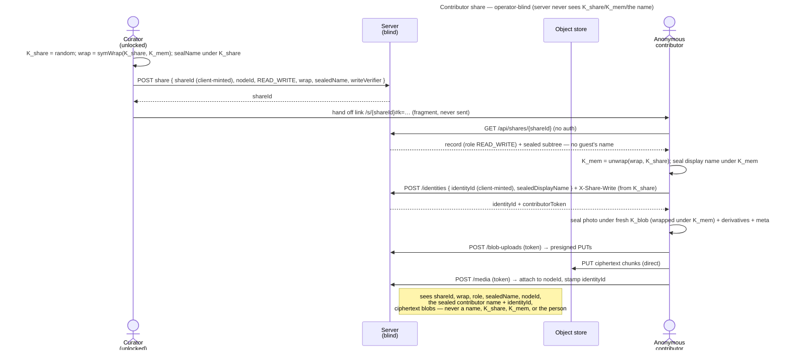

# UC: Share a Memory as a contributor link (anyone with the link can add photos)

- **ID:** uc.sharing.share-contributor
- **Primary actor:** **a curator** — the owner of a **personal-scope** Memory (holds its `K_mem`).
- **Secondary actor:** **an anonymous contributor** — no account, no identity keypair; names themselves once.
- **Goal:** publish **one** of your own Memories as a **contributor link** — anyone with the link can **view it and
  add photos** — while the server stays operator-blind and the rest of your content stays private.
- **Preconditions:** an **authenticated, unlocked** curator; the target Memory is in the caller's **personal scope**
  (v1 restriction); the caller can open it (holds `K_mem`).
- **Share roots today:** a contributor link can be rooted at a **Memory**, a **chapter** (its photos land in the
  chapter) or a **folder** ([ADR 0080](../../../decisions/0080-every-node-carries-a-key-a-folders-key-behaves-like-a-memorys.md) decisions 6 and 13): a folder's contributor creates folders and
  uploads files inside it — never a Memory, a drop box or another application's node (owner decision 2026-10-14; the
  server refuses them `422 illegal_scope`, and a real browser on 2026-10-14 showed a `READ_WRITE` guest's "New" menu as
  "New folder", "Upload files", "Upload folder…" and created a folder) —
  moves and renames the folders and Memories already there, and adds photos to any Memory or chapter below it. This use-case walks the Memory case; what
  each root kind allows is the [role matrix](../../../apps/memories.md#what-a-guest-may-do--the-role-matrix).
- **Postconditions (success):** a share record with **role READ_WRITE** exists (opaque), and a link
  `/s/{shareId}#k=<K_share>` lets any anonymous visitor open the Memory **and contribute photos** — after naming
  themselves — until the curator revokes it or it expires. Contributed photos appear in the Memory immediately
  (direct-append) and are attributed to the contributor's **sealed** name. Operator-blind throughout: the server
  never sees `K_share`, `K_mem`, any name (the Memory's or the contributor's), or the photo bytes.

This is the second sharing slice ([ADR 0030](../../../decisions/0030-contributor-public-share.md)), building on
the public **viewer** share ([uc.sharing.share-public-viewer](uc.sharing.share-public-viewer.md),
[ADR 0029](../../../decisions/0029-public-viewer-share.md)). The crypto is the same per-Memory second-wrap of
[ADR 0012](../../../decisions/0012-content-key-hierarchy.md); a contributor unwraps `K_mem` from the fragment key
exactly as a viewer does, then seals new media under it. **v1 is deliberately narrow: role READ_WRITE only
(view + add), direct-append, personal-scope Memories.**

## Main flow

1. **Create.** The curator opens one of their Memories → **Share** → chooses the **Contributor** role (instead of
   Viewer). The client mints `K_share` and a **256-bit `shareId`**, computes `symWrap(K_share, K_mem)`, re-seals
   the Memory name under `K_share`, and `POST`s the share record `{ shareId, nodeId, role: READ_WRITE, wrap,
   sealedName, writeVerifier, expiresAt? }` — `writeVerifier` is the hash of a write token derived from `K_share`
   ([ADR 0076](../../../decisions/0076-a-guest-write-proves-it-holds-the-links-key.md)). The server stores the record opaquely under that id.
2. **Hand off.** The client shows the link **`/s/{shareId}#k=<base64url(K_share)>`** to copy. `K_share` rides the
   fragment — never sent. The curator passes it out-of-band.
3. **Open + name yourself (anonymous).** A visitor opens the link. The client `GET`s `/api/shares/{shareId}` (**no
   auth**) → the record + the sealed subtree, and renders the Memory exactly as a member sees it (inbox #401) — the
   same view, with the functions a contributor lacks removed. At the visitor's **first write** the page asks for a
   **mandatory display name** in its one naming dialog (core's `GuestNaming`; nothing is sent before it). The
   visitor enters a display name; the client **seals it under `K_mem`** and creates an
   **anonymous share identity** under an `identityId` it mints (`POST /api/shares/{shareId}/identities
   { identityId, sealedDisplayName }` → `{ identityId, contributorToken }`, held on device). The request proves the
   visitor holds the whole link: `X-Share-Write` carries the token derived from the fragment key, and the server
   checks its hash against the share's `writeVerifier` — the id alone, from a database copy or a log, names no guest
   ([ADR 0076](../../../decisions/0076-a-guest-write-proves-it-holds-the-links-key.md)). The server stores
   only the ciphertext name + opaque ids, and serves the name back only to the Memory's members — never on a
   link's resolve, and the naming dialog says so ([ADR 0030](../../../decisions/0030-contributor-public-share.md)
   point 8).
4. **View + contribute.** The Memory renders in the member's Memory view: its gallery, the lightbox with the
   download, and the **Chapters** tab, through which the contributor navigates into a chapter as a member does (the
   address keeps `?node=` and the `#k=` key). **Upload** adds photos to the Memory or chapter **on screen** — through
   the **same picker** the curator's own gallery uses, so
   [uc.memory.upload](../../memory/use-cases/uc.memory.upload.md) § E3 (Safari's Photos gallery populates
   `input.files` late) holds here unchanged; it is a property of the picker, not of the screen, and a visitor
   is exactly the person who cannot be told to retry. The client then seals each under a fresh `K_blob`
   (wrapped under `K_mem`) with its
   derivatives + metadata, uploads the ciphertext chunks **direct-to-store** via the **share-scoped** presign
   (`POST /api/shares/{shareId}/blob-uploads`, presenting the `contributorToken`), then completes + attaches
   (`POST /api/shares/{shareId}/media`) — stamped with the contributor's `identityId` — to the shared Memory root, or,
   inside a chapter, to that chapter: the upload names it as its target (`nodeId`) and seals under the chapter's own
   key, and the server creates the contributor's own bucket there.
5. **Appears immediately.** The contributed photo is now part of the shared Memory (direct-append); every viewer
   (and the curator) sees it. The curator can delete it or **revoke** the link; the contributor can delete a photo
   **it added itself**, on its tile or in the lightbox (asked first — for good, a guest has no trash;
   `deleteShareMedia`, which the server allows only for the token's own identity).
   The server tells no guest which photos are whose, so the guest's device remembers what it uploaded under that
   identity, beside its session — the same store as the token, so it offers no more than the token may do (inbox #361).

## Alternate / exception flows

- **A1 — viewer on a contributor share:** a visitor who only wants to look is never asked a name; the name is
  mandatory for a contribution (ADR 0030) and asked at the first one (inbox #401 S5 — it used to be a pre-screen in
  front of the Memory).
- **A2 — revoked / expired:** `enabled = false` or a passed `expiresAt` → the resolve **and** the upload
  endpoints `404`/`403`. An upload in flight stops at its next window or at its complete, whichever comes first
  (every window is authorized again, [ADR 0013 §2](../../../decisions/0013-blob-storage-presigned-direct-to-store.md));
  already-uploaded photos remain (no retraction — see Quality notes).
- **A3 — change the grant in place (cr-0119):** the curator edits an existing **READ** share and switches it to
  **READ_WRITE** (or back) from the share-management dialog — the **same link keeps working**, no new `K_share`,
  no re-wrap. `role` is plaintext authorization the server enforces per request, so the new grant bites on the next
  resolve/upload (a promote enables contributions at once; a demote 403s new uploads at once, already-contributed
  photos stay). Restricted to **READ ↔ READ_WRITE** — a **WRITE_ONLY** drop-box is its own separate action and its
  write-only promise is never flipped in place (a `422 invalid_role_change` rejects setting WRITE_ONLY or editing a
  WRITE_ONLY share's role). Owner-gated via `updateShare` ([ADR 0036](../../../decisions/0036-editable-share-note-recoverable-share-key.md)).
- **A4 — someone else uses the same device ("Not you?", inbox #401 S2):** once named, the page says whose session
  this device holds ("You are here as Anna") with a "Not you?" that asks first, then forgets the session on the device;
  the next visitor names itself afresh, a new identity. Nothing on the server changes — what the first one added stays,
  under its name. The same core component (`GuestNaming`) names every guest of every link: the dialog a READ_WRITE
  guest gets at its first write (a Memory link's as a folder link's), and the two drop pages of a WRITE_ONLY link.
- **E1 — blank name:** the naming form blocks submission until a non-blank name is entered (mandatory).
- **E2 — over budget / full / rate-limited:** an oversized upload fails the per-blob byte budget; an upload that
  would take the link over its storage limit, or the tenant over its quota, is refused whole with the visitor told
  only that the link takes no more uploads right now
  ([uc.sharing.share-link-storage-limit](uc.sharing.share-link-storage-limit.md)); too many uploads in a window are
  rate-limited (per-share, best-effort) — defense against an abusive link holder.
- **E3 — link without the fragment key:** inert — without `K_share` nothing decrypts and nothing can be sealed
  under `K_mem`, so neither viewing nor contributing is possible (both halves required). The server enforces the
  write half too: naming yourself without the key-derived proof is the link's non-enumerable `404`, and so is
  naming yourself on a link minted before the proof existed, until a curator re-issues it — the manage list marks
  each such link ("Takes no new guests"), so the curator knows which to renew.

## Quality notes

- **Operator-blind.** The server stores the share record (as in ADR 0029) **plus** an opaque `share_identity`
  (the `K_mem`-sealed contributor name + a token hash) and a `share_identity_id` stamp on each contributed media.
  It never sees `K_share`, `K_mem`, the Memory name, the contributor's name, the photo bytes, or *who* the person
  is — only that an opaque identity contributed opaque ciphertext.
- **Mandatory name = the buckets hook.** The contributor names themselves once; the sealed name → the anonymous
  identity → its `share:{shareIdentityId}` **`owner_key`** → a per-contributor **bucket** grouping their uploads
  under that name — now [uc.memory.buckets](../../memory/use-cases/uc.memory.buckets.md) +
  [en.memory.buckets](../../memory/enablers/en.memory.buckets.md)
  ([ADR 0034](../../../decisions/0034-media-uploader-buckets.md)). This share stores the identity + shows
  contributed media inline; the buckets grouping reads that hook with **no migration** on the contributor half
  ([ADR 0030](../../../decisions/0030-contributor-public-share.md)).
- **The name is for the Memory's members.** Neither a link's resolve nor its media read serves a contributor
  identity, not even its own guests' — also after a READ_WRITE→READ change — and no contributed media in the
  read names one, so a visitor learns
  neither a name nor which uploads came from one person. A link plus a database dump still opens the names, as it
  opens the photos: accepted in [ADR 0030](../../../decisions/0030-contributor-public-share.md) point 8.
- **Direct-append; moderation is later.** A contributed photo is live immediately — good for a shared album, but
  spam is visible until the curator deletes it or revokes the link. Review-before-publish is a deferred slice.
- **Attribution is self-asserted.** Anyone with the link can name themselves anything; the contributor token binds
  *their* subsequent uploads to *that* identity but does not authenticate the person (accountless, operator-blind).
- **Revocation is soft (L1); already-uploaded is not retractable.** Revoke/expiry stop *new* views and every
  upload not yet completed; photos already contributed stay in the Memory (the curator deletes them
  individually if unwanted; a contributor deletes its own only through the live link, on the device it uploaded from).
- **Client-integrity trust tier ([ADR 0026](../../../decisions/0026-client-trust-tiers.md)).** Same as the viewer:
  the no-install page is passive-operator-safe, not operator-proof against an active foreign operator; surfaced by
  the **footer link** to the security docs. For the self-hosted case (operator = curator) the gap is moot.
- **Scope rotation ≠ share revocation.** Unchanged from
  [uc.sharing.share-public-viewer](uc.sharing.share-public-viewer.md). cr-0101's personal-scope v1 had no member
  removal; group/tenant contributor shares — where removal soft-revokes the removed member's shares — are now
  [uc.sharing.share-shared-scope](uc.sharing.share-shared-scope.md) (cr-0104).

## What this means for you / Was das für dich bedeutet

**EN —** You can turn one memory into a link where friends and family can **add their own photos** — not just
look. They open it in a browser, type their name once (so you can see who added what — other visitors of the link
don't see it), and drop in their pictures
— no account, nothing to install. It shows them **only that one memory**, never the rest of your space, and you
can switch the link off any time. New photos show up right away; if something doesn't belong, you can remove it.
The same honest note as always: on the web this is as private as your trust in whoever runs your veyq server —
if that's you, it's fully private; the "how safe is this?" link explains the details.

**DE —** Du kannst eine Erinnerung in einen Link verwandeln, bei dem Freunde und Familie **eigene Fotos beisteuern**
können — nicht nur anschauen. Sie öffnen ihn im Browser, tippen einmal ihren Namen ein (damit du siehst, wer was
beigetragen hat — andere, die den Link öffnen, sehen ihn nicht) und laden ihre Bilder hoch — ohne Konto, ohne Installation. Der Link zeigt **nur diese eine
Erinnerung**, nie den Rest deines Bereichs, und du kannst ihn jederzeit abschalten. Neue Fotos erscheinen sofort;
was nicht passt, kannst du entfernen. Dieselbe ehrliche Anmerkung wie immer: im Browser ist das so privat wie dein
Vertrauen in den, der deinen veyq-Server betreibt — bist das du selbst, ist es voll privat; der „Wie sicher ist
das?"-Link erklärt die Details.

## Related

- End-user view (docs site): [Sharing with people who have no account](../../../../site/src/content/docs/sharing.md)
- Feature: [Sharing](../_index.md)
- Decisions: [ADR 0030](../../../decisions/0030-contributor-public-share.md) (this contributor share — the sealed
  anonymous identity + the share-scoped upload path), [ADR 0029](../../../decisions/0029-public-viewer-share.md)
  (the share resource + anonymous access path it extends),
  [ADR 0012](../../../decisions/0012-content-key-hierarchy.md) (the `K_mem` second-wrap keying),
  [ADR 0013](../../../decisions/0013-blob-storage-presigned-direct-to-store.md) (the direct-to-store upload path
  the share-scoped presign mirrors), [ADR 0015](../../../decisions/0015-operator-blind-readable-urls.md) (fragment
  key), [ADR 0026](../../../decisions/0026-client-trust-tiers.md) (client-integrity trust tier).
- Cross-cutting: [Security Model](../../../crosscutting/security-model.md),
  [Scopes & Tenancy](../../../crosscutting/scopes-and-tenancy.md).
- Related: [uc.sharing.share-public-viewer](uc.sharing.share-public-viewer.md) (the read-only viewer share this
  builds on), [Memory](../../memory/_index.md) (what a Memory is — the thing being shared + contributed to).
- End-user view (docs site): [Is my data safe?](../../../../site/src/content/docs/privacy/is-my-data-safe.md)
