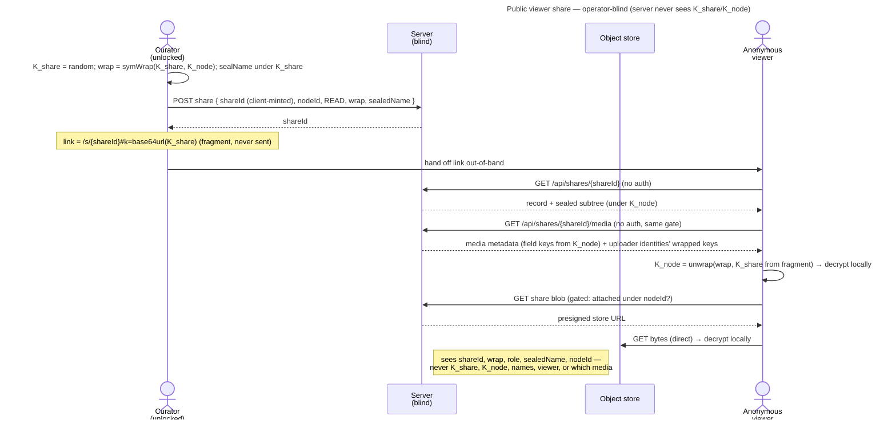

# UC: Share a Memory as a public viewer link

- **ID:** uc.sharing.share-public-viewer
- **Primary actor:** **a curator** — any member of the scope that holds the Memory (personal, group or tenant).
  A shared scope's governance is [uc.sharing.share-shared-scope](uc.sharing.share-shared-scope.md).
- **Secondary actor:** **an anonymous viewer** — no account, no identity keypair.
- **Goal:** publish **one** of your own Memories as a **read-only, anonymous, revocable** link that anyone with the
  link can open — while the server stays operator-blind and the rest of your content stays private.
- **Preconditions:** an **authenticated, unlocked** curator who is a member of the Memory's scope and can open it.
- **Share roots today:** a viewer link can be rooted at a **Memory**, a **chapter** or a **folder**
  ([ADR 0080](../../../decisions/0080-every-node-carries-a-key-a-folders-key-behaves-like-a-memorys.md) decisions 9 and 13); it shows that node and what lies below it, never what is beside or above
  it. This use-case walks the Memory case; the other roots take the same steps with that node's own key. What each
  role may do per root kind is the [role matrix](../../../apps/memories.md#what-a-guest-may-do--the-role-matrix).
  **Whatever the root, the guest sees exactly what a member sees** (inbox #401): a folder in the member's level view
  — its sub-folders, its Memories as cards with their dates and covers, its files, the map — and a Memory or a chapter
  in the member's Memory view — the gallery, the lightbox, the Chapters tab to navigate into — read from what the link
  opened, with every member-only function absent; every link it follows keeps the `#k=` key in the address. What only
  a guest's page adds: the breadcrumb up to the link's root, the curator's note, the role badge.
- **Postconditions (success):** a share record exists server-side (opaque), and a link `/s/{shareId}#k=<K_share>` opens
  the Memory subtree read-only for any anonymous visitor — until the curator revokes it or it expires. Operator-blind
  throughout: the server never sees `K_share`, `K_node`, any name, the viewer, or which media the viewer opens.

The record, the key path and the link's lifecycle are [en.sharing.public-link](../enablers/en.sharing.public-link.md)
([ADR 0029](../../../decisions/0029-public-viewer-share.md)).

## Main flow

1. **Create.** The curator opens one of their Memories → **Share** → *create public link*. The client generates a
   fresh 32-byte `K_share` and a **256-bit `shareId`**, computes `symWrap(K_share, K_node)`, re-seals the **Memory
   name under a field key derived from `K_share`**, and `POST`s the share record `{ shareId, nodeId, role: READ, wrap, sealedName,
   expiresAt? }`. The server stores the record opaquely under that id (a taken id is `409 id_taken`).
2. **Hand off.** The client shows the link **`/s/{shareId}#k=<base64url(K_share)>`** to copy. `K_share` lives in
   the **fragment** — never sent to the server. The curator passes it out-of-band (message, QR, wherever).
3. **Open (anonymous).** A visitor opens the link. The client `GET`s `/api/shares/{shareId}` (**no auth**) → the
   record **plus the sealed subtree** (the Memory node + its chapters: each chapter's key wrapped under its parent's key and its title sealed
   under a field key derived from it, nothing of the Memory's own entry above it — ADR 0080 Decisions 2 and 9), then `GET`s
   `/api/shares/{shareId}/media` → the Memory's media metadata and the wrapped keys of the uploader identities
   whose media it holds (Memories' `listShareMedia`). Both pass the same password gate; without a token the
   resolve answers the locked challenge and the media read a `404`.
   The client **unwraps `K_node` with the fragment key**, derives each chapter's key and opens its title down the
   chain, decrypts layout/metadata **locally**, and renders the Memory **read-only** in the member's Memory view (the
   guest reads the chapter titles; the Memory's own title is the share's `sealedName`): the Memory's own media in the
   gallery, its date and place as the members sealed them, and the Chapters tab; a chapter opens like a member's — its
   own gallery under its own key, the address carrying `?node=` and the `#k=` key. The guest never writes the
   Memory's date, place or cover (a member's view settles them automatically; a guest's does not).
4. **View media.** For each blob the client calls the **share-scoped, gated** blob endpoint; the server authorizes
   it **iff the blob is attached under the shared subtree**, returns a **presigned store URL**, and the client
   fetches the bytes **directly from the object store** and decrypts them locally.
5. **Manage / revoke.** The curator can list their shares and **revoke** one (`enabled = false`) or set an expiry;
   the next visitor request then `404`s. A revoke, and an expiry once it passes, **close** the link, and a close
   re-keys every node below its root ([en.sharing.public-link § Lifecycle](../enablers/en.sharing.public-link.md#lifecycle)).

## Alternate / exception flows

- **A1 — expiry:** a share past its `expiresAt` resolves `404` (same shape as an unknown id — non-enumerable), and a
  server sweep closes it, as a revoke does (A2).
- **A2 — revoked:** `enabled = false` → the resolve **and** the gated blob endpoint `404`; a visitor who already
  downloaded ciphertext can still replay *that*, but gets nothing new: the close re-keys the subtree below the root,
  so the old link's key opens nothing added after it, even in a dump (see Quality notes).
- **A3 — public links switched off on the instance:** while `core.public-shares` is off, every link of every role
  answers the resolve, the blob endpoint and every other guest endpoint exactly as an unknown id — a `404`, before any
  password is asked — and serves again, unchanged, once it is back on ([uc.admin.switch-capabilities](../../admin/use-cases/uc.admin.switch-capabilities.md) A3, ADR 0088 decision 5).
- **A4 — blocked by the operator:** a moderator blocked the link, or a guest uploader who came through it
  ([uc.moderation.take-a-measure](../../moderation/use-cases/uc.moderation.take-a-measure.md)): every guest path answers
  exactly as an unknown link, the curator's share list names the stop *blocked by the operator*, and neither a
  reactivation nor — for a blocked link — a re-issue passes until a moderator lifts it. Content a moderator blocked
  inside a live link shows as the placeholder *Blocked by the operator*, as it does for a member.
- **E1 — link without the fragment key:** the `shareId` alone is **inert** — the server returns the wrapped key,
  but without `K_share` the client cannot unwrap `K_node`, so nothing decrypts. Both halves are required.
- **E2 — wrong / guessed id:** unknown `shareId` → `404`. The 256-bit id is unguessable; there is no enumeration.

## Quality notes

- **Operator-blind.** The server stores only `shareId`, the wrap `symWrap(K_share, K_node)`, the plaintext `role`,
  the `K_share`-sealed name, and `nodeId`. It never sees `K_share`, `K_node`, a name, the viewer, or — because
  blobs are fetched direct-from-store — **which media a viewer opens**.
- **Least-privilege, crypto-enforced.** A share exposes **only the subtree under its root** (a Memory, a chapter or
  a folder): every node's key is random and independently wrapped, so the link reveals neither `K_SC` (the rest of
  the scope) nor the key of anything beside or above its root ([ADR 0012](../../../decisions/0012-content-key-hierarchy.md),
  [ADR 0080](../../../decisions/0080-every-node-carries-a-key-a-folders-key-behaves-like-a-memorys.md) decisions 1 and 9).
- **Client-integrity trust tier ([ADR 0026](../../../decisions/0026-client-trust-tiers.md)).** The crypto keeps
  the operator blind, but a **no-install viewer is served as operator-controlled web code** — so against an
  **actively malicious, foreign** operator, confidentiality depends on client integrity (it could serve tampered
  JS that captures the fragment key). This is **not** shouted in the viewer; the page carries a **footer link to
  veyq's security documentation** (the single source of the trust model). For the **default self-hosted** case
  (operator = curator) the gap is **moot**; a foreign-operator-proof viewer needs the future trusted-web client.
- **Revocation closes the link; already-read is not retractable.** Revoke/expiry stop *new* access (resolve + gated
  blobs `404`) and re-key the subtree below the root, so the link's key reads what existed at the close and nothing
  added after — but content a visitor already downloaded cannot be pulled back, and a re-key re-wraps keys without
  re-encrypting content (the residuals: [security model § Revocation](../../../crosscutting/security-model.md#revocation--two-layers)).
- **Scope rotation ≠ share revocation.** A scope rotation does **not** close a link: the re-key re-wraps the root's
  new key under an open link's own key, so the link keeps working at the same address
  ([ADR 0109](../../../decisions/0109-a-scope-rotation-re-keys-every-node-below-it.md) point 4). Switching it off,
  deleting or renewing it, or its end date passing closes it and re-keys its subtree; a removal switches off — closes —
  the removed member's links ([uc.sharing.share-shared-scope](uc.sharing.share-shared-scope.md)). A pause (the root
  trashed, a capability or requirement off, a moderation block) closes nothing.

## User impact

You can show one Memory to anyone, a grandparent or a group chat, through a link they open in a browser, without an
account, and switch it off whenever you like.

## Related

- End-user view (docs site): [Sharing with people who have no account](../../../../site/src/content/docs/sharing/index.mdx)
- Feature: [Sharing](../_index.md)
- Enabler: [en.sharing.public-link](../enablers/en.sharing.public-link.md) (the record, keys, gates and lifecycle)
- Decisions: [ADR 0029](../../../decisions/0029-public-viewer-share.md) (this share's resource + anonymous access
  path), [ADR 0012](../../../decisions/0012-content-key-hierarchy.md) (the `K_node` second-wrap keying),
  [ADR 0015](../../../decisions/0015-operator-blind-readable-urls.md) (fragment key),
  [ADR 0013](../../../decisions/0013-blob-storage-presigned-direct-to-store.md) (gated presigned blob reads),
  [ADR 0026](../../../decisions/0026-client-trust-tiers.md) (client-integrity trust tier)
- Cross-cutting: [Security Model](../../../crosscutting/security-model.md),
  [Scopes & Tenancy](../../../crosscutting/scopes-and-tenancy.md)
- Related: [Memory](../../memory/_index.md) (what a Memory is — the thing being shared)
- Security area of the docs site: [Protocols](../../../../site/src/content/docs/security/protocols.mdx)
- End-user view (docs site): [Create a link](../../../../site/src/content/docs/sharing/create-a-link.mdx)
- End-user view (docs site): [Change, switch off, renew and delete links](../../../../site/src/content/docs/sharing/manage-links.mdx)
