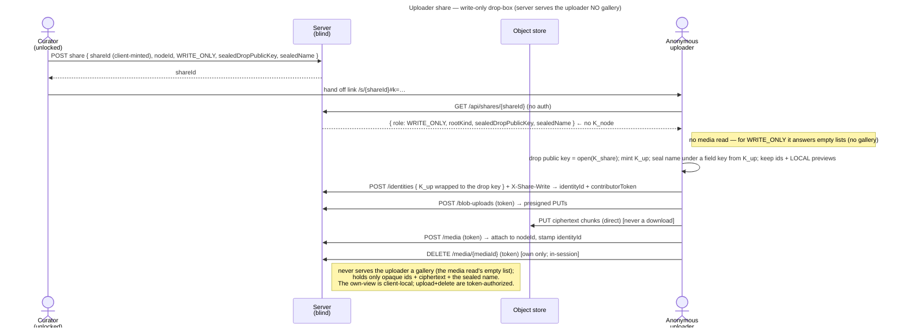

# UC: Share a Memory as an uploader link (a write-only drop-box)

- **ID:** uc.sharing.share-uploader
- **Primary actor:** **a curator** — the owner of a **personal-scope** Memory (holds its `K_node`).
- **Secondary actor:** **an anonymous uploader** — no account, no identity keypair; names themselves once.
- **Goal:** publish **one** of your own Memories as a **write-only drop-box** link — anyone with the link can **add
  photos** but **cannot see** the Memory's existing content (nor other contributors'), while the server stays
  operator-blind.
- **Preconditions:** an **authenticated, unlocked** curator; the target Memory is in the caller's **personal scope**
  (v1 restriction); the caller can open it (holds `K_node`).
- **Share roots today:** an uploader link can be rooted at a **Memory** or a **chapter** (sealed to the chapter's
  own drop key, its photos land in the chapter — [ADR 0080](../../../decisions/0080-every-node-carries-a-key-a-folders-key-behaves-like-a-memorys.md) decision 13), never at a folder (`422`). This
  use-case walks the Memory case; what each root kind allows is the [role matrix](../../../apps/memories.md#what-a-guest-may-do--the-role-matrix).
- **Postconditions (success):** a share record with **role WRITE_ONLY** exists (opaque), and a link
  `/s/{shareId}#k=<K_share>` lets any anonymous visitor **add photos** (after naming themselves) that append to the
  Memory — visible to the curator in *their* gallery. The uploader sees **only the photos they add this session**
  (from local previews, never a download) and can delete them **in that session**; a reload shows nothing.

This is the third sharing slice ([ADR 0031](../../../decisions/0031-uploader-public-share.md)), building on the
READ_WRITE share ([uc.sharing.share-contributor](uc.sharing.share-contributor.md),
[ADR 0030](../../../decisions/0030-contributor-public-share.md)). The upload crypto/path is identical; the
difference is the **`canView` gate** (a WRITE_ONLY link's media read answers an empty list) and the **session-only,
client-local** own-view. **v1: role WRITE_ONLY, personal scope, direct-append** — the personal-scope limit was lifted by
[uc.sharing.share-shared-scope](uc.sharing.share-shared-scope.md).

## Main flow

1. **Create.** The curator opens one of their Memories → **Share** → chooses the **Uploader** role. The client
   mints `K_share`, re-seals the name, and seals the Memory's **drop public key** under `K_share` — **no wrap of
   `K_node`** ([ADR 0031](../../../decisions/0031-uploader-public-share.md) point 7). The Memory's first WRITE_ONLY
   share mints the drop keypair and brings its private half sealed under `K_node`, which the server sets on the
   Memory once. It `POST`s `{ shareId, nodeId, role: WRITE_ONLY, sealedDropPublicKey, sealedDropPrivateKey?, sealedName,
   writeVerifier }` — the hash of a write token derived from `K_share` ([ADR 0076](../../../decisions/0076-a-guest-write-proves-it-holds-the-links-key.md)).
2. **Hand off.** The client shows the link `/s/{shareId}#k=<base64url(K_share)>` to copy.
3. **Open + name yourself (anonymous).** The visitor opens the link; the client `GET`s `/api/shares/{shareId}`
   (**no auth**) → `{ role: WRITE_ONLY, rootKind, sealedDropPublicKey, nodeId, sealedName }`; a WRITE_ONLY link's media
   read answers empty lists, so the client does not ask it (**no gallery** and
   **no `K_node`** — the uploader is never handed others' media, nor the key to read them). Because the role is
   WRITE_ONLY, the client shows a **mandatory name pre-screen** with a **clear note that uploads are visible only in
   this browser tab**; the visitor names themselves → the client mints the identity's own key `K_up`, seals the
   name under a field key derived from it, and creates an anonymous **share identity** carrying `K_up` wrapped to the drop public key, plus
   a `contributorToken`. The request carries `X-Share-Write`, the token derived from the fragment key, whose hash the
   server checks against the share's `writeVerifier`: the id alone names no guest ([ADR 0076](../../../decisions/0076-a-guest-write-proves-it-holds-the-links-key.md)).
4. **Add photos.** The uploader picks images — through the **same picker** the curator's own gallery uses, so
   [uc.memory.upload](../../memory/use-cases/uc.memory.upload.md) § E3 (Safari's Photos gallery populates
   `input.files` late) holds here unchanged. Each is sealed under `K_up` and uploaded via the **share-scoped**
   endpoints (as READ_WRITE). The client keeps the returned `{ mediaId }` + the **local preview** in session
   memory and renders it with the **same gallery mechanic** (grid + optimistic tile) — **from the local preview,
   never a download**. The photo appends to the Memory (the curator sees it).
5. **Delete / leave.** The uploader can **delete a photo they added this session** (`DELETE
   /api/shares/{shareId}/media/{mediaId}` with the token → deleted + blobs reclaimed **iff** it is their own).
   On **reload / new tab** the own-view is empty (session-only) — surfaced by a dedicated empty-state, not a blank
   gallery.

## Alternate / exception flows

- **A1 — reload:** the own-view is session-only; a reload / new tab shows a **dedicated empty-state** (“your earlier
  uploads aren’t shown here, they arrived safely, you can add more”), never a blank/broken gallery.
- **A2 — revoked / expired:** `enabled = false` / a passed `expiresAt` → resolve + upload + delete `404`/`403`;
  an upload in flight stops at its next window or its complete. While `core.public-shares.drop-box` (or its parent)
  is switched off on the instance, an existing WRITE_ONLY link answers every guest endpoint as an unknown link does,
  a `404`, and serves again unchanged once it is back on; a drop box node stays ([uc.admin.switch-capabilities](../../admin/use-cases/uc.admin.switch-capabilities.md) A3, ADR 0088 decision 5).
- **E1 — blank name:** the pre-screen blocks submission until a non-blank name is entered.
- **E2 — delete after reload:** not possible — the client no longer holds the id (session-only); the photo remains
  (the curator can still delete it from their own gallery).
- **E3 — over budget / full / rate-limited:** oversized uploads fail the byte budget; an upload that does not fit
  the link's storage limit or the tenant's quota is refused whole, as for a contributor
  ([uc.sharing.share-link-storage-limit](uc.sharing.share-link-storage-limit.md)); too many in a window are
  rate-limited (per share).

## Quality notes

- **Write-only, a real server capability (not just id-secrecy).** The `canView` gate (`{READ,READ_WRITE}`) is
  enforced at **both** guest read paths: the resolve returns `nodes: []` for a WRITE_ONLY share (only the sealed drop
  public key + `sealedName`) and the media read its empty list, **and** the blob endpoint (`GET /shares/{id}/blobs/{blobId}`) `404`s for an uploader —
  so even a *leaked* in-subtree id downloads nothing. On top of that it stays structural (an uploader is never
  handed anyone else's ids; ids are unguessable **identifiers**, not authorizers). The own-view is **client-local**
  (this session's uploads); upload + delete are **token-authorized** (the `contributorToken`).
- **The guest never holds `K_node` — write-only is cryptographic, not only a server refusal.** A WRITE_ONLY link
  carries the Memory's drop public key instead of a wrap of `K_node`; each guest identity seals its name and uploads
  under a key of its own, wrapped to that drop key. Every reader of the Memory — its members, a viewer or
  contributor link — opens those uploads through the drop private key the Memory keeps under `K_node`, and a member
  who edits one's metadata re-seals under the same key, so no media changes path. A leaked link plus a database
  and store dump reads only what that link's guests uploaded ([ADR 0031](../../../decisions/0031-uploader-public-share.md)
  point 7). A viewer or contributor link is served each uploader identity whose media it shows as its wrapped key
  alone, since it cannot open that media otherwise — never its name, which is for the Memory's members
  ([ADR 0030](../../../decisions/0030-contributor-public-share.md) point 8).
- **Session-only own-view; ephemeral by design.** The uploader’s own gallery lives only in the browser tab
  (local previews + an in-memory id list) — **never downloaded, never persisted**. A reload shows nothing. This is
  a deliberate privacy stance and a **sharp UX edge**, so it is **warned prominently** on the name pre-screen, as a
  persistent header badge, via a dedicated reload empty-state, and on delete (ADR 0031 §5).
- **Delete-your-own.** In-session, token-gated, ownership-checked (`share_identity_id == the token’s identity`) —
  the correct authorization for a destructive op, not gallery filtering.
- **Most operator-blind surface yet.** The server serves the uploader no gallery and no bytes at all (resolve
  `nodes: []`, the media read's empty list; the blob endpoint role-gated to `404`); it holds only the opaque identity +
  `share_identity_id` stamp (for the curator’s view + the delete check) + ciphertext.
- **Inherited from the contributor share.** Mandatory sealed name → anonymous identity; the share-scoped upload
  path; direct-append (the curator sees the contributions); byte budget + rate limit; the footer-link trust tier;
  scope-rotation ≠ share-revoke. cr-0102's personal-scope-only restriction is lifted for group/tenant by
  [uc.sharing.share-shared-scope](uc.sharing.share-shared-scope.md) (cr-0104).

## User impact

You can collect photos from event guests through a drop-box link, without an account, while they see neither what is
in the Memory nor what others added.

## Related

- End-user view (docs site): [Sharing with people who have no account](../../../../site/src/content/docs/sharing/index.mdx)
- Feature: [Sharing](../_index.md)
- Decisions: [ADR 0031](../../../decisions/0031-uploader-public-share.md) (this write-only drop-box — the
  client-local, session-only own-view + delete-own), [ADR 0030](../../../decisions/0030-contributor-public-share.md)
  (the sealed identity + share-scoped upload path it reuses), [ADR 0029](../../../decisions/0029-public-viewer-share.md)
  (the share resource + anonymous access path), [ADR 0012](../../../decisions/0012-content-key-hierarchy.md) (the
  `K_node` keying), [ADR 0013](../../../decisions/0013-blob-storage-presigned-direct-to-store.md) (the direct-to-store
  upload), [ADR 0026](../../../decisions/0026-client-trust-tiers.md) (client-integrity trust tier).
- Cross-cutting: [Security Model](../../../crosscutting/security-model.md),
  [Scopes & Tenancy](../../../crosscutting/scopes-and-tenancy.md).
- Related: [uc.sharing.share-contributor](uc.sharing.share-contributor.md) (view + add — the sibling upload role),
  [Memory](../../memory/_index.md) (what a Memory is — the thing being contributed to).
- End-user view (docs site): [Is my data safe?](../../../../site/src/content/docs/privacy/is-my-data-safe.md)
- End-user view (docs site): [Ask people to add photos](../../../../site/src/content/docs/sharing/request-uploads.mdx)
