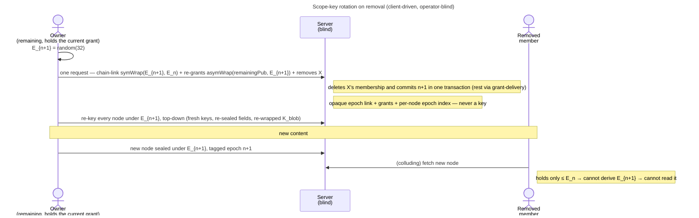

# Enabler: Scope-key rotation (content-key epochs)

- **ID:** en.spaces.scope-key-rotation
- **Type:** **Enabler** — structural foundation, no standalone end-user goal
  ([features/README](../../README.md#use-case-vs-enabler-vs-adr-vs-change-request)). It is the *substrate* that
  makes "remove a member" mean something cryptographically; the end-user goal lives in
  [uc.spaces.manage-group-members](../use-cases/uc.spaces.manage-group-members.md).
- **Provides:** the ability to **rotate a scope's content key forward into a new epoch** — granting the new epoch
  only to the **remaining** members, then re-keying every node of the scope under it — so a removed member can read
  pre-removal content but **never** post-removal content, except through a link they could rebuild until it is
  re-issued — against a malicious operator as far as [ADR 0024](../../../decisions/0024-scope-key-rotation.md)
  § Guarantee states — and **without re-encrypting anything in the store**.
- **Serves (use-cases/enablers):** [uc.spaces.manage-group-members](../use-cases/uc.spaces.manage-group-members.md)
  (member removal triggers a rotation), [uc.account.rotate-keys](../../account/use-cases/uc.account.rotate-keys.md)
  (a compromise re-keys **every** scope the holder is in) and
  [uc.spaces.complete-queued-rotation](../use-cases/uc.spaces.complete-queued-rotation.md) (an owner completes a
  rotation either trigger had to queue). The two are different triggers on one mechanism, and
  the *scope-type policy* in [ADR 0025](../../../decisions/0025-forward-secrecy-policy-per-scope.md) governs only
  the first: on **removal** a tenant is ACL-revoked and a personal scope has nobody to rotate away from, but on
  **compromise** both rotate — the tenant by ADR 0025 §2's explicit owner-triggered re-key, the personal scope
  self-served by its single owner.
- **Depends on:** [en.spaces.group-scope](en.spaces.group-scope.md) (the scope + its grant), the
  **grant-distribution primitive** generalized to re-grant existing members ([ADR 0020](../../../decisions/0020-grant-distribution-invite-wrap.md)),
  **grant-delivery** for a membership behind the epoch ([ADR 0021](../../../decisions/0021-operator-blind-background-tasks.md)),
  the **content-key hierarchy** ([ADR 0012](../../../decisions/0012-content-key-hierarchy.md)). **No new crypto
  primitive** — the epoch chain composes the existing `symWrap` / `asymWrap`.
- **Preconditions:** A group with ≥1 remaining owner online who holds its current grant, to perform the rotation
  (mint + wrap are client-side; the blind server cannot).
- **Postconditions (success):** The scope carries a new **current epoch**; the new epoch is `symWrap`'d over the
  previous (the backward chain) and `asymWrap`'d to each remaining member; new content seals under it, and every
  live and trashed node carries a fresh key minted at it ([uc.spaces.rekey-after-rotation](../use-cases/uc.spaces.rekey-after-rotation.md));
  the removed member's membership is gone (403). The server saw only opaque epoch-chain links, opaque grants,
  rewritten ciphertext in rows it already held, and per-node epoch indices — never a key.

## How rotation works (the epoch chain)

The scope content key is a sequence `E0, E1, …`; each new epoch **wraps its predecessor** (`symWrap(E_{n+1}, E_n)`),
so holding the latest epoch derives every earlier one, but an old epoch can never derive a newer one. A member's
grant wraps the **latest epoch they hold**. Each node carries the epoch its key was minted at, and every write sealed
under a node's key states it ([ADR 0109](../../../decisions/0109-a-scope-rotation-re-keys-every-node-below-it.md)
point 6). Full model,
guarantees, and the rotating-vs-stable (dedup) split: [ADR 0024](../../../decisions/0024-scope-key-rotation.md).

## Main flow — rotate on removal

1. A remaining owner's device **mints** a fresh `E_{n+1}` and posts the chain-link `symWrap(E_{n+1}, E_n)`, stating
   the epoch `n+1` it creates. `E_n` is the device's own grant, so the server commits only if that is the scope's
   current epoch + 1 (E3). The server does not take the client's word for that grant: an owner whose own grant is
   behind the scope's epoch, or absent, is refused `409 stale_epoch` with nothing stored, and an owner who rotated
   their account keys is refused `403 rotation_excluded` while a live rotation job of the scope carries their
   exclusion ([ADR 0060](../../../decisions/0060-key-rotation-after-compromise.md) Decision 4).
2. It **re-grants** `E_{n+1}`, signed by the rotator, to the remaining members it can reach (`asymWrap` to each
   identity) — a pending consent proposal included, which holds the key from its add on. For a **tenant** scope it
   also carries every **open member invite** ([ADR 0111](../../../decisions/0111-an-invitee-grants-itself-a-rotator-re-keys-its-own-scopes-and-a-key-chain-anchors-trust.md) decision 2): it reads
   them from `listOpenInvites`, re-grants the new epoch to each invite whose owner signature verifies under the
   signer key and whose signer passes its pin check, and declares the rest **pending**. The server refuses a
   rotation that leaves an open invite neither re-granted nor declared (`409 rotation_incomplete`) — one it forgot
   would hand its newcomer a key the members already left — and ignores an id that names no open invite. The
   **grant-delivery** reconciler finishes the rest: every membership behind the epoch (a member the re-grant
   skipped, a newcomer who joined through a pending invite), first-online-wins, idempotent
   ([ADR 0021](../../../decisions/0021-operator-blind-background-tasks.md)).
3. New content (names, `slug_token`s, `K_node`-wraps) seals under `E_{n+1}`; each new node carries epoch index `n+1`.
4. The same device re-keys every existing node of the scope under `E_{n+1}`, top-down: a fresh key per node, every
   field sealed under the old one re-sealed, each `K_blob` re-wrapped, nothing re-encrypted in the store
   ([uc.spaces.rekey-after-rotation](../use-cases/uc.spaces.rekey-after-rotation.md)); every member's device
   continues it in the background. A write into a node not yet re-keyed is `409 node_rekey_pending`: a member's client
   re-keys that node's path and retries at once, a guest's waits.
5. The removed member holds ≤ `E_n` and the node keys from before → decrypts pre-removal content, never what is
   added afterwards, except through a link they could rebuild, until it is re-issued.

## Alternate / exception flows

- **E1 — the remover cannot rotate:** rotation is *queued* as a `SCOPE_ROTATION` job on the operator-blind task
  queue ([ADR 0021](../../../decisions/0021-operator-blind-background-tasks.md)) — the removed membership is
  already deleted → layer-1 403 blocks their fetches meanwhile. The job is offered only to an **owner** of the
  scope, the only member who may commit a rotation; the next online owner claims it, completes the mint + re-grant
  on-device, and closes the job, first-online-wins. Events **join** a job only while it is unclaimed, so many
  removals before anyone is online still cost one rotation; an event that arrives after a job was claimed gets a
  job of its own, because the claimed job's worker may already have read the directory the event changed — one
  rotation more, in a window of seconds. A job is `done` only once its lease holder committed an epoch while
  holding its lease and no node of the scope lags it (`409 rekey_incomplete`). This is the async fallback when the remover isn't a key-holder (e.g. a tenant owner cutting a
  co-shared group, [uc.spaces.remove-tenant-member](../use-cases/uc.spaces.remove-tenant-member.md) A4); its
  whole lifecycle, failure modes included, is
  [uc.spaces.complete-queued-rotation](../use-cases/uc.spaces.complete-queued-rotation.md). When the
  remover *is* a key-holder (a group owner), the removal and its rotation are **one request**
  ([ADR 0024](../../../decisions/0024-scope-key-rotation.md) Decision 4): the server deletes the membership and
  commits the epoch in one transaction, so a failed rotation leaves the member in place and no job is needed; the
  bare member delete is refused for anyone but a pending consent proposal (`409 removal_requires_rotation`).
- **E2 — a remaining member's grant can't be re-wrapped:** that member's grant stays stale (they hold `E_n`
  while the scope is at `E_{n+1}`) → they fall to *waiting for the current key*: their client does not open the scope, so it
  writes nothing under `E_n`, and the server refuses a node create tagged `n` (`409 stale_epoch`, ADR 0024
  Decision 6). **Two cases that must not be confused,
  because only one self-heals.**
  - **A corrupt or unreadable pubkey** — the grant-delivery **stale-epoch trigger** (cr-0093) treats
    `grantedEpoch < currentEpoch` as behind and queues a delivery, so the next online key-holder
    re-wraps `E_current` and records `grantedEpoch = currentEpoch`. No manual intervention needed.
  - **A *changed* identity key (a rotation, or a substitution — indistinguishable on-wire)** — the reconciler
    **must not** auto-re-grant, and does not: every wrap-to-foreign-identity site is TOFU-gated
    ([ADR 0028](../../../decisions/0028-identity-authenticity-tofu-verification.md),
    [en.account.identity-pinning](../../account/enablers/en.account.identity-pinning.md)), so the worker
    **declines** the job and the re-grant loop **skips** that member while the rotation itself proceeds. They
    stay *waiting for the current key* until a human accepts the new key in the changed-key review. That is the intended
    behaviour and the reason an attacker cannot rotate their way back into a scope
    ([ADR 0060](../../../decisions/0060-key-rotation-after-compromise.md)); it is also why an accept must clear
    the declining worker's exclusion, or the re-admission it authorises is never delivered.
- **E3 — the rotation was built on a superseded epoch:** another rotation committed first (two owners, two tabs,
  a job reclaimed after its lease lapsed, or a panel removal meeting a queued job), or the rotating device's
  grant lags the scope (E2's skipped member). The server answers `409 stale_epoch` and stores nothing: no link and
  no grant. The device re-opens its grant and rebuilds the rotation **once**, from a fresh key
  ([ADR 0024](../../../decisions/0024-scope-key-rotation.md) §4 says why the key must be fresh). After a race the
  re-opened grant is current, because the winner re-granted it. If it still lags, the rotation fails: the
  synchronous remove reports it and the member stays, and a queued job is **declined** rather than failed, so it waits for an owner
  who is current instead of burning its attempts.

## Quality notes

- **Forward-confidential, without re-encryption.** The epoch costs one random key + one chain-wrap + one `asymWrap`
  per remaining member ([ADR 0024](../../../decisions/0024-scope-key-rotation.md)); the re-key that follows costs
  symmetric re-seals per node and medium in the database, and no store object is read or written
  ([ADR 0109](../../../decisions/0109-a-scope-rotation-re-keys-every-node-below-it.md) § Cost).
- **Operator-blind.** The server stores only the opaque epoch-chain links, the per-member and per-invite grants,
  a per-membership granted-epoch marker, a per-node epoch index and the re-key's rewritten ciphertext — no key,
  no plaintext. The epoch
  index is operational metadata the operator could infer from timing anyway.
- **Honest limit.** Already-read + pre-rotation content is not retractable; rotation protects **future** content.
  Layer-1 (deleted membership → 403) is the instant defense for everything future against an honest server.

> **No end-user section.** As an enabler this has no standalone "what this means for you" story — the value
> reaches the user through [uc.spaces.manage-group-members](../use-cases/uc.spaces.manage-group-members.md).

## Related

- Feature: [Spaces (scopes)](../_index.md)
- Decisions: [ADR 0024](../../../decisions/0024-scope-key-rotation.md) (the epoch model),
  [ADR 0109](../../../decisions/0109-a-scope-rotation-re-keys-every-node-below-it.md) (every rotation re-keys every node),
  [ADR 0012](../../../decisions/0012-content-key-hierarchy.md) (content-key hierarchy),
  [ADR 0014](../../../decisions/0014-group-scopes-and-governance.md) (§6 removal → rotation),
  [ADR 0020](../../../decisions/0020-grant-distribution-invite-wrap.md) / [ADR 0021](../../../decisions/0021-operator-blind-background-tasks.md)
  (grant re-delivery on rotation)
- Concept: [Security Model → revocation](../../../crosscutting/security-model.md)
