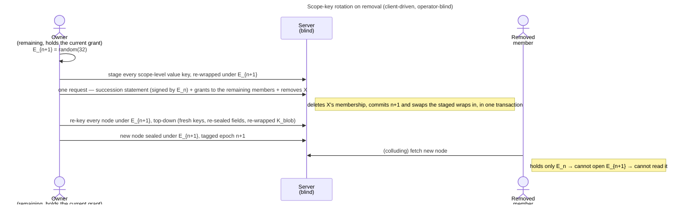

# Enabler: Scope-key rotation (content-key epochs)

- **ID:** en.spaces.scope-key-rotation
- **Type:** **Enabler** — structural foundation, no standalone end-user goal
  ([features/README](../../README.md#use-case-vs-enabler-vs-adr-vs-change-request)). It is the *substrate* that
  makes "remove a member" mean something cryptographically; the end-user goal lives in
  [uc.spaces.manage-group-members](../use-cases/uc.spaces.manage-group-members.md).
- **Provides:** the ability to **replace a scope's key with a fresh one at the next epoch** — granted only to the
  **remaining** members, every scope-level value's own key re-wrapped under it in the commit — no value rewritten —
  then every node of the scope
  re-keyed under it — so a removed member can read pre-removal content but **never** post-removal content, except
  through a link they could rebuild until it is re-issued, and the key they kept opens nothing in a dump taken after
  the rotation ([ADR 0115](../../../decisions/0115-a-scope-key-is-replaced-never-chained.md)) — **without
  re-encrypting anything in the store**.
- **The model** — the key replacement and its re-wrap of the value keys, the succession statement, who may commit a rotation, the cover
  rule, the policy per scope kind, the queued rotation and the node re-key — is the topic's current picture,
  [keys, grants and trust § Rotating a scope](../../../crosscutting/keys-grants-and-trust.md#rotating-a-scope). This
  enabler keeps its use-cases, its slice and its failure modes.
- **Serves (use-cases/enablers):** [uc.spaces.manage-group-members](../use-cases/uc.spaces.manage-group-members.md)
  (member removal triggers a rotation), [uc.account.rotate-keys](../../account/use-cases/uc.account.rotate-keys.md)
  (securing an account rotates **every** scope the account is in, each next epoch committed by the account's own
  devices), [uc.spaces.complete-queued-rotation](../use-cases/uc.spaces.complete-queued-rotation.md) (an owner
  completes a rotation a removal had to queue) and [uc.spaces.rekey-after-rotation](../use-cases/uc.spaces.rekey-after-rotation.md)
  (the node re-key every rotation runs). Removal and compromise are two triggers on one mechanism, and the
  *scope-type policy* in [ADR 0025](../../../decisions/0025-forward-secrecy-policy-per-scope.md) governs only the first:
  on **removal** a tenant is ACL-revoked (its owner may opt into a re-key after it, or run one alone,
  [uc.spaces.remove-tenant-member](../use-cases/uc.spaces.remove-tenant-member.md) A8–A9; a group owner runs the same
  re-key with nobody removed, [uc.spaces.manage-group-members](../use-cases/uc.spaces.manage-group-members.md) A6) and a personal scope has
  nobody to rotate away from; on **compromise** every
  scope the account is in rotates, the tenant and the personal scope included, each committed by the account itself
  ([ADR 0060](../../../decisions/0060-key-rotation-after-compromise.md) Decision 4).
- **Depends on:** [en.spaces.group-scope](en.spaces.group-scope.md) (the scope + its grant), the grant primitive
  ([ADR 0020](../../../decisions/0020-grant-distribution-invite-wrap.md)), **grant-delivery** for a membership behind
  the epoch ([ADR 0021](../../../decisions/0021-operator-blind-background-tasks.md)), the **content-key hierarchy**
  ([ADR 0012](../../../decisions/0012-content-key-hierarchy.md)). **No new crypto primitive** — a value key is wrapped by
  the one symmetric seal under a purpose of its own (`value-key`), and the succession statement is an Ed25519 signature from an HKDF-derived seed
  ([ADR 0115](../../../decisions/0115-a-scope-key-is-replaced-never-chained.md) decision 5).
- **Preconditions:** A scope with ≥1 owner online who holds its current grant, to perform the rotation (mint + wrap
  are client-side; the blind server cannot). After an account was secured, that account commits its scopes' next
  epochs itself, owner or not, through the pending row its publish left.
- **Postconditions (success):** The scope carries a new **current epoch**, one fresh key granted to each remaining
  member it anchors (the rest declared pending), proven by a succession statement from the old one; nothing at scope
  level is under the old key; every live and trashed node carries a fresh key minted at it; the removed member's
  membership is gone (403); every scope-level value is byte-identical, opening through its key's new wrap. The server
  saw only a succession public key and signature, opaque grants, rewritten wraps and ciphertext in rows it already
  held, and per-node epoch counters — never a key.

## Main flow — rotate on removal

1. A remaining owner's device **mints** a fresh `E_{n+1}`, opens every value key wrapped under `E_n`, wraps the same
   key under `E_{n+1}`, re-seals each scope-root entry, and stages them — a stage that writes a value is refused
   (`422 rekey_writes_value`); then it posts in **one request** the succession statement signed with `E_n`'s
   succession key, a grant of `E_{n+1}` to every remaining member its client anchors (naming each key), the members
   it cannot anchor as pending, and the member it removes. The server deletes the membership, commits `n+1` and swaps
   every staged wrap in, in one transaction, or stores nothing
   ([ADR 0115](../../../decisions/0115-a-scope-key-is-replaced-never-chained.md) decision 2).
2. New content seals under `E_{n+1}`: a new scope-root node's entry under the scope key, every node below under its
   parent's new key; each new node's `scopeEpoch` is `n+1`.
3. The same device re-keys every existing node of the scope under `E_{n+1}`, top-down
   ([uc.spaces.rekey-after-rotation](../use-cases/uc.spaces.rekey-after-rotation.md)); every member's device
   continues it in the background, and a member's write into a node not yet re-keyed re-keys that node's path first.
4. The removed member holds ≤ `E_n` and the node keys from before → decrypts pre-removal content, never what is
   added afterwards, except through a link they could rebuild, until it is re-issued.

## Alternate / exception flows

- **E1 — the remover cannot rotate:** a tenant owner cutting a co-shared group they hold no key to
  ([uc.spaces.remove-tenant-member](../use-cases/uc.spaces.remove-tenant-member.md) A4), or a declined consent
  proposal. The membership is deleted at once (layer-1 403) and the rotation is **queued** as a `scope-rotation` job,
  offered to owners of the scope only; many removals before anyone is online cost one rotation
  ([uc.spaces.complete-queued-rotation](../use-cases/uc.spaces.complete-queued-rotation.md)). When the remover *is* a
  key-holder (a group owner), the removal and its rotation are one request and no job is needed; a bare delete of a
  member is refused (`409 removal_requires_rotation`).
- **E2 — a remaining member is not granted the new epoch:** the rotator's client cannot anchor that member's key (a
  substitution, never a legitimate rotation, which is a signed step), so it declares them pending. Their grant stays
  behind (they hold `E_n` while the scope is at `E_{n+1}`) → they are *waiting for the current key*: everything they
  could open is now under `E_{n+1}`, so they read nothing of the scope until re-granted, write nothing under `E_n`, and the
  server refuses a write tagged `n` (`409 stale_epoch`).
  It is **transient**: grant delivery offers the job to every key-holder, a worker that cannot anchor them declines it
  (`identity_unanchored`), and the first member whose client anchors them delivers the epoch; their row reads
  "Waiting for someone who can confirm their key". When they secure their account, the publish clears every decline
  that targeted them, so a declining worker tries the new key
  ([keys, grants and trust § Grant delivery](../../../crosscutting/keys-grants-and-trust.md#grant-delivery-brings-a-behind-member-current)).
- **E3 — the rotation was built on a superseded epoch:** another rotation committed first (two owners, two tabs,
  a job reclaimed after its lease lapsed, or a panel removal meeting a queued job), or the rotating device's
  grant lags the scope (E2's skipped member). The server answers `409 stale_epoch` and stores nothing: no statement,
  no grant, no staged wrap. The device re-opens its grant, reads the members again and rebuilds the rotation **once**, from a fresh key
  ([ADR 0024](../../../decisions/0024-scope-key-rotation.md) Decision 4 says why the key must be fresh). After a race
  the re-opened grant is current, because the winner re-granted it. If it still lags, the rotation fails: the
  synchronous remove reports it and the member stays, and a queued job is **declined** rather than failed, so it
  waits for an owner who is current instead of burning its attempts.

## Quality notes

- **Forward-confidential, without re-encryption.** The epoch costs one random key, one succession statement, one
  grant per remaining member and a symmetric re-wrap of every scope-level value's own key — for a tenant three wraps
  per member, the name, picture and join record untouched ([ADR 0115](../../../decisions/0115-a-scope-key-is-replaced-never-chained.md) § Cost); the
  node re-key that follows costs symmetric re-seals per node and medium in the database, and no store object is read
  or written ([ADR 0109](../../../decisions/0109-a-scope-rotation-re-keys-every-node-below-it.md) § Cost).
- **Operator-blind.** The server stores only the succession public keys and signatures, the per-member and
  per-invite grants, a per-membership granted-epoch marker, per-node epoch counters, the rewritten wraps and the
  re-key's rewritten ciphertext — no key, no plaintext. The epoch counters are operational metadata the operator could infer from timing
  anyway.
- **Honest limit.** Already-read + pre-rotation content is not retractable, and a re-key re-wraps keys without
  re-encrypting content: a `K_blob` a former key-holder kept still opens that blob's bytes
  ([security model § Revocation](../../../crosscutting/security-model.md#revocation--two-layers)). Layer-1 (deleted
  membership → 403) is the instant defense for everything future against an honest server.

> **No end-user section.** As an enabler this has no standalone "what this means for you" story — the value
> reaches the user through [uc.spaces.manage-group-members](../use-cases/uc.spaces.manage-group-members.md).

## Related

- Feature: [Spaces (scopes)](../_index.md)
- Model: [keys, grants and trust](../../../crosscutting/keys-grants-and-trust.md)
- Decisions: [ADR 0115](../../../decisions/0115-a-scope-key-is-replaced-never-chained.md) (a key is replaced, never
  chained), [ADR 0024](../../../decisions/0024-scope-key-rotation.md) (epochs, rotate on removal),
  [ADR 0025](../../../decisions/0025-forward-secrecy-policy-per-scope.md) (when each kind rotates),
  [ADR 0109](../../../decisions/0109-a-scope-rotation-re-keys-every-node-below-it.md) (every rotation re-keys every node),
  [ADR 0012](../../../decisions/0012-content-key-hierarchy.md) (content-key hierarchy),
  [ADR 0014](../../../decisions/0014-group-scopes-and-governance.md) (§6 removal → rotation),
  [ADR 0020](../../../decisions/0020-grant-distribution-invite-wrap.md) / [ADR 0021](../../../decisions/0021-operator-blind-background-tasks.md)
  (grant re-delivery on rotation)
- Concept: [Security Model → revocation](../../../crosscutting/security-model.md#revocation--two-layers)
