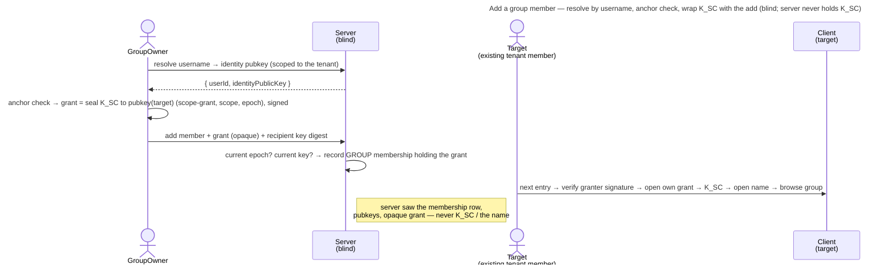

# UC: Add a member to a group

- **ID:** uc.spaces.add-group-member
- **Primary actor:** **GroupOwner** (`OWNER` on a GROUP scope — a per-scope role, any tenant member can hold it;
  adds the member — the only human action).
- **Goal:** give an **existing tenant member** access to a group — the GroupOwner picks them **by username** and
  their device wraps the group scope key `K_SC` to the target's identity in the same step, operator-blind, so the
  target holds the key from the add on.
- **Preconditions:** The caller is the group's **OWNER** and holds the group grant on an unlocked device (to wrap
  `K_SC`). The target is **already a member of the active tenant** with a published identity public key
  ([en.spaces.member-identity](../enablers/en.spaces.member-identity.md), [ADR 0023](../../../decisions/0023-per-tenant-member-identity.md))
  — there is **no onboarding** to do and no invite key
  ([ADR 0111](../../../decisions/0111-an-invitee-grants-itself-a-rotator-re-keys-its-own-scopes-and-a-key-chain-anchors-trust.md)
  decision 4).
- **Postconditions (success):** The target is a **member of the group holding a group grant** — so the group opens
  for them like any space they hold. The server saw only the new membership row, identity public keys, and an
  opaque, signed grant — never `K_SC`, and never the group's (sealed) name.

This use-case is the **group** consumer of the grant-distribution primitive
([ADR 0020](../../../decisions/0020-grant-distribution-invite-wrap.md)) — the wrap of
[uc.spaces.add-member](uc.spaces.add-member.md), but to an **existing tenant member** picked by **username**,
so it needs neither email nor an invite key ([ADR 0014](../../../decisions/0014-group-scopes-and-governance.md) §5).
Governance (who may add, the name stays sealed, no tenant-owner power) is [ADR 0014](../../../decisions/0014-group-scopes-and-governance.md).

## Main flow

1. In the open group, the **GroupOwner** opens **"add member"** and searches by **username**. The server resolves
   the handle **within the active tenant** to the target's **identity public key** — a **tenant-scoped resolve**,
   not a global user-search ([ADR 0020](../../../decisions/0020-grant-distribution-invite-wrap.md): a
   username-reachable variant scoped to the tenant is the group case's concern). The username is a plaintext,
   unique-in-tenant handle every tenant member already sees, so this leaks nothing new
   ([ADR 0023](../../../decisions/0023-per-tenant-member-identity.md)).
2. The GroupOwner picks the resolved member. Their client runs the **anchor check** on the served key and head
   ([ADR 0028](../../../decisions/0028-identity-authenticity-tofu-verification.md) Decision 2: the target's join record
   in the tenant decides first, the key followed along the target's key chain from the step it names, a key the chain
   does not reach — or a non-owner without a join record — refused with nothing sent), then **wraps** the group's current epoch key to it — `sealTo` under
   the `scope-grant` purpose, bound to the scope and epoch ([ADR 0072](../../../decisions/0072-a-seal-binds-its-object.md)),
   signed with the owner's identity key (Decision 6) — and posts it with the add, naming the key it is wrapped to
   (`recipientIdentityDigest`).
3. The server checks the grant is of the group's **current** epoch (`409 stale_epoch`) and names the target's
   current identity key (`409 recipient_key_not_current`), and records the GROUP membership (`role=MEMBER`)
   **with** that grant. Because the person already has an identity and is already a tenant member, there is
   **no email, no cold-register** (unlike [uc.spaces.add-member](uc.spaces.add-member.md)).
4. The member, on their **next entry**, verifies the granter's signature, opens their grant with their own identity
   private → `K_SC`, decrypts the group's sealed name for the switcher, and browses the group like any space
   ([uc.spaces.switch-spaces](uc.spaces.switch-spaces.md), [en.spaces.group-scope](../enablers/en.spaces.group-scope.md)).

## Alternate / exception flows

- **A1 — the target is already a group member:** `409 already_member` — no duplicate membership.
- **A2 — a rotation committed between the owner's read and the add:** `409 stale_epoch`, nothing written; the
  client re-opens the group and wraps the new epoch once more.
- **A3 — the target opted into consent ("ask before adding me"):** the add diverts into a **proposal** — a *soft*
  `pendingConsent` membership that holds the same grant, with the group name-key wrapped to them; the group is
  listed to them only once they accept. That is its own use-case, [uc.spaces.consent-group-add](uc.spaces.consent-group-add.md)
  (per [ADR 0014](../../../decisions/0014-group-scopes-and-governance.md) §5; built by cr-0094 and cr-0096). **This**
  use-case is the direct-add default — consent **off**.
- **E1 — the username doesn't resolve in this tenant:** a generic *not-found*. The resolve is **tenant-scoped** —
  a non-member (or a handle in another tenant) is not reachable, and the server never runs a global search
  ([ADR 0020](../../../decisions/0020-grant-distribution-invite-wrap.md)).
- **E2 — key-substitution by a malicious operator:** the owner's client wraps to the identity key the server
  resolved. The stance is [ADR 0028](../../../decisions/0028-identity-authenticity-tofu-verification.md):
  **TOFU-pin on first use**, a key the target's chain does not reach refused with "Can't confirm this key" and no
  accept, and out-of-band
  **safety-number verification** ([uc.spaces.enforce-verified-identities](uc.spaces.enforce-verified-identities.md))
  writes a verification every member of the tenant reads; an opt-in **strict mode** is not built
  ([uc.spaces.require-verified-identities](uc.spaces.require-verified-identities.md)). The target's join record
  anchors the key even before the owner pinned the target
  ([ADR 0111](../../../decisions/0111-an-invitee-grants-itself-a-rotator-re-keys-its-own-scopes-and-a-key-chain-anchors-trust.md)
  decision 12); what remains is a substituted key for a target the server presents as a tenant owner without a join
  record, trusted on first use (self-hosted makes it moot).
- **E3 — the member's grant won't unwrap** (corrupt / identity rotated without re-wrap): the member can't open the
  group → surfaced as an error; the scope row is **not** self-deleted (a blind operator must not force a wipe),
  matching [en.spaces.group-scope](../enablers/en.spaces.group-scope.md) E2.

## Quality notes

- **Operator-blind.** The server stores the new membership row with its opaque grant and relays identity public
  keys; the wrap is **client-side**. The group's **name stays sealed** under `K_SC` throughout — a member-add never
  surfaces it to the server. No scope key ever crosses the wire.
- **Only an owner adds, and the add carries the key.** The **GroupOwner** gates *who* joins (the tenant owner has
  **no** say, [ADR 0014](../../../decisions/0014-group-scopes-and-governance.md) §4) and hands over the key in the
  same request, so nobody waits for another member's device to be online.
- **Username resolve is tenant-scoped, not a global directory.** The resolve returns a pubkey only for a handle
  **inside the caller's own tenant** — the bounded variant [ADR 0020](../../../decisions/0020-grant-distribution-invite-wrap.md)
  reserved for the group case. Usernames are already visible to every tenant member (cr-0083), so exposing them to
  a fellow member yields no scope key and no new enumeration surface beyond the tenant.
- **Additive only.** This use-case only **adds** a member. **Consent** (the account-global "ask before adding me"
  opt-in, soft membership) is [uc.spaces.consent-group-add](uc.spaces.consent-group-add.md) (built); **promote/
  demote a co-owner, remove a member, the last-owner guard, `K_SC` rotation, and the orphan rule** are the
  group-lifecycle slice ([ADR 0014](../../../decisions/0014-group-scopes-and-governance.md) §4/§6).

## User impact

You bring a fellow member of your space into a group by their username, and your own device hands them the group's
key, so they are in at once and the server can never slip anyone into your group.

## Related

- Feature: [Spaces (scopes)](../_index.md)
- Enablers: [en.spaces.group-scope](../enablers/en.spaces.group-scope.md) (the group this adds members to),
  [en.spaces.member-identity](../enablers/en.spaces.member-identity.md) (the per-tenant username the owner searches
  by), [en.spaces.personal-scope](../enablers/en.spaces.personal-scope.md) (Personal, beside every group)
- Decisions: [ADR 0014](../../../decisions/0014-group-scopes-and-governance.md) (group governance — who admits,
  the sealed name, consent + lifecycle deferrals), [ADR 0020](../../../decisions/0020-grant-distribution-invite-wrap.md)
  (the reusable grant-distribution primitive + the tenant-scoped username resolve), [ADR 0111](../../../decisions/0111-an-invitee-grants-itself-a-rotator-re-keys-its-own-scopes-and-a-key-chain-anchors-trust.md)
  (a group add needs no invite key), [ADR 0007](../../../decisions/0007-membership-role-grant-relation.md) (role vs. grant),
  [ADR 0023](../../../decisions/0023-per-tenant-member-identity.md) (per-tenant username)
- Sibling use-case: [uc.spaces.add-member](uc.spaces.add-member.md) (the **tenant** consumer — email invite +
  cold-register; this is its by-username, existing-member counterpart), [uc.spaces.switch-spaces](uc.spaces.switch-spaces.md)
  (once granted, the member switches into the group)
- Concept: [Scopes & Tenancy](../../../crosscutting/scopes-and-tenancy.md), [Security Model → key-directory
  trust](../../../crosscutting/security-model.md)
- End-user view (docs site): [People in a group](../../../../site/src/content/docs/spaces/group-members.mdx)
