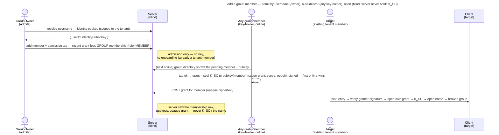

# UC: Add a member to a group

- **ID:** uc.spaces.add-group-member
- **Primary actor:** **GroupOwner** (`OWNER` on a GROUP scope — a per-scope role, any tenant member can hold it;
  admits the member — the only human action); **any group key-holder's device** completes the key delivery
  automatically.
- **Goal:** give an **existing tenant member** access to a group — the GroupOwner picks them **by username**, and the
  group then hands over the key by itself: any group member's device wraps the group scope key `K_SC` to the
  newcomer's identity, operator-blind.
- **Preconditions:** The caller is the group's **OWNER** (holds the group grant, so their unlocked device can
  compute the membership's **admission tag** from the group's current epoch key —
  [ADR 0020](../../../decisions/0020-grant-distribution-invite-wrap.md) move 6 — and can wrap `K_SC`).
  The target is **already a member of the active tenant** with a published identity public key
  ([en.spaces.member-identity](../enablers/en.spaces.member-identity.md), [ADR 0023](../../../decisions/0023-per-tenant-member-identity.md))
  — there is **no onboarding** to do. At least one group key-holder comes online after the membership is
  recorded, to deliver the key.
- **Postconditions (success):** The target is a **member of the group** and, once **any** group key-holder's device
  has wrapped `K_SC` to them, holds a **group grant** — so the group opens for them like any space they hold.
  The server saw only the new membership row with its admission tag, identity public keys, and opaque, signed
  grant ciphertext — never `K_SC`, and never the group's (sealed) name.

This use-case is the **group** consumer of the grant-distribution primitive
([ADR 0020](../../../decisions/0020-grant-distribution-invite-wrap.md)) — the same wrap + auto-delivery as
[uc.spaces.add-member](uc.spaces.add-member.md), but over an **existing tenant member** picked by **username**,
so it **skips the email-onboarding half** and is a **pure invite-wrap** ([ADR 0014](../../../decisions/0014-group-scopes-and-governance.md) §5).
Governance (who may add, the name stays sealed, no tenant-owner power) is [ADR 0014](../../../decisions/0014-group-scopes-and-governance.md).

## Main flow

1. In the open group, the **GroupOwner** opens **"add member"** and searches by **username**. The server resolves
   the handle **within the active tenant** to the target's **identity public key** — a **tenant-scoped resolve**,
   not a global user-search ([ADR 0020](../../../decisions/0020-grant-distribution-invite-wrap.md): a
   username-reachable variant scoped to the tenant is the group case's concern). The username is a plaintext,
   unique-in-tenant handle every tenant member already sees, so this leaks nothing new
   ([ADR 0023](../../../decisions/0023-per-tenant-member-identity.md)).
2. The GroupOwner picks the resolved member. Their client computes the membership's **admission tag**, bound to
   the target's user id, and the server records a **grant-less GROUP membership** (`role=MEMBER`) carrying it —
   admission only; **no key crosses the wire**. Because the person already has an identity and is
   already a tenant member, there is **no email, no cold-register** (unlike [uc.spaces.add-member](uc.spaces.add-member.md)).
3. **Delivery is automatic — no second human action.** Every group member already holds `K_SC`, so **any** group
   member's client — the owner's or another's — that is online after the membership was recorded sees the pending
   member in the group's **member directory** (with their identity public key) and, once the admission tag
   verifies under its own current epoch key, **eagerly wraps** `K_SC` to them. The **first** key-holder to do so
   wins; the rest see the grant already present and no-op. Delivery is a
   `grant-delivery` job on the operator-blind background-task mechanism ([ADR 0021](../../../decisions/0021-operator-blind-background-tasks.md)),
   exactly as for the tenant scope.
4. The wrap seals `K_SC` to the member's hybrid public key under the `scope-grant` purpose, bound to the scope
   and epoch ([ADR 0072](../../../decisions/0072-a-seal-binds-its-object.md)) — the same hybrid KEM as a
   self-grant, only the recipient differs — and the key-holder signs it with its identity key
   ([ADR 0028](../../../decisions/0028-identity-authenticity-tofu-verification.md) Decision 6). It runs **on the
   key-holder's device** and is posted as the member's grant; the server stores opaque ciphertext.
5. The member, on their **next entry**, opens their grant with their own identity private → `K_SC`, decrypts the
   group's sealed name for the switcher, and browses the group like any space
   ([uc.spaces.switch-spaces](uc.spaces.switch-spaces.md), [en.spaces.group-scope](../enablers/en.spaces.group-scope.md)).

## Alternate / exception flows

- **A1 — the target is already a group member:** picking them is a **no-op** (idempotent) — they already hold, or
  are pending, a grant. No duplicate membership.
- **A2 — no group key-holder is online when the member is added:** the member stays pending, surfaced as
  *awaiting access* — **not** an error. Only a key-holder can wrap `K_SC`; the blind server cannot. Access
  completes as soon as **any** group member is next online (step 3).
- **A3 — the target opted into consent ("ask before adding me"):** the add diverts into a **proposal** instead of
  admitting immediately — a *soft*, grant-less membership that delivery **skips** until the invitee accepts, with
  the group name one-off-sealed to them. That is its own use-case, [uc.spaces.consent-group-add](uc.spaces.consent-group-add.md)
  (per [ADR 0014](../../../decisions/0014-group-scopes-and-governance.md) §5; built by cr-0094 and cr-0096). **This**
  use-case is the direct-add default — consent **off**.
- **E1 — the username doesn't resolve in this tenant:** a generic *not-found*. The resolve is **tenant-scoped** —
  a non-member (or a handle in another tenant) is not reachable, and the server never runs a global search
  ([ADR 0020](../../../decisions/0020-grant-distribution-invite-wrap.md)).
- **E2 — key-substitution by a malicious operator:** the wrapping key-holder takes the identity pubkey from the
  server. The verification stance is settled by [ADR 0028](../../../decisions/0028-identity-authenticity-tofu-verification.md):
  **TOFU-pin on first use**, a **changed** key is a UI notice / a hard block for the grant-delivery worker, and
  out-of-band **safety-number verification** ([uc.spaces.enforce-verified-identities](uc.spaces.enforce-verified-identities.md)) elevates a
  contact to *verified*; an opt-in **strict mode** hard-gates on unverified. The pinning and the proactive ceremony
  are built ([en.account.identity-pinning](../../account/enablers/en.account.identity-pinning.md)); strict mode is
  not ([uc.spaces.require-verified-identities](uc.spaces.require-verified-identities.md)). The operator cannot invent a member (no admission tag), so what remains is a
  substituted key on a real add before anyone pinned the target (self-hosted makes it moot).
- **E3 — the member's grant won't unwrap** (corrupt / identity rotated without re-wrap): the member can't open the
  group → surfaced as an error; the scope row is **not** self-deleted (a blind operator must not force a wipe),
  matching [en.spaces.group-scope](../enablers/en.spaces.group-scope.md) E2.

## Quality notes

- **Operator-blind.** The server stores the new membership row + relays identity public keys; the wrap is
  **client-side**; the grant is opaque ciphertext. The group's **name stays sealed** under `K_SC` throughout — a
  member-add never surfaces it to the server. No scope key ever crosses the wire.
- **Admission vs. delivery ([ADR 0020](../../../decisions/0020-grant-distribution-invite-wrap.md) §5).** The
  **GroupOwner** gates *who* joins (only an owner admits — the tenant owner has **no** say, [ADR 0014](../../../decisions/0014-group-scopes-and-governance.md) §4);
  **any** group key-holder delivers the *key* (automatic, first-online-wins), because every group member already
  holds `K_SC`. Access isn't bottlenecked on the owner, and no one confirms the same person twice. Owner-only is
  server policy; that admission needs a key-holder is cryptographic — delivery checks the admission tag.
- **Username resolve is tenant-scoped, not a global directory.** The resolve returns a pubkey only for a handle
  **inside the caller's own tenant** — the bounded variant [ADR 0020](../../../decisions/0020-grant-distribution-invite-wrap.md)
  reserved for the group case. Usernames are already visible to every tenant member (cr-0083), so exposing them to
  a fellow member yields no scope key and no new enumeration surface beyond the tenant.
- **The active-operator gap — the closing stance.** The add wraps to the server-returned pubkey; **which** key is
  trusted is governed by **TOFU pinning + safety-number verification** ([ADR 0028](../../../decisions/0028-identity-authenticity-tofu-verification.md),
  [security-model](../../../crosscutting/security-model.md)) — a first-seen key is pinned, a changed key is
  surfaced (UI) or refused (worker), and verification elevates to *verified*. The first sight of a key stays
  unverified until someone compares safety numbers (self-hosted makes it moot); Key Transparency remains the
  end-state.
- **Additive only.** This use-case only **adds** a grant. **Consent** (the account-global "ask before adding me"
  opt-in, soft membership) is [uc.spaces.consent-group-add](uc.spaces.consent-group-add.md) (built); **promote/
  demote a co-owner, remove a member, the last-owner guard, `K_SC` rotation, and the orphan rule** are the
  group-lifecycle slice ([ADR 0014](../../../decisions/0014-group-scopes-and-governance.md) §4/§6).

## User impact

You bring a fellow member of your space into a group by their username, and the group's key reaches them from a
member's device, so the server can never slip anyone into your group.

## Related

- Feature: [Spaces (scopes)](../_index.md)
- Enablers: [en.spaces.group-scope](../enablers/en.spaces.group-scope.md) (the group this adds members to),
  [en.spaces.member-identity](../enablers/en.spaces.member-identity.md) (the per-tenant username the owner searches
  by), [en.spaces.personal-scope](../enablers/en.spaces.personal-scope.md) (where a not-yet-delivered member still
  works)
- Decisions: [ADR 0014](../../../decisions/0014-group-scopes-and-governance.md) (group governance — who admits,
  the sealed name, consent + lifecycle deferrals), [ADR 0020](../../../decisions/0020-grant-distribution-invite-wrap.md)
  (the reusable grant-distribution primitive + the tenant-scoped username resolve), [ADR 0021](../../../decisions/0021-operator-blind-background-tasks.md)
  (grant-delivery job), [ADR 0007](../../../decisions/0007-membership-role-grant-relation.md) (role vs. grant),
  [ADR 0023](../../../decisions/0023-per-tenant-member-identity.md) (per-tenant username)
- Sibling use-case: [uc.spaces.add-member](uc.spaces.add-member.md) (the **tenant** consumer — email invite +
  cold-register; this is its by-username, existing-member counterpart), [uc.spaces.switch-spaces](uc.spaces.switch-spaces.md)
  (once granted, the member switches into the group)
- Concept: [Scopes & Tenancy](../../../crosscutting/scopes-and-tenancy.md), [Security Model → key-directory
  trust](../../../crosscutting/security-model.md)
- End-user view (docs site): [People in a group](../../../../site/src/content/docs/spaces/group-members.mdx)
