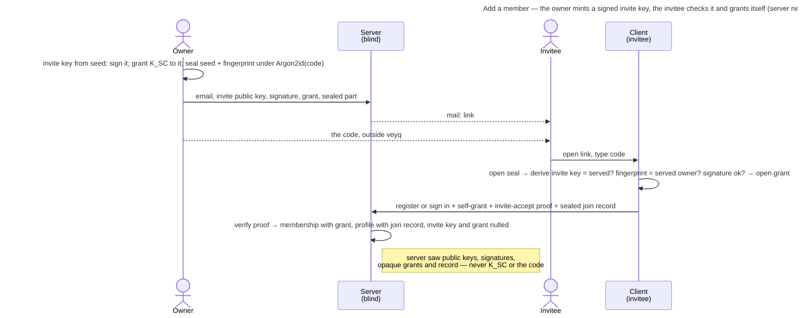

# UC: Add a member to the shared Tenant space

- **ID:** uc.spaces.add-member
- **Primary actor:** Tenant **Owner** (invites); the **invitee** (joins with the code the owner passed on).
- **Goal:** give another person access to the shared **Tenant** space — the owner invites them, and the invitee
  joins holding the tenant key at once, with nobody else's device involved, operator-blind
  ([ADR 0111](../../../decisions/0111-an-invitee-grants-itself-a-rotator-re-keys-its-own-scopes-and-a-key-chain-anchors-trust.md)
  decisions 1–3).
- **Preconditions:** The owner holds the TENANT grant (born cold at activation, [ADR 0006](../../../decisions/0006-cold-tenant-scope-birth.md))
  and invites from an **unlocked vault**: the invite holds a grant of the tenant's current epoch key, which only a
  key-holder can wrap. The tenant can send mail ([ADR 0055](../../../decisions/0055-mail-is-a-precondition-not-a-capability.md)),
  and the owner has a way outside veyq to pass the invitee a code (a message, in person).
- **Postconditions (success):** The invited person is a **member** of the tenant holding a **TENANT grant** they
  wrapped to their own identity, and a **join record** in their tenant profile — so they open the shared space at
  once. The server saw the invite's public key, the owner's signature over it, opaque grant ciphertext and the
  sealed join record — never the scope key, the invite's private key or the code.

This use-case is the tenant consumer of the grant-distribution primitive
([ADR 0020](../../../decisions/0020-grant-distribution-invite-wrap.md)); a group add wraps directly instead
([uc.spaces.add-group-member](uc.spaces.add-group-member.md)).

## Main flow

1. The owner opens **"add member"** and enters the person's **email**. Their client makes the invite a
   **placeholder member** ([ADR 0111](../../../decisions/0111-an-invitee-grants-itself-a-rotator-re-keys-its-own-scopes-and-a-key-chain-anchors-trust.md)
   decision 1): it mints an **invite key** from a fresh 32-byte seed, **signs** its public half with the owner's
   identity (statement `invite-key` over tenant, invite, the key's hash and the expiry, which is the instance's
   invite lifetime `MyTenant.memberInviteTtlSeconds` from now), **wraps the tenant's current epoch key** to it (a
   grant whose recipient is the invite id), and **seals** the seed, the owner's fingerprint hash and the owner's
   account under `Argon2id(code)` — the link's secret part. The **code** is 10 Crockford base32 characters, minted
   on the owner's device and shown once with a copy button; the owner may type a **password** instead (at least
   the account password's length floor). The link is always sealed: the server mails it, so an unsealed link would
   hand the operator the invite.
2. The server checks the grant is of the **current** epoch under the tenant's lock (`409 stale_epoch`), that it
   names the invite key it stores beside it (`409 recipient_key_not_current`), and that the signed expiry is its
   own lifetime within a minute (`400`); it stores the public key, the signature, the signer's key as it signed and
   the grant on the invite row, mints the **single-use** token (hashed), and **mails** `…/tenant/accept#<token>.<sealed>`
   to the address — keeping no copy of the sealed part. Mail is the **only** channel: the response carries no
   secret ([ADR 0055](../../../decisions/0055-mail-is-a-precondition-not-a-capability.md)). A tenant with no
   sendable mail settings is **refused** (`503 mail_unavailable`) before anything is minted.
3. The owner passes the **code** on themselves, never by email.
4. The invitee opens the link and types the code. Their client opens the seal and **checks the invite before it
   sends anything**: the key the seed derives must be the served invite key, the served owner key must hash to the
   fingerprint inside the seal, and the owner's signature over the invite key must verify under it. It then
   verifies the invite grant's signature and opens it with the invite key. A wrong code is the invitee's to retype;
   a failed check is "This invite can't be checked — ask for a new one", and nothing is sent.
5. The invitee **registers** (identity born cold on-device, the Emergency Kit issued) or, with an account already, signs in with their Secret Key. Their client **grants itself** the tenant key — a
   grant sealed to its own identity, naming that key's digest — signs the `invite-accept` proof with the invite key,
   and writes the **join record**: its identity and Secret-Key proof public keys and the owner-signed invite,
   signed by the invite key **and** the new identity, sealed under the tenant key (field `member-join-record`,
   bound to tenant and member). The optional name and picture are sealed under the same key at join.
6. The server verifies the proof under the stored invite key (`403 invite_proof_invalid`), writes the MEMBER
   membership **with** the self-grant and the profile with its join record, and consumes the invite, nulling its
   key and grant in the same statement. The newcomer is in the shared space at once
   ([uc.spaces.switch-spaces](uc.spaces.switch-spaces.md)).

## Alternate / exception flows

- **A1 — the invitee already has an account on this instance:** they **sign in** with password and Secret Key and
  accept; the join record names the proof key their Secret Key derives. *(The existing-member, by-username variant
  is [uc.spaces.add-group-member](uc.spaces.add-group-member.md).)*
- **A2 — a rotation of the tenant meets an open invite:** the rotator re-grants the new epoch to every open invite
  whose owner signature verifies and whose signer passes its anchor check, and declares the rest **pending**; the
  server refuses a rotation that does neither for an open invite (`409 rotation_incomplete`) and ignores an id that
  names no open invite. Every member reads the open invites' keys for this (`listOpenInvites`, no email). A pending
  invite's newcomer self-grants the epoch it can open and joins **behind**; the narrow grant delivery brings it
  current ([en.spaces.scope-key-rotation](../enablers/en.spaces.scope-key-rotation.md) E2), and until then the
  sidebar says *Waiting for the current key*.
- **A3 — a grant a rotation re-wrapped:** it names that rotator, not the inviting owner, as its granter. The
  newcomer cannot anchor that member yet and trusts its key on first use, pinning it; a grant naming the inviting
  owner verifies only under the key the link anchored, so an invite whose grant the inviting owner re-wrapped in a
  rotation after changing identity reads "ask for a new one".
- **E1 — the invite is expired, revoked or already consumed:** a generic failure that points at whoever invited;
  the token is single-use, and an ended invite holds no key and no grant.
- **E2 — the operator against the invite:** it mails the link, so it holds the sealed part and may guess offline —
  against a 50-bit code behind Argon2id at the production profile. It cannot swap the owner's key or the invite key,
  because the fingerprint sits inside the seal and the invitee derives the invite key itself. A password the owner
  chose is only as strong as that password. Self-hosted makes it moot.
- **E3 — the member's grant won't unwrap** (corrupt / identity rotated without re-wrap): the member can't open
  the tenant → surfaced as an error; the scope row is **not** self-deleted (a blind operator must not force a
  wipe), matching [en.spaces.tenant-scope](../enablers/en.spaces.tenant-scope.md) E3.

## Quality notes

- **Operator-blind.** The server stores the invite's public key, the owner's signature and the signer's key as it
  signed, opaque grants and the sealed join record. The invite's private key and the code never reach it; the
  sealed part of the link is mailed and dropped.
- **Member identity ([en.spaces.member-identity](../enablers/en.spaces.member-identity.md), cr-0083).** Each
  member shows a per-tenant **`username`** (plaintext handle, chosen at join, unique in the tenant) and their
  **real name sealed under a field key derived from `K_tenant`** — decrypted on-device by any member, never seen by the server;
  **`email` is owner-only** ([ADR 0023](../../../decisions/0023-per-tenant-member-identity.md)).
- **Auth ≠ content.** Onboarding makes someone a *member* (a role); only the identity-unwrapped grant yields the
  key ([ADR 0007](../../../decisions/0007-membership-role-grant-relation.md)). Every membership is now born with
  its grant.
- **The owner is the trust root.** The owner's signature on the invite key and the invite key's signature on the
  join record chain **owner → invite → newcomer**. Nothing reads the join record to decide anything yet; the
  tenant's first owner has none ([ADR 0111](../../../decisions/0111-an-invitee-grants-itself-a-rotator-re-keys-its-own-scopes-and-a-key-chain-anchors-trust.md)
  decision 3).
- **A session alone mints no invite.** The server verifies the invite key's `invite-key` signature under the
  caller's stored identity key before it mints or re-issues (`TenantHandler.signedByCaller`, `400 invalid_request`,
  also for a signed expiry with a fraction of a second), so a session without the owner's unlocked vault — a phished
  password — creates no invite any client would carry or deliver to: the role the admission tag played, on an honest
  server.
- **What no wrap checks yet.** Because nothing reads the join record, a membership the operator writes into the
  database is wrapped to by the next rotation or delivery after the anchor check, as a first use
  ([security-model](../../../crosscutting/security-model.md)).
- **Inviting is owner-only.** Only a tenant OWNER mints, re-issues or revokes a member invite (`403
  not_tenant_owner`); a member never hands the key to someone the owner did not invite.
- **Delivery result, never silent (cr-email-invite-send-hardening).** The mint reports how the invite went. On
  a member invite only **SENT** is reachable: no sendable mailer is refused up front, and a send that errors is
  `503 mail_send_failed` with the invite **revoked again** — there is no copy-link to hand a survivor to, so a
  live token nobody can reach would be worse than no invite ([ADR 0055](../../../decisions/0055-mail-is-a-precondition-not-a-capability.md) §6).
  A failed **re-issue** therefore leaves the invitee with no live invite at all, since the supersede already
  happened; the owner retries. The send runs **after the mint transaction commits** (a hung SMTP server can't
  hold a DB connection), so the undo is a compensation rather than a rollback, and the result is request-scoped
  and **never persisted** — no new operator-visible metadata
  ([ADR 0049](../../../decisions/0049-email-delivery-boundary.md)).
- **Anti-bombing rate limit (cr-email-invite-send-hardening).** Once mail is a real channel, repeated invites to
  one address are **rate-limited** — per-(tenant, recipient) as the primary guard and per-tenant as a volume cap
  (429 + `Retry-After`, no invite minted). It is enforced in the handler on the tenant-owner member paths (the
  per-IP auth limiter can't key on a recipient); the re-issue loop against one address is the sharpest vector.
- **Additive only.** This use-case only **adds** a member. Removal is
  [uc.spaces.remove-tenant-member](uc.spaces.remove-tenant-member.md); revoking an open invite is
  [uc.spaces.manage-member-invites](uc.spaces.manage-member-invites.md).

## User impact

You let someone into your shared space with an email invitation and a code you pass on yourself, and they are in at
once, so the server never holds what opens the invitation.

## Related

- Feature: [Spaces (scopes)](../_index.md)
- Enablers: [en.spaces.tenant-scope](../enablers/en.spaces.tenant-scope.md) (the shared space this adds members
  to), [en.spaces.member-identity](../enablers/en.spaces.member-identity.md) (the profile the join record lives in),
  [en.spaces.scope-key-rotation](../enablers/en.spaces.scope-key-rotation.md) (how a rotation carries open invites)
- Decisions: [ADR 0111](../../../decisions/0111-an-invitee-grants-itself-a-rotator-re-keys-its-own-scopes-and-a-key-chain-anchors-trust.md)
  (the invite as a placeholder member, the self-grant and the join record), [ADR 0020](../../../decisions/0020-grant-distribution-invite-wrap.md)
  (grant distribution), [ADR 0007](../../../decisions/0007-membership-role-grant-relation.md) (role vs. grant),
  [ADR 0006](../../../decisions/0006-cold-tenant-scope-birth.md) (the owner's cold-born grant),
  [ADR 0055](../../../decisions/0055-mail-is-a-precondition-not-a-capability.md) (mail as the only channel)
- Sibling use-case: [uc.spaces.switch-spaces](uc.spaces.switch-spaces.md) (the member switches Personal ↔ Tenant),
  [uc.spaces.manage-member-invites](uc.spaces.manage-member-invites.md) (re-issue and revoke),
  [uc.admin.create-tenant](../../admin/use-cases/uc.admin.create-tenant.md) (the owner invite this member invite extends)
- Concept: [Scopes & Tenancy](../../../crosscutting/scopes-and-tenancy.md), [Security Model → key-directory
  trust](../../../crosscutting/security-model.md)
- End-user view (docs site): [Who gets into your space](../../../../site/src/content/docs/space-owners/who-gets-into-your-space.mdx)
- Security area of the docs site: [Protocols](../../../../site/src/content/docs/security/protocols.mdx)
- End-user view (docs site): [Accept an invitation](../../../../site/src/content/docs/getting-started/accept-an-invitation.mdx)
