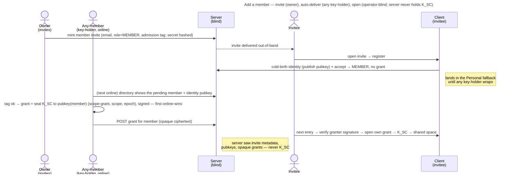

# UC: Add a member to the shared Tenant space

- **ID:** uc.spaces.add-member
- **Primary actor:** Tenant **Owner** (invites — the only human action); **any tenant key-holder's device**
  completes the key delivery automatically.
- **Goal:** give another person access to the shared **Tenant** space — the owner invites them, and the tenant then
  hands over the key by itself: any member's device wraps the tenant scope key to the newcomer's identity,
  operator-blind.
- **Preconditions:** The owner holds the TENANT grant (born cold at activation, [ADR 0006](../../../decisions/0006-cold-tenant-scope-birth.md))
  and mints the invite from an **unlocked vault**: the invite carries an **admission tag** that only a holder of
  the tenant's current epoch key can compute ([ADR 0020](../../../decisions/0020-grant-distribution-invite-wrap.md)
  move 6). At least one key-holder (every member holds `K_SC`) comes online after the newcomer joins,
  to deliver the key; a way to deliver the invite secret out-of-band (email, as the owner invite already does).
- **Postconditions (success):** The invited person is a **member** of the tenant and, once **any** key-holder's
  device has wrapped the key to them, holds a **TENANT grant** — so they open the shared space instead of the
  Personal fallback. The server saw only the invite metadata with its admission tag, identity public keys, and
  opaque, signed grant ciphertext — never the scope key.

This use-case is the first consumer of the grant-distribution primitive
([ADR 0020](../../../decisions/0020-grant-distribution-invite-wrap.md)); groups reuse the same primitive later.

## Main flow

1. The owner opens **"add member,"** enters the person's **email** and `role = MEMBER`. The server mints a
   **single-use member invite** (the secret hashed, never stored plaintext) and **emails it to that address** —
   reusing the tenant-invite machinery that today mints only the owner. Mail is the **only** channel: the mint
   response carries no secret, because the token is minted for the invited person and must not travel through
   whoever is looking at the owner's screen ([ADR 0055](../../../decisions/0055-mail-is-a-precondition-not-a-capability.md)).
   A tenant with no sendable mail settings is therefore **refused** (`503 mail_unavailable`) before anything is
   minted — the cost of that, and why it is accepted, is priced in the ADR.
2. The invitee opens the invite, previews the tenant (name, domain), and **registers**: their identity is
   **born cold on-device** and its public bundle published, they set their password + master-key wraps, and
   accept. They are now a tenant **member with no grant** — so they land in the **Personal fallback**
   ([uc.spaces.switch-spaces](uc.spaces.switch-spaces.md), [ADR 0019](../../../decisions/0019-token-less-tenant-home.md))
   and the Tenant entry reads *awaiting access*.
3. **Delivery is automatic — no second human action.** Every tenant member already holds `K_SC`, so **any**
   member's client — the owner's or another member's — that is online after the newcomer joined sees them
   *awaiting access* in the scope's **member directory** (with their identity public key) and, once their
   admission tag verifies under its own current epoch key, **eagerly wraps** the key to them. The **first**
   key-holder to do so wins; the rest see the grant already present and no-op.
4. The wrap seals `K_SC` to the member's hybrid public key under the `scope-grant` purpose, bound to the scope
   and epoch ([ADR 0072](../../../decisions/0072-a-seal-binds-its-object.md)) — the same hybrid KEM as a
   self-grant, only the recipient differs — and the key-holder signs it with its identity key
   ([ADR 0028](../../../decisions/0028-identity-authenticity-tofu-verification.md) Decision 6). It runs **on the
   key-holder's device** and is posted as the member's grant; the server stores opaque ciphertext.
5. The member, on their **next entry**, opens their grant with their own identity private and reaches the
   shared **Tenant** space; the tree + favorites load for it ([uc.spaces.switch-spaces](uc.spaces.switch-spaces.md)).

## Alternate / exception flows

- **A1 — the invitee already has an account on this instance:** they **accept** rather than cold-register
  (the accept branch); they still become a grantless member until a key-holder wraps (step 3). *(v1 tenant
  onboarding targets a new person by email; the existing-member, by-username variant is
  [uc.spaces.add-group-member](uc.spaces.add-group-member.md) — the group case under
  [ADR 0014](../../../decisions/0014-group-scopes-and-governance.md).)*
- **A2 — no key-holder is online when the member joins:** the member stays in the Personal fallback, surfaced as
  *awaiting access* — **not** an error. Only a key-holder can wrap the key; the blind server cannot. Access
  completes as soon as **any** member (the owner or another) is next online (step 3) — not specifically the owner.
- **E1 — the invite is expired / already consumed:** a generic failure; the secret is single-use.
- **E2 — key-substitution by a malicious operator:** the wrapping key-holder takes the identity pubkey from the
  server, so a malicious operator could substitute its own key. The stance is
  [ADR 0028](../../../decisions/0028-identity-authenticity-tofu-verification.md): **TOFU-pin** the key on first
  use, **surface a change** (UI notice / worker block), and elevate via out-of-band **safety-number verification**
  ([uc.spaces.enforce-verified-identities](uc.spaces.enforce-verified-identities.md)); opt-in **strict mode** hard-gates.
  The operator cannot *invent* a member — it cannot compute an admission tag — but it can redeem a genuine
  invite with a key of its own before anyone has pinned the invitee: the first-use gap
  ([ADR 0020](../../../decisions/0020-grant-distribution-invite-wrap.md) § Consequences). Self-hosted makes it moot.
- **E3 — the member's grant won't unwrap** (corrupt / identity rotated without re-wrap): the member can't open
  the tenant → surfaced as an error; the scope row is **not** self-deleted (a blind operator must not force a
  wipe), matching [en.spaces.tenant-scope](../enablers/en.spaces.tenant-scope.md) E3.

## Quality notes

- **Operator-blind.** The member directory returns only **operational metadata** the server already stores
  (identity public keys, roles, grant-present flags, admission tags); the wrap is **client-side**; the server
  stores the grant as opaque ciphertext. No scope key ever crosses the wire.
- **Member identity ([en.spaces.member-identity](../enablers/en.spaces.member-identity.md), cr-0083).** Each
  member shows a per-tenant **`username`** (plaintext handle, chosen at join, unique in the tenant) and their
  **real name sealed under `K_tenant`** — decrypted on-device by any member, never seen by the server;
  **`email` is owner-only** ([ADR 0023](../../../decisions/0023-per-tenant-member-identity.md)).
- **Auth ≠ content.** Onboarding makes someone a *member* (a role); it grants **no content**. Only the
  identity-unwrapped grant yields the key — a role without a grant is deliberately hollow
  ([ADR 0007](../../../decisions/0007-membership-role-grant-relation.md)), which is exactly the *awaiting
  access* state.
- **Admission vs. delivery.** The **owner** gates *who* joins (only the owner mints invites); **any** key-holder
  delivers the *key* (automatic, first-online-wins) — because every member already holds `K_SC`. A non-inviting
  member can't admit anyone; they only help hand the key to someone the owner already admitted. Owner-only is
  server policy; that admission needs a key-holder is cryptographic — every delivering device checks the
  invite's admission tag, so neither a stolen owner password nor the operator admits anyone. So access isn't
  bottlenecked on the owner, and no one is asked to confirm the same person twice (a second human checkpoint
  returns only under the opt-in **strict mode** of [ADR 0028](../../../decisions/0028-identity-authenticity-tofu-verification.md), where an unverified member is not auto-delivered until verified).
- **The active-operator gap, stated honestly.** Delivery pins the newcomer's key on first sight and refuses a
  changed one ([ADR 0028](../../../decisions/0028-identity-authenticity-tofu-verification.md)); what remains is
  that first sight itself, closed only by out-of-band safety-number verification or, eventually, key
  transparency (E2). Self-hosted makes it moot ([security-model](../../../crosscutting/security-model.md)).
- **Delivery result, never silent (cr-email-invite-send-hardening).** The mint reports how the invite went. On
  a member invite only **SENT** is reachable: no sendable mailer is refused up front, and a send that errors is
  `503 mail_send_failed` with the invite **revoked again** — there is no copy-link to hand a survivor to, so a
  live token nobody can reach would be worse than no invite ([ADR 0055](../../../decisions/0055-mail-is-a-precondition-not-a-capability.md) §6).
  A failed **re-issue** therefore leaves the invitee with no live invite at all, since the supersede already
  happened; the owner retries. The send runs **after the mint transaction commits** (a hung SMTP server can't
  hold a DB connection), so the undo is a compensation rather than a rollback, and the result is request-scoped
  and **never persisted** — no new operator-visible metadata
  ([ADR 0049](../../../decisions/0049-email-delivery-boundary.md)).
- **Anti-bombing rate limit (cr-email-invite-send-hardening).** Once mail is a real channel, repeated invites to
  one address are **rate-limited** — per-(tenant, recipient) as the primary guard and per-tenant as a volume cap
  (429 + `Retry-After`, no invite minted). It is enforced in the handler on the tenant-owner member paths (the
  per-IP auth limiter can't key on a recipient); the re-issue loop against one address is the sharpest vector.
- **Additive only.** This use-case only **adds** a grant. Removal is
  [uc.spaces.remove-tenant-member](uc.spaces.remove-tenant-member.md); a scope-key rotation
  ([ADR 0024](../../../decisions/0024-scope-key-rotation.md)) carries the admission tag forward.

## What this means for you / Was das für dich bedeutet

**EN —** Your shared space starts as just yours; this is how you let others in. Invite someone by email — that's
your one decision. They set up their own account and land in their private space at first; then the key to the
shared space is handed over **automatically** — any member's device (yours or another's) seals a copy of the key
to the newcomer as soon as it's online, and from then on they see everything in the space. The key is wrapped
**on a member's device** straight to them: the server only passes along sealed data it can't read, and never
holds the key itself. Because a person, not the server, must hand over the key, a new member waits briefly in
their private space until *any* of you is next online — usually moments in an active space, and the price of the
server never being able to let someone in behind your back.

**DE —** Dein gemeinsamer Bereich gehört zuerst nur dir; so lässt du andere hinein. Lade jemanden per E-Mail ein
— das ist deine eine Entscheidung. Die Person richtet ihr eigenes Konto ein und landet zunächst in ihrem
privaten Bereich; dann wird der Schlüssel zum gemeinsamen Bereich **automatisch** übergeben — das Gerät
irgendeines Mitglieds (deins oder ein anderes) versiegelt dem Neuling eine Kopie des Schlüssels, sobald es
online ist, und ab dann sieht die Person alles im Bereich. Der Schlüssel wird **auf dem Gerät eines Mitglieds**
direkt an sie versiegelt: der Server reicht nur versiegelte Daten weiter, die er nicht lesen kann, und hält den
Schlüssel nie selbst. Weil ein Mensch — nicht der Server — den Schlüssel übergeben muss, wartet ein neues
Mitglied kurz in seinem privaten Bereich, bis *irgendjemand* von euch das nächste Mal online ist — in einem
aktiven Bereich meist nur Momente, und der Preis dafür, dass der Server niemand hinter deinem Rücken hereinlassen
kann.

## Related

- Feature: [Spaces (scopes)](../_index.md)
- Enablers: [en.spaces.tenant-scope](../enablers/en.spaces.tenant-scope.md) (the shared space this adds members
  to — its grant-distribution is now this use-case), [en.spaces.personal-scope](../enablers/en.spaces.personal-scope.md)
  (where a grantless member falls back), [en.spaces.group-scope](../enablers/en.spaces.group-scope.md) (reuses
  the same member-add primitive)
- Decisions: [ADR 0020](../../../decisions/0020-grant-distribution-invite-wrap.md) (grant distribution — the
  reusable primitive), [ADR 0007](../../../decisions/0007-membership-role-grant-relation.md) (role vs. grant),
  [ADR 0006](../../../decisions/0006-cold-tenant-scope-birth.md) (the owner's cold-born grant this hands out
  copies of), [ADR 0014](../../../decisions/0014-group-scopes-and-governance.md) (group member-add reuses the
  primitive), [ADR 0019](../../../decisions/0019-token-less-tenant-home.md) (the Personal fallback a grantless
  member sees)
- Sibling use-case: [uc.spaces.switch-spaces](uc.spaces.switch-spaces.md) (once granted, the member switches
  Personal ↔ Tenant), [uc.admin.create-tenant](../../admin/use-cases/uc.admin.create-tenant.md) (the owner
  invite this member invite extends)
- Concept: [Scopes & Tenancy](../../../crosscutting/scopes-and-tenancy.md), [Security Model → key-directory
  trust](../../../crosscutting/security-model.md)
- End-user view (docs site): [Who gets into your space](../../../../site/src/content/docs/who-gets-into-your-space.md)
- Security area of the docs site: [Protocols](../../../../site/src/content/docs/security/protocols.mdx)
