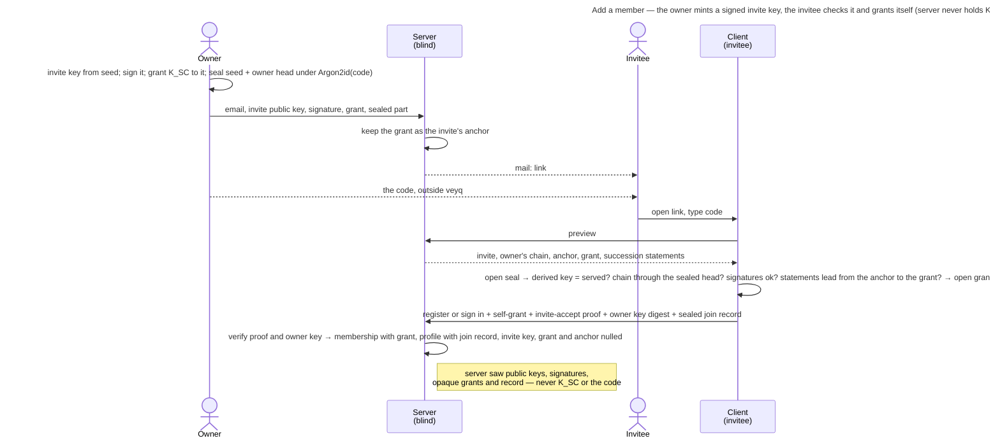

# UC: Add a member to the shared Tenant space

- **ID:** uc.spaces.add-member
- **Primary actor:** Tenant **Owner** (invites); the **invitee** (joins with the code the owner passed on, or from a
  link that carries it).
- **Goal:** give another person access to the shared **Tenant** space — the owner invites them, and the invitee
  joins holding the tenant key at once, with nobody else's device involved, operator-blind
  ([ADR 0111](../../../decisions/0111-an-invitee-grants-itself-a-rotator-re-keys-its-own-scopes-and-a-key-chain-anchors-trust.md)
  decisions 1–3).
- **Preconditions:** The owner holds the TENANT grant (born cold at activation, [ADR 0006](../../../decisions/0006-cold-tenant-scope-birth.md))
  and invites from an **unlocked vault**: the invite holds a grant of the tenant's current epoch key, which only a
  key-holder can wrap. The tenant can send mail ([ADR 0055](../../../decisions/0055-mail-is-a-precondition-not-a-capability.md)),
  for either way ([ADR 0129](../../../decisions/0129-a-member-invite-is-mailed-or-handed-over-as-a-link.md) decision 3), and the owner has a way outside veyq to pass the invitee a code, or the
  link itself (a message, their own mail, in person).
- **Postconditions (success):** The invited person is a **member** of the tenant holding a **TENANT grant** they
  wrapped to their own identity, and a **join record** in their tenant profile — so they open the shared space at
  once. The server saw the invite's public key, the owner's signature over it, opaque grant ciphertext and the
  sealed join record — never the scope key, the invite's private key or the code, and of a link invite (A5) not the
  sealed part either.

This use-case is the tenant consumer of the grant-distribution primitive
([ADR 0020](../../../decisions/0020-grant-distribution-invite-wrap.md)); a group add wraps directly instead
([uc.spaces.add-group-member](uc.spaces.add-group-member.md)).

## Main flow

1. The owner opens **Invite member**, chooses **Invite by email** (the dialog opens on **Share a link**, A5) and enters
   the person's **email**. Their client makes the invite a
   **placeholder member** ([ADR 0111](../../../decisions/0111-an-invitee-grants-itself-a-rotator-re-keys-its-own-scopes-and-a-key-chain-anchors-trust.md)
   decision 1): it mints an **invite key** from a fresh 32-byte seed, **signs** its public half with the owner's
   identity (statement `invite-key` over tenant, invite, the key's hash and the expiry, which is the instance's
   invite lifetime `MyTenant.memberInviteTtlSeconds` from now), **wraps the tenant's current epoch key** to it (a
   grant whose recipient is the invite id), and **seals** the seed, the owner's **key-chain head** and the owner's
   account under `Argon2id(code)` — the link's secret part (`invite-link` v2). The **code** is 10 Crockford base32 characters, minted
   on the owner's device and shown once with a copy button; the owner may type a **password** instead (at least
   the account password's length floor). The link is always sealed: the server mails it, so an unsealed link would
   hand the operator the invite.
2. The server checks the grant is of the **current** epoch under the tenant's lock (`409 stale_epoch`), that it
   names the invite key it stores beside it (`409 recipient_key_not_current`), and that the signed expiry is its
   own lifetime within a minute (`422 invite_expiry_invalid`), as the owner's signature over the invite key is its
   caller's (`422 invite_signature_invalid`); it stores the public key, the signature, the signer's key as it signed and
   the grant on the invite row — the grant a second time as the invite's **anchor** (ADR 0111 decision 19) — mints the **single-use** token (hashed), and **mails** `…/tenant/accept#<token>.<sealed>`
   to the address — keeping no copy of the sealed part. This operation's only channel is mail: its response carries
   no secret ([ADR 0055](../../../decisions/0055-mail-is-a-precondition-not-a-capability.md)). A tenant with no
   sendable mail settings is **refused** (`503 mail_unavailable`) before anything is minted.
3. The owner passes the **code** on themselves, never by email.
4. The invitee opens the link and types the code. The preview serves the invite with the owner's whole key chain,
   the anchor grant and the tenant's succession statements above the anchor's epoch. Their client opens the seal and **checks
   the invite before it sends anything** (`checkInvite`, ADR 0111 decision 19): the key the seed derives must be the
   served invite key and the seal's signer the served one; the owner's chain must pass through the head inside the
   seal and end at the served owner key; the owner's signatures over the invite key and over the anchor grant must
   verify under that key; and the grant it is handed must be the anchor, or carry a key the served succession
   statements lead to from the anchor key's succession public key (ADR 0115 decision 5). An existing account also judges the owner against its pin with that chain. It then opens
   the grant with the invite key. A wrong code is the invitee's to retype; a failed check is "This invite can't be
   checked — ask for a new one", and nothing is sent.
5. The invitee **registers** (identity born cold on-device, the Emergency Kit issued) or, with an account already, signs in with their Secret Key. Their client **grants itself** the tenant key — a
   grant sealed to its own identity, naming that key's digest — signs the `invite-accept` proof with the invite key,
   and writes the **join record**: its identity and Secret-Key proof public keys and the owner-signed invite,
   signed by the invite key **and** the new identity, sealed under the tenant key (field `member-join-record`,
   bound to tenant and member). The accept names the owner key that record carries (`signerIdentityDigest`). The
   optional name and picture are sealed under the same key at join.
6. The server verifies the proof under the stored invite key (`403 invite_proof_invalid`) and that the named owner
   key is still the invite's (`409 invite_changed`, E4), writes the MEMBER membership **with** the self-grant and the
   profile with its join record and the owner who rooted it, and consumes the invite, nulling its key, grant and
   anchor in the same statement. The newcomer is in the shared space at once
   ([uc.spaces.switch-spaces](uc.spaces.switch-spaces.md)).

## Alternate / exception flows

- **A1 — the invitee already has an account on this instance:** they **sign in** with password and Secret Key and
  accept; the join record names the proof key their Secret Key derives. *(The existing-member, by-username variant
  is [uc.spaces.add-group-member](uc.spaces.add-group-member.md).)*
- **A2 — a rotation of the tenant meets an open invite:** the rotator re-grants the new epoch to every open invite
  whose owner signature verifies and whose signer passes its anchor check, and declares the rest **pending**; the
  server refuses a rotation that does neither for an open invite (`409 rotation_incomplete`) and ignores an id that
  names no open invite. The anchor moves to the new epoch only when the invite's signer commits the rotation under
  the invite's signer key; any other rotation leaves the owner's grant as the anchor. Every member reads the open
  invites' keys for this (`listOpenInvites`, no email). A pending invite's newcomer holds only a key the rotation
  replaced: its join record sealed under it is refused (`409 stale_epoch`, nothing born), so the invite is redeemable
  once it carries the current epoch ([ADR 0115](../../../decisions/0115-a-scope-key-is-replaced-never-chained.md)
  decision 8).
- **A3 — a grant a rotation re-wrapped:** it names that rotator, not the inviting owner, as its granter. The
  newcomer neither anchors nor pins that member: the grant counts because the served succession statements lead from
  the owner's anchor to its key, which the operator cannot fake without the anchor's key (ADR 0111 decision 19,
  ADR 0115 decision 5). A
  rotator this account already pinned is still judged against its pin.
- **A4 — the owner secured their account after inviting:** their securing re-signed the open invite with the new
  identity ([uc.account.rotate-keys](../../account/use-cases/uc.account.rotate-keys.md) E3), and the newcomer reaches
  that key through the owner's chain from the head in the link — the step signed by the old identity **and** the old
  Secret-Key proof key. The invite keeps working; anything the owner's retired key signs is refused.
- **A5 — the owner shares a link instead** ([ADR 0129](../../../decisions/0129-a-member-invite-is-mailed-or-handed-over-as-a-link.md) decisions 1, 2 and 6). **Share a link**, the dialog's first
  way, asks for no address. The client builds the invite as in step 1, always under a generated code, and posts it
  without address or sealed part (`createMemberInviteLink`); the server runs step 2's checks, mail as a precondition
  and the tenant's invite budget, sends **nothing**, and answers the single-use token to this owner only. The client
  writes `…/tenant/accept#<token>.<sealed>.<code>` on its own origin and shows it once inside an editable message (the
  space's name, the link, its expiry, "works once"), to copy, hand to the system share sheet where the browser has one,
  or open in the owner's mail program, beside the warning that whoever has the link can join. Several link invites may
  be open at once, and a mailed invite supersedes none of them. The link opens without a code prompt and the page
  strips its fragment; steps 4–6 follow, with three differences: a new account **types its address**, which starts
  unconfirmed and is sent its confirmation mail at once (the client signs in with the password it already holds and
  asks once; a failure there is not the join's,
  [uc.account.confirm-email-address](../../account/use-cases/uc.account.confirm-email-address.md)); **any** account of
  the instance may sign in instead, its address confirmation left as it was; and an account already a member is
  refused `409 already_member`, decided under the tenant's lock before the invite is spent, so the link stays good for
  the one it was meant for. A register that sends an address for a mailed invite, or none for a link one, is
  `422 invite_kind_email_mismatch`.
- **E1 — the invite is expired, revoked or already consumed:** a failure that points at whoever invited; the token
  is single-use, and an ended invite holds no key and no grant. A consumed one says so (`410 invite_redeemed`, "already
  been used — tell whoever invited you"), apart from a revoked or expired one (`410 invite_no_longer_valid`), so a
  link someone else took first is noticed — detection, not prevention; a suspended tenant's invites all answer
  `invite_no_longer_valid`. The preview tells them apart until the terminal-invite purge drops the row.
- **E2 — the operator against the invite:** it mails a mailed invite's link, so it holds the sealed part and may guess offline —
  against a 50-bit code behind Argon2id at the production profile. It cannot swap the owner's key or the invite key,
  because the owner's head sits inside the seal and the invitee derives the invite key itself, nor hand the newcomer
  a tenant key of its own, which links to no anchor. A password the owner chose is only as strong as that password.
  Self-hosted makes it moot. What it can still do is ADR 0111 § What stays open's: with a party that held the
  anchor's epoch, plant a later one for an invite someone other than the owner carried; with a thief of the owner's
  retired key, withhold the owner's securing step from a new account, whose join record then reads as an anomaly to
  every co-member. A link invite's sealed part and code never reach it, which leaves it nothing to guess; the link is
  a bearer credential in the channel the owner chose instead (ADR 0129 § Consequences).
- **E3 — the member's grant won't unwrap** (corrupt / identity rotated without re-wrap): the member can't open
  the tenant → surfaced as an error; the scope row is **not** self-deleted (a blind operator must not force a
  wipe), matching [en.spaces.tenant-scope](../enablers/en.spaces.tenant-scope.md) E3.
- **E4 — the owner secured their account between the check and the accept:** the server refuses the accept with
  `409 invite_changed`, because the owner key the join record names is no longer the invite's. The client re-reads
  the preview and re-runs the checks once with the invite key and the link facts it kept — no code asked for again —
  and accepts with the record naming the new key; a second refusal, or a re-read that no longer checks, is "ask for a
  new one". So no join record lands naming a key the owner's securing retired.

## Quality notes

- **Operator-blind.** The server stores the invite's public key, the owner's signature and the signer's key as it
  signed, opaque grants (the anchor among them), the sealed join record and who rooted it. The invite's private key
  and the code never reach it; the sealed part of a mailed link is mailed and dropped, a link invite's never sent.
- **Member identity ([en.spaces.member-identity](../enablers/en.spaces.member-identity.md), cr-0083).** Each
  member shows a per-tenant **`username`** (plaintext handle, chosen at join, unique in the tenant) and their
  **real name sealed under a field key derived from its own value key, whose wrap `K_tenant` holds** — decrypted on-device by any member, never seen by the server;
  **`email` is owner-only** ([ADR 0023](../../../decisions/0023-per-tenant-member-identity.md)).
- **Auth ≠ content.** Onboarding makes someone a *member* (a role); only the identity-unwrapped grant yields the
  key ([ADR 0007](../../../decisions/0007-membership-role-grant-relation.md)). Every membership is now born with
  its grant.
- **The owner is the trust root.** The owner's signature on the invite key and the invite key's signature on the
  join record chain **owner → invite → newcomer**, and every member's client reads the join record as the anchor of
  the newcomer's key in the tenant; the tenant's first owner has none. When the owner secures their account, they
  endorse each record they rooted with the new key, without which a record their retired key signed counts nowhere
  ([ADR 0111](../../../decisions/0111-an-invitee-grants-itself-a-rotator-re-keys-its-own-scopes-and-a-key-chain-anchors-trust.md)
  decisions 3, 12, 15 and 21).
- **A session alone mints no invite.** The server verifies the invite key's `invite-key` signature under the
  caller's stored identity key before it mints or re-issues (`TenantHandler.signedByCaller`, `400 invalid_request`,
  also for a signed expiry with a fraction of a second), so a session without the owner's unlocked vault — a phished
  password — creates no invite any client would carry or deliver to: the role the admission tag played, on an honest
  server.
- **A membership the operator writes is not wrapped to — unless it writes an owner.** A non-owner without a join
  record is an anomaly to every wrap a member's client makes in the tenant; an owner without one is a root, trusted on
  first use, because roles are the server's word ([security-model](../../../crosscutting/security-model.md) § Key-directory
  trust).
- **Inviting is owner-only.** Only a tenant OWNER mints, re-issues or revokes a member invite (`403
  not_tenant_owner`); a member never hands the key to someone the owner did not invite.
- **Delivery result, never silent (cr-email-invite-send-hardening).** The mailed mint reports how the invite went
  (a link mint sends nothing and reports no delivery). On a mailed member invite only **SENT** is reachable: no sendable mailer is refused up front, and a send that errors is
  `503 mail_send_failed` with the invite **revoked again** — there is no copy-link to hand a survivor to, so a
  live token nobody can reach would be worse than no invite ([ADR 0055](../../../decisions/0055-mail-is-a-precondition-not-a-capability.md) §6).
  A failed **re-issue** therefore leaves the invitee with no live invite at all, since the supersede already
  happened; the owner retries. The send runs **after the mint transaction commits** (a hung SMTP server can't
  hold a DB connection), so the undo is a compensation rather than a rollback, and the result is request-scoped
  and **never persisted** — no new operator-visible metadata
  ([ADR 0049](../../../decisions/0049-email-delivery-boundary.md)).
- **What the owner waits for (inbox #566, #631).** The one slow step is the code's Argon2id at the production profile,
  about 0.8 s, so the dialog mints the code and starts that derivation as it opens, while the owner types the address.
  Measured live on 2026-10-29 (headless Chrome 156 against a fast-jar, the dev Mailpit as SMTP behind a timing tap, a
  1-minute load of 3.2–3.6, six invites each way): sent at once, the send took 0.80–0.85 s to the code shown (1.6 s for a
  session's first, its worker cold), nearly all of it the rest of the derivation; sent three seconds after the dialog
  opened, 77–117 ms (median 91). Of those, the tenant list, the owner's key chain and the scopes take about 10–15 ms
  each, one after another (no granter key anchor: the owner's grant is its own), and the POST 34–63 ms on the server,
  of which about 30 ms are the checks and the mint and 13–17 ms the SMTP session. So the mail hand-off is no share
  worth moving, and it stays inside the request: its answer is what ADR 0055 § 6 needs to revoke an undelivered
  invite. A remote SMTP server adds its own round trips to that step, which the dialog's "sending" line names.
- **Anti-bombing rate limit (cr-email-invite-send-hardening).** Once mail is a real channel, repeated invites to
  one address are **rate-limited** — per-(tenant, recipient) as the primary guard and per-tenant as a volume cap
  (429 + `Retry-After`, no invite minted). It is enforced in the handler on the tenant-owner member paths (the
  per-IP auth limiter can't key on a recipient); the re-issue loop against one address is the sharpest vector. A link
  mint or re-issue has no recipient and spends the per-tenant bucket alone.
- **Additive only.** This use-case only **adds** a member. Removal is
  [uc.spaces.remove-tenant-member](uc.spaces.remove-tenant-member.md); revoking an open invite is
  [uc.spaces.manage-member-invites](uc.spaces.manage-member-invites.md).

## User impact

You let someone into your shared space with a link you hand over yourself, or with an email invitation and a code
you pass on, and they are in at once, so the server never holds what opens the invitation.

## Related

- Model: [keys, grants and trust](../../../crosscutting/keys-grants-and-trust.md) (grants and the invite)
- Feature: [Spaces (scopes)](../_index.md)
- Enablers: [en.spaces.tenant-scope](../enablers/en.spaces.tenant-scope.md) (the shared space this adds members
  to), [en.spaces.member-identity](../enablers/en.spaces.member-identity.md) (the profile the join record lives in),
  [en.spaces.scope-key-rotation](../enablers/en.spaces.scope-key-rotation.md) (how a rotation carries open invites)
- Decisions: [ADR 0111](../../../decisions/0111-an-invitee-grants-itself-a-rotator-re-keys-its-own-scopes-and-a-key-chain-anchors-trust.md)
  (the invite as a placeholder member, the self-grant and the join record), [ADR 0020](../../../decisions/0020-grant-distribution-invite-wrap.md)
  (grant distribution), [ADR 0007](../../../decisions/0007-membership-role-grant-relation.md) (role vs. grant),
  [ADR 0006](../../../decisions/0006-cold-tenant-scope-birth.md) (the owner's cold-born grant),
  [ADR 0055](../../../decisions/0055-mail-is-a-precondition-not-a-capability.md) (mail as a precondition),
  [ADR 0129](../../../decisions/0129-a-member-invite-is-mailed-or-handed-over-as-a-link.md) (the two ways: mailed, or a link the owner hands over)
- Sibling use-case: [uc.spaces.switch-spaces](uc.spaces.switch-spaces.md) (the member switches Personal ↔ Tenant),
  [uc.spaces.manage-member-invites](uc.spaces.manage-member-invites.md) (re-issue and revoke),
  [uc.admin.create-tenant](../../admin/use-cases/uc.admin.create-tenant.md) (the owner invite this member invite extends)
- Concept: [Scopes & Tenancy](../../../crosscutting/scopes-and-tenancy.md), [Security Model → key-directory
  trust](../../../crosscutting/security-model.md)
- End-user view (docs site): [Who gets into your space](../../../../site/src/content/docs/space-owners/who-gets-into-your-space.mdx)
- Security area of the docs site: [Protocols](../../../../site/src/content/docs/security/protocols.mdx)
- End-user view (docs site): [Accept an invitation](../../../../site/src/content/docs/getting-started/accept-an-invitation.mdx)
