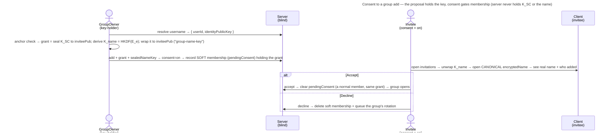

# UC: Consent before being added to a group

- **ID:** uc.spaces.consent-group-add
- **Primary actor:** **the invited member** (accepts or declines) — with the **GroupOwner** as the trigger (adds a
  consent-required member) and **any account holder** as the one who set the preference.
- **Goal:** let a person **opt in to being asked first** — so a GroupOwner cannot silently drop them into a group.
  When the toggle is on, an add becomes a **proposal** the person **accepts or declines**; the group is listed to
  them, and opens, **only after acceptance**.
- **Preconditions:** The target is **already a tenant member** with a published identity public key
  ([en.spaces.member-identity](../enablers/en.spaces.member-identity.md)). The target has turned **"ask before
  adding me to groups"** on (an **account-global** preference, default **off**). The GroupOwner holds the group
  grant (so their device can derive the group's name-key `K_name` and wrap it to the invitee).
- **Postconditions (success on Accept):** the proposal becomes a normal membership holding the grant it already
  held, and the group opens for them at once. On **Decline**: the soft membership is dropped with no trace kept,
  and — because it held the group key — the group's **rotation is queued**. Operator-blind throughout: the server
  saw a membership row, identity public keys, and opaque ciphertext (the grant, the wrapped name-key and the
  already-stored canonical name it opens) — never `K_SC`, and never the plaintext name.

This use-case realizes the **optional consent opt-in** of [ADR 0014](../../../decisions/0014-group-scopes-and-governance.md) §5,
with the invitee's name-preview mechanism defined by [ADR 0027](../../../decisions/0027-group-invite-name-shared-key.md).
Since [ADR 0111](../../../decisions/0111-an-invitee-grants-itself-a-rotator-re-keys-its-own-scopes-and-a-key-chain-anchors-trust.md) decision 4 the proposal **holds the group's grant from the add
on**, like a direct add: consent gates **membership** — the listing and every group operation — not the key, and
taking a proposal back rotates the group as a removal does. It builds directly on
[uc.spaces.add-group-member](uc.spaces.add-group-member.md) (the default direct-add) — the only additions are the
**soft membership**, a **wrapped name-key** that lets the invitee read the group's **canonical** name (not an
owner-typed claim), and the **accept/decline** step.

## Main flow

1. **The preference (account-global).** A person turns on **"ask before adding me to groups"** — one setting on
   their account, applying in **every** tenant they belong to. It is a low-sensitivity server-visible boolean
   (operational metadata, like other account settings): the operator learns *that* someone likes to be asked,
   never any key or content. Default **off** → the direct-add of [uc.spaces.add-group-member](uc.spaces.add-group-member.md).
2. **The owner adds (a proposal).** The GroupOwner resolves the target by **username** exactly as in direct-add
   and picks them; their client wraps the group's current epoch key to the target after the anchor check, as a direct
   add does. The server sees the preference is **on**, so it records a **soft membership** (`pendingConsent`) —
   *proposed*, not yet a member — **holding that grant**. A rotation of the group re-grants a pending proposal like
   any member, so an accept never opens onto a key the group already left.
3. **The wrapped name-key.** The owner's device — a key-holder — derives the group's **name-key**
   `K_name = HKDF(E_e, "group-name-key")` from the key of the epoch the name was sealed under, and wraps **the key
   bytes** (not a name copy) to the invitee's identity: `sealTo` to the invitee's X-Wing identity key under the `group-name-key` purpose,
   posted as the proposal's `sealedNameKey`. The server returns the scope's **canonical** `encryptedName` in the
   invitation. Handing the *key* — not a name — is the crux of [ADR 0027](../../../decisions/0027-group-invite-name-shared-key.md):
   the invitee opens the **same** ciphertext the members hold, so a modified owner **cannot** privately show a
   divergent name. `K_name` is one-way from `E_e` (HKDF), so it leaks the name and nothing else — not `E_e`, not `K_SC`.
4. **The invitee decides.** In a **group-invitations** view — reached from an **appears-on-demand attention badge**
   in the top bar (beside the upload-queue tray; rendered only while at least one proposal is open) — the invitee
   unwraps `sealedNameKey` with their own identity private key → `K_name`, decrypts the canonical `encryptedName`
   under it, and sees **the group's (group-consistent) name + who added them** (the owner's per-tenant username,
   already visible to them) + the tenant.
   - **Accept** → the server clears `pendingConsent`; the proposal is now a normal membership with the grant it
     already held — consenting changes nothing about keys — and the group opens for them at once. From here it is
     identical to direct-add step 4. The accept is decided under the group's lock, the one a decline, an add and a
     tenant removal take, and asks under it whether the proposal is still there (inbox #599).
   - **Decline** → the server **deletes** the soft membership and, in the same transaction under the scope's lock,
     **queues the group's rotation** (the invitee held the key). No `declined` state is kept (silent drop). The
     owner may propose again later.
5. **Rescind (owner).** Before acceptance the owner may withdraw the proposal — the same delete, which queues the
   group's rotation too. After acceptance the person is a real member and leaves via the normal remove path
   ([uc.spaces.manage-group-members](uc.spaces.manage-group-members.md)).

## Alternate / exception flows

- **A1 — the target has consent OFF (the default):** there is no proposal step — the add is the immediate
  direct-add of [uc.spaces.add-group-member](uc.spaces.add-group-member.md). This use-case does not apply.
- **A2 — already a member (or already proposed):** picking them is a **no-op** (idempotent) — a live membership
  or an open proposal already exists; no duplicate.
- **A3 — the invitee is offline / never responds:** the proposal simply **stays pending** — not an error. It holds
  the key, and every rotation re-grants it; the owner may rescind (which queues the group's rotation). There is no
  auto-expiry by time in v1 (a deferred polish).
- **A3b — the group's only accepted owner leaves the tenant.** Every open proposal on the group **expires**: the row is
  deleted, the invitation is gone (an accept answers `404 invitation_not_found`, a decline is the usual silent no-op).
  A proposal is never handed the group. If accepted members remain, the oldest is promoted and the group's queued
  rotation takes the proposals' key away with the departed owner's; if none remains, the group is tombstoned and
  nothing rotates ([uc.spaces.remove-tenant-member](uc.spaces.remove-tenant-member.md) step 4). An invitee removed
  from the tenant loses their own proposal as a decline would (its A7). An accept that overlaps either removal waits on
  the group's lock the removal holds and then answers `404 invitation_not_found` — never a member of a group the removal
  tombstoned, nor of one in a tenant that removed them.
- **A3a — a proposed member is not a member yet, on any route.** Until they accept, the invitee reads and
  answers their own invitation and nothing of the group: every group operation — content, media, favorites,
  shares, roster, jobs — answers them exactly as it answers a stranger (the same 404,
  [scope-access](uc.spaces.scope-access.md)). That gate, not the key, is what keeps a proposal out: the proposal
  holds the grant, but the server serves it nothing of the group.
- **A4 — re-invite after a decline:** allowed. The decline left no `declined` marker (silent drop), so a fresh
  proposal is just a new soft membership holding a fresh grant. (The cost, accepted: an owner could re-propose repeatedly — a
  rate-limit/mute is a deferred polish, not a v1 gate.)
- **E1 — the username doesn't resolve in this tenant:** a generic *not-found*, tenant-scoped resolve — identical
  to direct-add E1.
- **E2 — key-substitution by a malicious operator:** the grant and the name-key wrap both go to the pubkey
  the server returns, consistent with direct-add E2 and the shared primitive. Consent gates the *human's*
  agreement, not key authenticity; that is governed by [ADR 0028](../../../decisions/0028-identity-authenticity-tofu-verification.md)
  (**TOFU-pin** on first use, a **changed** key surfaced/refused, out-of-band **safety-number verification** via
  [uc.spaces.enforce-verified-identities](uc.spaces.enforce-verified-identities.md), opt-in strict); the
  anchor check runs before both wraps, strict mode is not built ([security-model](../../../crosscutting/security-model.md)).
  Note ADR 0027 closes a **different** attack — a *modified-owner* private name-lie — orthogonal to this
  operator-key seam.

## Quality notes

- **Consent gates membership; a taken-back key rotates the group.** The proposal holds `K_SC` from the add on
  ([ADR 0111](../../../decisions/0111-an-invitee-grants-itself-a-rotator-re-keys-its-own-scopes-and-a-key-chain-anchors-trust.md) decision 4), so declining or rescinding cannot un-give it — which is
  why both queue the group's rotation, as a removal does: what the group writes after that rotation is out of the
  declined key's reach. Before it, the invitee could read the group's current epoch only with a dump of the
  ciphertext, since the server serves a proposal nothing of the group (A3a). This replaces the consent-first rule
  of [ADR 0014](../../../decisions/0014-group-scopes-and-governance.md) §5, under which delivery skipped a soft
  membership until accept and an accepted member then waited for a key-holder's device.
- **Operator-blind — no new leak beyond direct-add.** The server stores a membership row (`pendingConsent`) with
  its opaque grant + one opaque wrapped name-key, and relays identity public keys + the already-stored canonical `encryptedName` to the
  invitee. It already stores membership rows + sealed names for direct-add; the plaintext name and `K_SC` never
  appear, and the name-key it relays is one it cannot use. The **consent boolean is account-global and
  server-visible** — a deliberate, honest exception: a GroupOwner attempting an add learns *that* the person wants
  to be asked (the add returns "proposal sent" instead of "added"). Low-sensitivity operational metadata, no key
  or content — the standing trade for a one-setting preference over a per-tenant one.
- **Pending is owner-visible only.** A `pendingConsent` invitee shows in the group's member directory as *invited
  — awaiting consent* to **owners** only; ordinary members see them only once they accept. The invitee's own
  invitations view is theirs alone.
- **The invitee's attention badge is a client-derived, self-clearing count — no new server signal, no read-state.**
  The top-bar badge counts the invitee's open proposals from the **same** `listMyGroupInvitations` the view already
  fetches; the blind server holds those `pendingConsent` rows regardless, so surfacing a count adds nothing it does
  not already see. Accept/Decline removes the row, so the count falls on its own — there is **no read/unread state**
  to persist (no per-user engagement metadata, no store beyond what consent already needs). It is deliberately a
  single-signal badge, **not** a persistent notifications hub: a multi-source hub, a server-persisted read-state, and
  folding the terms-acceptance gate ([uc.account.accept-terms](../../account/use-cases/uc.account.accept-terms.md),
  a hard router gate) into it are all out of scope — each would add a store or server-visible metadata this
  presentation surface does not need.
- **Accept is one flag; taking back costs a rotation.** Accept flips one flag and moves no key. Decline / Rescind
  delete one row and queue the group's rotation in the same transaction; the rotation runs when an owner's device
  completes it ([uc.spaces.complete-queued-rotation](uc.spaces.complete-queued-rotation.md)).
- **Consent is an honest-operator gate on every tier ([ADR 0026](../../../decisions/0026-client-trust-tiers.md)).**
  The proposal holds the key, and *soft* is the server's `pendingConsent` flag: an active operator can clear it or
  serve the invitee the group's ciphertext, even on a client it does not serve. Consent protects a person from
  being placed in a group against their will, not from holding its key.

## User impact

You can choose to be asked before anyone adds you to a group, so you see which group and who invited you, and the
group shows up for you only once you accept.

## Related

- Feature: [Spaces (scopes)](../_index.md)
- Use-cases: [uc.spaces.add-group-member](uc.spaces.add-group-member.md) (the default direct-add this gates),
  [uc.spaces.manage-group-members](uc.spaces.manage-group-members.md) (how an accepted member later leaves)
- Enablers: [en.spaces.group-scope](../enablers/en.spaces.group-scope.md) (the group + its sealed name),
  [en.spaces.member-identity](../enablers/en.spaces.member-identity.md) (the identity pubkey the name-key is wrapped to)
- Decisions: [ADR 0027](../../../decisions/0027-group-invite-name-shared-key.md) (the derived name-key the invitee
  reads the canonical name with — supersedes the one-off seal), [ADR 0014](../../../decisions/0014-group-scopes-and-governance.md)
  §5 (the consent opt-in), [ADR 0111](../../../decisions/0111-an-invitee-grants-itself-a-rotator-re-keys-its-own-scopes-and-a-key-chain-anchors-trust.md) decision 4 (the proposal holds the grant),
  [ADR 0020](../../../decisions/0020-grant-distribution-invite-wrap.md) (the grant-wrap), [ADR 0023](../../../decisions/0023-per-tenant-member-identity.md) (per-tenant username),
  [ADR 0026](../../../decisions/0026-client-trust-tiers.md) (the client trust tier the consent guarantee rides on)
- End-user view (docs site): [Accept a group invitation](../../../../site/src/content/docs/spaces/group-invitations.mdx)
