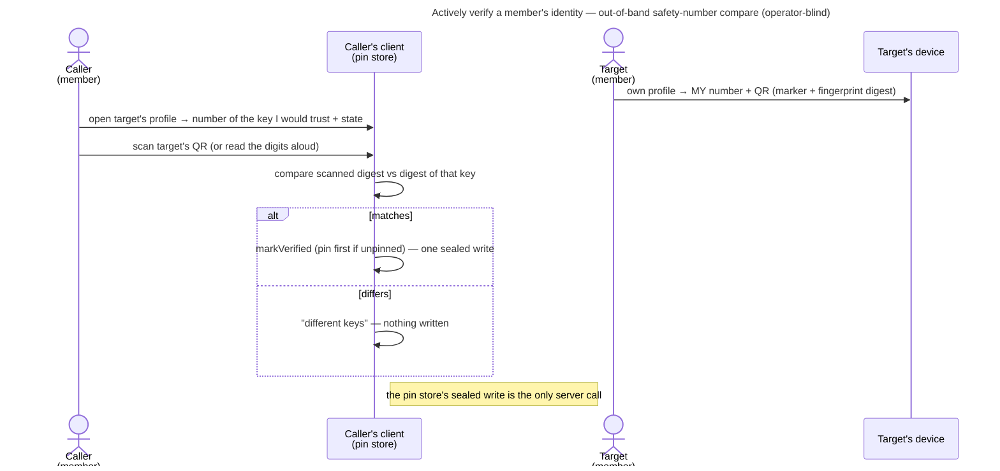

# UC: Actively verify a member's identity (safety number)

- **ID:** uc.spaces.enforce-verified-identities
- **Primary actor:** **a member** proactively confirming another member's identity key; the other member shows
  their own safety number on their own device.
- **Goal:** confirm out-of-band that a member's identity public key is really theirs — elevate the pin to
  **verified** — and see who is verified wherever members are listed. This is the proactive half of
  [ADR 0028](../../../decisions/0028-identity-authenticity-tofu-verification.md) (Decision 3); the
  passive half — pin on first sight, notice and review a changed key — is
  [uc.spaces.verify-identity](uc.spaces.verify-identity.md), which this use-case builds on rather than repeats.
  *Requiring* verification before sharing (strict mode) is
  [uc.spaces.require-verified-identities](uc.spaces.require-verified-identities.md), still open. (The id predates
  that split; it names this ceremony now.)
- **Preconditions:** an **authenticated, unlocked** caller; the target is a current member of the tenant (the
  tenant's member directory lists them and their identity key). A pin is not required: verifying an unpinned
  member pins them with the confirmed key (ADR 0028 Decision 3).
- **Status:** **built** (cr-identity-verification, web). Seen in a real browser on 2026-10-14 (a freshly
  seeded two-member tenant): the owner's own profile showed "Your safety number" with its QR; the member's profile showed
  "Not verified" and 6x5 digits equal to the number computed independently from the member's stored identity key (the
  crypto package's `fingerprint` over the database's `identity_public_key`); "Compare digits" → "They match" turned it
  "Verified" with "… is verified on this account", the tenant's member list showed "Verified", and both survived a full
  reload. Not exercised in the browser: the camera scan, "They don't match", a verified contact's key change.
- **Postconditions (success):** the target's pin is **verified**, on the key the compare confirmed; the profile and
  the tenant's and groups' member lists say "Verified". Operator-blind throughout: the only server call is the pin
  store's sealed write, so the operator never learns who verified whom.

## Main flow

0. **Show mine.** On their own profile page (`#people/<own id>`) every member sees **their own** safety number
   (6×5 digits, `safetyNumber`, the vector-pinned `fingerprint`) and a QR of it. The QR is `veyqid:1:` plus the
   base64 of the 32-byte fingerprint digest the digits are rendered from (`v1.fingerprintHash`) — never the identity
   bundle, which would void the `jsqr` exception in `web/CLAUDE.md` (53 characters, QR version 4). The number comes
   from the caller's own vault, not from the directory.
1. **Open their profile.** The caller opens a member's profile → the app shows the safety number of the key it
   would **trust** — the pin's, or the directory's when there is no pin — the state (*Not verified*, *Verified*,
   *Key changed*) and two ways to compare: **Scan their code** and **Compare digits**.
2. **Compare out-of-band.** **Scan:** the caller scans the QR on the other member's own profile; the app compares
   the scanned digest with the digest of the key it shows. **Compare digits** (A1): the number is shown large and
   the two read it aloud, then the caller answers "They match" or "They don't match".
3. **Feedback.** **Match** (a scanned code of that key, or "They match") → `markVerified` on the compared key in one
   sealed write — pinning it first, in the same write, when there was no pin (E1); the state reads *Verified* on
   the profile and in the tenant's and groups' member lists from then on. **Mismatch** (a code of a different key,
   or "They don't match") → *these are different keys, do not mark them verified*; nothing is written, and where
   the pin already differs from the directory the changed-key review is one click
   ([uc.spaces.verify-identity](uc.spaces.verify-identity.md) handles the review from there).

## Alternate / exception flows

- **A1 — no camera / can't scan:** **compare the digits** read aloud or side by side — the safety number is
  language-neutral decimal digits by design. A camera the browser refuses is said in the scanner, which points at
  this path.
- **A2 — a QR that is not a safety code** (another app's code, an Emergency Kit, a pairing code): said as such,
  never compared and never accepted; nothing is written.
- **A3 — a verified contact's key changes:** the member lists and the profile say "Verified key changed", and the
  changed-key review ([uc.spaces.verify-identity](uc.spaces.verify-identity.md)) says the contact was verified
  and that accepting does not verify the new key. Accepting re-pins as `pinned`; *Verified* returns only through a
  new compare on the profile, which then offers it again (ADR 0028 Decision 3).
- **E1 — the target has no pin yet:** the profile shows the directory's key; a match pins that key **already
  verified** in the one write. Until a compare happens, a profile view pins nothing (ADR 0028 Decision 3).
- **E2 — the key moved under the compare:** a pin of a different key appeared between the read and the write (a
  concurrent device, the delivery worker's first-use pin, an accepted change) → `IdentityMovedError`: nothing is
  written, the profile says so and shows the key the store now holds, and the compare starts over.
- **E3 — this device refuses its pin store** (ADR 0028 Decision 7): the profile says why, with the link to the
  settings hub's reset, and offers no compare.

## Quality notes

- **Operator-blind.** Verification is **client-only** — the compare runs on the device against the sealed pin; the
  write is the pin store's one opaque ciphertext, so the trust graph stays off the server
  ([en.account.identity-pinning](../../account/enablers/en.account.identity-pinning.md)).
- **It closes the first-use gap for those who compare.** TOFU cannot see a key substituted at first contact; a
  compare out-of-band can — which is why the ceremony ships without strict mode (ADR 0028 Decision 3).
- **Manual, so it protects those who do it.** Verification is optional trust elevation; requiring it is
  [uc.spaces.require-verified-identities](uc.spaces.require-verified-identities.md). Stated, not oversold.
- **Tier-consistent ([ADR 0026](../../../decisions/0026-client-trust-tiers.md)).** Holds against an active
  operator only on a client it does not serve, once the pin store cannot be rolled back
  ([ADR 0028](../../../decisions/0028-identity-authenticity-tofu-verification.md) Decision 7); honest-operator on
  operator-served web.

## What this means for you / Was das für dich bedeutet

**EN —** To be sure someone really is who they say, open their profile and compare your **safety number** for them
with the one they see on their own profile — scan the code on their screen, or read the digits to each other. If it
matches, they are marked **"Verified"**, on their profile and in every member list. If it doesn't, the app tells
you not to trust that key. If a verified person's key ever changes, the app says so more loudly, and you compare
again before they are verified once more.

**DE —** Um sicher zu sein, dass jemand wirklich die Person ist, die sie vorgibt zu sein, öffne ihr Profil und
vergleiche deine **Sicherheitsnummer** für sie mit der, die sie in ihrem eigenen Profil sieht — scanne den Code auf
ihrem Bildschirm oder lest euch die Ziffern vor. Stimmt sie überein, wird die Person als **„Verifiziert"** markiert,
im Profil und in jeder Mitgliederliste. Stimmt sie nicht, sagt dir die App, dass du diesem Schlüssel nicht trauen
sollst. Ändert sich der Schlüssel einer verifizierten Person einmal, sagt die App das deutlicher, und ihr vergleicht
erneut, bevor sie wieder verifiziert ist.

## Related

- Feature: [Spaces (scopes)](../_index.md)
- Enablers: [en.account.identity-pinning](../../account/enablers/en.account.identity-pinning.md) (the sealed pin
  store + `markVerified`/`safetyNumber` this ceremony drives)
- Use-cases: [uc.spaces.verify-identity](uc.spaces.verify-identity.md) (the passive half this builds on — pin on
  first sight, notice and review a changed key), [uc.spaces.require-verified-identities](uc.spaces.require-verified-identities.md)
  (strict mode, which would require this), [uc.memory.participants](../../memory/use-cases/uc.memory.participants.md)
  (the profile page this lives on)
- Decisions: [ADR 0028](../../../decisions/0028-identity-authenticity-tofu-verification.md) (the authenticity
  model, Decision 3), [ADR 0017](../../../decisions/0017-crypto-primitives-and-post-quantum-strategy.md)
  (the fingerprint / safety number), [ADR 0026](../../../decisions/0026-client-trust-tiers.md) (the trust tier
  this rides on)
- End-user view (wiki): [Is my data safe?](../../../../wiki/en/is-my-data-safe.md)
