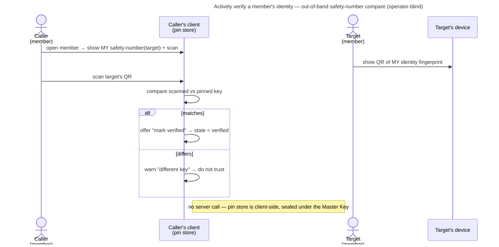

# UC: Actively verify a member and enforce it account-wide (strict mode)

- **ID:** uc.spaces.enforce-verified-identities
- **Primary actor:** **a scope member** proactively confirming another member's identity key, and — optionally —
  an account holder who wants that confirmation *required* before sharing.
- **Goal:** confirm out-of-band that a member's identity public key is really theirs — elevate the pin
  **pinned → verified** — and, for those who want it, turn on **strict mode** so an unverified member is never
  silently trusted with a share. This is the proactive half of
  [ADR 0028](../../../decisions/0028-identity-authenticity-tofu-verification.md); the passive half — pin on
  first sight, notice and review a changed key — is [uc.spaces.verify-identity](uc.spaces.verify-identity.md),
  which this use-case builds on rather than repeats.
- **Preconditions:** an **authenticated, unlocked** caller; the target appears in a scope **member directory** the
  caller can read; the caller already holds a **pin** for the target
  ([uc.spaces.verify-identity](uc.spaces.verify-identity.md) A1 — first sight already ran).
- **Postconditions (success):** the target's pin is **verified** (elevated from `pinned`); if strict mode was
  turned on, the grant-delivery worker treats every **unverified** member of the scope as *awaiting access*
  rather than delivering to them. Operator-blind throughout: the pin store is sealed under the Master Key, and
  the strict-mode setting itself never leaves the client as anything a server could key on.

## Main flow

1. **Open "Verify".** The caller opens a member → the app shows **their own** view of that member's **safety
   number** (6×5 digits) + a **scan** affordance.
2. **Compare out-of-band.** The ergonomic path is **QR**: the other person's device shows a QR of *their* identity
   fingerprint; the caller **scans it**, and the app **compares the scanned value against the pinned key**.
3. **Feedback.** **Matches** → offer "mark verified" → `state = verified`. **Differs** → warn *this is a different
   key* — do **not** trust; likely a substituted key or an un-accepted rotation
   ([uc.spaces.verify-identity](uc.spaces.verify-identity.md) handles the review from here).

## Alternate / exception flows

- **A1 — no camera / can't scan:** fall back to **reading the digit groups** aloud out-of-band and confirming they
  match — the safety-number is language-neutral decimal digits by design.
- **A2 — strict mode (account-global toggle):** with "require verification before sharing" on, an **unverified**
  member is **skipped by the grant-delivery worker** (they stay *awaiting access*) until verified here; a changed
  key is a **hard block**, not a notice (ADR 0028 §4). **Not yet buildable as a simple flag:** a per-account
  toggle cannot protect shared-scope content, since any co-member can key an unverified identity regardless of
  the caller's own setting — the mechanism has to be **scope-wide**, and that redesign is undecided. This use-case
  states the intent; the shape is open.
- **E1 — the target has no pin yet:** verification needs a pin to compare against
  ([uc.spaces.verify-identity](uc.spaces.verify-identity.md) A1 pins on first sight); until then there is nothing
  to elevate.

## Quality notes

- **Operator-blind.** Verification is **client-only** — comparing a scanned/spoken safety-number against the
  sealed pin; **no server call**, so the operator never learns who verified whom (the trust graph stays off the
  server, [en.account.identity-pinning](../../account/enablers/en.account.identity-pinning.md)).
- **Manual, so it protects those who do it.** In the default flow verification is **optional** trust elevation;
  strict mode is for those who want it enforced. Stated, not oversold.
- **Advisory noise until strict mode exists.** A per-member "verified" badge with nothing reading it is why the
  ceremony UI was deliberately not shipped alongside the pin-store primitives that back it (cr-0099) — it only
  pays for itself once something *acts* on the distinction.
- **Tier-consistent ([ADR 0026](../../../decisions/0026-client-trust-tiers.md)).** Holds against an active
  operator only on a client it does not serve, once the pin store cannot be rolled back
  ([ADR 0028](../../../decisions/0028-identity-authenticity-tofu-verification.md) Decision 7); honest-operator on
  operator-served web.

## What this means for you / Was das für dich bedeutet

**EN —** To be extra sure someone really is who they claim, you can **verify** them: hold your phones together
and scan a QR code (or read a short number aloud). Match = a green "verified"; no match = a warning not to
trust. You only do it once per person, and it works in every shared space with them. If you want it enforced,
a "require verification" setting refuses to share with anyone you haven't verified yet.

**DE —** Um ganz sicher zu sein, dass jemand wirklich ist, wer er vorgibt zu sein, kannst du ihn **verifizieren**:
Handys aneinanderhalten und einen QR-Code scannen (oder eine kurze Zahl vorlesen). Passt = ein grünes
„verifiziert"; passt nicht = eine Warnung, nicht zu vertrauen. Du machst es nur einmal pro Person, und es gilt
in jedem geteilten Raum mit ihr. Willst du es erzwingen, verweigert eine Einstellung „Verifizierung
erforderlich" das Teilen mit noch nicht verifizierten Personen.

## Related

- Feature: [Spaces (scopes)](../_index.md)
- Enablers: [en.account.identity-pinning](../../account/enablers/en.account.identity-pinning.md) (the sealed pin
  store + `markVerified`/`safetyNumber` primitives this ceremony drives)
- Use-cases: [uc.spaces.verify-identity](uc.spaces.verify-identity.md) (the passive half this builds on — pin on
  first sight, notice and review a changed key)
- Decisions: [ADR 0028](../../../decisions/0028-identity-authenticity-tofu-verification.md) (the authenticity
  model, §4 = strict mode), [ADR 0017](../../../decisions/0017-crypto-primitives-and-post-quantum-strategy.md)
  (the fingerprint / safety-number), [ADR 0026](../../../decisions/0026-client-trust-tiers.md) (the trust tier
  this rides on)
- End-user view (wiki): [Is my data safe?](../../../../wiki/en/is-my-data-safe.md)
