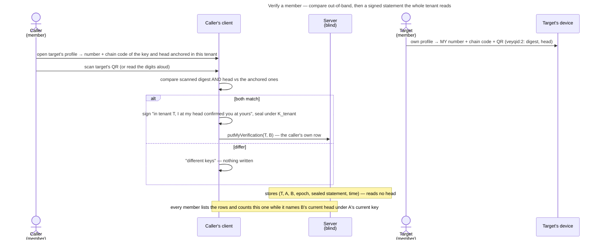

# UC: Actively verify a member's identity (safety number)

- **ID:** uc.spaces.enforce-verified-identities
- **Primary actor:** **a member** proactively confirming another member's identity key; the other member shows
  their own safety number on their own device.
- **Goal:** confirm out-of-band that a member's identity key **and** key-chain head are really theirs, and record it
  as a **verification** every member of the tenant reads — so *verified by …* counts for everyone there — and see who
  is verified wherever members are listed. This is the proactive half of
  [ADR 0028](../../../decisions/0028-identity-authenticity-tofu-verification.md) (Decision 3) and of
  [ADR 0111](../../../decisions/0111-an-invitee-grants-itself-a-rotator-re-keys-its-own-scopes-and-a-key-chain-anchors-trust.md)
  decisions 12–15; the passive half — pin on first sight, anchor by the join record, follow the key chain, surface a
  key it does not reach — is [uc.spaces.verify-identity](uc.spaces.verify-identity.md), which this use-case builds on
  rather than repeats. *Requiring* verification before sharing (strict mode) is
  [uc.spaces.require-verified-identities](uc.spaces.require-verified-identities.md), still open. (The id predates
  that split; it names this ceremony now.)
- **Preconditions:** an **authenticated, unlocked** caller; the target is a current member of the active tenant (the
  tenant's member directory lists them, their identity key and key-chain head), and this device anchors them there
  ([uc.spaces.verify-identity](uc.spaces.verify-identity.md)); a member it does not anchor offers no compare. A pin is
  not required: the anchor check pins a member seen for the first time.
- **Status:** **built** — crypto, contracts, backend and web; clicked in a real browser (2026-10-28, three members:
  two compared, the third saw *verified by*, which fell away when the verified member secured their account).
- **Postconditions (success):** the caller's signed verification of the target's current head sits in the caller's
  own row in the tenant; every member's client that anchors both counts it, so the profile reads *Verified* and
  *Verified by {names}.*, and the tenant's and groups' member lists badge *Verified*. The operator stores the row and
  cannot read it — but sees from its address that the caller verified the target, and when.

## Main flow

0. **Show mine.** On their own profile page (`#people/<own id>`) every member sees **their own** safety number
   (6×5 digits, the vector-pinned `fingerprint`), their **chain code** (10 digits, two groups of 5, of their key-chain
   head, `v1.chainCodeDigits`) and a QR of both: `veyqid:2:` plus the base64 of the 32-byte fingerprint digest and of
   the 32-byte head — never the identity bundle, which would void the `jsqr` exception in `src/web/CLAUDE.md`. The
   number comes from the caller's own vault, and the chain code only from a served chain that ends at that vault's
   identity (`myChainHead`); a chain that does not is said, with no number and no code, so a step withheld from both
   sides cannot match.
1. **Open their profile.** The caller opens a member's profile → the app shows the safety number and chain code of the
   key and head this device **anchors** in the tenant, the state (*Not verified*, or *Verified* with *Verified by
   {names}.*, the caller named as "you"; *New* beside it while this account first saw them under 14 days ago) and two
   ways to compare: **Scan their code** and **Compare digits**. A contact who secured their account also reads "New
   identity, signed by their previous key, on {date}", and one whose earlier pin the join record replaced reads "The
   key you saw before wasn't theirs. Their invitation confirms this one."
2. **Compare out-of-band.** **Scan:** the caller scans the QR on the other member's own profile; the app compares the
   scanned digest and head with the key and head it shows. **Compare digits** (A1): number and chain code are shown
   large and the two read them aloud, then the caller answers "They match" or "They don't match".
3. **Feedback.** **Match** (a scanned code of that key **and** head, or "They match") → `verifyPerson`: the caller's
   identity signs *"in this tenant, I at my head confirmed you at yours"*, sealed under the tenant's current epoch and
   written into the caller's own row (`putMyVerification`); the profile reads "{name} is verified. Everyone in this
   space sees that you verified them." **Mismatch** (a code of a different key, of the same key at another head — a
   withheld step — or "They don't match") → *these are different keys, do not mark them verified*; nothing is written.
4. **Everyone in the tenant sees it.** Every member's client lists the tenant's verifications (`listVerifications`)
   and counts one while it opens at its slot, names the subject's **current** head and verifies under the verifier's
   **current** key at the verifier's current head, the verifier anchored in the tenant (`countVerifications`). The
   profile names the verifiers; the lists badge *Verified*.

## Alternate / exception flows

- **A1 — no camera / can't scan:** **compare the digits** read aloud or side by side — safety number and chain code
  are language-neutral decimal digits by design. A camera the browser refuses is said in the scanner, which points at
  this path.
- **A2 — a QR that is not a safety code** (another app's code, an Emergency Kit, a pairing code): said as such,
  never compared and never accepted; nothing is written. A `veyqid:1` code comes from an app that shows no head: "That
  code comes from an older version of the app. Ask {name} to update their app, then scan again." Nothing is written.
- **A3 — a verified contact secures their account:** their key chain reaches the new key, so their head moves and
  every verification of the old head stops counting — *Verified* drops and returns only through a new compare, which
  then shows the new key's number and chain code beside "New identity, signed by their previous key"
  ([uc.spaces.verify-identity](uc.spaces.verify-identity.md)). A key the chain does not reach reads "Can't confirm
  this key" whether the contact was verified or not, and offers no compare and no accept.
- **A4 — the verifier secures their account:** before the publish the client collects its own verifications that
  verify under its current key at its current head, and after it re-signs each with the new identity and the new head
  over the old row ([uc.account.rotate-keys](../../account/use-cases/uc.account.rotate-keys.md); ADR 0111 decision 13).
  A row the re-signing missed (a tenant this device could not open, a lost write) stops counting; a statement the
  retired key signs afterwards counts nowhere.
- **E1 — the target is not pinned yet:** the anchor check that shows the profile pins them, through their join record
  in the tenant (or, for a root owner, on first use); a profile view of an anomaly pins nothing.
- **E2 — the key moved under the compare:** the directory serves another key or head between the read and the write
  → `IdentityMovedError`: nothing is signed, the profile says so and re-reads what the tenant anchors now, and the
  compare starts over. A key the tenant no longer anchors at the write → `IdentityUnanchoredError`: nothing is signed,
  and the profile re-reads into the anomaly.
- **E3 — this device refuses its pin store** (ADR 0028 Decision 7): the profile says why, with the link to the
  settings hub's reset, and offers no compare.

## Quality notes

- **Nobody writes another's verification.** The row is keyed by the authenticated caller, never by the body, and the
  statement is signed by the verifier's identity and bound to tenant, verifier and subject; a row moved to another
  slot neither opens nor verifies. The operator can only withhold rows — a *verified* falls away, nothing opens.
- **Operator-blind for content, not for who verified whom.** The statement is sealed under the tenant key, so the
  server reads no head and cannot tell which rows count; but a row's address (tenant, verifier, subject) and its write
  time are plaintext, so it learns who verified whom in a tenant, and when
  ([ADR 0111](../../../decisions/0111-an-invitee-grants-itself-a-rotator-re-keys-its-own-scopes-and-a-key-chain-anchors-trust.md)
  § Consequences). A member's removal deletes the rows naming them.
- **It closes the first-use gap for those who compare**, and the chain code makes a withheld step visible to them
  (ADR 0111 decision 14).
- **Manual, so it protects those who do it.** Verification is optional trust elevation; requiring it is
  [uc.spaces.require-verified-identities](uc.spaces.require-verified-identities.md). Stated, not oversold.
- **Tier-consistent ([ADR 0026](../../../decisions/0026-client-trust-tiers.md)).** Holds against an active
  operator only on a client it does not serve, once the pin store cannot be rolled back
  ([ADR 0028](../../../decisions/0028-identity-authenticity-tofu-verification.md) Decision 7); honest-operator on
  operator-served web.

## User impact

You can be sure a member really is who they say by comparing a safety number and chain code with them; everyone in
that space then sees that you verified them, and you see when someone's key no longer follows from the one you knew.

## Related

- Feature: [Spaces (scopes)](../_index.md)
- Enablers: [en.account.identity-pinning](../../account/enablers/en.account.identity-pinning.md) (the pin store and
  the anchor check the compare starts from)
- Use-cases: [uc.spaces.verify-identity](uc.spaces.verify-identity.md) (the passive half this builds on — pin on
  first sight, anchor by the join record, follow the key chain), [uc.spaces.require-verified-identities](uc.spaces.require-verified-identities.md)
  (strict mode, which would require this), [uc.account.rotate-keys](../../account/use-cases/uc.account.rotate-keys.md)
  (which re-signs the verifier's verifications), [uc.memory.participants](../../memory/use-cases/uc.memory.participants.md)
  (the profile page this lives on)
- Decisions: [ADR 0028](../../../decisions/0028-identity-authenticity-tofu-verification.md) (the authenticity
  model, Decision 3), [ADR 0111](../../../decisions/0111-an-invitee-grants-itself-a-rotator-re-keys-its-own-scopes-and-a-key-chain-anchors-trust.md)
  (decisions 12–15: the record, the re-signing, the chain code, the display),
  [ADR 0017](../../../decisions/0017-crypto-primitives-and-post-quantum-strategy.md) (the fingerprint / safety number),
  [ADR 0026](../../../decisions/0026-client-trust-tiers.md) (the trust tier this rides on)
- End-user view (docs site): [Is my data safe?](../../../../site/src/content/docs/privacy/is-my-data-safe.md)
- End-user view (docs site): [Verify a person](../../../../site/src/content/docs/account/verify-a-person.mdx)
