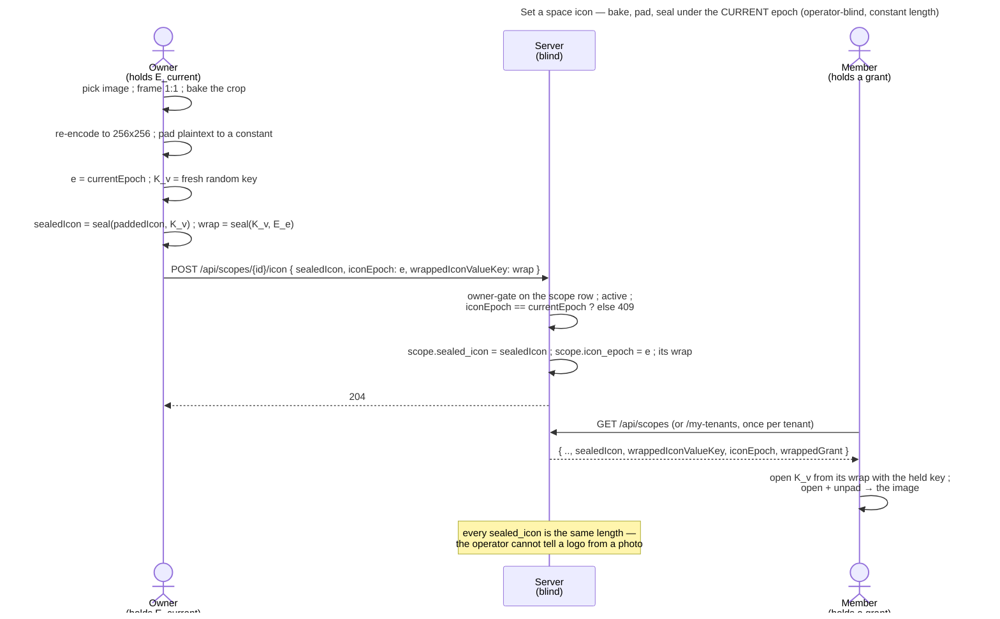

# UC: Space icon — a chosen image as a space's avatar

- **ID:** uc.spaces.set-space-icon
- **Primary actor:** the space's **OWNER** — the **TenantOwner** (`OWNER` on the tenant **root** scope,
  `scopeId == tenantId`) on a TENANT, the **GroupOwner** (incl. a promoted co-owner) on a GROUP. The owner is the space's
  **icon authority**, exactly as they are its name authority ([uc.spaces.rename-group](uc.spaces.rename-group.md)).
- **Secondary actor:** every other member — they **read** the icon; they never write it.
- **Goal:** give a space a **face** — one square image, framed on device and **sealed** so the server never
  sees it — shown wherever the space appears: the sidebar's active row and the tenant overview
  ([uc.spaces.switch-spaces](uc.spaces.switch-spaces.md)). The **initial** stays the fallback.
- **Preconditions:** an **authenticated, unlocked** `OWNER` who holds a grant at the scope's **current**
  content-key epoch (the write key). The scope is a **TENANT** or a **GROUP** — a
  **PERSONAL** scope has no icon, there being nothing to tell it apart from. It is **active**, not
  pending-deletion ([uc.spaces.delete-group](uc.spaces.delete-group.md) A4).
- **Postconditions (success):** the scope row carries `sealedIcon` — one **constant-length** ciphertext,
  whatever the source image was — and `iconEpoch` = the epoch it was sealed under. Every member holding a
  grant sees the icon on their next list; the server stored an opaque blob of a fixed size + a small integer,
  and never the image, its size, or a key.

## What a space icon is

A space icon is **one square image, deliberately chosen** — there is **no auto-icon**. A space never gets a
face from nothing; unset ⇒ the initial shows, mirroring a Memory without a cover
([uc.memory.cover](../../memory/use-cases/uc.memory.cover.md)).

Unlike a Memory cover — which stores a **reference + a normalized `0..1` crop** and re-renders it from the
referenced media — an icon stores its **own pixels**: there is no source image on the server to re-frame
against, so **the crop is baked in at save**. The consequence is stated, not hidden: an icon cannot be
re-framed later, and replacing one means picking a new file. For an avatar rendered at ~38 px that is the
right trade, and it is what keeps the icon a **field** — no `K_blob`, no blob path, no chunking; like a name,
one row, one write.

Two properties make that field safe to keep inline:

- **A fixed pixel box.** The image is re-encoded on device to a fixed square. The avatar renders at
  2.1–2.35 rem ≈ 34–38 CSS px, so **256×256** carries roughly 2× headroom for any future surface.
- **A constant plaintext length.** The encoded bytes are **padded to a constant** before sealing, so every
  `sealedIcon` in the database has the identical length — a flat two-colour logo and a dense family photo are
  indistinguishable by size. This also turns the column's size cap into an exact computed constant rather than
  an estimate (see the Quality notes).

## Main flow

1. **The owner picks an image.** In the space's settings they choose a file (`accept="image/*"`). There is no
   picker over existing media — an icon is not curated out of a Memory's photos.
2. **They frame it 1:1.** A square crop viewport with drag-pan + zoom. This is the Memory cover's cropper —
   which today is **inline in `MemoryCoverDialog.vue` and hardcoded to 16:9**, so serving an avatar means
   **extracting** it and giving it a ratio. Saving **bakes** the framing into the pixels.
3. **The client re-encodes + pads.** The framed square goes through the existing on-device pixel stage
   (`deriveImage`, called with its own spec — the seam `uploadCoverBlob` already uses) to the fixed 256×256
   box, then the encoded bytes are padded to the constant plaintext length. Quality steps down until the
   encode fits the pad target.
4. **The client seals it under a value key of its own.** `e = currentEpoch` (the scope key `E_e` the grant carries);
   a fresh value key `K_v` (32 random bytes, minted for this one write,
   [ADR 0115](../../../decisions/0115-a-scope-key-is-replaced-never-chained.md));
   `sealedIcon = b64std(seal(K_v, paddedIcon, space-icon ‖ scopeId ‖ e))` — the repo's one symmetric seal
   (`0x02 || nonce(12) || aead`) through the typed seal of `@veyq/crypto`, which draws its own nonce, with the
   `space-icon` purpose, the scope and the icon epoch as the AAD context
   ([ADR 0072](../../../decisions/0072-a-seal-binds-its-object.md)); and `wrappedIconValueKey = seal(E_e, K_v,
   value-key ‖ scopeId ‖ e ‖ SHA-256(the icon's seal context))`. A fresh `K_v` is what makes a replaced icon
   forward-secret — the same reason a rename mints one. (Note the sibling docs write this step as `symEncrypt(…)`;
   that is notation, not a symbol.)
5. **POST the icon.** `POST /api/scopes/{scopeId}/icon { sealedIcon, iconEpoch: e, wrappedIconValueKey }` — opaque
   values and the epoch.
6. **The server writes the row (blind).** Owner-gated on the **scope row** (A3); it rejects a stale
   `iconEpoch` (A1) and a pending-deletion scope (A2). Otherwise it overwrites `sealed_icon`, `icon_epoch` and the
   wrap and returns `204`. It never sees a key, decodes an image, or learns its size.
7. **Members read it.** On their next list a member opens `K_v` from its wrap with the one scope key it holds — a
   rotation re-wraps `K_v` under its new key and leaves the icon and its `iconEpoch` — decrypts + unpads, and renders it
   through `TenantAvatar`'s existing
   `icon` prop over an object URL owned by `useObjectUrls`. In the **tenant overview** that same read runs
   once per tenant against that tenant's own grant — the widened read path
   [uc.spaces.switch-spaces](uc.spaces.switch-spaces.md) shows and
   [en.spaces.tenant-scope](../enablers/en.spaces.tenant-scope.md) specifies.

## Alternate / exception flows

- **A1 — stale epoch (a concurrent rotation):** between the owner's read and their POST another owner removed
  a member and rotated, so `currentEpoch` advanced → `409 stale_epoch`. The client refetches, re-seals under
  the fresh epoch and retries **once** — the same optimistic-concurrency shape, and the same client retry, a
  rename already uses ([uc.spaces.rename-group](uc.spaces.rename-group.md) A1). Rare on a group; rarer on a
  tenant, which rotates only on an explicit re-key or a secured account
  ([ADR 0025](../../../decisions/0025-forward-secrecy-policy-per-scope.md)).
- **A2 — the space is pending-deletion:** an icon-set or an icon-clear is a write → `409 scope_deleting`,
  read-only until restore/purge ([uc.spaces.delete-group](uc.spaces.delete-group.md) A4,
  [scope-access](uc.spaces.scope-access.md)). Group slice only — a tenant has no grace-delete.
- **A3 — the caller is not the OWNER:** `403 not_scope_owner`. A plain member is not the icon authority. The
  membership guard runs **first**, so a non-member gets the same `404` as a bogus id
  ([ADR 0042](../../../decisions/0042-http-failure-projection.md)).
- **A4 — the reader holds no grant for that space:** the icon cannot be opened → the **initial** shows. Not an
  error. Every member joins holding a grant ([uc.spaces.add-member](uc.spaces.add-member.md)), so this is the
  window in which a member's grant is behind or refused (*waiting for the current key*) until grant-delivery
  brings it current ([en.spaces.scope-key-rotation](../enablers/en.spaces.scope-key-rotation.md) E2) — **transient**,
  not the steady state.
- **A5 — remove the icon:** the owner clears it → `sealed_icon` + `icon_epoch` are reset and every member falls
  back to the initial. Same owner gate, but **no epoch check**: a removal carries no ciphertext that could be
  sealed under a stale epoch, so the concurrency guard a set needs (A1) has nothing to guard here. Idempotent.
  Still a write, so it is refused while the space is being deleted (A2).
- **E1 — the browser cannot decode the file:** rejected in the picker with a message. Unlike a Memory cover —
  which seals the **pristine bytes** un-resized when a codec is undecodable — an icon has **no such fallback**:
  the fixed box and the constant length are the whole point, so bytes that cannot be re-encoded cannot be
  stored. Size, though, is never the user's problem — any decodable image is re-encoded to fit.
- **E2 — malformed / wrong-key `sealedIcon`:** best-effort — the initial shows. Never a throw and never a
  broken image, the same posture a dangling Memory cover takes
  ([uc.memory.cover](../../memory/use-cases/uc.memory.cover.md) E2/E4).

## Quality notes

- **Why the icon is sealed while the tenant's *name* is not.** The name is cleartext because **at creation no
  key exists** under which it could be sealed — the Server Owner types it while the tenant is `PENDING`, and
  `K_SC` is not born until the invited owner activates
  ([uc.admin.create-tenant](../../admin/use-cases/uc.admin.create-tenant.md),
  [ADR 0006](../../../decisions/0006-cold-tenant-scope-birth.md)). That is a **mechanism necessity**, not a
  judgement that a name is harmless. An icon is set *after* activation, by a grant-holder — no necessity
  applies, so [ADR 0023](../../../decisions/0023-per-tenant-member-identity.md)'s rule binds: *only the
  plaintext the mechanism requires stays plaintext*. The asymmetry **is** the rule, not an exception to it —
  and it holds under SaaS, where veyq becomes the operator and a plaintext family photo would be worst.
- **The first sealed content on a TENANT row.** Until now a tenant scope row was pure opaque metadata plus
  ciphertext grants — deliberately *"anonymous, like personal"*. The icon ends that, and
  [en.spaces.tenant-scope](../enablers/en.spaces.tenant-scope.md) is where the change is recorded, not here.
  Note what is **not** claimed: the tenant's name stays cleartext. This is not a step toward a sealed tenant
  name, and nothing here should be cited as one.
- **Constant length — the leak is closed, not booked; and the cap is proven, not inherited.** A sealed
  *name*'s length leaks a handful of low-signal bytes. A sealed *image*'s length is close to a fingerprint of
  the image, and the tenant overview hands the operator one length **per tenant in a single response** — enough
  to correlate spaces that share a logo, which is exactly the SaaS threat sealing exists to answer. Padding to
  a constant costs a pad/unpad and removes the signal entirely. This is the repo's **first length-hiding
  rule**: the hard invariant lists *sizes* among the sanctioned opaque metadata, so booking the residual would
  also have been defensible — we spend three lines instead, because an image is not what that list had in
  mind. The padding pays a second time at the column: every opaque field in the schema is `TEXT`, which is
  **65,535 bytes on MariaDB and effectively unbounded on H2**, so an oversized value passes the entire test
  suite and fails only in production. Two fields of exactly that shape already exist
  (`identity_pins.sealed_blob` declares `@Size(max = 1048576)` over a `TEXT` column;
  `veyq_scope_favorites.ciphertext` (core's since inbox #409) declares `65536` against a 65,535-byte column). The icon must not become
  the third — and because its plaintext is a constant, its `@Size` is the **exact computed base64 length** of
  the sealed constant: one number, provably inside `TEXT`, inherited from neither neighbour.
- **A value key of its own, like the name — and for the same reasons.** The icon's `K_v` is random and fresh at
  every icon write, so handing it out leaks **this icon and nothing else** — no content, no dedup key, no earlier
  or later icon — and a rotation re-wraps it and never rewrites the icon, so no rotator can replace it
  ([ADR 0115](../../../decisions/0115-a-scope-key-is-replaced-never-chained.md) decision 2). The group slice's next
  question then has its answer built: [uc.spaces.consent-group-add](uc.spaces.consent-group-add.md) hands a pending
  invitee the name's `K_v` so they read the **canonical** name before accepting; an icon in that same preview is a
  second sealed key rather than an impossibility
  ([ADR 0027](../../../decisions/0027-group-invite-name-shared-key.md)). Its wrap's seal purpose, `value-key`, is
  pinned as a conformance vector ([ADR 0017](../../../decisions/0017-crypto-primitives-and-post-quantum-strategy.md)).
- **`iconEpoch` follows the write.** An icon-set writes it, and a rotation leaves it: its commit re-wraps the icon's
  `K_v` under the new key and never rewrites the icon (`ScopeRekeyCommit`,
  [ADR 0115](../../../decisions/0115-a-scope-key-is-replaced-never-chained.md) decision 2) — so a reader needs only
  the key it holds, and no wrap under a key a removed member kept is left in the store after the rotation. The `K_v`
  a removed member extracted opens this icon in a later dump until the next icon-set — an icon they could see anyway.
- **The owner gate comes free — and it is the one already got wrong once.** The tenant **root** scope is keyed
  `id == tenantId`, so `isScopeOwner(caller, scopeId)` against a `kind=TENANT` row **is** the tenant-owner
  check: no new query, and no opening to re-introduce the `tenantId`-only gate cr-0163 fixed as a privilege
  escalation ([ADR 0007](../../../decisions/0007-membership-role-grant-relation.md) — *the `tenantId` column is
  for belonging, never authorization*).
- **Reuse — including where the editor lives.** `TenantAvatar` already carries the `icon` prop, the `` and
  its CSS: it is the swap point it claims to be. `deriveImage` already accepts a caller-supplied spec
  (`uploadCoverBlob` is the template). `useObjectUrls` owns the object URL, and here it is **mandatory** —
  unlike the group-name read, which returns only strings, this one returns decrypted **bytes**. The **editor's
  home** is already decided by what is built: a space's owner-only identity edit is an **inline header at the
  top of that space's members panel** — a group's rename lives in a `group-name-header` exactly there. The
  tenant's members panel has no such header, so the icon's home is **that header, mirrored one scope-kind up**,
  in the settings hub's tenant section. Not a new screen — an extension of a built pattern.
- **Two things this reuse does *not* get for free.** The cropper is **not** reusable as-is: it is inline in
  `MemoryCoverDialog.vue` and 16:9-hardcoded, and `CoverCrop` is a **type**, not a component — extracting it is
  real work, not a prop flip. The pixel stage is not ready either: `deriveImage` is **JPEG-only and fills no
  background**, so a transparent logo flattens onto an uninitialised (black) canvas — invisible for photos, its
  only use today; wrong for an icon. The icon encodes **WebP with alpha**, which needs a `mimeType` threaded
  through — and libwebp's own build to write it, in every browser alike, because Safari's canvas answers WebP with a
  PNG that never fits the pad ([ADR 0127](../../../decisions/0127-the-web-client-encodes-webp-with-its-own-build-of-libwebp.md)).
- **Trust tier — unchanged for the seal, widened for the read.** The seal's strength tracks
  [ADR 0026](../../../decisions/0026-client-trust-tiers.md) like all veyq E2EE; there is no icon-specific
  weakness. The **read** is what moves: rendering other tenants' icons means the switcher's origin receives
  every tenant's grant, so a malicious operator serving that client harvests keys for tenants the user never
  visits. That lands squarely in the tier ADR 0026 already books as lost, and not at all on a self-served
  client. The rule and its full reasoning live once, in
  [en.spaces.tenant-scope](../enablers/en.spaces.tenant-scope.md).

## User impact

As an owner you can give your shared space or a group a picture, so everyone recognises it at a glance, while the
server never sees the image.

## Related

- Feature: [Spaces (scopes)](../_index.md)
- Enablers: [en.spaces.tenant-scope](../enablers/en.spaces.tenant-scope.md) (the scope the v1 slice gives a
  face, and the owner of the widened cross-tenant read path),
  [en.spaces.scope-key-rotation](../enablers/en.spaces.scope-key-rotation.md) (the rotation that re-wraps the icon's
  key under each new one),
  [en.spaces.group-scope](../enablers/en.spaces.group-scope.md) (the identical field one level down, its
  name already sealed on the same row)
- Use-cases: [uc.spaces.switch-spaces](uc.spaces.switch-spaces.md) (where the icon shows, and the widened
  `my-tenants` read), [uc.spaces.rename-group](uc.spaces.rename-group.md) (the sibling sealed-field write —
  same epoch rule, same owner gate, same stale-epoch `409`),
  [uc.spaces.consent-group-add](uc.spaces.consent-group-add.md) (the wrapped-key preview the icon's own
  `K_v` keeps open), [en.spaces.scope-key-rotation](../enablers/en.spaces.scope-key-rotation.md) (grant-delivery — why A4 is
  transient), [uc.admin.create-tenant](../../admin/use-cases/uc.admin.create-tenant.md) (why the tenant name is
  cleartext), [uc.memory.cover](../../memory/use-cases/uc.memory.cover.md) (the cropper + pixel stage this
  reuses, and the reference-vs-baked contrast)
- Decisions: [ADR 0023](../../../decisions/0023-per-tenant-member-identity.md) (*only the plaintext the
  mechanism requires stays plaintext* — the rule that seals this),
  [ADR 0027](../../../decisions/0027-group-invite-name-shared-key.md) (the derived key + the per-field epoch
  this copies), [ADR 0024](../../../decisions/0024-scope-key-rotation.md) (epochs),
  [ADR 0115](../../../decisions/0115-a-scope-key-is-replaced-never-chained.md) (the icon moves to every new key),
  [ADR 0025](../../../decisions/0025-forward-secrecy-policy-per-scope.md) (when a tenant rotates), [ADR 0007](../../../decisions/0007-membership-role-grant-relation.md) (the
  owner gate keys on the root scope), [ADR 0006](../../../decisions/0006-cold-tenant-scope-birth.md) (cold
  birth — why no key exists when the name is typed),
  [ADR 0026](../../../decisions/0026-client-trust-tiers.md) (the tier the widened read is charged to),
  [ADR 0017](../../../decisions/0017-crypto-primitives-and-post-quantum-strategy.md) (the conformance vector
  for the icon-key derivation), [ADR 0042](../../../decisions/0042-http-failure-projection.md) (membership
  guard first)
- End-user view (docs site): [Rename, decorate and delete a group](../../../../site/src/content/docs/spaces/manage-a-group.mdx)
- End-user view (docs site): [Invite and manage members](../../../../site/src/content/docs/space-owners/who-gets-into-your-space.mdx)
