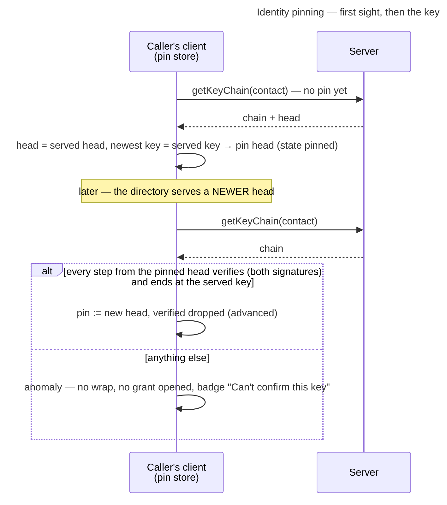

# UC: Trust-on-first-use, then follow a contact's key chain, and surface a key it does not reach

- **ID:** uc.spaces.verify-identity
- **Primary actor:** **a scope member** (any key-holder who can see a member directory), through their client's
  automatic pinning and chain walk. No human decision is part of it.
- **Goal:** hold an honest, operator-blind record of every contact's identity — their key-chain head, pinned the first
  time the client trusts it — and judge every later key by that contact's signed key chain: follow a legitimate
  rotation without asking anyone, and never wrap to or accept a key the chain does not reach. Closes the operator
  key-substitution gap by *detection*, not by proactive verification — actively confirming a key out-of-band on a
  member's profile is [uc.spaces.enforce-verified-identities](uc.spaces.enforce-verified-identities.md), and requiring
  it before a share is [uc.spaces.require-verified-identities](uc.spaces.require-verified-identities.md)
  ([ADR 0028](../../../decisions/0028-identity-authenticity-tofu-verification.md) Decision 2,
  [ADR 0111](../../../decisions/0111-an-invitee-grants-itself-a-rotator-re-keys-its-own-scopes-and-a-key-chain-anchors-trust.md)
  decisions 7, 15, 16).
- **Preconditions:** an **authenticated, unlocked** caller; the target appears in a scope **member directory** the
  caller can read, which serves the target's key and key-chain head; the caller's **pin store**
  ([en.account.identity-pinning](../../account/enablers/en.account.identity-pinning.md)) is available. The pin it
  writes is **account-global** — pinned once, trusted everywhere.
- **Postconditions (success):** the target is **pinned** at its key-chain head (first sight, silently), its pin has
  **moved** to a newer head the chain reaches, or its key is an **anomaly** that nothing is wrapped to and no grant
  from it is opened. Operator-blind throughout: the pin store is sealed under the Master Key; the server never learns
  who pinned whom.

This use-case narrates the gate from the caller's side; the pin store and the chain walk are
[en.account.identity-pinning](../../account/enablers/en.account.identity-pinning.md).

## Main flow

1. **First sight.** The caller's client is about to wrap to a member's key, or to open a grant they signed, for the
   first time. The pin store has no entry, so it reads the member's key chain, checks that its head is the served one
   and its newest key the served key, **pins the head silently** (state `pinned`) and proceeds — trust-on-first-use.
   No caller action, no notice.
2. **The same key again.** The served head is the pinned one and the served key the key at it: `match`, no chain read.
3. **The contact secured their account.** The directory serves a newer head. The client walks the chain from the
   pinned head: every step signed by the previous identity **and** the previous Secret-Key proof key, each naming its
   predecessor, the key at the pinned head equal to the pinned one. It ends at the served key, so the pin moves to the
   new head (`advanced`), *Verified* drops, and the member's profile says "New identity, signed by their previous key,
   on {date}". Nobody is asked.
4. **A key the chain does not reach.** Anything else — a head older than the pinned one, a step not signed by both
   previous keys, a chain the server does not serve — is an **anomaly**: the member lists badge it "Can't confirm this
   key" with the note to compare safety numbers in person, nothing is wrapped to it (a rotation declares the member
   pending, "Waiting for someone who can confirm their key"), and a grant it signed is refused
   (`granter_key_unanchored`). There is no accept: a legitimate rotation is always signed, so the gate never fires for
   one, and it never blocks anybody's write.

## Alternate / exception flows

- **A1 — the human-less grant-delivery worker meets an anomaly:** no wrap happens; the worker **declines the job**
  back to the server (`identity_unanchored`, never re-offered to this account). Another key-holder whose pin the chain
  reaches delivers instead; and when the target secures their account, the publish clears every decline that targeted
  them, so this worker tries the new key. See [en.account.identity-pinning](../../account/enablers/en.account.identity-pinning.md).
- **E1 — a legitimately rotated key (post-compromise recovery):** the target secured their account
  ([uc.account.rotate-keys](../../account/use-cases/uc.account.rotate-keys.md)), which is a step of their key chain
  signed by both previous keys → step 3, with no review. Grants the contact signed with the retired key before the
  rotation still open, but only at an epoch at or below this device's floor for the scope; a newer epoch signed by a
  retired key is refused (`granter_key_retired`), because that is what a thief holding the old identity would forge.
- **E2 — a substituted key (active operator MITM):** the operator holds no previous Secret-Key proof key, so it
  cannot sign a step the chain accepts, and an invented chain naming the pinned identity with another proof key does
  not start from the pinned head → step 4. This is the whole point; the residual is a key substituted before first
  sight (§ Quality notes).
- **E3 — this device refuses the pin store itself** (older than one it has held, missing after it held one, or
  unreadable — [ADR 0028](../../../decisions/0028-identity-authenticity-tofu-verification.md) Decision 7): no pin
  is read or written, so every wrap to a foreign key pauses and the notice says why, with a link to the settings
  hub's *Start a list over*. Only the user, on a device, after a confirmation that names the cost, starts the
  store over — empty, so every contact is first-seen again and every verification is gone. No server response
  reaches that write; a server can still withhold the store until the user does it, which is now visible and
  consented rather than silent.

## Quality notes

- **Operator-blind.** Every pin is an entry sealed under the Master Key at an opaque id; the server never learns who
  pinned whom — only how many pins an account holds
  ([ADR 0104](../../../decisions/0104-the-identity-pin-store-is-one-sealed-entry-per-pin-under-a-sealed-head.md)).
- **The first-use gap (honest).** A pin only catches a key that *changes* after first sight. A key substituted
  **before** first sight — a whole invented chain for a contact nobody pinned — is invisible until someone actively
  verifies out-of-band
  ([uc.spaces.enforce-verified-identities](uc.spaces.enforce-verified-identities.md)) or Key Transparency exists
  (the end-state).
- **The anomaly is the only block.** It gates wraps and grants, never anybody's write. Requiring *verified* before a
  share is strict mode, [uc.spaces.require-verified-identities](uc.spaces.require-verified-identities.md), still open.
- **Tier-consistent ([ADR 0026](../../../decisions/0026-client-trust-tiers.md)).** Holds against an active
  operator only on a client it does not serve, once the pin store cannot be rolled back
  ([ADR 0028](../../../decisions/0028-identity-authenticity-tofu-verification.md) Decision 7); honest-operator on
  operator-served web.

## User impact

Your device remembers each person's key the first time, follows it when they secure their account, and shares nothing
with a key that does not follow from it, so nobody can quietly pose as someone you share with.

## Related

- Feature: [Spaces (scopes)](../_index.md)
- Enablers: [en.account.identity-pinning](../../account/enablers/en.account.identity-pinning.md) (the sealed pin
  store + the chain walk this narrates), [en.spaces.member-identity](../enablers/en.spaces.member-identity.md)
  (the directory the badges hang on), [en.account.key-model](../../account/enablers/en.account.key-model.md)
  (identity rotation → a legitimate key change)
- Use-cases: [uc.spaces.enforce-verified-identities](uc.spaces.enforce-verified-identities.md) (the proactive
  ceremony this pin store also backs), [uc.spaces.require-verified-identities](uc.spaces.require-verified-identities.md)
  (strict mode, planned), [uc.spaces.add-group-member](uc.spaces.add-group-member.md),
  [uc.spaces.consent-group-add](uc.spaces.consent-group-add.md), [uc.spaces.add-member](uc.spaces.add-member.md)
  (the wrap flows whose E2 key-substitution risk this closes), [uc.account.rotate-keys](../../account/use-cases/uc.account.rotate-keys.md)
  (the legitimate-rotation source of E1)
- Decisions: [ADR 0028](../../../decisions/0028-identity-authenticity-tofu-verification.md) (the authenticity
  model), [ADR 0017](../../../decisions/0017-crypto-primitives-and-post-quantum-strategy.md) (the fingerprint /
  safety-number), [ADR 0026](../../../decisions/0026-client-trust-tiers.md) (the trust tier this rides on)
- End-user view (docs site): [Is my data safe?](../../../../site/src/content/docs/privacy/is-my-data-safe.md)
- End-user view (docs site): [Verify a person](../../../../site/src/content/docs/account/verify-a-person.mdx)
- End-user view (docs site): [Start a list over](../../../../site/src/content/docs/help/start-a-list-over.mdx)
- End-user view (docs site): [A key can't be confirmed](../../../../site/src/content/docs/help/key-changed.mdx)
