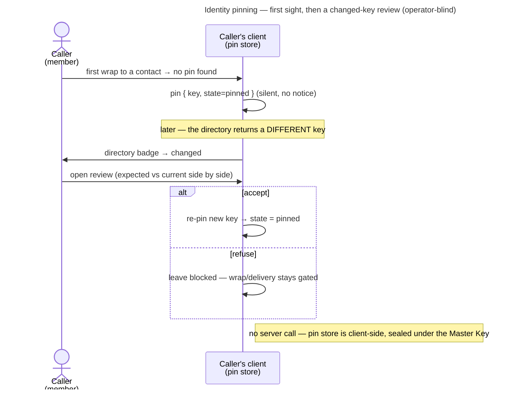

# UC: Trust-on-first-use, notice, and review a changed identity key

- **ID:** uc.spaces.verify-identity
- **Primary actor:** **a scope member** (any key-holder who can see a member directory), through their client's
  automatic pinning and, when a pin changes, through a review they perform.
- **Goal:** hold an honest, operator-blind record of every contact's identity key — pinned the first time the
  client trusts it — and put any later change to a human: accept a legitimate rotation, or refuse a substituted
  one. Closes the operator key-substitution gap by *detection*, not by proactive verification — actively
  confirming a key out-of-band and enforcing that account-wide is
  [uc.spaces.enforce-verified-identities](uc.spaces.enforce-verified-identities.md), the deliberate follow-up
  ([ADR 0028](../../../decisions/0028-identity-authenticity-tofu-verification.md)).
- **Preconditions:** an **authenticated, unlocked** caller; the target appears in a scope **member directory** the
  caller can read; the caller's **pin store** ([en.account.identity-pinning](../../account/enablers/en.account.identity-pinning.md))
  is available. Pinning is surfaced per scope, but the pin it writes is **account-global** — pinned once, trusted
  everywhere.
- **Postconditions (success):** the target's key is **pinned** (first sight, silently) or a **changed** key has
  been reviewed and either **accepted** (re-pinned) or **refused** (left blocked). Operator-blind throughout: the
  pin store is sealed under the Master Key; the server never learns who pinned or reviewed whom.

This use-case is the **human-review half** of [ADR 0028](../../../decisions/0028-identity-authenticity-tofu-verification.md);
the pinning mechanism + the change-response is [en.account.identity-pinning](../../account/enablers/en.account.identity-pinning.md),
which this use-case's flow only narrates from the caller's side.

## Main flow

1. **First sight.** The caller's client is about to wrap to a member's identity key for the first time. The pin
   store has no entry, so it **pins the key silently** (state `pinned`) and proceeds — trust-on-first-use. No
   caller action, no notice.
2. **A key changes.** On a later wrap, the directory returns a **different** key for that member. The member's row
   in the directory now carries a **changed** badge instead of the usual trust state.
3. **Open the review.** The caller opens the changed member → the app shows the **expected** (pinned) vs the
   **current** (directory) safety-numbers side by side.
4. **Decide.** The caller compares the two out-of-band (a call, a channel already trusted — the *proactive*
   ceremony that produces a fresh comparison is its own use-case) and either:
   - **accepts** — re-pins the new key (state returns to `pinned`), or
   - **refuses** — leaves it blocked; the wrap and any pending grant delivery stay gated.

## Alternate / exception flows

- **A1 — the human-less grant-delivery worker hits a changed key:** no wrap happens; the worker **blocks** (no
  `K_SC` wrap) and **declines the job** back to the server (never re-offered to this worker) — the directory's
  `changed` badge is what a human later reviews (steps 3–4 above). See
  [en.account.identity-pinning](../../account/enablers/en.account.identity-pinning.md).
- **E1 — a legitimately rotated key (post-compromise recovery):** the target rotated their identity
  ([uc.account.rotate-keys](../../account/use-cases/uc.account.rotate-keys.md)), so their key legitimately
  changed → badge **changed**. The caller reviews and **accepts** — the same review path as an attack, decided by
  the human, not the wire.
- **E2 — a substituted key (active operator MITM):** identical on-wire to E1 — the review surfaces it; the caller
  who compares out-of-band sees the mismatch and **refuses**. This is the whole point.

## Quality notes

- **Operator-blind.** The pin store is a single Master-Key-sealed ciphertext; the server never learns who pinned
  or reviewed whom, nor the count.
- **The first-use gap (honest).** A pin only catches a key that *changes* after first sight. A key substituted
  **before** first sight is invisible until someone actively verifies out-of-band
  ([uc.spaces.enforce-verified-identities](uc.spaces.enforce-verified-identities.md)) or Key Transparency exists
  (the end-state).
- **Advisory by default.** Nothing here is *enforced* — a caller who never opens a `changed` review still has the
  wrap/delivery gated, but nothing stops them from ignoring the badge indefinitely. Enforcing verification
  account-wide is strict mode, on the follow-up use-case.
- **Tier-consistent ([ADR 0026](../../../decisions/0026-client-trust-tiers.md)).** Holds against an active
  operator only on a client it does not serve, once the pin store cannot be rolled back
  ([ADR 0028](../../../decisions/0028-identity-authenticity-tofu-verification.md) Decision 7); honest-operator on
  operator-served web.

## What this means for you / Was das für dich bedeutet

**EN —** When you share memories with someone, your app quietly remembers their security key the first time —
no action needed. If it ever changes, you'll be told, because a changed key can mean someone is trying to
impersonate them. You then decide: does this look right (maybe they got a new phone), or does it look wrong?

**DE —** Wenn du Erinnerungen mit jemandem teilst, merkt sich deine App beim ersten Mal still dessen
Sicherheitsschlüssel — ohne dass du etwas tun musst. Ändert er sich je, wirst du informiert, denn ein geänderter
Schlüssel kann heißen, dass sich jemand als diese Person ausgibt. Du entscheidest dann: passt das (vielleicht ein
neues Handy), oder wirkt es falsch?

## Related

- Feature: [Spaces (scopes)](../_index.md)
- Enablers: [en.account.identity-pinning](../../account/enablers/en.account.identity-pinning.md) (the sealed pin
  store + the change-response this narrates), [en.spaces.member-identity](../enablers/en.spaces.member-identity.md)
  (the directory the badges hang on), [en.account.key-model](../../account/enablers/en.account.key-model.md)
  (identity rotation → a legitimate key change)
- Use-cases: [uc.spaces.enforce-verified-identities](uc.spaces.enforce-verified-identities.md) (the proactive
  ceremony + strict-mode follow-up this pin store also backs), [uc.spaces.add-group-member](uc.spaces.add-group-member.md),
  [uc.spaces.consent-group-add](uc.spaces.consent-group-add.md), [uc.spaces.add-member](uc.spaces.add-member.md)
  (the wrap flows whose E2 key-substitution risk this closes), [uc.account.rotate-keys](../../account/use-cases/uc.account.rotate-keys.md)
  (the legitimate-rotation source of E1)
- Decisions: [ADR 0028](../../../decisions/0028-identity-authenticity-tofu-verification.md) (the authenticity
  model), [ADR 0017](../../../decisions/0017-crypto-primitives-and-post-quantum-strategy.md) (the fingerprint /
  safety-number), [ADR 0026](../../../decisions/0026-client-trust-tiers.md) (the trust tier this rides on)
